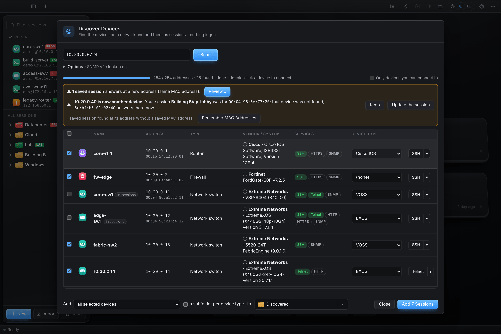

# Changelog

All notable changes to Termwright. Each release on GitHub shows its section of this file and the list of commits.

## Unreleased - Simulated lab

- Emulated lab, **QEMU command line**: each start writes the exact command QEMU runs a switch with (read from the host) to the emulator log at info level; right-click a switch → *QEMU Command Line…* shows it and copies it. A switch's CPU is taken from that command, so an image's own `-cpu` (More QEMU options) also holds on a live move.

- Emulated lab, Images: the *Downloading %* button moves on with the download (it showed the percentage of when the image was opened).

- Emulated lab, **link check**: right-click a running switch → *Check Its Links (30 s)* turns on QEMU's own trace of its e1000 or e1000e network cards for 30 seconds and says what happened - whether QEMU took links down (the switch restarted auto-negotiation), the switch turned a receiver off, or frames were dropped (link down, multicast filter, overrun). It tells a problem of the emulation from one inside the switch's software.
- Emulated lab: e1000-82545em in the image NIC choices.

- Emulated lab, **clouds** can be selected (click) and have a right-click menu: *Add Link to It*, take a port off, *Remove Cloud* (Delete also removes a selected one; the ports on it come off the host's network at their next restart). Test ports have a right-click menu too (*Stream from Here*, *Remove Test Port*).
- Emulated lab, **Captures** sum up what a capture holds per protocol and sender (LLDP, LACP, STP, EDP… first): one look shows which end sends which control protocol; click one to filter.

- Emulated lab, **traffic generator**: put a **test port** on any free switch port (right-click a switch → *Add Test Port…*, or Traffic → ＋ Test Port) - a sender and counter on the host where the switch runs, no VM; it has a MAC and an address and answers ARP and ping there. **Streams** between test ports (or to every other one, or to an address): UDP, ICMP, TCP SYN, ARP or raw L2, with a VLAN tag, frame size, packets per second and seconds or a count; each passes when its loss (and average latency, when both ends are on one host) stays within its limits. The **Traffic** tab shows sent, received, loss, latency and PASS/FAIL live; *Report…* saves HTML or CSV; the connector has **lab_traffic** for AI agents (add ports and streams, start, stop, report). Ports without a cable now have a socket a test port can use (a switch started before this needs one restart for its test ports).
- Emulated lab, **Captures**: delete a stopped capture (✕ or *Delete*, also *Delete All Stopped*) - its pcap file on the host goes too; two captures of one port each show their own packets; the vendor discovery protocol (EDP) is named as such.

- Emulated lab, boot menus: a menu that takes one key gets the key alone (Enter only if the menu then still waits); the Enter that used to follow stayed in the buffer and opened the next stop of the boot. The device pack's boot answers and facts patterns now follow the pack as it improves them.

- Emulated lab, hover card: the state (● running) sits at the top right, apart from the name; *Management* no longer says "planned, not on the switch yet" for a switch that took its address before Termwright restarted or that resumed from a fast start (the address it took is kept); the serial number read from the switch follows the device pack's newest pattern (an image keeps up with the pack's).

- Emulated lab, **Events** has columns: time, host, switch, **Level** (OK in green, INFO, WARN in yellow, FAIL in red - the message in the same colour, no more boxed rows) and **Trigger** - USER (you, in Termwright), AI (an agent through the connector) or SYSTEM (Termwright on its own: watching the switches, retrying a copy). Copy includes both.
- Emulated lab, **QEMU versions**: a live move keeps the machine type the switch runs as (QEMU's default is each version's and each distribution's own), so it moves live to a host with the same or a newer QEMU; to an older QEMU it is refused with the reason, and a move with its disk to another version boots it there instead of resuming a state that would not load. *On the Hosts* warns when the hosts' QEMU versions differ, and a host check flags a QEMU older than 4.2.

- Emulated lab, **packet capture**: right-click a cable → *Capture Packets* records it both ways at one end while the switches keep running (QEMU writes a pcap file on the host; the cable turns red and dashed). The **Captures** tab lists the captures and shows each one's packets live - number, time, source, destination, protocol (Ethernet, VLAN, ARP, IPv4/IPv6, ICMP, TCP, UDP, DHCP, DNS, LLDP, STP, LACP, OSPF, BGP, VRRP…), length and info - with a filter, *Stop*, *Save .pcap…* and *Wireshark* (opens it in Wireshark on this computer, live while it captures). The connector has **lab_capture** (start, stop, read with a filter, list) for AI agents.
- Emulated lab, the hover card moves to the left of a switch near the canvas's right edge instead of running off it.

- Emulated lab, the software version and serial number come from the switch: after it boots, Termwright reads them on its CLI (an image profile's facts commands - EXOS: show version, IMG:; Fabric Engine: show software detail and show sys-info) and shows them on the canvas, in the hover card and the side panel (the serial Termwright gave shows until the switch reported its own). The firmware was empty before. Serial numbers in a persona file can be made SIMxxxx-xxxx, the only form some images take (device pack 1.5.7).
- Emulated lab, the status bar no longer repeats the topology name and the hosts (they are in the header and the Hosts menu).

- Emulated lab, three new icon styles, neutral with colour only for the status lights: **Slate tiles** (a slate tile with a white symbol per role), **Steel isometric** (grey hardware in 3-D with its ports) and **Rack front (1U)** (the front of the box as it sits in a rack: ears, port blocks, LEDs). Pick them in the tool dock (all switches) or per switch (Draw As…).

- Emulated lab, **Log** tab in the bottom pane: the emulator's own log (emulator.log in the lab folder, three files of 5 MB) with everything the lab does, at a level you choose - Errors, Warnings, Info (default), Debug (each command run on a host, how long it took and how it ended, what day 0 typed) or Verbose (also the commands' text and output, secrets removed). Refresh, Copy and Save….
- Emulated lab, Fabric Engine on the host's network (macvtap): it answers on its OOB port with its own MAC (its MAC block + 0x81), not the NIC's, so nothing reached it by SSH; the port now gets the MAC the switch uses (an image profile setting: mgmtMacAlign/mgmtMacOffset, in the device pack 1.5.6), and NAT leases are found by it too.
- Emulated lab, the hover card shows the switch's type (EXOS/VOSS), model (or "no persona") and firmware; the name under a switch can be dragged away from a cable (double-click puts it back) and has a backdrop so a cable does not run through it.

- Emulated lab, the Topology menu opens again when no topology has been saved yet (it got nothing to show and stayed shut).
- Emulated lab, console logins no longer lock a switch out: the console is listened to before Enter wakes it, and a password asked for an empty user name gets one Enter, not three (Fabric Engine counts each as a failed login: "Access denied : length 0 not allowed", then "Lock out for 60 seconds").
- Emulated lab, **Console Log** tab in the bottom pane next to the live console: everything the selected switch's console showed since it started, with its Events - Refresh, Copy and Save….
- Emulated lab, canvas: under each switch its model and software - "5520-24T · EXOS 33.6.1.14" with a persona, "EXOS-VM 32.6.3.126" or "VOSS-VM 9.4.0.0" without - instead of the model twice and a "persona ✓" badge (a persona that failed still shows).
- Emulated lab, **Cloud** on the canvas: a host's own network as a node; Add Link from a switch port to it puts that port on the host's network (when the switch starts), drawn as a cable with its port; drag it where you like. *Add Cloud* in the tool dock adds one before any port is on it.
- Emulated lab, icon styles: Classic diagram symbols and Line icons are no longer offered (switches drawn with them keep them until changed).

- Termwright connector (MCP) for AI agents, the emulated lab end to end: **lab_images**, **lab_add_switches**, **lab_cable** (connect or remove a list), **lab_power** (start, stop, restart, shut down), **lab_wait** (until booted and configured), **lab_console** (log in on a switch's console and type configuration or show commands, outputs back), **lab_check_cabling** (LLDP against the cables), **lab_move** (live, copy or image) and **lab_events**, next to show_lab. Each change is approved by the user in Termwright, a whole list at once; outputs have secrets removed.

- Emulated lab, live moves between hosts with different CPUs: a switch started with its host's own CPU used instructions the other host lacks after a live move, and its programs crashed there (EXOS: the login service, so the address step was refused). With more than one host, switches now start with a CPU every host has (Westmere: Intel since 2010, AMD alike), and a live move of one started with its host's own CPU to a host with another CPU is refused with what to do (restart it once, or Save, Copy and Resume, which then boots it there). A login refused because the switch's login service (AAA) did not answer is tried again for a few minutes, and says so instead of asking for a password.

- Emulated lab, live move progress: QEMU counts the disk at its full size (only what the switch wrote travels), which made the total jump from the memory's 2 GB to 6 GB; once the disk is across the progress counts the memory alone, and the disk line says it is counted at its size.

- Emulated lab, a live move cut off earlier (Termwright closed in the middle) left a copy of the switch waiting on the new host, and the next move failed with "could not wait on the new host: <nil> up …": that leftover is now stopped first. A process is taken for a switch only when it is QEMU (a pid file left from before a host restarted could name another process). Live moves also work with newer QEMU, which dropped the -d option of migrate.

- Emulated lab, live moves finish: no bandwidth cap, a switch that writes its memory faster than it goes over is slowed down until it can finish (auto-converge), and the last pause may take up to a second. The progress counts its disk too (QEMU up to 9.0 sends it with the memory) - "99 % · about 2 s left" for minutes was the memory done and the disk still going - and says when the switch is being slowed.

- Emulated lab, a live move to a host on another network works: the switch goes across running, then gets an address of the new host's network typed on its console (the old one removed first) and its SSH session follows - it keeps running throughout. Before, it was refused with "a live move keeps it".

- Emulated lab, KVM turned on at a host shows at once: a host without KVM is looked at again each minute, Move to Host looks at both hosts' /dev/kvm before it offers anything (Live and the "no KVM" warning were from the last check, and from the topology's hosts only), and the Events say "KVM is on now on …".

- Emulated lab, Set Up on a host whose user has only Termwright's network commands without a password asked for no password and stopped with "Process exited with status 1" and an empty log: the host check now tells that apart from sudo for anything, Set Up asks for the sudo password then, and sudo's own messages reach the log.
- Emulated lab, Remove Host: one tick, *Everything Termwright put on this host*, chooses all of it (images, switch disks, what Set Up did); each can still be chosen alone. Nothing is deleted unless chosen.

- Emulated lab, KVM is chosen when a switch starts, from what the host has at that moment: a host where KVM was turned on (or off) since it was checked runs its switches right away, without Check Again, and its host entry follows. A start in software emulation says so in the Events.

- Emulated lab, Hosts: **Set Up Again…** is always there for a host that has everything, to run every step again (safe to repeat, for example after something changed on the host). Set Up now writes down what it adds (packages it installed, its sudo rule, the user put in the kvm group) in /var/lib/termwright/setup.
- Emulated lab, **Remove Host…** first reads the host and asks what to do there: delete its images (with their size and folder), delete the switches' own disks, remove Set Up's sudo rule, take the user out of the kvm group, uninstall the packages Set Up installed (only those it wrote down) - each one a choice, with the sudo password when needed, and a last confirmation before anything is deleted. "Remove, Keep Everything There" only forgets the host; a host that cannot be reached can only be forgotten. Refused while switches of the open topology run there.

- Emulated lab, Hosts → Set Up: the **Set Up…** button is next to Check Again (no scrolling down), its panel opens at the top with the steps in one row and the log across the full width, and *What the host has* ticks each item as its step is done; at the end the host is checked again and its rows show the result at once (no closing and opening again).
- Emulated lab, hosts without KVM: a switch starting there says so in the Events (software emulation, 5 to 10 times slower, and how to turn on nested virtualization); moving a switch from a KVM host to one without says so in the move dialog. An image profile can give such hosts an Intel CPU model (*tcgCpu*) for images that do not recognise QEMU's default CPU.

- Emulated lab, hosts without password-less sudo: **Set Up** (with the sudo password) can now let the host's user run only the network commands the switches need (ip, iptables, sysctl, virsh, arping, chown of /dev/tap*) without a password, in /etc/sudoers.d/termwright (checked with visudo first). Then switches on that host can use a lab bridge, NAT or the host's network instead of only port forwarding. The host check counts such a rule as sudo.

- Emulated lab, **Images → On the Hosts** (also *Images on the Hosts…* in the Hosts menu): images down the side, hosts across the top, read fresh from each host. Each cell says whether the host has the image, is copying it (with speed and time left), waits, failed (why, Retry), has another file of that name (Replace) or would run low on disk. **Make All Hosts the Same** copies every image to every host (from this computer, or from a host that has it), with *Copy Here*, *Copy to All Hosts* and *Copy the Missing Ones Here* for less. *Keep all hosts the same* copies an image to every host once it is downloaded or copied to one; *Keep 20 % disk free* holds back a copy that would leave less than a fifth of a host's disk free (*Copy Anyway*). Click a host for its panel: address, QEMU, CPU and load, memory and disk (total and free), where its images are (*Change…* moves them to another folder, for example a bigger disk, and leaves a link), its checks with Set Up buttons, and which other hosts it reaches - UDP for cables and TCP for live moves, both ways (*Check Between All Hosts*); *Open the Ports…* shows the firewall commands to run.
- Emulated lab, a switch that does not start says why: a port QEMU could not open (a macvtap port on a host without sudo) or QEMU's own log, instead of an empty reason, with what to do. A move to a host whose management needs sudo it does not have is refused before anything is copied, and a moved switch that did not start there no longer says "it resumed there".

- Emulated lab, moves show their progress: each copy (the image, the booted image, its disk) and a live move's memory show how far they are, how much of how much, the speed and the time left - in the switch's state, the Inventory and on the canvas (a bar under the switch on its way).

- Emulated lab, Move to Host between networks: a switch whose address is on one host's network can now move to a host on another network. It gets an address of the new host (a host new to the topology whose network is another gets its own lab bridge - change it in Hosts), the address is typed when it starts there and its SSH session follows; it boots there instead of resuming, as its old address would not work. A live move keeps the address, so it says to use Save, Copy and Resume. Only a move from a fixed address to a host that gives addresses by DHCP, NAT or port forwarding is refused, with what to set in Hosts.

- Emulated lab, copying an image to a host: Termwright checks the host has room first and says how much is free and needed; a copy that breaks off (the connection dropped) is tried again up to four times and goes on where it stopped; the copy is checked with its checksum on the host before it is used, and a damaged one is removed. Two switches starting at once no longer copy the same image side by side (the second waits and finds it there); before, the second copy could delete the first one's image and leave only its checksum file, so later starts thought the image was there. The image itself is now checked too, and a lone checksum file is removed. A failed copy is in the Events log with the reason in plain words. A switch whose disk cannot be made says why (the image is missing on that host, or damaged - then the next Start copies it again) instead of "disk <file>".
- Emulated lab, Events: each line shows the host it happened on (with the host's colour) before the switch; Copy includes it.
- Emulated lab, Move to Host: Live is offered only when both hosts have KVM or both have none (otherwise the dialog says why and Save, Copy and Resume is the default); the Events log opens when a move starts, says "moving to ..." at once, and a refused move is listed there too, not only in a message that goes away.
- Emulated lab, Hosts menu: simpler - one card per host with its speed (Fast with KVM, Slow without), how many switches run, CPU and memory bars and its management in short words; the cable check is one line with *Check now*; the long explanation is in the ? tooltip.

* **Simulated lab** (Transfer → Labs (Simulated, Emulated)…): switches simulated on this computer, each a small SSH server on 127.0.0.1 with a command line - abbreviations, `?` help, Tab, VLANs, ports, IP interfaces, save and reset, ping, traceroute and LLDP between the switches over the cables you draw (not a real operating system: no protocols are run). The switches come from a **device pack** (one `.vm` file: models, port layout, commands, outputs, serial formats) that you load with your consent - it shows the pack’s terms and checksum, is kept on this computer only and can be removed; Termwright carries no models itself. A model’s name sets its ports (`…-16MW-8T`: 16 MW and 8 T ports). **New Lab…** chooses models, operating system, counts, names, management network and cabling (leaf-spine, chain, ring); the Lab window shows the switches, the topology (drag, details, show config, cables) and the cables; their sessions are in a **Simulated Lab** folder with live state and Start / Stop Lab. Serial numbers and MAC addresses can be changed; **Command Outputs** print pasted real output with each switch’s values filled in. Packs are tested with transcripts.
* **Emulated lab: real VM images on a Linux KVM host** (Lab window → Emulated lab). The vendors’ own VM images (`.qcow2`, or the settings from a GNS3 appliance file) boot with QEMU/KVM on a Linux server reached over SSH - the real operating system, protocols and APIs included; nothing of Termwright is installed on the host. KVM Hosts are checked (KVM, QEMU, free vCPU, memory and disk, sudo) and **Set Up QEMU/KVM…** installs QEMU from the distribution's packages, loads KVM and adds the user to the kvm group (with the sudo password, not saved); each image has a profile (vCPU, RAM, ports, ready text, login, day-0 commands, answers) and is copied to the host once, every switch booting from a copy-on-write disk. New Lab sizes the lab against the host, with management by port forwarding (no root) or a bridge (sudo). Each switch shows its boot state; the day-0 commands are typed on the console after the first boot. An SSH session and a console session per switch (through the host as jump host), virtual cables between the VMs that can be pulled and plugged in, Restart, Back to Day 0 and Remove.
* **Lab serial numbers.** *New in the Model's Format* gives switches serial numbers in the device pack's (or the image's) format; emulated switches take a serial number (as their SMBIOS serial) and a MAC address. Sessions of a lab that are missing are made again when it starts. The emulated CPU column shows the use now (a share of the switch's vCPUs), not the average since boot.
* **Emulated lab: management on the host's network.** A switch's first port joins the host's bridge (or its network port through macvtap) and gets its address from your DHCP server; Termwright reads it on the console (the image's *Address command*) after each boot and points the SSH session there. This is the default when the host has password-less sudo.
* **Lab buttons in the title bar** (a flask for the simulated lab, a cube for the emulated one). The Session Manager's bottom row is **New, Shell, Scan** (Shell opens a local shell; Import stays in File and the ⋯ menu), in the start page's colours. An emulated switch no longer falls back to *booting* when its ready text scrolls out of the console log.
* **Emulated lab: templates, personas, resources, host use.** The tabs follow the work: KVM Hosts, Images (with versions), Templates, Switches. A template is an image with vCPU, memory and disk, the model it acts as, and where serial numbers and MACs start (they count up per switch). Image profiles can bring a persona file (model, serial numbers, modules, stack members) that Termwright writes into a switch's disk with libguestfs while it is off; switches' resources and personas can be changed later. A bar shows what the lab takes of its host now. *Images → Import Profiles (.json)* reads image profiles and templates; serial numbers from a list can be just the first one, MACs from a first address.
* **Emulated lab: devices instead of forms.** New Lab rows pick a device (a model the images can be, or an image as it is) and the software version from the image files of that kind; serial numbers and MACs are filled in in the model's real format (from the device pack) and can be made anew. Device packs can bring the emulator's image profiles (`emulator.json`), and an added image file is recognised by its name. Persona errors stay visible (they are no longer cleared by the day-0 step), switches are powered off cleanly before their persona is written, libguestfs errors say what to do, and a host that is itself a VM gets a note about passing the switches' MAC addresses.
* **Emulated lab: the host's NAT network, and management changed later.** A fourth management choice, like GNS3's NAT node: the first port joins libvirt's `virbr0` on the host and gets an address from its DHCP server; Termwright reads it from the host's DHCP leases, so any image gets an address without a CLI command (the default on a host that is itself a VM). Set Up installs and starts libvirt's default network. The lab's management is now shown and changed in the bar under the tabs: it can be changed while switches run (they are stopped and started again with it, their configuration kept), and their sessions follow.
* **Fixed: persona files went into the mount-point folder instead of the partition** (for example `/scratch` on the root filesystem rather than the `/scratch` partition), so the switch booted as the plain image. The file now goes on the partition the image mounts there (its `/etc/fstab`, or a partition labelled like the folder) and is read back (switches whose file was written the old way get it again on their next start); a profile's *check* command (for example `show version`) confirms the model after boot, or shows **running · no persona** with the reason and where the file was written.
* **Fixed: day-0 stopped at a first-login questionnaire** (`… [y/N/q]:`): it is answered with `q`, the defaults.
* **Fixed (simulated lab): "no host key"** when starting switches after the lab was reloaded (for example after loading a device pack). New simulated labs use `10.99.0.0/16` (a lab with the old full `/24` grows to `/16`), the "network is full" error shows once and says what to do, and the wizard's buttons no longer wrap.
* **Lab cabling:** switches added to a lab go on from its last switch in a chain or ring; the preview numbers new names past the ones in use, as the lab does, instead of showing the same name twice.
* **Lab workspace.** The lab buttons at the top right open the lab as a tab, in the style of GNS3: a palette of devices to drag onto the canvas, the switches with live states, model and address, cables with the port at each end (pulled ones red), right-click menus, Add Link (switch, port, switch, port), zoom, the selected switch with its persona and problems, the topology summary, the host's use, and an **Events** log of everything done to each switch - started, persona written where or why not, booted, day-0, persona checked, address, errors - plus the end of its console. New Lab and Add Switches are a panel beside the canvas, which shows the switches to come; **Configure** has the device model, stack slots, serial numbers, MAC, the persona's values with a live preview of its file and whether it is in the switch, and resources; Add Link shows the switch's front panel (free and cabled ports); **Images and Templates** and **Hosts** (resources, what is installed, management choices, Set Up with its steps and log) are pages of the workspace.
* **Emulated lab: GNS3 appliances with downloads, units, hosts to choose from.** An imported appliance lists each version with its size, MD5 and download link, and **Download All** fetches the image files (MD5 checked). Versions come from the appliance; image names like `NOSGNS3.9.4.0.0.qcow2` are read as 9.4.0.0 (a number glued to a word is skipped). Memory shows MB and GB, disks GB, the disk type is listed everywhere, and *More QEMU options* has examples. New Lab shows the KVM hosts as cards with their free vCPU, memory and disk; serial numbers and MACs are filled in (with ↻) in New Lab and templates. A device dropped on an empty lab makes the switch at once when the host is clear.
* **Fixed: a persona file could still go into an empty mount-point folder** when the image mounts the partition from its own start scripts (no fstab entry): an image profile can now name what is at the top of the right filesystem (*fsHas*), an empty folder on a root filesystem is never taken, and when nothing fits the error lists the disk's filesystems with their contents. Switches whose file was written that way get it again on their next start.
* **Lab Events pane:** taller by dragging its top edge, **Copy** and **Clear**; a failed login or day-0 shows the end of what the console printed, a missing persona what the check command printed, and a login refused while the switch still starts is tried again. Downloads show their progress in the button (green when done) and the folder they go to.
* **Emulated lab: public appliances.** Images → *Public appliances* lists open-source routers, firewalls, switch OSes, Linux hosts and a traffic generator (and vendor lab images that need your own account) from the public GNS3 registry; **Add** puts their versions in the image list, ready for Download All. GNS3 appliance files in the newer registry format (several settings, default login, download pages) are read.
* **Emulated lab: more disks, CD-ROMs and BIOS files.** An image can boot with a second (third, fourth) disk, a CD-ROM and a BIOS file, as GNS3 appliances describe them; each switch writes to a layer of its own on every disk (raw disks and ISO files work too). The image page lists all its files with Choose… and Download (zipped files are unpacked), and the public appliance list now includes images that need them and cloud images with their cloud-init CD-ROM.
* **Simulated lab workspace: Load Device Pack** in the toolbar (and on the empty palette).
* **Fixed: emulated switches showed every port active** although only a few were cabled: ports without a cable (and pulled cables) now have their link down after the switch starts, as in GNS3. On the host's network the host's port is put in promiscuous mode, as GNS3's cloud node does.
* **Lab downloads: a queue you can order.** The Images page shows what is downloading and what waits, in order, with *Next*, *Earlier*, *Later*, ✕ (stop it, or take it out of the queue) and *Stop all*. Downloads packed as `.gz`, `.xz` or `.bz2` (as many registry images are) are unpacked before their MD5 sum is checked.
* **Public appliances can be removed.** An added appliance shows how many of its images are in the list and **Remove**, which takes them out and deletes the files Termwright downloaded for them (not files you chose yourself, and not while a switch or template uses them).
* **SONiC-VS** in the public appliances (the community build of the SONiC network OS, versions 202411 and master, login `admin`): its ports are named `Ethernet0`, `Ethernet4`, … - port names can now count in steps (`Ethernet{n*4-4}`).
* **Fixed: an emulated switch's SSH session kept asking for the password.** The session used the device type's saved login (meant for your real switches of that kind) or, for an image whose login has no password (EXOS' `admin`), had none saved; it now always uses the image's own login and password, an empty one included, and follows when the image's password is changed. In all SSH sessions a refused password is asked for three times in all (not three times per login method), the prompt says the saved or typed password was refused, and the error then says the login was refused.
* **Fixed: day-0 on the console answered questions that were not asked.** A question is now answered only while it waits at the end of the console, so text that went by (the first login's questionnaire, a command's output) no longer types `q` at the CLI or the login prompt (an EXOS console then logged itself out and refused `q` as user name). Day-0 commands that ask to be confirmed (`(y/N)`) are answered with `y`; a log message printed after the prompt no longer makes day-0 wait for a prompt it already had (Enter shows it again); `Press <SPACE> to continue` pages go on by themselves; a check command that asks a question no answer covers says which question. Every answer is in the Events log. The switches' console sessions log in as the image's user too.
* **Lab colours as in GNS3:** a switch is green when it is up, orange while it starts, red when it is stopped or failed to start. A switch that is up with a problem (day-0, persona) stays green with an orange **!** (its problem on hover), and the bar counts them apart from failed switches.
* **Emulated lab: the host's network, routed (cloud).** A management choice for hosts whose network does not let the switches' own MAC addresses through (a host that is itself a VMware or Hyper-V VM, or on Wi-Fi), where bridged switches only got a link-local address: the switches get fixed addresses on the host's network from a first address you pick, with its gateway; the host routes for them and answers ARP for their addresses (proxy ARP), so they reach the network and are reached from it with any protocol (SSH, HTTP/HTTPS, FTP, TFTP, SCP, image upgrades). Images have **Set address** commands, typed on the console at each start (also for the lab bridge, which so far gave the switches no address); the device pack 1.4.3 brings them for EXOS and VOSS.
* **Lab console pane you can type in.** The selected switch's console at the bottom of the lab shows the end of its console; a click (or **Type here**) connects it there, live, without a tab of its own, and **Disconnect** closes it (while it is connected, day-0 and checks on that console wait, as the console takes one connection).
* **Session options: why Proxy cannot be chosen.** A session goes through a jump host or a proxy, not both; the page now says so when a jump host is set (lab sessions use the KVM host as jump host).
* **Fixed: changing the management while switches ran could be ignored** (the switches kept their NAT addresses although the menu showed the new choice): a status read still running from before the stop said they were up. Termwright now waits for a fresh one, says so when switches still run, and the switches start again either way. Their SSH address shows "through the host" for the routed host network and the lab bridge.
* **Lab console pane:** it says when the switch's console is open in a tab (a console takes one connection) with *Go to the Tab*, takes the keyboard when it connects, and **Console** moves a console from the pane to a tab.
* **Fixed: the routed host network (cloud) could not be chosen on a host checked by an older Termwright** (its own address was not known yet): the host is checked again, and when a management change fails the menu shows the lab's real management again instead of the choice that was not made.
* **Lab reachability check:** once a switch has its management address, Termwright tries it from the host (ping, SSH port 22, Telnet port 23) and says in Events what answers - so a session that does not connect tells whether the switch or the way to it is the problem.
* **Fixed: switches with a fixed address (routed host network, lab bridge) kept a link-local address.** EXOS's first login ends with *save your configuration changes to primary.cfg? (y/N)*, which was left unanswered, so the login, the persona check and the address commands waited until they timed out. Yes/no questions at a login now take their default (the capital letter); day-0 commands are still confirmed with yes.
* **Fixed: the lab bridge sent the switches' traffic to an old bridge.** Bridges of removed labs or of an earlier management (with the same network) are removed when switches start, and a lab's bridge goes with its last switch.
* **Management modes tested end to end:** a test bench (`scripts/emu-bench`) boots a small switch with DHCP, SSH, Telnet and HTTP in each mode - port forwarding, NAT network, lab bridge, routed host network, bridged host network - and checks it gets its address and answers from the host (and from the network for the host's network). The reachability check in Events now covers HTTP too, waits up to a minute for the switch's services, runs for NAT-network switches as well, and says when the host cannot reach a macvtap switch by design.
* **Lab sessions straight when they can be:** on the routed or bridged host network, once a switch has its address Termwright tries its SSH port from this computer; when it answers, the switch's SSH session connects without the jump host (else through the host, as before), and Events says which.
* **Fixed: a lab bridge kept the address of an earlier management** (the routed host network after the lab bridge, or the other way round), so the host spoke to the switches from the wrong address; the bridge now has only the address of the current one.
* **Emulated lab: the bridged host network with fixed addresses.** For a network without DHCP, *The host's network (bridged)* asks whether the switches get their addresses from a DHCP server or as fixed addresses from a first address on (with the gateway); they are typed on the console at each start, and the switches are reached straight from the network.
* **Session options: turn the jump host or the proxy off.** Each has its own switch on the Jump Host / Proxy page and is turned off without being lost: the connection does not use it, it stays shown (greyed) and works again when it is turned on.
* **Emulated lab: fixed addresses that another device uses are found.** When the management takes fixed addresses (routed or bridged host network), Termwright asks the network for them while the switches are off and names the ones another device answers on (with its MAC address), so a session does not end up at that device.
* **Lab switches in the Session Manager:** right-click a switch's session (or its console) to **Start**, **Stop** or **Restart** the switch. Fixed: a starting emulated switch showed a large yellow oval instead of a dot.
* **Fixed: a new fixed address was not taken by EXOS switches that had one already** (EXOS refuses a second address on the Mgmt VLAN): device pack 1.4.5 removes the old one first, and Termwright now asks the switch which address it has after typing it - when it is not the one given, Events says so (with what the switch showed) instead of pointing the session at it.
* **The active tab stands out:** tinted with the accent colour, an accent line under it and its name in bold.
* **Lab topology: every cable is shown.** Several cables between the same two switches run side by side, fanning out from each switch with their own ports (before, they were drawn on top of each other and only one could be seen).
* **LAGs in the topology.** The cables of a LAG are one thicker track with a ring at each switch that has the LAG (static or LACP, with its ports); a LAG set on one switch only has one ring there, its cables fan out to single ports on the other switch and it is shown in orange with the reason on hover. LAGs are read from the switches after they start (the image's LAG command: `show sharing` on EXOS, `show mlt` on VOSS; *Read Its LAGs* on a switch) and can be set in Termwright on a cable's menu (LACP or static, on both switches or one); what a switch reports wins.
* **Lab: hover a switch** for where it runs, its console (host and port), management address and port, CPU and memory it uses now, serial number, MAC and cables. **Inventory** (a tab of the lab's bottom pane) lists every switch under its host with its state, console, management, CPU and memory, and the host's CPU and memory; *Copy* gives it as CSV. The memory a switch uses now is read from the host.
* **Teams: Reinstall or Update… for owners**, also when the team server runs this Termwright's version: install the **nightly build** (the newest build of main, with fixes before they are released) or the **latest release** on the team server, the same safe way as an update (the old container comes back if the new one does not answer).
* **Fixed: no check box on the team admin page could be ticked** once a theme (Light or Dark) had been picked on it: the theme's click handler also landed on the page itself and drew the page again on every click, before the box could count. Update the team server to get it.
* **Team admin page, Discover:** a click anywhere on a result row ticks it, and the selection is kept by the page itself, so a box can no longer be left out of step when the page is drawn again during the click. (A team server older than 0.34.1 still has the earlier page: update it with Options → Teams → Update Server….)
* **Emulated lab: named topologies.** The *Topology* chip in the lab's bar saves the lab under a name (and keeps it there as it changes), opens a saved one - also with all its switches started at once (*Open and Start All*) - starts a new one, and deletes old ones. Switches that run are stopped first (after asking); a new topology's sessions get a folder of their own.
* **Emulated lab on several hosts.** One topology can run on several KVM hosts: *Add Switches* picks any checked host (the ones already in the lab are marked), a switch's menu has *Move to Host* (it starts there from its image), and cables between switches on different hosts are UDP tunnels between the hosts (dashed, purple; the hosts must reach each other on UDP 20000-29999). Each host is an area round its switches on the canvas with its address, management and vCPU/memory; each host keeps its own management (the *Management* chip has a host menu); the side panel shows a card per host; the Inventory lists the switches under their host with console, management, CPU and memory; the switch tooltip names its host.
* **Emulated lab: a prompt hidden by log messages after the login.** Fabric Engine prints *ZTP+ discovery failed* right after the login, which hid the prompt and failed the day-0 configuration (*no prompt after the password*); Termwright now presses Enter to show the prompt again.
* **Emulated lab: the factory password while none is set.** A device pack can give an image its factory password (Fabric Engine), used for the console login and the sessions until you set one; a login refused without any password now says to set the image's password.
* **Telnet: Enter is a bare CR in binary mode.** Once binary was agreed (a QEMU serial console asks for it) Enter no longer sends CR NUL: the NUL reached Fabric Engine as a character, so a typed password had one character too many and an empty login followed. The emulated lab also waits out a console lock-out ("Lock out for 60 seconds") before logging in again, does not retry a login refused without a password, and existing images get the pack's factory password and ready text.
* **Emulated lab: a first login that asks for a new password.** A console answer can type the image's password (`{password}`), so a switch that must change its default password at the first login (Fabric Engine: *Enter the New password*) gets it twice and carries on; the events say "the image's password" instead of the password.
* **Emulated lab: running switches no longer stay "booting".** A switch is ready when its console log since the start shows its ready text (*login:*), not only the end of it: after a login and some commands, or after Termwright was restarted, the end no longer showed it and the switch stayed orange with *booting* though it ran.
* **Emulated lab: Fast start.** Stop saves each running switch's state into its disk (a QEMU snapshot) and Start resumes it in seconds - no boot, no day 0, its configuration, address and sessions as they were. *Shut Down* on a switch's menu (and Reload) stops it without saving, so it boots next time. A changed persona, management, memory, CPUs, disk size or image makes it boot again, and the old state is dropped; a state that does not load (another QEMU) boots instead. *Fast start* in the lab's bar turns it off. The saved state takes the switch's memory size on the host's disk.
* **Emulated lab: Fabric Engine's "--More-- (q = quit)"** is recognised as a page prompt; day 0 and the LAG check waited on it until the switch was stopped.
* **Emulated lab: a persona that did not take says why.** The check lists the persona file's folder on the switch: the file there means the switch read it and kept its first model (some images take a persona only on their first boot - Back to Day 0), no file means it went to another filesystem of the disk. The check's output drops the banner lines.
* **Emulated lab: the persona badge says what is known.** ✓ only once the switch showed the model on its CLI (kept across restarts of Termwright); *persona ?* while the file is written but not checked yet; *no persona* with the reason when the check found another model.
* **Emulated lab: Back to Day 0 writes the persona again.** The new disk got no persona file (Termwright still counted the old one as written), so the switch booted as the plain image. Reset also forgets the saved state and the old persona check. Session editor: the Jump host and Proxy switches show off while none is chosen.
* **The AI agent and the emulated lab.** A new agent tool, *Emulated lab* (on by default), gives the AI the lab as it is: the switches with model, software, state, KVM host, management address, console and the saved sessions to open, the cables with their LAGs and tunnels, the KVM hosts with CPU and memory, and recent problems. The agent can start, stop and shut down switches, add and remove cables, pull and plug links, mark LAGs and read them from the switches (`lab ...` lines, asked like configuration changes; read-only mode refuses them), and configures a switch through its saved session. The MCP server has *show_lab* for outside AI tools.
* **Emulated lab: the topology configures the switches, and checks the cabling.** A LAG marked on a cable has *Set the LAG on the Switches…* on the cable's menu: it shows the commands for each switch (from its device profile: `lagSet` per mode, `lagDel`), types them on the consoles and reads the LAGs back; *Remove the LAG from the Switches…* does the opposite for a LAG the switch has. **Check Cabling** in the lab's bar asks the running switches for their LLDP neighbours (`neighborCmd`) and marks every cable as drawn, wrong (it sees another switch) or none; the cable's tooltip and the Events say which. The AI agent has `lab setlag`, `lab unsetlag` and `lab checkcabling`, and sees the check's result on each cable.
* **Emulated lab: device drawings in five styles.** Devices are drawn as *Classic 3-D* (the blue boxes and cylinders of network diagrams, the default), *Classic diagram symbols* (round router, switch with crossed arrows, brick firewall), *Isometric hardware* (3-D hardware with port lights), *Line icons* or *Front panels* - all Termwright's own drawings. The style is chosen on the empty lab, or with the style menu beside the zoom buttons; *Draw As* on a switch's menu picks its kind (access switch, core, router, firewall, AP, server, KVM host, cloud) and its style, for every switch of that model in the topology (new ones too). The choices are kept with the topology and in backups.
* **Emulated lab: topologies across hosts, copied and shared.** Opening a topology whose hosts are not yours asks where each host's switches go (your checked hosts with their vCPU, free memory and disk); switches on another host start there from their images with its best management. A stopped switch dragged into another host's area moves there. The side panel has *Check UDP Between Hosts* (each host sends UDP to each other one, as the cables between hosts do) and *Add a Host to this Topology*. Saved topologies can be duplicated (a lab of its own), renamed, exported to a .twlab file and imported; the list shows all the hosts a topology uses.
* **Emulated lab: a data port on the host's network.** *Port on the Host's Network…* on a switch's menu puts one of its data ports on the KVM host's network, like a cloud node on that port (a tap on the host's bridge, or macvtap on its network port); the switch shows ⇡ with the port, and the AI agent has `lab uplink`. It applies when the switch starts.
* **Emulated lab: one boot for a new switch.** When a switch powers off after its first boot to take its persona, Termwright keeps that disk as the image's booted copy on the host; the next switches from that image start on it, get their persona before their first boot and boot once. The *Fast start* tooltip says about how much disk the saved states take.
* **Emulated lab: templates are device types.** The device list on the left has a *Templates* group: a template (an image version with its resources, model and module) is dragged onto the canvas like any device.
* **Emulated lab: move a switch to another host with what it has.** *Move to Host* (or dragging it into another host's area) now offers **Live (No Downtime)** for a running switch: QEMU's live migration copies its memory and disks to the other host while it keeps running, then the switch carries on there (a ping or two may be lost); its cables follow through UDP relays. **Save, Copy and Resume** (**Copy Its Disk** when stopped) saves it, copies its disk through this computer and resumes it there, keeping its configuration and day 0. **From Its Image** boots it there from day 0, as before.
* **Fixed: a switch moved to a host without KVM did not start** ("Could not access KVM kernel module"): each host now uses its own acceleration, and a live move between a KVM host and one without it is refused (use Save, Copy and Resume).
* **Emulated lab: Boxes icon style, the new default** (the first lab look: a rounded box with a small faceplate), and **cables now run to the edge of each drawing** in every style instead of stopping short of it.
* **Fixed: switches did not start when an old cable relay was cleaned up** (the clean-up matched its own start script).
* **Emulated lab: short problems in the side panel.** A persona problem shows in three lines at most, in plain words (*The switch did not take the persona: it does not show 5720-48MW*); the whole text is in its tooltip and **Details in Events ›** opens the Events log.
* **Emulated lab: the Events log is kept** (its last 300 entries) when Termwright starts again or is updated; **Clear** empties it.
* **Emulated lab: a calmer workspace that never reflows.** One header row: the topology, page tabs (*Canvas, Hosts, Images, Templates*, with counts), a health bar with the switch counts, **Management** (one menu for every host: each host's management side by side, with KVM shown) and Start/Stop All. The canvas tools float at the bottom of the canvas (*Add Switches, Add Link, Restart the selected switch, Console All, Check Cabling*, zoom and the drawing style). A status bar at the bottom shows the topology, each host with its KVM and management, what is happening now (a switch booting or moving, and how many more), downloads, images, vCPU and memory in use, and *Fast start*. On a narrow window the header drops words, never a row.
* **Emulated lab: a move shows on the canvas.** As soon as a switch starts moving to another host, its new copy is drawn among that host's switches, dashed, with the step it is at (*copying its disk…*) and a moving dashed line from the switch; when the move is done the switch takes that place (a failed move leaves it where it was, the reason in the Events).
* **Emulated lab: Save Console Log…** beside Console, SSH and Configure (and in the switch's menu): everything its console showed since it started, from its log on the host, with its Events, saved to a file - to keep, or to send when a boot or login went wrong.
* The host list over the canvas (Hosts: Tags) folds away with a click on its title.
* **Emulated lab: Draw As in a window of its own.** The switch menu has one **Draw As…** item; the window shows what the device can be drawn as (access switch, core, router, firewall, AP, server, KVM host, cloud) and the six styles, large, with a **Dark / Light** preview.
* **Emulated lab: nothing selected.** A click on the empty canvas, Esc, or ✕ beside the switch's name in the side panel unselects it: the side panel shows the whole topology again.
* **Emulated lab: moves and copies show in the header.** While a switch moves to another host (or an image is copied, a state saved or resumed, images downloaded) the header shows it with its step (*⇄ sw-1: copying its disk…*, +N for more); a click opens the Events. In a narrow window the header keeps the topology's name and drops the word *Topology*.
* **Fixed: SSH was not on after day 0 with fixed management addresses**: the address was set after the day-0 commands (*enable ssh2*, *save configuration*). The address now comes first, then day 0, so its commands find the management port configured and the saved configuration has it.
* **Emulated lab: no more waiting after a click.** Changing an icon, clearing the Events, drawing a cable and the like waited for the switches' state to be read from every host over SSH (seconds with a slow host); the state is now read in the background and the lab answers at once.
* **Fixed: day 0 on a switch with a first-login questionnaire never got typed**: its `[y/N/q]` questions were answered with q, which ends the session (the switch then asks to save and to quit it). They now take their defaults (Enter), also for images added with the old answer; a session that was logged out anyway is logged in again.
* **Emulated lab: a planned address is shown as planned.** With fixed management addresses the side panel and Inventory say *planned, not on the switch yet* until day 0 has set the address on the switch and the switch shows it. A failed day 0 offers **Type Day 0 Again** next to the problem (the disk and configuration stay).
* **Fixed: day 0 could log itself out after a first-login questionnaire**: the switch then asked *Are you sure you want to quit this shell session? (Y/n)* and the default (yes) was taken. A question whose yes would end the session or the switch's run (quit, exit, log out, reboot, shut down) is now answered no.
* **Fixed: day 0 typed the login while the switch's login was not ready yet** (`(pending-AAA) login:` while its authentication service starts): Termwright now leaves such a prompt alone, types Enter every few seconds until the plain prompt comes, then logs in; an image profile can name more such prompts (*notReady*).
* **Emulated lab: a switch's problem in the side panel is three lines at most** (the whole text in its tooltip), with **Details in Events ›**, as for persona problems.
* **Emulated lab: Inventory by host.** Each host is a row of its own (KVM, address, management, switches and running, its CPU and memory); its switches sit under it, indented with a line in the host's colour. Click a host to hide or show its switches (all shown at first); **Collapse All** / **Expand All**.
* **Emulated lab: a clearer topology with many hosts.** A view bar on the canvas: zoom as one control, **− [ 100 % ▾ ] +**, whose menu has **Fit** (the whole topology), **Fill** (as wide as the canvas) and 50-200 %, and Ctrl/⌘ with the wheel or a trackpad pinch zooms too; **Hosts: Auto / Areas / Tags / Off** - areas round each host's switches for up to three hosts, and from four on a colour tag under each switch with a host list that **focuses** one host (its switches and cables stand out, the rest is dimmed); **Arrange by Host** puts each host's switches together; **Ports** and **Addresses** show or hide the labels; **Only problems** dims everything that is fine; **Map**, a small map of the whole topology with the part in view (click to go there). The choices are remembered.
* **Emulated lab: the hosts in one menu.** The host cards left the side panel: the header's hosts button (*2 hosts · 21 % vCPU*) opens each host's switches, vCPU, memory and load next to its management, the cables between hosts with **Check UDP Between Hosts**, **Add a Host to this Topology** and **All Hosts…**. The side panel keeps the selected switch and the topology summary.
* **Fixed: two emulated switches could get the same management address** (after a switch was removed or moved, a new one took the address another still had): a new or moved switch gets the next address nobody on the host has, and a switch that shares one gets a free one when it starts (the Events say which).
* **Emulated lab: an image is copied to a host only when it is not there.** The check reads the file's checksum robustly and, for an image whose checksum is not known, its size; when Termwright does copy it, the Events say why (*not on the host yet* or *a different file*).
* **Emulated lab: a boot that stops at a menu goes on.** An image profile can name menus its boot may stop at (*bootAnswers*, for example a developer menu reached by a key typed too early); when the end of the console shows one, Termwright types the answer and says so in the Events.
* **Fixed: an emulated switch could loop in FailSafe** when its image refused the persona's serial number as too long (some images put a prefix in front of it). An image profile can now say how long a serial number may be (*serialMax*); a longer one keeps its last characters, and the switch gets the corrected file at its next start.

## 0.34.1 (2026-11-10)

A fix for the team admin page.

* **Team admin: Discover check boxes.** Ticking a scanned device (or *select all*) could do nothing when the page refreshed while the mouse button was down - mostly in Safari. The boxes now keep their listener across refreshes, and the page waits until the click is handled before drawing itself again.

## 0.34.0 (2026-11-10)

Name sessions after their devices, a Network Check from this computer and the device tabs, a firewall check for the file servers, calmer folder colours, and who is free now on the team admin page.

* **Name After Devices.** Sessions named by their address get the name the device gives itself. Right-click a folder → **Name After Devices…** reads each hostname and model in the background and renames them in one go (hostname, hostname (model) or hostname · last octet, editable, with Undo). After connecting, a session named by its address is offered the device's name - or renamed automatically with Undo (Settings → General → Sessions named by an address). A new **Hostname** device fact for EXOS, VOSS, Cisco IOS and Linux. Team servers learn each device's hostname and model from members' Termwright and from scans; owners rename devices on **Inventory → Name After Devices**, and Usage reports show the device's own name with its address and a **Model** column.
* **Network Check** (Transfer → Network Check…): who can reach what - this computer and the open device tabs (their own read-only ping, typed in the tab) against gateway, DNS, internet and any host or `host:port`, as a matrix with a hint where a device misses what the computer reaches. A cell opens the path: **Traceroute** shows each hop and where the answers stop. **Speed (iPerf3)**: an iperf3 server on this computer with the command for the device, and a test to any iPerf3 server both ways.
* **Network Check on switches: management VR.** A device no longer pings its own address (it said it could not reach itself), and when the default VR or VRF does not answer, the ping and traceroute are tried in the management one (EXOS VR-Mgmt, VOSS MgmtRouter, NX-OS management) - an address only reachable there is no longer shown as unreachable. *Packet transmit error* now reads *no route*.
* **File servers: firewall check.** The File Servers window shows whether this computer's firewall (macOS, Windows Defender, ufw, firewalld) lets devices reach Termwright, allows it with one click (the system asks for an administrator password), and **Test from <tab>** proves a device can fetch a file from this computer.
* **Team admin: who is free now.** Usage reports have a **Now** column - free, in use (by whom) or reserved (by whom, until when) - sortable, in the CSV export, and **Only free now** lists the devices you can open or reserve right away.
* **Calmer folder and environment colours.** *Soft* (the new default: softer folder colours by level, tinted PROD / LAB tags), *Vivid* (the colours until now, solid tags) or *Steel blue* (blue-grey by level, outlined tags) - Settings → General → Folder colours, and on the Welcome screen. Your own environment colours are toned the same way.

## 0.33.0 (2026-11-10)

An AI assistant and agent beside the terminal - with your own Claude login or any AI service - built-in TFTP, FTP and HTTP servers, single sign-on for teams, and one modern window.

* **Restore from Backup…** (Settings → General → Backup, next to *Back Up Now*): pick a backup zip; your current settings are backed up first, Termwright closes, and the backup is put back when it starts again (files that are not in the backup stay).
* **AI chats are kept in the data folder** (`ai-chats.json`, readable only by you) instead of the window's own storage, so backups include them; the chosen **agent tools** are a setting now (backed up, exported and synced). Both move over by themselves.
* **The Classic layout is removed** (toolbar, tab strip, in-window menu bar, Connect Bar). Everyone gets the modern window: every menu command is in the title bar's ⋯ menu (and the macOS menu) with the same shortcuts, and View → Connect Bar opens Quick Open. Settings that chose Classic open the modern window; nothing else changes.
* **Start page buttons in three styles** - *Raised* (the default: a thick edge, they lift and press down), *Keycaps* (like keyboard keys, with the shortcut) or *Glow cards* (a round icon glowing in the action's colour). Each action has its own colour. Choose in Settings → General or on the Welcome screen.
* **Settings → AI Assistant: Model is a drop-down list** of the models the service offers (loaded when opened, readable names such as *Sonnet 5.5*), and you can still type a model name. For Claude Code it lists the newest of each family (Opus, Sonnet, Haiku…) and every version the installed Claude Code knows (read from the program, nothing sent).
* **Claude Code effort** (Low, Medium, High, Extra high, Max, or the model's default) in Settings → AI Assistant and in the AI panel's model menu; the panel shows the model and effort in use.
* **Switches look right:** the knob is centred and fills the switch (a border from the text-box style pushed it down).
* **Start page: at most 12 cards** in Favourites and Recent together - favourites first, recent sessions fill the rest (*Show all* still lists every recent session).
* **AI panel** instead of the AI window: a chat beside the terminal - docked right or left, or floating - with follow-up questions, chat history, a large typing area, pasted pictures, and *Add context* (selection, copied text, whole terminal, other tabs, files).
* **AI Agent: fully autonomous mode** (orange; the other levels are yellow, Read only white). The agent runs commands and configuration changes without asking - production sessions still ask before every command and connection, and reboot / reload / erase always ask. It confirms once when chosen.
* **AI Agent works on groups of devices:** it finds saved sessions by folder (location), name, address or device type and connects by name, path or IP with the saved login (never sent to the AI); a chip per device shows its progress, and commands the device refuses are flagged. A connection that fails is reported at once instead of after a timeout.
* **AI Agent tools Logger and Recorder:** it logs and records the tabs it works on (a marker per command), also in Read only.
* **Choose the AI model in the AI panel** (the chip in its header); answers show the model that wrote them (Claude Code reports it, e.g. Sonnet 5.5).
* **Fixed:** the AI agent permission was not kept after restarting Termwright.
* **AI panel: tokens, New Chat, agent tools.** Each answer shows the tokens sent and received (as Claude, OpenAI-compatible services, Ollama and Claude Code count them), the chat its total, and the typing area an estimate before sending. **New Chat** sits under the header and in Chats. In Agent mode the wrench button chooses the tools (run commands in tabs, connect to saved sessions) and each answer lists the tools it used. Claude Code now answers in JSON, which gives its token counts.
* **AI Agent mode**: the AI connects to saved sessions and runs commands in your tabs to find a problem or fix it. Read-only commands (per device type, editable in Device Types) run by themselves; anything else shows the exact command to Run, Edit, Skip or Stop; production sessions always ask; or choose *Ask before every command* / *Read only*.
* **Start page cards:** the time and the open/closed dot move to the top right while the quick buttons show.
* **Start page cards:** the card under the pointer comes forward smoothly (no more tilting) and shows quick buttons - Connect, Open in SFTP, Copy the address, More; the long path tooltip that covered the next card is gone.
* **Settings → AI Assistant redone** as three clear groups - AI service (with a Ready / Not working status and Test), Privacy, and Claude connector (Added / Not added for Claude Desktop and Claude Code, set up by hand).
* **Claude Code as the AI service** - your own Claude login, no API key: Termwright runs the Claude Code program on your computer (without tools) for Explain and Ask.
* **Use Termwright from Claude Desktop and Claude Code** (Settings → AI Assistant → *Use Termwright from Claude*): Termwright becomes a connector (MCP server). Claude can list your open tabs and saved sessions and read a tab (passwords, keys and SNMP communities removed); it can open a session or type a command only after you allow it in Termwright (each time, or for 15 minutes in a tab; changes always asked, with a warning) - or never. *Add to Claude Desktop* / *Add to Claude Code* set it up; it listens on this computer only, with a random key.
* **AI button in the title bar** (sparkles; also Options → AI Assistant…): it opens the AI window for the open tab, or the AI settings while no service is set up (a small amber dot). The window sends the selected text, the copied text, the whole terminal (screen and scrollback) or the tabs in the send group - the selection when there is one, otherwise the whole terminal - with how many lines and tokens that is and a warning for long text (keep only the last 200 / 500 / 1,000 lines). Ask your own question about it, or one click on *Explain this*, *Find problems*, *Summarise* or *Commands to fix it*.
* **Team admin page, Discover:** *Network devices only* and *Hide devices already in the inventory* now always untick (the page no longer redraws while a mouse button is down, which lost the click) and are remembered in the browser.
* **EXOS port states in colour.** In `show ports` / `show port no-refresh` the Network keyword set colours Port State **E** (enabled) green and **D** (disabled) amber, Link State **A** (active - up) green and **R** (ready - down) red, like up / down for other systems. Existing settings get it once; only rows that start with a port number are coloured.
* **File servers: TFTP, FTP and HTTP** (Transfer → File Servers…). Devices fetch software images and licences from a folder on this computer and send their configurations to it - no separate TFTP or FTP program needed. Listens only on the address you choose (the one that reaches the open tab's device is picked for you); uploads only when you allow them; nothing outside the folder can be read or written; a live list of transfers, refusals included. The window writes the command for the device (EXOS, Cisco IOS and NX-OS, Arista EOS, Junos, Linux, or your own per device type) and pastes it into the tab. The status bar shows the running servers and the progress; they stop after 30 minutes without transfers and when Termwright closes.
* **Single sign-on for teams** (Microsoft Entra ID first; Okta, Google and any OpenID Connect service). The owner sets it up on the admin page's *Single sign-on* (with the Entra steps and the redirect address to register); members choose *Join with Microsoft* in Termwright and sign in in the browser. Allowed e-mail domains and groups, the invite key kept or not, and a sign-in again every few weeks (30 days by default) so people who left drop out. The ID token's signature, issuer, audience, expiry and nonce are checked, PKCE is used, and another account cannot take over a member.
* **AI assistant (optional, off by default).** Right-click in a terminal: *Explain with AI* explains the selected output or error, *Ask AI for a Command* gives the commands for the tab's device type. Choose the service in Settings → AI Assistant: Claude (your API key), an OpenAI-compatible service (OpenAI, Azure OpenAI, a company gateway) or Ollama (local - nothing leaves your network). Passwords, secrets, keys, SNMP communities and tokens are removed before sending (and, if you want, addresses and host names); the window shows what was sent; commands are pasted without Enter or saved to the Command Library.
* **Escape over the terminal.** Escape closes the right-click menu and a dialog also when the keyboard focus is in the terminal behind them (it went to the device before).
* **Faster with big session trees.** The Session Manager reloads in 80 ms instead of 0.8 s with 20,000 sessions (unchanged files are not read again), and the sync's half-minute check reads only files that changed. Measurements and how to repeat them: [docs/PERFORMANCE.md](docs/PERFORMANCE.md).
* **Team server for big teams.** The usage history is written in the background every 15 seconds instead of on every change; *last used* goes to members only when it changed; large answers are compressed; requests may be up to 16 MB (a backup to restore up to 256 MB - before, restoring the backup of a busy team failed at 1 MB). With 200 members and 5,000 devices, everyone's heartbeat is answered within half a second.

## 0.32.0 (2026-11-08)

Sync your own computers, Mosh and Telnet over TLS, keyboard and screen reader support in every dialog, and more for teams.

* **Sync your own computers through a shared folder.** Settings → General → *Sync*: choose a folder your computers share (OneDrive, iCloud Drive, Dropbox, a network share). Every half minute sessions, accounts, device types, Folder Defaults and the library (and Global Options if you want) go to and come from your other computers; changes and deletions too, unless the session was changed there later. Passwords and keys never go there, and team folders stay with the team server.
* **Mosh** for SSH sessions (Session Options → Connection → *Connect with Mosh*): the mosh program of your computer logs in with the session's address, port, user and key, and the session survives sleep, Wi-Fi changes and a new address. The tab says how to install mosh when it is missing (Windows: in WSL).
* **Telnet over TLS** (telnets, port 992): the certificate is checked against the system's authorities and the host name, or *Accept any certificate* for an appliance's self-signed one.
* **Local echo** (Session Options → Terminal) for Telnet, raw and serial devices that do not echo what you type.
* **Escape closes dialogs, Tab stays in them.** Escape closes the menu or dialog on top the way its Close or Cancel button does (a busy dialog asks to cancel first); Tab and Shift+Tab stay inside the dialog, and a new dialog takes the focus. Dialogs are announced to screen readers with their title, and icon-only buttons by their tooltip.
* **Teams: Tell Me When It Is Free.** Right-click a device someone else has open or reserved: a notice comes as soon as nobody else has it.
* **Teams: hand the team over.** The owner makes another member the owner (Teams window or the admin page's Members) and stays as co-owner.
* **Teams: backup and restore on the admin page** (owner): the team, members, invite, inventory, reservations, usage history and the certificate in one file, and putting a backup back. The server takes a restored certificate at once.
* **Teams: a searchable activity log.** The admin page keeps 5000 events, with a filter and *Export CSV*; sign-ins are noted once per sign-in instead of each time the page opens, and role changes are noted too.
* **Russian**: the remaining windows are translated - Passwords & Accounts, Run and Collect, the Command Library, Backups, Checklists, Session Options and the new features.

## 0.31.0 (2026-11-07)

Update the team server from Termwright, working-hours utilization, Teams in Russian, and fixes from a review of the Teams feature.

* **Update the team server from Termwright.** Options → Teams… shows each team server's version; when it is older than your Termwright, owners and co-owners get a notice and **Update Server…**: Termwright logs in to the host over SSH, gets the new image (downloaded or copied over SSH) and starts the team's container again with the same name, port, network, data volume and settings. The old container is kept until the new one answers and comes back if it does not. Members see that the server is older; everyone sees when it is newer than their Termwright.
* **The admin page shows the team server's version** at the bottom left.
* **Russian: Serial is now «COM-порт»** ([#2](https://github.com/nperiannan/termwright/issues/2)). «Последовательный порт» was too long for the protocol buttons. The serial port list's hints are translated too.
* **Update Server… is careful about which container it touches.** It picks the container whose certificate is the team's (never another team's server on the same host, and nothing on the wrong host), checks that the new server answers with the new version, and otherwise starts the old one again. It keeps the container's environment (such as TZ), restart policy, memory and CPU limits and labels, updates a server from Docker Compose with Compose, and explains how to update one installed with systemd. One SSH login, at most 90 seconds of waiting, and the notice's *Update Server…* opens the update directly; *Later* skips that version for a week. Teams joined later are checked too, and a hint shows when no SSH session logs in to the team server's host.
* **The same person on two computers is one person.** A member with your name (your laptop and the lab PC, say) is you: connecting from your other computer to your own reservation no longer asks, notifies you or counts as a conflict; your other computer can change or release it, and the card says *you (another computer)*. The admin page counts people, not computers, for members and *peak at once*.
* **In use and reserved count for network devices only, by the team's device type.** A device without a device type is no longer counted (an iDRAC or a Linux server without a type was); the admin page's Inventory shows them as *not tracked* with a filter, so they can be given a type. The team server ignores others from older Termwrights too.
* **Console sessions count.** A serial or console server session named after a team device (*core-sw1 console*, *core-sw1-con*) shows that device's status and counts as having it open.
* **Utilization: all hours or working hours.** The admin page's top bar switches utilization between all hours and working hours (Monday to Friday, 9:00-18:00 in your time zone).
* **Activity shows times in your time zone** (reservation ends were written in UTC).
* **Teams in Russian.** The Teams window, Push to Team, Reserve, the team cards and notices and the update are translated.

## 0.30.0 (2026-11-07)

Teams: a team server of your own on a lab host, a shared inventory, who uses and reserved which device, and an admin page with usage reports.

* **Teams (optional): a team server of your own, set up from Termwright.** Options → Teams… → *Set Up a Team Server…* logs in to a Linux host of your lab with an SSH session, checks Docker, picks a free port from 7443 (never one in use, such as 80 or 8080), starts a small container that restarts with the host, and makes you its owner; *Join a Team…* takes the invite you send to your team. Owners and co-owners see and renew the invite and manage the members. Several teams can use the same host. Termwright trusts the server only by its certificate fingerprint, and the server keeps no passwords, keys or sessions; without a team Termwright sends nothing anywhere. See [the team server guide](docs/TEAM_SERVER.md).
* **Team inventory, synced to everyone.** The team's devices appear in every member's Session Manager as a folder named after the team and follow the server within seconds; logins stay each person's own. **Push to Team…** (Session Manager and Discover Devices) offers your sessions to the team - devices it has already, under any name, are shown and left out; members' pushes wait for an owner or co-owner to approve.
* **The team admin page** for owners and co-owners, opened signed in from Options → Teams… → *Open Admin Page* (no passwords on the server): inventory with folders and CSV import/export, approvals, scans from the lab host itself, members and invites, and an activity log.
* **Teams are kept in a file of their own** (`teams.json`), so an older Termwright that rewrites the settings cannot drop them. If a Termwright lost its team anyway, *Set Up a Team Server…* with the same host and team name reconnects to the running server as its owner, keeping members, inventory and the invite.
* **Who uses which device.** For the network devices of a team's inventory (switches, routers, firewalls, access points - not computers, Linux machines, phones, printers or IoT boards), everyone sees who has one open (● with their initials in the Session Manager, names on the start page cards) and who reserved it (🔒). Hovering the badge shows a card with the reservation (from, until, length, note), who has the device open and since when, and when it was last used and how long it has been free - the device card shows the same at its bottom. Right-click → *Reserve…* (until a time, with a note), *Change Reservation…* or *Release Reservation*; owners and co-owners can release anyone's. Connecting to a device someone else reserved asks first, and they get a notice; connecting to one others have open says so.
* **A better team admin page**: overview (in use now, reservations, what needs you), inventory with select-all per list and folder, discover with *Select all* and *Hide those already in the inventory*, members, activity, and *Help & About* - with the Termwright icon. What you type is no longer cleared by the page's refresh.
* **Usage reports for owners.** The admin page's Overview and Usage reports show how long whom had which device open, who reserved what and for how long, utilization per device and device type, when the lab is busy, devices nobody used, conflicts, and insights on what to buy or remove - for 7, 30, 90 days or a year, with CSV export. A theme switch (system, light, dark) sits at the top right. The Inventory and Discover pages are redone: folders on the side, device icons, status and utilization per device, select all, and a selection bar.
* **The team server for manual installs**: each release has `termwright-team-linux-amd64.tar.gz` and `-arm64.tar.gz` (the program, a Dockerfile, a Compose file and a systemd unit) and the image `ghcr.io/nperiannan/termwright-team`.
* **Old SSH algorithms in Quick Connect and for a whole folder** ([#4](https://github.com/nperiannan/termwright/issues/4)). Quick Connect and the New Session side panel have *Allow legacy algorithms* for SSH, and Edit Sessions (right-click a folder → *Edit All Sessions in Folder…*) has *Old SSH algorithms* to turn them on or off for every SSH session at once.

## 0.29.0 (2026-11-06)

A Mac look on every system, a simpler choice of how SSH logs in (with a key made and installed for you), Discover Devices that connects every way a device answers, and the main menu in Russian.

* **A Mac look on Windows and Linux.** The interface uses Inter (shipped with Termwright, the open font closest to the Mac's) and terminals use Termwright Mono (DejaVu Sans Mono, which Menlo was made from), so Termwright looks the same on every system; the Mac keeps its own fonts. Settings → General → Interface font has *System font of this computer* for the old look; a terminal font you chose stays.
* **Choose how an SSH session logs in, and make a key there.** The session panel has *Log in with: Password · Key · Key, then password*. With a key: pick a file, or *Generate a new key* (Ed25519, for this server), and tick *Copy the key to the server at the first login* - the first connection asks for the password once, Key Login Setup adds the public key and checks it. A session without a key of its own shows *Password* - also with an account, a password manager or a device type login; keys from the SSH agent and `~/.ssh` are still tried quietly first, as OpenSSH does.
* **Properties is the last item of a session's right-click menu** (Folder Defaults for a folder), so it is always in the same place.
* **Discover Devices, results.** Only the list scrolls; what to add (all or some device types, a subfolder per type, the folder) sits in the bar at the bottom next to *Add*, and is greyed out until devices are selected. Every device gets a *Connect ▾* button with each way it answered (SSH, SFTP, Telnet, RDP, VNC, the web interface), the recommended one first. Unknown devices get a best guess with its reason ("Router / access point - likely: TP-Link, web admin only"; TVs, cameras, the gateway). *192.168.1.40 is now another device* says which session and both MAC addresses, with *Keep* and *Update the session*.
* **Device types for every device, and new ones from the scan.** Phones, IoT boards, TVs - devices with no SSH or Telnet - can have a device type too; *+ New device type…* in the list makes one with its icon (phone, IoT, TV, camera, router…). New icons: TV / media player and camera; Options → Device Types has an *Icon* choice.
* **Russian: the main menu too** (File, Edit, View… - [#2](https://github.com/nperiannan/termwright/issues/2)). The menu bar follows Settings → General → Language, at once, without a restart. On a Mac, the application menu (About, Hide, Quit) is the system's.

## 0.28.2 (2026-11-01)

The Android terminal works on real phones - whole letters, the prompt above the keyboard - with calmer dark cards on the start page and a tidier Discover Devices.

* **Discover Devices: calmer before a scan.** The window opens narrow, with the networks of this computer as a list to pick from (one line per network - wired and Wi-Fi on the same network share it), the addresses to type below, and the SNMP options folded away. It widens for the results.
* **Android terminal: letters no longer cut off at the bottom or squeezed together.** xterm measured its letters on a hidden canvas but showed them as page text, which the phone draws bigger (its font size setting) or in another font; the terminal now measures with page text, the way it draws, and ignores the phone's text zoom (the terminal has its own size: menu → Text size).
* **Android terminal: its own font and a readable title.** The terminal brings DejaVu Sans Mono, so it looks the same on every phone, and the session name in its title bar is light (it was black on dark grey).
* **Glacier dark: deep slate cards.** The start page cards are darker with a soft light from the top and grey sides; the light shine across them is gone.
* **Android: the terminal shows what the device prints.** The terminal was sized for the whole screen and did not shrink when the keyboard opened, so the prompt, what you typed and the device's answers were hidden under the keyboard. It now fits the visible part above the keyboard and the key bar, keeps the cursor line in view, and never cuts the last row; the text is a little smaller (11), so a switch's output fits on a phone.

## 0.28.1 (2026-11-01)

The Android app for 0.28.0: it did not build.

* **Fixed: the Android APK was missing from 0.28.0** - the terminal code did not compile. The release job also adds files to an existing release when it is run again.

## 0.28.0 (2026-11-01)

The Android app grows up - an SSH and Telnet terminal, a home screen widget and wakes on a schedule - and the Glacier start page gets 3D cards and a neutral light theme.

* **Glacier: a neutral light theme, 3D search bar and buttons, and what Termwright is.** The light Glacier theme is white and grey instead of bluish (blue stays for the accent, the selection and what is under the pointer). The search bar and the quick buttons on the start page are 3D like the cards - the buttons lift under the pointer and press down - with grey edges that show on the dark theme too. Beside the name: *Open-source remote access platform* and the protocols it speaks.
* **Android: SSH and Telnet terminal.** *Connect* opens a terminal on the phone (the desktop's xterm.js) with a key bar for Esc, Tab, Ctrl, Alt, arrows and the characters a phone keyboard hides. Logins are asked once and kept encrypted (or only until the app closes), host keys are shown to accept, Telnet logs in with the saved login, and sessions with a jump host go through it when the phone is away. Several sessions stay open, with copy, paste, text size, Send Break and reconnect; a notification keeps them connected while the app is in the background (with *Disconnect all*), and SSH sends a keepalive every 30 s.
* **Android: home screen widget and wakes on a schedule.** A *Termwright devices* widget shows the devices you pick, whether they are up, and a *Wake* button that follows the device until it answers. A device can be woken every day or on weekdays at a set time from the phone, also while the app is closed, with a notification afterwards; the computer's schedule comes with the import. The widget and notifications use the Termwright icon.
* **3D cards on the Glacier start page.** Favourite and recent cards are thick tiles tipped back a little, with the icon standing off the face; the card under the pointer turns towards it (flat when the system asks to reduce motion). They have room between them, and reach up to half a card past the search bar on each side, only into free space, so a side panel or a small window never cuts them off.
* **More on each start page card.** The model and the login together (`7520-48Y-8C · admin@10.127.34.173`), the folder the session is in, a chip with how it connects on every card, and the time at the right, where a long version can no longer push it out.
* **Recent keeps 12 sessions** (was 10): four full rows of three cards.
* **A radar for Discover Devices.** The start page button, the Session Manager's *Scan* button and the Discover Devices window have a radar icon; the pulse stays with *Show which devices answer*, so the two no longer look alike.
* **The session type stays visible with a device type.** A session with a device type shows the device's icon (switch, server…), so how it opens was hidden. Start page cards now have a chip with the session icon and type (SSH, SFTP, Telnet, Serial…), and the Session Manager's hover card a *Session* line. On recent cards the time ("8 hours ago") sits beside the chips, so a long version no longer hides it.
* **Wake-on-LAN menu: only the session you right-click.** *Wake Up* is greyed out ("device is up") while the device answers, and *Wake Up and Connect* is only on the session itself (an SSH, RDP or VNC session with the device's MAC address) - a Wake-on-LAN session no longer lists the device's other sessions ("Wake Up and Connect to TNAS" twice).
* **Termwright for Android (preview).** A small companion app (`mobile/`, Kotlin with the Go core): import a Termwright export, see which devices answer, and wake them with one tap - from the phone on the same Wi-Fi, or through a jump host such as a NAS when away, with the sleep-proxy ports for Macs. A quick settings tile wakes a favourite. Logins are kept encrypted with the Android Keystore; a jump host's key is accepted once and checked after that. The APK is attached to releases and nightlies.

## 0.27.0 (2026-11-01)

Wake-on-LAN on a schedule and for Macs with Apple silicon, logging in again after a device restarts, and console logins that behave.

* **Waking a Mac with Apple silicon.** These Macs often ignore the magic packet but wake through a Bonjour Sleep Proxy (Apple TV, HomePod) when a connection comes in for a service they offer. A Wake-on-LAN session can now connect to such ports after the packet (*Wake a Mac through its sleep proxy*, e.g. `22, 5900`), from the jump host when the packet goes from there. A session can hold several MAC addresses (Wi-Fi and dock), and a jump host without python3 sends the packet with perl.
* **Scheduled Wake-on-LAN.** A Wake-on-LAN session can wake its device every day or Monday to Friday at a set time (session panel or Session Options → Connection), while Termwright is open. A wake missed by more than 15 minutes - the computer was asleep or Termwright closed - is skipped rather than sent late.
* **Log in again when the device restarts** (Session Options → Logon Actions). A console server keeps the connection open while the switch behind it reboots or crashes, so *Reconnect automatically* never fires; with this option, a login prompt that comes back by itself is answered again (once every half minute at most). After your own `exit` or `logout` it is not.
* **No login again after `exit`.** On a console that was still logged in, the automatic login waited for the first `login:` prompt - which came when you typed `exit` - and logged straight back in. Typing before the first login prompt (Enter alone excepted, to wake a console) now ends the automatic login for that connection.
* **No password in the session side panel.** The Properties / New Session panel has the *No password* box of Session Options (for devices whose login has an empty password, such as EXOS `admin`); it showed "saved in the system keychain" for such a session.
* **No more `^[[75;247R` before the prompt.** Some devices (EXOS on a console port, for example) ask the terminal where the cursor is and then read the answer as typed text. When a device prints that answer back, or rejects it as a command right after connecting ("% Invalid input detected"), Termwright stops answering for the session and remembers it; it can also be set by hand in Session Options → Terminal → *Do not answer cursor position requests*.
* **Fixed: Telnet and serial sessions imported from SecureCRT did not log in by themselves** (they have *Automate logon* off). With no device type and no logon actions, a session with a saved username now always answers the login and password prompts; leave the username empty to type the login yourself. Empty rows in an imported logon action table no longer count as logon actions, a prompt followed by a NUL byte is recognised, and the saved password is looked up before the connection starts to show output (macOS can stop to ask for keychain access).

## 0.26.0 (2026-10-31)

Russian in every build, and Telnet that logs in by itself and opens in character mode.

* **Russian in every build** ([#2](https://github.com/nperiannan/termwright/issues/2)). Settings → General → Language → *Русский (частично)* is no longer limited to nightly builds. About 750 more texts are translated: Configuration Backups, Change Checklists, Run and Collect, Software Update, Discover Devices and its results, Passwords & Accounts, Environments, Folder Defaults, the folder and session menus, the Files panel and SFTP, Set Up Remote Desktop, Keyboard Shortcuts and Quick Open. Messages that come from the devices or from the background (connection errors) are still English. File, folder, bookmark and tab names are never translated.
* **Fixed: Download nightly said "404 Not Found"** when a newer nightly was published while the update window was open (the nightly replaces its files). The window now looks again and downloads the build that is there.
* **Fixed: Quick Connect showed program text** (`{{ device && inherit ? … }}`) in the Account list instead of *The device type's login* / *Own username and password*.
* **Telnet opens in character mode.** Termwright now starts the Telnet option negotiation itself (echo, suppress go-ahead, window size, terminal type), as PuTTY and SecureCRT do. Terminal and console servers that waited for it stayed in line mode: they held what was typed until Enter, and a switch behind them printed the terminal's answers as text, such as `^[[73;247R` before the prompt. A console server port that is not Telnet but plain TCP should use the *Raw* protocol.
* **Telnet and serial log in without a device type.** A session with a saved username and password, but no device type and no logon actions, answers the usual `Login:` / `Username:` and `Password:` prompts by itself (any case; a banner that only mentions "login:" is not answered). Before, it stopped at the prompt.
* **No nightly for documentation changes.** Software Update no longer offers a nightly build whose only changes since your version are documentation (README, docs), and a push that only changes documentation builds no nightly.

## 0.25.2 (2026-10-31)

Glass folder and file icons in Glacier, and a clearer Software Update window.

* **Glass folder and file icons**: in the Glacier style, folders in the Session Manager, the Files panel, SFTP and the folder picker have a front flap with a light edge and a soft shadow (lower when open), and files in the Files panel and SFTP are a page with a folded corner and a glossy type label. Settings → General → *Folder and file icons*: **As the style** (glass in Glacier, flat in Standard), **Glass** or **Flat** - so either look can be used with either style.
* **Software Update window**: a ✕ in the header, and **Close** and **Download** at the bottom (Download is active only when a newer release is available). On the stable channel a nightly build is a one-line *Show* link instead of a card; shown, or on the nightly channel, it has **Back Up Now**, the risk checkbox and **Download Nightly** in view (they were folded away). Fixed in Glacier: the release cards had a large empty gap (the start page card style reached them, and other dialog cards). The nightly date is the build date, not the day the nightly release was first created.

## 0.25.1 (2026-10-31)

Readable dialogs in the Glacier style, tabs you can drag, and an Environment menu for folders and sessions.

* **Fixed in the Glacier style: see-through dialogs.** A dialog opened from another one (for example *Save as Device Fact* from Session Options), side panels and pop-ups were partly transparent, so the text behind showed through and they could not be read or edited - in the light and the dark theme. Dialogs, menus, panels and pop-ups are solid again; the glass stays on the title bar, the Session Manager, the start page and its cards.
* **Drag tabs to reorder them** in the title bar (and in the classic tab strip); a line shows where the tab lands. The new order is kept for *Reopen the tabs that were open*.
* **Double-click the empty title bar to zoom the window** (fill the screen, or back), as a system title bar does; on macOS it follows System Settings → Desktop & Dock → *Double-click a window's title bar to* (zoom, minimise or nothing).
* **Glacier start page cards are never squeezed**: three per row when there is room, two or one when the start page is narrow - with the session side panel open or in a small window - instead of three cards with cut-off names.
* **Environment… in the right-click menu** of a folder and of a session (it replaces *Mark as Production*): pick any environment from the list - each with its tag and colour - or *None* to follow the parent folder, or create a new one on the spot (name, tag, one of the ten colours, *Like production*). The menu item shows the current one, e.g. *Environment: Production (from the folder)…*.

## 0.25.0 (2026-10-31)

The Glacier style, your own environments, accounts with a private key, and a smoother Session Manager.

* **Start page footer**: *Built for the people who keep networks running.* - with the version you run (and, after the update check, *up to date* or the newer release, which opens Software Update), how many times Termwright was downloaded from GitHub, the licence and a link to the project. The download count is not fetched when update checks are turned off.
* **Environments of your own** (Settings → Environments): rename and recolour Production, Staging, Test / Lab and Development, or add more (for example *Pre-production*, *Customer A*), each with a short tag and one of ten environment colours. *Like production* makes an environment ask before pastes and show its tag on the tab, as production does. The environment colours are never folder colours: folders now have their own colour for the top level and five levels of subfolders (amber, violet, blue, teal, pink, lime). A folder in an environment - and everything in it, subfolders and sessions - takes the environment's colour and tag, unless a subfolder or session has its own. CSV import takes the id of a custom environment too (and `prod`, `stage`, `lab`, `dev`).
* **Linux sessions get the Files panel**: choosing a Linux device type (Linux, Ubuntu, Debian, RHEL, Rocky, …) for an SSH session turns on *Files panel beside the terminal*; it stays a choice. Discover Devices and Edit Sessions do the same.
* **Expand All / Collapse All Folders** in the Session Manager's ⋯ menu.
* **Which devices answer - for one folder**: with a folder selected, the pulse button checks only the sessions in that folder (and its subfolders); with no folder selected, every session. The ⋯ menu shows which folder is checked.
* **Copy Scrollback** and **Copy Scrollback as HTML Report** (tab menu, the terminal's right-click menu and File): the whole output as text, or as the same report *Save Scrollback As HTML…* writes - colours, highlighting and the device's model, version and serial number - to paste into a mail or a document.

* **Fixed in the Glacier style: the Session Manager's hover card and the Sessions menu.** The glass blur of the Session Manager and the title bar made the hover card (and the title bar's Sessions menu) open inside those panels, where they were cut off. Panels over the still background no longer blur (it looks the same); menus, dialogs, cards and the hover card keep their glass.
* **Context menus stay inside the window**: a menu opened near the bottom (or the right edge) moves up (or left) by its real size, so its last items - *Delete* - are no longer hidden under the status bar; a menu taller than the window scrolls.

* **Accounts can log in with a private key** ([#1](https://github.com/nperiannan/termwright/issues/1)): Passwords & Accounts → an account → *Log in with* **Password** or **Private key** (a key file, with *Browse…*). SSH sessions that use the account log in with its key - also as a jump host and for SFTP - unless the session has a key file of its own; the key's passphrase is asked once and can be saved like any key passphrase. The account's password stays optional, for Telnet or when the server refuses the key.
* **Quick Connect has an Account list** ([#1](https://github.com/nperiannan/termwright/issues/1)): choose an account to log in with instead of typing a username and password, for a one-off connection or a session saved from Quick Connect. Typing `user@host` in the connect line goes back to the typed username.
* **Glacier is the default style.** New and existing installations use Glacier unless *Standard* was chosen (Settings → General → Style).

* **Glacier style** (Settings → General → Style, next to *Standard*): frosted glass panels - graphite in the dark theme, icy in the light one - for the Session Manager, title bar, start page, menus and dialogs, in the light and the dark theme. The start page shows raised cards, three per row and up to five rows (15), that lift on hover. The title bar keeps its height, so on macOS its icons stay level with the window buttons. *Standard* stays the default and is unchanged.

## 0.24.1 (2026-10-31)

Fixes deleting sessions.

* **Fixed: deleting sessions and folders did nothing in 0.24.0.** The new check for sessions that use a deleted session as their jump host failed when no session used it, and stopped the delete. Moving or renaming a session also skipped its *Undo* for the same reason.
* **Confirm before deleting sessions** (Settings → General, on by default): deleting sessions or folders asks first; turned off, they are deleted at once (Undo stays in the Session Manager's ⋯ menu). A jump host that other sessions use still always asks.
* **The Delete key deletes** the selected sessions or folder in the Session Manager (Delete, or the Mac's delete key), and a start page card has *Delete* in its menu.

## 0.24.0 (2026-10-30)

Remote desktop diagnosis, Wake-on-LAN that reaches the network, a documented import format and better scanning.

* **The Termwright import template is easy to find.** *Import Sessions* opens with a box *Your sessions are in another tool?* - *Save the Termwright import template…*, the *Format guide*, and the source **Termwright template (CSV)**, which now sits in the Termwright group instead of under Inventories.

* **Moving, renaming or deleting a jump host asks about the sessions that use it.** A session is the jump host of other sessions (SSH, RDP and VNC) by its path, so moving it to another folder, renaming it or deleting it left them pointing at nothing. Now, after a **move or rename** (drag, cut/paste, *Rename*, *Edit Sessions*, or the session's own options), Termwright lists the sessions - and the folders whose default jump host it is - that use it and asks *Update them* or *Leave them*; for a **delete** it lists them and asks *Delete them too* or *Delete only the jump host* (a folder default is cleared). The questions are always asked, also when *Confirm before moving* is off. Undo of a move updates them back.

* **A Wake-on-LAN session fills in its network from the IP address.** Type the device's IP address and the *Network* box shows where the magic packet will go (the network of this computer's interface on it, else the /24 around the address); change the mask when the network is different. A network you typed yourself is never overwritten. With only a network, the device is found by its MAC address after the wake (the address found is saved in the session).

* **Discover Devices can add a device as a Wake-on-LAN session.** A device that showed no SSH, Telnet, RDP or VNC port (a PC that is off, a phone, a printer) but has a MAC address can now be ticked (or right-click → *Add as a Wake-on-LAN Session*) and is saved as a Wake-on-LAN session with its address and MAC address. Such devices are never ticked automatically.

* **Copying from the scan results works.** Cmd/Ctrl+C copies text selected anywhere in the app's own pages (before, it only looked at the terminal, so a selected MAC address was never copied and the clipboard kept the last thing copied - the IP address). Clicking a row no longer ticks it while text is selected. The right-click menu of a result has **Copy IP Address**, **Copy MAC Address** (when the device has one), **Copy Vendor / System Info** (the vendor and system with everything it is based on) and **Copy All Details**.

* **Discover Devices lists this computer's networks.** The scan page shows every network the computer has an address on - wired, Wi-Fi and VPN adapters - with interface, address, network and size; click one to fill the range (the first non-VPN network is filled in when the box is empty), or type any range yourself. *Refresh* picks up a VPN connected later.

* **Wake-on-LAN is sent from the network the device is on.** A session with a jump host was always woken *from the jump host*, so the packet never reached the network this computer (and a phone app) is on. *Send from* is now **automatic** by default: from this computer when it has a network interface on the device's network, otherwise from the jump host (or jump station); a session can still force *this computer* or *the jump host* (Session Options → Connection). The notice after sending says where the packet was sent from and to which addresses.

* **Wake-on-LAN advertises the magic packet on the whole network.** Before, a device with an address got the packet only at one worked-out broadcast address (for example `10.234.179.255`), which routers, virtual networks and many Wi-Fi setups drop. Now the packet also goes to `255.255.255.255`, out of **every network interface by its own address** (macOS and Windows send the limited broadcast out of one interface only), and to the broadcast address of each. When the packet is sent from a jump host, it goes to both addresses too. The three repeats stay. On macOS, Termwright needs the **Local Network** permission (System Settings → Privacy & Security → Local Network) to send broadcasts.

* **A documented import format** ([docs/IMPORT_FORMAT.md](docs/IMPORT_FORMAT.md)): Termwright does not add an importer for every tool; any tool, spreadsheet or inventory can be converted to a CSV with the columns of that page (host, name, folder, protocol, port, username, device type, environment, jump host, key file, MAC address, account, serial and Wake-on-LAN settings) and imported. *Import → CSV* has **Save a template CSV…** (an example with a session of every kind, RDP and VNC through an SSH session included) and a link to the guide. The import result now lists what was left out or replaced: columns it does not know, rows without a host, a protocol, port or environment it did not understand, and jump hosts it could not find. In a table, a jump host is named by its session path and follows the sessions when they are imported into a folder.

* **Importing keeps the jump host of RDP, VNC and SSH sessions working.** The jump host of a session is a reference to another session by its path. When sessions were imported into a folder (*Import into folder*) or an imported copy was renamed because the name existed, the reference still pointed at the old path and the session could not connect. The import now points each session at the imported copy of its jump host, wherever it landed; a jump host that is not part of the import keeps its path and uses the session of that name in your list. Exports to Termwright's own formats (folder, .zip, .xml) and CSV keep RDP and VNC sessions with their port, user and jump host; PuTTY, MobaXterm, Tabby and ssh config have no RDP or VNC, so those sessions are left out and listed in the export report.

* **A VNC password typed at the login can be saved**: after a VNC login with a typed password works, a toast offers *Save Password*, which keeps it with the session (OS keychain) so it is not asked for again.
* **Set Up Remote Desktop says when a session has no saved password.** Sessions get the password only when the run set it (a new user, or a VNC service it configured). When the desktop user or the VNC service already existed, the password is not known to Termwright; the dialog now says so instead of leaving a surprise prompt at the first connect, and tells to run the setup again with *Reconfigure services that already run* to set a new one.

* **The Session Manager refreshes by itself.** Adding, changing, moving, renaming or deleting a session or folder updates the list at once (the backend announces every change, so no path can leave it stale), and changes made to the session files from outside - a sync tool, a git pull, another copy of Termwright - show up within a few seconds. The *Refresh* button is no longer needed; an unchanged list is left as it is, so nothing flickers.

* **Diagnose Remote Desktop** (was *Collect Logs*): for an RDP or VNC session that does not connect, right-click it → *Diagnose (why it does not connect)…* (or the machine's SSH session → *Diagnose Remote Desktop…*). One click runs a connection test from your computer through the jump host (the first bytes of the RDP / VNC handshake) and reads the state and logs of that service on the machine over the SSH session, and the dialog **names the problem in a line or two** in red with what to do (a blocked VNC address after wrong passwords, a stopped or failed service, nothing listening on the port, a refused port forward, a missing user or home folder, failed logins in the log), or says *No problem found* in green. *Show details* lists everything that was checked in green and red and holds the full report to copy or save. Some checks need sudo; the result says so and *Diagnose Again* takes the sudo password (sent on standard input, never shown). Nothing is changed and no password is in the report.
* **Restart a service from the diagnosis**: *Restart VNC service* / *Restart RDP service* (an SSH session offers both) restarts `tigervnc@<display>` or `xrdp` and `xrdp-sesman` on the machine over the SSH session, after asking, then diagnoses again to show the result. It is highlighted when a restart should fix the problem, such as TigerVNC blocking the address after several wrong passwords (answer `RFB 003.003`, *Too many security failures*), which a restart clears.
* **Set Up Remote Desktop: who can connect is chosen per service.** RDP and VNC each have *Through this SSH session (recommended)* or *Directly from the network*, and the sessions are saved to match: `127.0.0.1` with the SSH session as jump host, or the machine's own address without a jump host. Opening VNC directly warns that it is not encrypted and its password has at most 8 characters. The firewall network applies to the services opened directly.
* **Session Manager shows what 127.0.0.1 means**: a session that reaches `127.0.0.1` through a jump host is listed as `127.0.0.1 (on <jump host>)`, in the list, the hover card and the address bar.

* **Interface language** ([#2](https://github.com/nperiannan/termwright/issues/2)): Settings → General → **Language**. The first language is **Русский** (a preview, offered only in nightly and development builds until it is reviewed; partial): the menus, Session Manager, Quick Connect, Settings, Session Options (page names, Connection and Authentication) and Import Sessions are translated; whatever is not translated yet stays English. Terminal output, session, folder and file names and the program's own error messages are not translated. A language is one plain list of texts (`frontend/src/app/i18n/ru.ts`), with plural forms for counts, so more screens and more languages can be added without touching the screens themselves.

## 0.23.0 (2026-10-30)

Remote desktop setup, old SSH devices and mRemoteNG import.

* **Old SSH servers** ([#4](https://github.com/nperiannan/termwright/issues/4)): a device that only offers old algorithms (for example `diffie-hellman-group1-sha1`, `aes128-cbc`, `hmac-sha1`) failed with *no common algorithm*. Session Options → Authentication → **Algorithms** now has **Allow legacy algorithms** (the old ones are added at the end of each list, so modern ones are still preferred whenever the server offers them) and lists for **Key exchange**, **Ciphers**, **MACs** and **Host key** in the OpenSSH syntax (`a,b` exactly these, `+a` add, `-a*` remove, `^a` put first). An unknown name is reported by name. When the handshake fails with *no common algorithm*, the error now says to tick *Allow legacy algorithms*. Tested against a server that offers only those old algorithms.
* **mRemoteNG import** ([#3](https://github.com/nperiannan/termwright/issues/3)): Import Sessions → *mRemoteNG connections (confCons.xml)*. Containers become folders; SSH, Telnet, RAW, RDP and VNC connections come with the user name, domain, port and protocol they inherit from their container, and the description. Saved passwords are decrypted (the default master password, or the one typed in the *Master password* box) and moved into the OS keychain, never written into the session files. HTTP, ICA, Rlogin and SSH1 connections are skipped and listed. A file mRemoteNG encrypts as a whole is refused with what to change in mRemoteNG. The password decryption follows mRemoteNG's documented format and is tested with data built the same way, not yet against a file from a real mRemoteNG.
* **Set Up Remote Desktop…**: right-click an SSH session (or its tab, or Options) to install the XFCE desktop with xrdp (RDP) and/or TigerVNC (VNC) on an Ubuntu 22.04, Ubuntu 24.04 or Debian 12 machine. The script (`scripts/remote-desktop/`) runs **in the background** over the tab's SSH connection: nothing is typed in the terminal and the dialog shows one line of progress with the details behind a link. Each service gets a **user of its own** (`name-rdp`, `name-vnc`, created without administrator rights; an existing user is left as it is). The passwords for the new users, sudo and VNC default to the SSH login's password (saved, or typed when connecting and kept in memory for that tab) and travel on the script's standard input, never on a command line, and are masked in all output. A service that is already running is left untouched; by default both listen on the machine's own address only. When it ends without errors, Termwright creates `name (RDP)` and `name (VNC)` next to the SSH session (127.0.0.1, the SSH session as jump host) with Open buttons; they store the user name and, for a user the setup created, its password. *Check First* reports without changing anything. When a service does not come up, what the setup created for it is removed again (only for that service: VNC stays when only RDP fails); users that existed and installed packages are left alone. The dialog has a **Copy log** button. *Reconfigure services that already run* repairs an earlier setup. The dialog warns when a chosen user is logged in at the machine's own screen.
* **RDP and VNC to the same machine as the same user**: opening one while the other is open asks to close the first (Cancel opens nothing). When someone else is connected to the machine's RDP or VNC, Termwright warns first and never closes their session.
* **Sessions button in the title bar**: the wide *Search or connect…* box is now a small button that drops down a list of every session with its small device icon and address, grouped by folder with favourites first; type to filter, ↵ connects, Alt+↵ opens SFTP, and an address that is no session connects to it. Quick Open (sessions, tabs, commands) stays on ⌘G / Ctrl+Shift+G and the start page.
* **View → Connect Bar in the modern layout** opens Quick Open (which does the same) and says so, instead of switching an option that only shows in the classic toolbar.
* **Compact rows keep the modern folders**: in the modern layout, compact Session Manager rows now show the coloured folders (by level, production in red) at a smaller size and the session counts, instead of the classic blue folders.
* **Files panel follows the terminal's user**: after `sudo su -` in the terminal the panel browses as root (red *root* badge) instead of showing *permission denied* for /root, also on a host behind a jump station; after `exit` it browses as the login user again. ⋯ → *Browse as root (sudo)* switches by hand. A sudo password asked for the panel no longer switches the active tab away.
* **Session Manager**: the button that shows which devices answer (pulse) is now beside the filter box in the modern layout on every platform - before, it was only in the ⋯ menu unless rows were compact. With compact rows the header has a **two-line rows** button and the ⋯ menu, so compact rows can be turned off where they were turned on.
* **macOS title bar**: the tabs and buttons of the modern title bar now sit on the same line as the window buttons (close, minimise, zoom). Termwright reads where macOS draws them, so this holds on every macOS version.

## 0.22.0 (2026-10-29)

Accounts, and sessions and settings that move together between computers.

* **Accounts** ([#1](https://github.com/nperiannan/termwright/issues/1)): Passwords & Credentials is now **Passwords & Accounts**. An account (username and password, from the keychain or a password manager) can be chosen in Session Options and the side panel (**Account**: *Default* - the folder's account, else the device type's - an account, or *Own username and password*), in Folder Defaults, in device types and in Edit Sessions. A card says who will log in. Changing an account's password updates every session that uses it; a refused login offers **Update the Account Password**; *Convert Sessions…* turns sessions that share a username and saved password into one account. Renaming an account renames it everywhere. Exports to other programs take the account's username (never its password).
* **Import / export**: Termwright's own folder, zip and XML exports keep accounts, the Files panel, *SFTP opens on*, the Wake-on-LAN options and Wake-on-LAN sessions (tested); the CSV gains *account*, *network* and *files_panel* columns and reads back RDP, VNC and Wake-on-LAN sessions with their protocol (they came back as SSH before); exports to PuTTY, KiTTY, MobaXterm, Tabby and OpenSSH leave Wake-on-LAN sessions out and list them in the summary. The password vault carries the accounts with their notes.
* **Settings in exports**: Export Sessions → Zip or Folder now includes the settings (*Include settings*, on by default): device types, accounts (without passwords), Folder Defaults, the command library, checklists, Run and Collect, backup jobs, alerts, buttons, shortcuts, workspaces, bookmarks and the Global Options. Folders on disk, the master password, open tabs and the window position are left out. Import Sessions has **Termwright .zip** and **Termwright folder** sources; when the file has settings, it shows what is in it and imports the parts you tick (Global Options only when chosen). Same-named items are replaced, the others kept; Folder Defaults, checklists, jobs and workspaces follow the *Into folder* choice and renamed sessions. Copying `settings.json` by hand is no longer needed.
* **Changed**: a device type with an account chosen in Global Options → Device Types now logs in with that account (the choice had no effect before). Sessions with their own username and password are not affected.

## 0.21.0 (2026-10-29)

A cleaner, more modern look, now the default. The **Classic** layout (toolbar, tab strip and menu bar) stays: switch at any time with View → Modern / Classic Layout, the ⋯ menu, Quick Open or Global Options → General → Layout.

* **Title bar**: the tabs (with a status dot and badges), a **Search or connect** box (Quick Open), Quick Connect, SFTP, the layout menu, the theme switch, Global Options and a **⋯** menu with File, Edit, View, Transfer, Tools and Help. On macOS the tabs share the title bar with the window buttons (after a restart when the layout is changed).
* **Quick Open connects**: type an address or a connect line (`ssh admin@10.1.1.1`, `voss 10.1.1.1`, `telnet host 2001`, `serial COM3 115200`) and Enter connects.
* **Start page**: a large search-or-connect box, quick actions (Quick Connect, New Session, Local Shell, Import, Discover) and cards for Favourites and Recent sessions with device icons, address and when they were last used.
* **Session Manager**: roomier two-line rows with a device icon (switch, router, firewall, server… from the device type) and the address, solid folders coloured by level (top-level amber, subfolders purple, deeper blue; production folders light red - right-click a folder → Mark as Production) with session counts and New / Import / Scan buttons at the bottom.
* **Session options in a side panel**: New Session and Session Options open beside the terminal with the everyday fields (name, folder, protocol, open as terminal or SFTP only, address and port or serial port and speed, device type, user name, password, environment); the Advanced rows and **More options…** open the full dialog at that page.
* **Running scripts** show as a pill in the title bar with a Stop button.
* **Many tabs**: tabs keep their names and scroll sideways (mouse wheel or trackpad); the active tab is always scrolled into view.
* **Compact Session Manager** (Global Options → General, or ⋯ → Compact Session Manager): one line per session, as in the classic layout, for long lists.
* **Terminal** (modern layout): more room around the text, the cursor in the accent colour, a lighter terminal bar and a tidier status bar (state, protocol · user@host:port, device type, size).
* **Keyword highlighting colours the text** (up in green, down in red, addresses in blue) instead of the background; Global Options → Keyword Highlighting → Style brings the coloured background back.
* **Connecting card**: while a session connects for the first time, a card shows each step (opening the connection or the jump host, checking the host key, logging in, starting the shell).
* **Error card**: when a session cannot connect, a card shows the reason, a hint and Try Again, Edit Session, Find by MAC Address and the other fixes.
* **Welcome flow** once after installing or updating to 0.21 (Help → Welcome… shows it again): pick the theme, text size and layout; import sessions - SecureCRT, PuTTY, SuperPuTTY, MobaXterm and OpenSSH sessions found in their usual places are listed with an Import button, export files (SecureCRT .xml/.zip or Config folder, PuTTY/KiTTY .reg, SuperPuTTY Sessions.xml, MobaXterm, CSV) are one click away; then a few tips to get started.
* **New device and session icons**: a vivid rounded tile with the device drawn in white - a switch with its ports, a router with antennas, a firewall shield, a ceiling access point, a rack server, and computer, storage, phone, mobile, IoT and printer. View → Tile / Glyph Icons (or Global Options → General → Icons) shows just the device in its colour, without the tile.
* **Keyboard shortcuts for the menus**: nearly every menu command has one, e.g. Disconnect ⌘D, Clear Screen ⌘⇧K, Auto Scroll ⌘⇧A, Timestamps ⌘⇧T, Log Session ⌘⇧L, Open SFTP Tab ⌘P, Save Screen As Image ⌘⇧P, layouts ⌘1-⌘4 (on Windows and Linux Ctrl+Shift+key and Alt+Shift+key). Help → Keyboard Shortcuts lists them all.
* **Device facts**: model, version, serial, MAC address and uptime (and any value you add) are read after connecting, in a background login - nothing is typed in your tab. Version and uptime are read at every connect, model, serial and MAC once. They show on the tab (hover), the status bar ("VOSS 8.10.0.0 · up 41 days"), the start page cards, the Session Manager hover card, the session side panel and the HTML scrollback report; a MAC address found is saved with the session, so Find by MAC works. VOSS, EXOS, Cisco IOS and Linux come with the rules; right-click a session → Refresh Device Facts reads them now.
* **Teach a device fact in two clicks**: run the command in a tab (e.g. show sys-info), select the value, right-click → Save Selection as Device Fact. Termwright works out the command and the pattern (regex) from the output, shows that it finds the value, and saves it with the device type. Global Options → Device Types lists and edits the facts.
* **Device Facts in Session Options**: every fact in one list - value, command, every connect or once - with Edit (name, value, command, pattern; the pattern is tested against the last output) and Remove (stops reading it for the device type and clears the value), Add by Hand for a value without a command (e.g. Location), Read Now, and teach a new fact without the terminal: type the command (e.g. show sys-info), Run - it runs in a background login - select the value in the output and Save Selection as Fact. The session side panel's Device facts box has Edit, which opens this page. Save Selection as Device Fact is also in the Edit menu (⌘⇧6 / Alt+Shift+6), for when a right-click in the terminal pastes.
* **Keyword highlighting is on**: the Network set (up, enable(d), forwarding in green; down, error, failed in red; warning, disable(d) in amber; IP addresses in blue) is used by every session that does not choose its own; Settings → Keyword Highlighting → Default set → None turns it off.
* **Clear Recent / Clear Favourites**: right-click the Recent or Favourites heading, the Session Manager's ⋯ menu, or Clear on the start page; right-click a recent session → Remove from Recent.
* **Create SFTP Session / Create SSH Session**: right-click an SSH2 session (Session Manager, start page card or tab) to save a copy that opens the SFTP file browser - or, for an SFTP session, a terminal - with the same address, login and saved password.
* **Save Screen As Image** (File menu, tab menu): the visible terminal screen as a PNG, with its colours and highlighting.
* **Folder picker**: Discover Devices (Add to folder) and the session side panel choose any existing folder or subfolder from a list, or take a new name.
* **Discover Devices** in the modern layout: a cleaner scan bar, progress and results table.
* **Quick Connect** (modern layout): one box takes a connect line (`voss admin@10.10.0.7`, `ssh user@host:2222`, `serial COM3 115200`) and fills the fields below it - protocol, address and port, device type, user name - or fill the fields yourself; a switch saves it as a session, More options… opens the full Session Options.
* **Session Options** (modern layout): the device icon, name, folder, protocol and address at the top; navigation with icons (Connection, Authentication, Jump Host / Proxy, Port Forwarding; Terminal: Appearance, Logon Actions, Logging); Name | Folder (folder picker), Protocol, Address | Port and Device type | Environment side by side, and a card with Use the device type's login and Reconnect automatically.
* **Settings** (Global Options in the modern layout): Appearance first with theme previews and Layout / Icons switches, then Behaviour (switches with a short explanation under each) and Folders and files; the navigation has icons and Automation and System groups.
* **SFTP** (modern layout): a bar with the session, Run as and the copy protocol (SFTP / SCP); flat panes with a folder path you can click (each folder opens with one click, a click beside it types a path), a .. row, amber folders, coloured file-type badges (CFG, LOG, IMG, TXT, KEY…), Name / Size / Modified (Today 09:41, 12 Oct - the full date and the permissions on hover), and one transfer bar with progress, speed, time left, Cancel and the other transfers; ✕ closes it (running transfers go on in the background, the bar comes back for the next one). The classic transfer list has Close too. A bookmark bar under each path (click to open, right-click to remove, + Bookmark), and a Delete button on both sides: on the server it deletes, on this computer it moves to the Trash / Recycle Bin.
* **Command Window**: Active tab / All connected / Selected as one switch and Send as the main button; the find bar has icon buttons.
* **Import / Export** (modern layout): Import shows the sessions found on this computer first (SecureCRT, PuTTY, MobaXterm, OpenSSH - Use fills the source and path), then the sources as cards, a folder picker and Keep both / Replace / Skip. Export: All or Selected, Termwright formats as cards, the other programs as chips, and where to save.
* **Passwords & Credentials, Command Library, Command History, Workspaces, Folder Defaults** (modern layout): icon headers; credentials in a table with password-manager and remove buttons; commands listed with their first line, Name | Folder, device-type chips, Send to as a switch and To Command Window; history rows with a device badge, age and count and the keys in the footer; workspaces as cards with a layout preview and their sessions (green when open); folder defaults in pairs with the folder's colour.
* **Prompts** (New Folder, Rename, confirmations, passwords and host keys) have an icon and a button that says what it does (Create, Rename, Save).
* The **+** after the tabs opens New Session (Quick Connect is the lightning button).
* **Backups, Change Checklists, Run and Collect, Recordings, Key Login Setup, Software Update, About, Keyboard Shortcuts, Console Server Ports, Bulk Edit, Devices With a New Address, Compare** (modern layout): icon headers, tables with coloured status pills (no change / changed / failed), checklist steps Before → After → Compare, choice cards and a key-type switch for key login, the nightly build folded away in Software Update, features as tiles in About, a searchable Keyboard Shortcuts list with keycaps, a switch per field in Bulk Edit, and old → new address for moved devices.
* **Start page**: the search box, the quick buttons (spread across its width), the card headings and Clear line up on one column; bigger session cards (lift on hover), and a card with Connect when there are no sessions yet.
* **Master password**: an **unlock window** at start-up when a master password is set (Unlock, or Not now to be asked for passwords when connecting); **Lock Now** in Passwords & Credentials; any 4 or more characters with a strength meter (no forced capitals, numbers or symbols); the welcome flow has an optional master password step.
* **SFTP**: check boxes to select several files (and a select-all box), **New File** on both sides (never overwrites), Delete on both sides (this computer: to the Trash / Recycle Bin), a bookmark bar.
* **Quick Connect** remembers *Save as a session*, and Settings → General → *Save Quick Connect sessions* saves every Quick Connect.
* **Terminal font**: 14 with normal line spacing (the font's own); Settings → Terminal → **Line spacing** (1 - 1.35) next to Font size.
* **SFTP lists scroll** in the modern layout (a long folder pushed the panes and the Copy / Sync / Diff buttons out of the window), and the keyboard works in them: ↑ / ↓ (Shift selects a range), Home / End, Page Up / Down and Enter to open.
* **Timestamps** start on the first line after they are turned on (devices that end lines with \n\r lost the stamp of the first line).
* **SFTP through a jump station**: after `sudo su -`, `sudo -i`, `su` or a new shell in the terminal an SFTP tab follows, the folder and user are read again from the new shell, so an SFTP tab opened before becoming root follows root.
* **SFTP**: the copy arrows, **Sync** (→ / ←) and **Diff** sit between the panes; select one file on each side and Diff opens Compare with both (line numbers, ignore whitespace and timestamps). The transfer bar always shows the speed, and a finished transfer its average speed.
* **Session Manager**: device types line up in one column (room for any IPv4 address), and a new hover card (device icon, name, address, then Via, device type, facts, MAC and login in two columns) that opens faster.
* **SFTP Diff**: compares any two selected files - one on each side or both on the same side (disabled with more than two); **Compare** says at the top in green that the files (or outputs) are identical - exactly, or once whitespace / timestamps are ignored - or in amber how many lines differ.
* **SFTP and the terminal through a jump station**: the terminal's host is read from the shell's folder report, so an SFTP tab on the jump station follows the terminal once you `exit` from the target (folder detection is turned on in the shell you return to), and the target's SFTP tab stops following it. When the terminal is on the other host, the tab shows **>_ On <host> ▾**: Switch This Tab to <host> reopens it there. An SFTP session with its own login follows an open terminal tab of the same session too. **Open SFTP Tab** (title bar, ⌘P, tab menu) on such a session opens on the host the terminal is on - the target, or the jump station after `exit` - so the tab can follow its folder (the jump station if SFTP on the target does not start). Session Options → Logon Actions → **SFTP opens on** has *Where the terminal is* (the default), *Always <jump station>* and *Always <target>*; a host chosen there wins (sessions set to the jump station before keep *Where the terminal is* - choose *Always* again if you want it).
* **Session Manager: Copy, Cut, Paste and Undo**: copy or move sessions, selections and whole folders (right-click or Cmd/Ctrl+C / X / V); dragging or pasting into another folder asks first (Settings → General → *Confirm before moving sessions*, on by default); **Undo** (⋯ menu, Cmd/Ctrl+Z, or the notice) takes back the last three moves, pastes or deletes and says first what it will do (*session X will be moved from Y back to the top level*, *folder A will be re-created*, *session D will be deleted*).
* The session side panel has **More Options…** next to Cancel.
* **Wake-on-LAN sessions**: a new protocol (New Session → More… → Wake-on-LAN) with the MAC address, the network or the IP address (one of them is required; `192.168.1.0`, `192.168.1` or an address mean its /24) and the UDP port (9); *Wake Up and Connect to …* opens the device's other session (same MAC or IP) once it answers. Double-click sends the magic packet to that network's broadcast address only; with an IP address the device is pinged until it answers (and its NetBIOS name read), with only a network the network is searched for the MAC address 4 times, 30 s apart (both settings) and the address found is saved - or the device is marked not present / down. Sessions with an address are pinged every 2 minutes (setting): a green dot when up, orange when down. Own power icon in the Session Manager.
* **Wake-on-LAN**: right-click a session with a MAC address → **Wake Up** or **Wake Up and Connect** (also the tab menu, Transfer menu, folders and selections, and the error card when a connection times out). The magic packet goes to the broadcast address of the device's network only, from this computer or - for a device behind a jump host or jump station - from that server (python3 or wakeonlan); Session Options → Connection has the broadcast address, port and *from*. Termwright then watches the device's port for up to three minutes and says when it answers.
* **Web pages through a session**: right-click a session or tab → **Open Web Page Through This Session…** (any address, out through that SSH server - internal names like `nas.lan` work) or **Open Web Interface…** (the device's own web UI through its jump host or jump station). Chrome, Edge, Chromium, Brave or Firefox opens in a window of its own with a temporary profile whose traffic and name lookups go through a private SOCKS5 tunnel; the web server only sees the SSH server. Closing the window ends the tunnel and deletes the profile.
* **Files panel** beside an SSH terminal - on the side opposite the Session Manager (Session Options → *Files panel beside the terminal*, or View → Files Panel / the title-bar button / ⌘⇧1 for a tab): a small file browser that **follows the terminal's folder** (through a jump station too), **cd's the terminal** to a folder you open in it (when the shell is at a prompt), and opens a **double-clicked file on this computer** with its usual program; when you save it, the panel asks to **upload** it back (Upload Now / Not Now / Stop Watching). Upload, Download…, New Folder, Rename, Delete, Copy Path, hidden files on/off, drag the edge to resize. Programs and shortcuts (.exe, .app, .command, .bat …) are never opened from a server.
* The **session side panel** has the *Files panel beside the terminal* and *Reconnect automatically* switches for SSH sessions.
* **Command History**: wider, a tidy footer, a trash button on each command (or Shift+Delete) to forget a mistyped or no longer supported command, and **Clear History…** (a red button) asks which device types to forget.
* Passwords & Credentials: Export / Import no longer overlap the fields above them.
* **Docs**: a rewritten README (overview, highlights, capabilities, installation, migration, data and privacy), the User Guide and FEATURES updated for every 0.21 feature, and new screenshots of every page.
* Corners are less rounded (dialogs, cards, buttons); on macOS the title bar is as tall as the window buttons need, so the sidebar button and the tabs line up with them.
* Dialogs, menus, notices, the Command Window and the Button Bar use the same design (surfaces, rounded corners, spacing) in the modern layout.
* The Button Bar is hidden once when updating (View → Button Bar shows it again).
* Fixed: the bar with the error and its fixes (Edit Session, Forget Saved Password, …) was missing on a failed connection since 0.20.1.

## 0.20.9 (2026-10-28)

* **About** shows how many times Termwright was downloaded from GitHub (all files of all releases, as GitHub counts them; looked up when About opens and remembered for six hours, nothing is shown when GitHub cannot be reached).

## 0.20.8 (2026-10-27)

* Start page and About in the **light theme**: the same icon as in the dark theme - the four tiles on the page, without the white tile - so both themes match. The app's icon in the Dock / taskbar is unchanged.

## 0.20.7 (2026-10-27)

* **Interface font and text size** (Global Options → General): System (the default, as before), VS Code (the font VS Code uses on each system), Inter or IBM Plex Sans (both included), and text from 13 px (default) to 17 px for menus, dialogs and the Session Manager.
* **Serial hex**: the send bar sends **hex bytes** (`48 65 6C 0D 0A`, `0x02,0x03`, `4865`; mistakes are marked and not sent) and **View: Hex** shows what the device sends as hex bytes; **Save…** writes the output to a file.
* Start page and About in the dark theme: the icon is the four tiles without the dark tile and its light shade.
* Other programs' names now appear only where sessions are imported or exported; the session file document is `docs/SESSION_FILES.md` with a trademark note, and scripting is described by its `crt` object.

## 0.20.6 (2026-10-27)

* CSV import reads back the **MAC address, environment and jump host** that Termwright's CSV export writes (they were lost on a round trip). The folder, zip and XML exports already keep everything, device type and MAC included - now covered by a test.

## 0.20.5 (2026-10-27)

* **Theme switch** at the top right: sun (Light), moon (Dark) and screen (follow the system); the tooltip tells the current theme (and what the system shows), a click changes it.
* SuperPuTTY import: **Cygterm and Mintty** sessions become Local Shell sessions (their own command, else Cygwin's bash on Windows, else the normal shell). RLogin stays out (unencrypted, needs administrator rights) and the import says why.

## 0.20.4 (2026-10-27)

* **SuperPuTTY import**: File → Import Sessions → *PuTTY / KiTTY / SuperPuTTY sessions* takes SuperPuTTY's `Sessions.xml` with its folders, host, port, protocol (SSH, Telnet, Raw, Serial), username and the `-i`, `-l`, `-P`, `-A`, `-X` extra arguments. Passwords given with `-pw` go to the OS keychain, not into the session files. Before, a `Sessions.xml` was read as a SecureCRT XML export and nothing was imported.

## 0.20.3 (2026-10-27)

* **Typing and Backspace no longer lag in long sessions**: keyword highlighting marked every match in the whole scrollback, and the terminal redrew all of those marks on every key - after a few thousand lines of output with addresses and up/down (over 10,000 marks) each key cost several times more, and holding Backspace kept deleting after the key was released. Only the rows in view are highlighted now (about a hundred marks, whatever the length of the session); scrolling up highlights the rows as they come into view.
* **Keyword highlighting is off by default** (existing settings switch once; pick a default set such as *Network* in Global Options → Keyword Highlighting, or a set per session).
* Discover Devices: the address count no longer goes past the total (260 / 254); devices checked a second time are counted separately ("6 checked again").

## 0.20.2 (2026-10-27)

* **Save Scrollback As HTML** (File menu, right-click the terminal or a tab): the scrollback as a web page with the Termwright logo, the session, address, the device's model, OS version, serial number and MAC address (from the output on screen, or read in a background connection for VOSS, EXOS, Cisco and Linux device types), device type, protocol, user, connection and the date and time it was saved, then the output with its colors and keyword highlighting as shown in the tab - to open in a browser, attach to a ticket or print to PDF.

## 0.20.1 (2026-10-27)

* **Discover Devices finds the same devices every time**: on macOS a scan could run out of sockets (apps start with a limit of 256) and then miss the ports, SNMP and names of many devices; the limit is raised and the scan stays within it. Devices are woken before the checks (their MAC address is looked up first), devices that are there but showed no login port are checked a second time more slowly, and checks wait and retry when the computer is short of sockets. "stopped" was shown after every scan; it now shows only when Stop was pressed.
* **Terminal bar** under SSH, Telnet, Raw and local shell tabs: Timestamps, Auto scroll and Clear. ✕ hides it for a tab; Global Options → Terminal → *Terminal bar* hides it everywhere.
* Serial tabs show the **port and speed** of the connection at the start of the send bar; the bar wraps in narrow panes.
* **Faster typing** with many sessions: the Session Manager only puts the rows in view on the page (a tree of 1,500 sessions went from about 20,000 page elements to 650), and Command Window suggestions are worked out when the keys pause.
* The UI theme **follows the system** by default (light or dark with the computer); existing settings switch to it once and a theme chosen later stays.
* Start page: a smaller icon in front of the Termwright title; the icon on the start page and in About has a dark version for the dark theme.

## 0.20.0 (2026-10-27)

* **Serial consoles**
  * **Port list** in Session Options and Quick Connect: the ports of this computer in order (`COM2` before `COM10`, `/dev/ttyUSB2` before `/dev/ttyUSB10`, `/dev/cu.*` on macOS) with the USB adapter's name and ID. It updates by itself: a cable plugged in appears as *(new)* and is picked when no port was chosen; *Other port…* types a name.
  * **Detect Speed**: tries the common baud rates and keeps the one where the device answers with readable text; *Detect the speed each time it connects* does it on every connect.
  * **Send bar** under serial tabs: message box (Enter sends, ↑/↓ recall) with CR / LF / CR+LF / no line ending, **Timestamps**, **Auto scroll** and **Clear**. Right-click → *Send Bar* shows it on any tab.
* **Every connection**
  * **Clear Screen** (new eraser button, right-click the terminal or a tab, Edit menu) empties the screen and the scrollback. *Clear Scrollback* now keeps what is on the screen.
  * **Timestamps**: local time with milliseconds at the start of each line; per tab, or on by default for a session (Session Options → Terminal → Display). Off by default.
  * **Auto scroll** on by default; turned off (new arrow button, right-click, Edit menu, or per session) the view stays still while output arrives, with *Turn On* in the corner.
* **Discover Devices**: an address without a mask such as `192.168.1.0` (or `192.168.1`) scans its /24; the address field is shorter with **Scan** next to it.
* **Faster typing** in the Command Window (and other text fields) when the Session Manager shows many sessions: deleting with Backspace no longer lags.

## 0.19.2 (2026-10-27)

* **New app icon**: four tiles for the main features - terminal, remote desktop, device discovery and backups - with file transfer in the middle; on the start page, the About window, the window and taskbar icon and the installers.
* Global Options → Device Types: more space between the device type buttons and the Name field.

## 0.19.1 (2026-10-27)

* Start page: the Termwright title is semi-bold, and a **Discover Devices** button sits next to Import Sessions.

## 0.19.0 (2026-10-27)

* **Export to other programs** (File → Export Sessions…): **PuTTY** and **KiTTY** (.reg for Windows), a **PuTTY sessions folder** (Linux / macOS), **MobaXterm** (.mxtsessions), **Tabby** profiles (YAML), **OpenSSH config** (ssh, VS Code and other SSH tools) and **CSV**, next to the SecureCRT folder / zip / XML.
  * Carried over: name, folder, protocol, address, port, username (also from the device type and folder defaults), key file, jump host (PuTTY 0.77+ SSH proxy, MobaXterm SSH gateway, Tabby jump host, `ProxyJump`), SOCKS / HTTP proxy, port forwards, keep-alive, agent / X11 forwarding, remote command, serial settings.
  * A summary lists the sessions a format cannot hold and the settings that stay in Termwright (device type logins, logon actions, triggers…). Passwords are never exported.
* Import: MobaXterm bookmarks with a space after `=` and their comments are read correctly; PuTTY / KiTTY session names that include their folder keep the plain name.

## 0.18.0 (2026-10-27)

* **Devices that get a new address from DHCP**: sessions remember the device's **MAC address** (saved by Discover Devices; Session Options → Connection → *MAC address*; *Remember MAC Addresses* for older sessions found by a scan).
  * After a scan, Discover Devices lists saved sessions whose device answers at a **new address** (same MAC) and addresses that now belong to **another device**; **Review…** updates the ticked sessions.
  * **On connect** the MAC address of the device that answers is compared with the saved one before anything is sent; if another device answers, Termwright asks: *Find the Device by MAC* or *Connect Anyway*. Background runs never log in to a different device.
  * **Find by MAC Address** (connection error bar) searches the session's network for the device and offers its new address.
  * The SSH host key at the new address is compared with the saved one (*same* / *different*); when it is the same it is trusted at the new address too.
  * Works on this computer's own network (MAC addresses are not visible through routers, VPNs, jump hosts or proxies).

## 0.17.0 (2026-10-27)

* **Session recording and playback**: right-click a tab → **Record Session** (or record every connection of a session, a folder or all sessions). Recordings keep what the device showed with its timing and window size changes - not what you type - one file per connection in the open asciinema format (`.cast`). **Add Marker…** (`Mod+J`) adds a note at that point. File → **Recordings…** lists them; the **player tab** has play / pause, speed 0.5×-8×, seek, *Skip idle*, markers, text search and *Export Text…*. Old recordings can be deleted after N days. Background runs are never recorded.
* **Smart cards (PIV, CAC, PKCS#11)**: Global Options → **Smart Cards** reads the cards through their PKCS#11 library (OpenSC, YubiKey `libykcs11` and others; usual places found automatically) and copies a key's public key for `authorized_keys`. Session Options → SSH2 Authentication → **Smart card** uses any key on the card or a chosen one, also with OpenSSH certificates, jump hosts, SFTP and agent forwarding (card keys offered through the forwarded agent). RSA (rsa-sha2-256/512) and ECDSA keys. The PIN is asked at the first login and kept in memory only until Termwright quits (or asked every time); keys that need the PIN for each signature are supported. Folder Defaults can set the smart card for a folder.
* The script recorder is now *Start / Stop Script Recording* (Script menu) and its tab badge *SCRIPT*, so it is not confused with session recordings.

## 0.16.0 (2026-10-27)

* **Run and Collect** (File → Run and Collect…, or right-click a session, folder or selection): run commands on many devices in the background (four at a time, saved logins, nothing asked) and see values from their output in one table - columns are a name, a device type and a pattern; inventory columns (model, version, serial number, uptime) are suggested for the built-in device types. **Copy Table**, **Export CSV…**, the full output per device and earlier runs are kept.
* **Console servers**: protocol **Console** opens a device through the port of a console server (SSH as `user:portNN` or `user:ttySN`, SSH to 3000 + N, Telnet to 2000 + N or 7000 + N, or custom), using the console server's session for the address, jump host and SSH login and the device type for the login on the device. Right-click a console server's session → **Console Server Ports…** creates the sessions for a range or list of ports in one go. Console sessions work with backups, checklists and Run and Collect.
* **Change Checklist…** on the Session Manager menu of a session, a folder or a selection: opens the checklist of exactly those devices, or starts a new one with them (also File → Change Checklists… and Quick Open).
* Session Options no longer logs an Angular error when it shows the device type's login.

## 0.15.0 (2026-10-27)

* **Change checklists** (File → Change Checklists…): show commands per device type, run on a set of devices before and after a change in the background; each device is marked *same* or *changed* (times, dates and uptime counters ignored) and **Compare** shows before and after. Every change is kept with its date and an optional ticket / note.
* **Command History** (Script → Command History…, `Mod+Y`): search every command typed in terminals and the Command Window (session, device type, time, how often); type it in the tab, run it or put it in the Command Window. The command is read from the terminal line without the prompt. Commands that may carry a secret (password, secret, community, key-string, pre-shared, tokens) are never remembered; history can be turned off and cleared.
* **Suggestions in the Command Window** from history and the Command Library, the active tab's device type first (never another device type's commands); Tab takes one.
* **Backups and checklists with `config terminal`** in a device type's after-login steps: the prompt the device shows afterwards (`sw:1(config)#`) is learned, so the run no longer fails with *no prompt after after-login step*. The built-in VOSS prompt pattern also accepts configuration modes.
* Compare Outputs names checklist files *Before:* / *After:*.

## 0.14.1 (2026-10-26)

* **Configuration backups of VOSS switches**: the device type's after-login steps (`enable`, `terminal more disable`) now run one at a time, each only when the device shows the prompt it expects - `enable` is skipped for accounts that start at `#`, and nothing is typed before the switch is ready. Before, a backup could wait for a `#` that never came and fail with *no prompt after logging in*.
* A failed backup keeps **what the device sent** (*device output* link next to the error, `last-error.txt` in the device's backup folder), and the error shows the last line and the prompt pattern it was checked against.

## 0.14.0 (2026-10-26)

* **Configuration backups** (File → Configuration Backups…): back up the configuration of sessions and folders on demand or every day / on weekdays at a set time, four devices at a time in the background, with the session's login (device type, saved passwords, keys, jump hosts) and without asking anything. Copies are kept per device (newest N), saved only when the configuration changed (timestamps and similar lines ignored), and **What Changed** opens the last two in Compare Outputs. Device types have **Backup commands** (EXOS `show configuration`, VOSS / Cisco IOS `show running-config`). Right-click a session, folder or selection → *Back Up Configuration(s)*.
* **RDP sessions**: open in the computer's Remote Desktop client - Remote Desktop Connection on Windows (saved password handed over), Windows App on macOS (*Copy Password*), FreeRDP or Remmina on Linux - with domain, full screen and window size options. Through a jump host or proxy Termwright opens a local tunnel for the client.
* **VNC sessions** in a built-in viewer tab (noVNC): VNC servers, Raspberry Pi, Linux desktops and macOS Screen Sharing; Ctrl+Alt+Del, clipboard both ways, view only, fit to tab; also through jump hosts and proxies.
* Connect Bar: `rdp [user@]host[:port]`, `vnc host[:port]`. Discover Devices adds computers with only RDP or VNC as RDP / VNC sessions (VNC recognised by its `RFB` greeting).
* Compare Outputs: *Ignore timestamps* also ignores day and month names (`Mon Oct 26`).
* Roadmap updated with the planned change checklists, command history search, run-and-collect, console servers and more.

## 0.13.1 (2026-10-26)

* **Session filter finds the exact device**: when a host name, address or session name equals the filter text (e.g. `10.127.34.2`), only those sessions are listed; *N more sessions containing …* shows the others (`10.127.34.231`, `10.127.34.28` …). Other results are sorted: starting with the text first.

## 0.13.0 (2026-10-26)

* **Edit many sessions at once**: select sessions with Cmd/Ctrl-click or Shift-click (or right-click a folder → *Edit All Sessions in Folder…*) and change folder, device type, username, password, protocol, port, jump host, environment, color scheme, keyword set or auto reconnect in one go. Selections can also be connected, deleted, added to Favourites or dragged to a folder together.
* **Favourites and Recent** at the top of the Session Manager, with when each session was last connected (kept when sessions or folders are renamed or moved).
* **Hover card** on sessions: target, jump host, device type, password state (saved / asked / no password / from the device type), last connected, description.
* **Environments**: Production, Staging, Test / Lab, Development per session or folder (Folder Defaults). Coloured tags in the Session Manager and a coloured line on tabs; production sessions ask before a multi-line paste and before a send to several tabs.
* **Which devices answer**: optional dot per session from a quick TCP check of its port every minute (pulse button in the Session Manager header).
* **Search in Global Options**: find an option by name and jump to it, highlighted.
* **Errors that offer the fix**: a failed connection shows what went wrong with *Reconnect*, *Edit Session*, *Edit Jump Host*, *Device Type Login* or *Forget Saved Password*; a failed SFTP "browse as root" offers *Run As Command…*; a failed open offers *Try Again* / *Edit Session*.
* **Device-type-aware commands**: Command Library commands can be marked for device types (or take it from their folder name); the active tab's commands are listed first, can be filtered, rank first in Quick Open, and the new **Commands ▾** menu in the Command Window puts them in the box to check before sending.
* **Discover Devices**:
  * **Connect without saving**: double-click a device or right-click → *Connect*.
  * **IoT and embedded boards** get their own kind and icon: ESP32/ESP8266 (ESPHome, Tasmota, WLED), Arduino, STM32, RP2040, nRF, Shelly, Sonoff, Tuya, RTOS firmware (FreeRTOS, Zephyr, ThreadX, NuttX, Mbed, MicroPython, lwIP). New checks: unicast mDNS service list (DNS-SD), CoAP (UDP 5683), ESPHome API (6053), MQTT (1883), Modbus/TCP (502); iPhones and Android phones are also recognised by their mDNS services.

## 0.12.6 (2026-10-26)

* **Discover Devices recognises the network OS** (EXOS, VOSS, BOSS, IOS/IOS XE/IOS XR, NX-OS, Junos, EOS, FortiOS, PAN-OS, RouterOS, Comware, ArubaOS) from any evidence - SNMP, web certificate, Telnet greeting - and picks that device type. An EXOS switch that runs OpenSSH and answers no SNMP (certificate *Extreme Networks, Inc., EXOS*, Telnet *telnet session telnet0 on /dev/ptyb0*) is now EXOS, not Linux, and its system column says *EXOS*.
* **Choose what Add saves**: *all selected devices* (as before) or *only the selected devices of these device types* - tick one or more device types; each shows how many devices it has. **A subfolder per device type** puts them in e.g. *Discovered/EXOS* and *Discovered/VOSS*. The choices are remembered.
* New network switch icon (switch arrows over a row of ports).
* Builds retry downloading Go modules and the Wails tool when the Go module or checksum server drops the connection.

## 0.12.5 (2026-10-26)

* **Device type passwords**: the password prompt during a Telnet/Serial login offers *Remember for device type …*; an empty password with the box ticked records that the device has none, so it logs in by itself from then on. The prompt names the user (`Password for admin@10.0.0.5`).
* Session Options and Quick Connect show the device type's password state next to *Use the device type's username and password*: *no password*, *password saved* or *password asked when connecting*.
* Discover Devices ignores web page titles that are unfilled templates (e.g. `{{pageTitle}}`) instead of using them as the system description.

## 0.12.4 (2026-10-26)

* Neutral wording: the start page says **Import Sessions** (sessions can come from several terminal programs and inventories); README, About and Options no longer single out one product.
* **Mobile phones and tablets** in Discover Devices: recognised from their mDNS (Bonjour) or DNS name (iPhone, Galaxy, Pixel …), a phone maker's MAC address, or a private (random) MAC address with no open ports - which Android and iOS use on Wi-Fi, so no vendor list can name them. New mobile icon; devices are also named from mDNS.
* `scripts/watch-build.sh [tag]` follows a GitHub build from the terminal: every job, its current step and time (GitHub CLI if installed, otherwise the public API).

## 0.12.3 (2026-10-26)

(0.12.2 was not published: its Linux build timed out on a slow Ubuntu mirror. Its changes are in 0.12.3.)

* **Text is kept exactly as typed**: macOS no longer capitalises the first letter (e.g. user name `rwa` became `Rwa`), corrects spelling or replaces quotes and dashes in any field - user names, passwords, prompts, commands.
* Release notes: every release and nightly build now lists its changes and commits ([CHANGELOG.md](CHANGELOG.md)).
* Build: more reliable nightly publishing; Linux build packages are kept in the build cache, so a slow Ubuntu mirror no longer breaks the Linux build.

## 0.12.1 (2026-10-26)

* **Much better device identification** in Discover Devices: web page title, server and certificate; Telnet banner and login prompt (with proper option negotiation); SIP over UDP for phones; MAC address and maker (IEEE vendor list) from the ARP table; this computer listed; product names win over generic words (a TerraMaster NAS is a NAS, not Windows; EXOS with OpenSSH is a switch, Mocana SSH is network gear).
* **ⓘ evidence** per device: everything the result is based on.
* **NAS / storage** kind; device type suggested from the Telnet login prompt; **Show / Hide** for the SNMP community; a note when no device answers SNMP.

## 0.12.0 (2026-10-26)

* **Discover devices** (File → Discover Devices…): scan a network or address range, see each device with an icon for its kind (switch, router, firewall, access point, server, computer, phone, printer), its name, vendor and system (SNMP v2c, DNS, SSH greeting), and add the selected ones - or all - as sessions with a matching device type. It never tries to log in. See the [User Guide](docs/USER_GUIDE.md#discover-devices).

  

## 0.11.5 (2026-10-26)

* **SFTP follows the terminal's user**: after `sudo su -` in the terminal (also on a host behind a bastion), the SFTP tab opened from it browses as root and opens the terminal's folder (configurable).

## 0.11.4 (2026-10-25)

* Upgrade code for pre-release installs removed.
* Password vault files use a new format version: export them again after updating (older vault files are not read).

## 0.11.3 (2026-10-25)

* **Working directory detection on by default** (configurable in Global Options → General) - Termwright turns folder reporting on in bash/zsh by itself when an SFTP tab opens from a terminal, also on a host behind a bastion; SFTP tabs follow the terminal folder.
* **Hidden Session Manager** leaves a slim *SESSIONS* strip on its side to bring it back.
* **About** shows the GitHub link with a *Copy Link* button to share Termwright.

## 0.11.2 (2026-10-25)

* **Working directory detection** - an SFTP tab opened from a terminal starts in the terminal's folder, can **follow** every `cd`, and can `cd` the terminal to the folder shown in SFTP. One click turns on folder reporting for bash/zsh (this shell or permanently); OSC 7, iTerm2 and VS Code sequences are understood.

## 0.11.1 (2026-10-25)

* **Session Manager left or right, shown or hidden** - header buttons, View menu or command palette; the choice is remembered.
* **Colored SFTP browser** - the same folder icons as the Session Manager, and files colored by type (text, archive, image, firmware, script, key), links and hidden files marked.
* **Clearer updates** - the update window shows the installed version, the latest stable release with its changes, and a newer nightly build (if any) with a warning and a **Back Up Now** step; an older nightly is no longer offered as an update.
* **Windows import** - the file picker also offers *All files (\*.\*)*, so an `.XML` export always shows.

## 0.11.0 (2026-10-25)

* **Kerberos (GSSAPI) login** - uses your `kinit` ticket, or logs in to Kerberos itself (principal + password); works with OpenSSH's `gssapi-with-mic`.
* **SSH certificates** (`key-cert.pub` or any certificate file) and **FIDO2 / U2F security keys** (`sk-ed25519`, `sk-ecdsa`, through ssh-agent).
* **Password managers** - any password field can point to **1Password** (`op://…`), **Bitwarden** (`bw://…`), **HashiCorp Vault** (`vault://…`) or a command (`cmd://…`); the secret is read when connecting and never stored.
* **VBScript** logon scripts (`.vbs`, Windows) with the `crt` object, and `crt.Screen.Get` / `CurrentRow` now read the **rendered screen** (Python and VBScript).

## 0.10.6

* New application icon (terminal + file transfer), red-on-hover tab close buttons, clearer folder arrows.
* User guide: [how SFTP through a jump station works](docs/USER_GUIDE.md#sftp-through-a-jump-station-bastion---how-the-files-travel) - files stream from the AWS host through the jump station's memory straight to your computer.

## 0.10.5 (includes 0.10.4)

* **Run as** in the SFTP tab: browse as root (`sudo`) or any user with your own command (`sudo su - oracle`, `su - admin`, `sudo -iu postgres`); password prompts are shown so you can answer them. Works on hosts behind a jump station too.

## 0.10.2

* **SecureCRT passwords are imported**: saved session passwords (encrypted or plain) move into the OS keychain during import; optional SecureCRT configuration passphrase.
* **Key passphrases** are listed in Passwords & Credentials (change / forget / add), can be remembered from the connect prompt, and are part of the password-vault export.
* SFTP and SCP on the target of an `ssh … host` remote command, through the jump station.

## 0.10.0

* **Device types** - login profiles for EXOS, VOSS, Cisco IOS and Linux (add your own) with their **own username and password** (keychain, or *No password* for EXOS `admin`). Connect with just an address: `voss 10.1.1.1` in the Connect Bar, or pick the type in Quick Connect, a session or a folder. Sessions inherit the device type's login or untick *Use the device type's username and password* to override it.
* **SFTP through a jump station** - when a session's remote command is `ssh -t -i key user@host`, open SFTP (and SCP) on that host using the key stored on the jump station: tab or Session Manager menu, or set *SFTP opens on* in the session.
* **SCP from the SFTP tab** - browse with SFTP, copy with SCP (*Copy via SCP*).
* **Compare With…** on the tab menu (pick another tab or a file), with optional *Ignore prompts*; import sources grouped by SecureCRT / other apps / inventories.
* User guide: new [SSH keys: generate, install and store](docs/USER_GUIDE.md#ssh-keys-generate-install-and-store) section.
* **Command library** with `{{variables}}`, **send to selected tabs**, **Quick Open** (`Cmd+G`), **workspaces** and **folder defaults**.
* **Output alerts** across all tabs (notice, tab badge, sound, desktop notification) and **paste confirmation** for multi-line pastes.
* **Compare outputs** of two tabs or files; **bulk import** from CSV, Ansible, NetBox and AWS EC2.
* Per-line timestamps, copy as HTML with colors, OSC 8 links, remembered window size, portable mode.

## 0.9.0

* **PuTTY `.ppk` keys** work directly as identity files (formats 2 and 3, encrypted or not) - no PuTTYgen conversion.
* **Python scripts with the `crt` object**: `.py` logon scripts, Run Script, buttons and key bindings get the familiar `crt` object (`crt.Screen.WaitForString`, `crt.Dialog.Prompt`, `crt.Arguments`, …) and run with your installed Python 3.
* **Terminal colors**: *Auto* scheme follows the light/dark UI, and one scheme can be applied to all sessions (imported default schemes now follow the global scheme).
