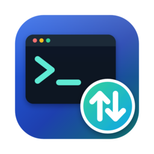

<p align="center"></p>

# Termwright

**Termwright** is a free, open-source terminal emulator and session manager for **Windows, Linux and macOS (Apple Silicon)**.
It's a desktop app (not a web app), built from scratch in **Go** (backend) and **Angular + xterm.js** (UI) and packaged into a
**single native binary** with [Wails](https://wails.io).

It reads and writes the **SecureCRT® session file format**, so you can import an existing session library
(SecureCRT 9.x and older) and export back to it.


📖 **[User Guide](docs/USER_GUIDE.md)** · [Scripting](docs/SCRIPTING.md) · [SecureCRT compatibility](docs/SECURECRT_COMPAT.md) · [Roadmap](docs/ROADMAP.md)

## What's new in 0.12.1

* **Much better device identification** in Discover Devices: web page title, server and certificate; Telnet banner and login prompt (with proper option negotiation); SIP over UDP for phones; MAC address and maker (IEEE vendor list) from the ARP table; this computer listed; product names win over generic words (a TerraMaster NAS is a NAS, not Windows; EXOS with OpenSSH is a switch, Mocana SSH is network gear).
* **ⓘ evidence** per device: everything the result is based on.
* **NAS / storage** kind; device type suggested from the Telnet login prompt; **Show / Hide** for the SNMP community; a note when no device answers SNMP.

## What's new in 0.12

* **Discover devices** (File → Discover Devices…): scan a network or address range, see each device with an icon for its kind (switch, router, firewall, access point, server, computer, phone, printer), its name, vendor and system (SNMP v2c, DNS, SSH greeting), and add the selected ones - or all - as sessions with a matching device type. It never tries to log in. See the [User Guide](docs/USER_GUIDE.md#discover-devices).

  

## What's new in 0.11.5

* **SFTP follows the terminal's user**: after `sudo su -` in the terminal (also on a host behind a bastion), the SFTP tab opened from it browses as root and opens the terminal's folder (configurable).

Older releases: see the **[changelog](CHANGELOG.md)**.

## Features (v0.12)

| Area | What works |
|---|---|
| Protocols | SSH2, Telnet (NAWS/TTYPE/ECHO/SGA negotiation), Serial (COM / tty, RTS/CTS and XON/XOFF flow control, DTR/RTS, break), Local shell (PTY on macOS/Linux, ConPTY on Windows), Raw TCP |
| SSH2 | Password, keyboard-interactive, public key (identity file, encrypted keys, **PuTTY `.ppk`** keys, `~/.ssh/id_*`), **SSH certificates**, **FIDO2 security keys**, **Kerberos / GSSAPI**, SSH agent, known_hosts verification with new/changed-key prompts, keep-alive, **remote command** (e.g. `ssh -t` from a jump station to a cloud host) |
| Key login setup | Generate (Ed25519 / RSA 4096 / ECDSA) or reuse a key, install it on Linux, macOS, BSD or **Windows OpenSSH** servers (incl. `administrators_authorized_keys`), test a key-only login and switch the session to it |
| Tunnels & routing | Local / remote / dynamic (SOCKS5) port forwarding, chainable jump hosts, SOCKS5 and HTTP CONNECT proxies, X11 and agent forwarding, auto reconnect |
| Device types | Login profiles (EXOS, VOSS, Cisco IOS, Linux, custom): login steps for Telnet/Serial, after-login steps for every protocol (`enable`, paging off), own username/password (or none) inherited or overridden per session; used by Quick Connect, the Connect Bar (`voss 10.1.1.1`), sessions and folder defaults |
| Session Manager | Folder defaults (user, device type, jump host …), workspaces, Quick Open palette, folder tree, filter/search, drag & drop, new/edit/duplicate/rename/delete, connect-all-in-folder, Connect Terminal / Connect SFTP Session, recent sessions |
| Discovery | Scan a network or range (up to a /22): ports, SSH/Telnet banners, web page/server/certificate, SIP (phones), SNMP v2c name and model, DNS, MAC address and maker; icons per kind (switch, router, firewall, AP, server, NAS, computer, phone, printer) with the evidence; add selected devices as sessions with a suggested device type. Never logs in. |
| Import / export | Native storage is the SecureCRT `Config/Sessions/*.ini` layout (unknown keys preserved byte-for-byte): import a Config folder, `.zip`, XML export or `.ini` (saved passwords go to the OS keychain); export to folder, `.zip` or XML. Also imports **CSV**, **Ansible** inventories, **NetBox**, **AWS EC2**, **PuTTY / KiTTY** (`.reg`, `~/.putty/sessions`), **MobaXterm** (`.mxtsessions`) and OpenSSH `~/.ssh/config` |
| Logon automation | Automate logon with an Expect/Send table (hide, trailing CR, named credentials, `\s \w \v \p` escapes), send initial CR, logon scripts with arguments, output triggers |
| Terminal | Tabs and tiled views (side by side / stacked / grid), xterm-256color/truecolor, Unicode, scrollback search, keyword highlighting, per-session font, Backspace mode, copy-on-select, right-click paste, zoom, clickable links, session lock, Connect Bar |
| Appearance | Dark / Light / follow-system UI with accent color; terminal scheme *Auto* (follows the UI) or one scheme for all sessions; 12 built-in color schemes (Solarized, Dracula, Nord, Gruvbox, Catppuccin, …), custom scheme editor with import/export, per-session scheme and font |
| Capture | Session logging (raw or plain text, append, per-line timestamp prefix, filename tokens, start on connect), save scrollback / selection to file |
| File transfer | SFTP browser (dual pane) over the terminal's login or as a **standalone SFTP session** for one-session devices (e.g. VOSS); folder transfers, sync, **resume**, **bookmarks**, **server-to-server copy**, **SCP transfers from the SFTP browser**, **SFTP on a remote command's target through the jump station**, **Run as root or any user (sudo / su)**; SCP (files and folders), ZMODEM (auto `sz`/`rz`), YMODEM batch, XMODEM |
| Scripting | SecureCRT-style **Python** and **VBScript** (Windows) scripts (`crt.Screen.WaitForString`, `crt.Screen.Get` on the rendered screen, `crt.Dialog.Prompt`, …) and JavaScript scripts (`term.waitFor`, `readUntil`, `openSession`, …), logon scripts, script recorder, key map (keys → text / action / script). See [docs/SCRIPTING.md](docs/SCRIPTING.md) |
| Automation | Command window and **command library** with `{{variables}}` (send to the active tab, **selected tabs** or **all tabs**), button bar (text, actions, scripts), **output alerts** (notice, sound, desktop notification), paste confirmation and line delay, **compare outputs** (diff two tabs or files, ignore prompts; *Compare With…* on the tab menu) |
| Security | Passwords and key passphrases in the OS keychain (never in session files), **password managers** (1Password, Bitwarden, HashiCorp Vault, command), named credentials, **master password**, encrypted password-vault export/import (AES-256-GCM + scrypt) |
| Updates | Help → Check for Updates: stable or nightly channel from GitHub releases, downloads and opens the installer |

## Screenshots

| | |
|---|---|
|  <br/>*Tiled sessions with keyword highlighting* |  <br/>*SFTP with bookmarks, resume and server-to-server copy* |
|  <br/>*Logon actions (expect/send) and remote command* |  <br/>*Key login setup* |
|  <br/>*Import from SecureCRT, PuTTY, MobaXterm or OpenSSH* |  <br/>*Light theme* |
|  <br/>*Device types with their own login* |  <br/>*Quick Connect: device type + address* |
|  <br/>*Command library with variables* |  <br/>*Compare outputs* |
|  <br/>*Send to selected tabs* |  <br/>*SFTP browser copying with SCP* |
|  <br/>*SFTP on an AWS host through the jump station* |  <br/>*Choose the jump station or the target* |
|  <br/>*Right-click a tab → Compare With… another tab* |  <br/>*SFTP as root or another user* |
|  <br/>*Kerberos, certificates and security keys* |  <br/>*1Password, Bitwarden, HashiCorp Vault* |
|  <br/>*Workspaces* |  <br/>*Output alerts* |
|  <br/>*Discover devices with the evidence behind each result* |  <br/>*Selected devices added as sessions* |

The roadmap is in [docs/ROADMAP.md](docs/ROADMAP.md).

## Download

Every push to `main` publishes a **nightly** pre-release on the repository's Releases page: a macOS **DMG** and zip (Apple Silicon M1–M5), a Windows **installer** and zip, and Linux **.deb** packages and tarballs for amd64 and arm64. See the [User Guide](docs/USER_GUIDE.md#1-install).
The macOS app is ad-hoc signed but not notarized, so after unzipping it run `xattr -dr com.apple.quarantine Termwright.app` once.

## Build

Prerequisites: **Go 1.24+**, **Node.js 24 LTS** (22.22+ or 26+ also work), and the Wails CLI:

```bash
go install github.com/wailsapp/wails/v2/cmd/wails@v2.10.2
wails doctor            # checks platform dependencies
```

Platform notes:
* **Windows**: the WebView2 runtime (preinstalled on Windows 10/11).
* **Linux**: `sudo apt install libgtk-3-dev libwebkit2gtk-4.1-dev` (Ubuntu 24.04+; build with `-tags webkit2_41`).
* **macOS**: Xcode command-line tools (`xcode-select --install`).

```bash
make build       # or: wails build -clean -skipbindings   (Linux: add -tags webkit2_41)
# result: build/bin/termwright(.exe) or build/bin/Termwright.app
make dev         # live-reload development
# -skipbindings: the UI calls the Go methods directly, so generated TS bindings are not needed
# Go 1.27+: the Makefile sets GOTOOLCHAIN=go1.24.7 because the Wails 2.10 CLI cannot read newer Go packages.
# Without make:  GOTOOLCHAIN=go1.24.7 wails build -clean -skipbindings -platform darwin/arm64
make test        # Go unit + integration tests (includes an end-to-end SSH test)
```

Cross-builds of every platform run in GitHub Actions ([.github/workflows/build.yml](.github/workflows/build.yml)): Windows amd64, Linux amd64/arm64 and macOS arm64.
macOS builds are unsigned. After downloading one, run `xattr -dr com.apple.quarantine Termwright.app` or sign it with your own Developer ID.

## Migrating from SecureCRT, PuTTY or MobaXterm

**PuTTY / KiTTY**: export with `reg export HKCU\Software\SimonTatham\PuTTY\Sessions putty.reg` (or use `~/.putty/sessions`) and choose *PuTTY / KiTTY sessions* in File → Import Sessions. **MobaXterm**: right-click *User sessions* → *Export all sessions to file* and choose *MobaXterm sessions*. Details in the [User Guide](docs/USER_GUIDE.md#14-migrating-from-securecrt-putty-or-mobaxterm).

**SecureCRT**:

1. **File → Import Sessions…** → *SecureCRT configuration folder*, then select your config folder:
   * Windows `%APPDATA%\VanDyke\Config`
   * macOS `~/Library/Application Support/VanDyke/SecureCRT/Config`
   * Linux `~/.vandyke/SecureCRT/Config`
2. The session files are copied unchanged. Saved SecureCRT passwords are encrypted per-installation, so Termwright asks for each password once and can save it in your OS keychain.
3. To go back, use **File → Export Sessions…** → *Folder* and copy the `Sessions` folder into SecureCRT's Config folder, or use *XML*.

The key-by-key mapping is documented in [docs/SECURECRT_COMPAT.md](docs/SECURECRT_COMPAT.md).

## Project layout

```
main.go, app.go            Wails entry point, native menu, methods bound to the UI
internal/securecrt         .ini / XML session format reader & writer (lossless)
internal/session           session model, folder store, import/export
internal/term              SSH2 (incl. Kerberos, certificates, FIDO2), Telnet, Serial, local PTY, SFTP/SCP, scripts (JS, Python, VBScript)
internal/logging           session logs, filename tokens, ANSI stripping
internal/config            data directory + global options (settings.json)
internal/secrets           OS keychain integration
internal/secretref         password managers (1Password, Bitwarden, HashiCorp Vault, commands)
frontend/                  Angular 22 app (standalone components, signals, zoneless)
```

The data directory is `%APPDATA%\Termwright`, `~/Library/Application Support/Termwright` or `~/.config/Termwright`. You can override it with `TERMWRIGHT_HOME`.

## License

Apache License 2.0. See [LICENSE](LICENSE) and [NOTICE](NOTICE).
