# Termwright team server

A team that shares a lab can see in Termwright **who uses which device**. Each team runs its own small server - usually a Docker container on a Linux host of its lab - and every member's Termwright connects to it. No cloud service and no company-wide administrator are involved: a team sets up its own server, and several teams can use the same host.

Teams are **optional**. Without one, Termwright works exactly as before and sends nothing anywhere.

| Teams | Set Up a Team Server |
|---|---|
| 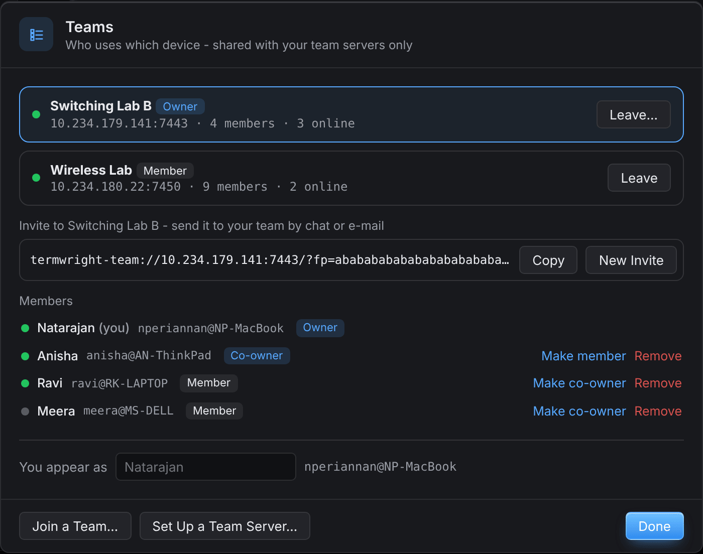 | 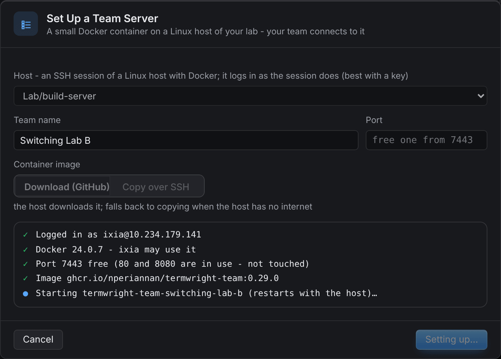 |

## What is shared

- Who is who: the name each person chose, their user name and computer name.
- The **team inventory**: the lab's devices - name, folder, address, port, protocol, device type, MAC address and description.
- Which network devices someone has open, and reservations with their note and end time (switches, routers, firewalls, access points and the like - not computers, Linux machines, phones, printers or IoT boards, which take several logins at once).

**In use and reserved.** In the Session Manager a team device someone else has open shows ● with their initials, a reserved one 🔒 (hover for name, time and note; the start page cards show names). Right-click → **Reserve…** keeps a device until a time with a note; **Release Reservation** ends it (owners and co-owners can release anyone's). Connecting to a device someone else reserved asks first and sends them a notice. A laptop that sleeps or closes drops out of *in use* within about a minute and a half. A device counts only with a device type of a network device (a device without one is *not tracked* on the admin page's Inventory). A serial or console server session named after a team device (*core-sw1 console*) counts as having that device open. Members with the same name - you on your laptop and on the lab PC - are one person: your own reservation does not warn you on your other computer, and the reports count people, not computers.

**Tell Me When It Is Free**: right-click a device someone else has open or reserved; a notice comes when nobody else has it. **Hand over**: the owner makes another member the owner (Teams window or Members page) and stays as co-owner.

| Team card (hover the badge) | Device card | Reserve… |
|---|---|---|
| 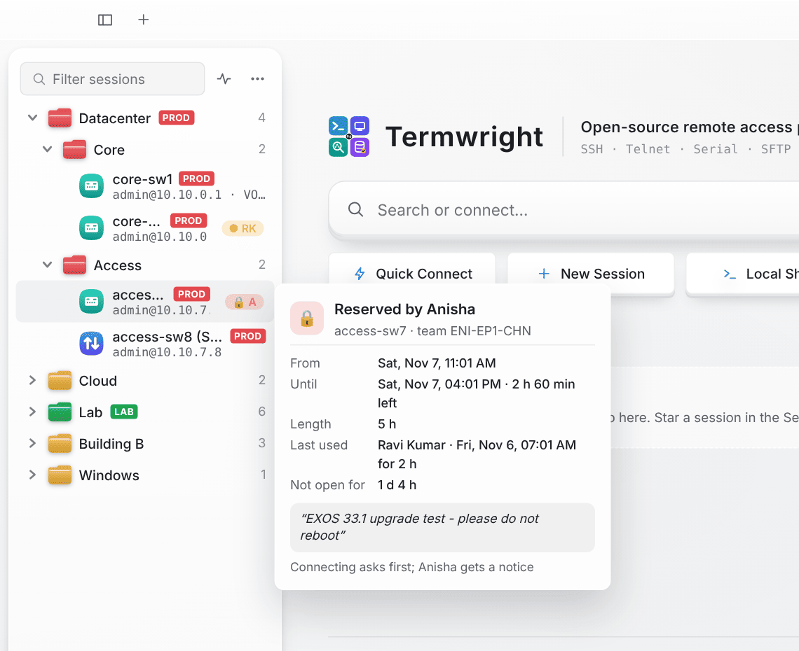 | 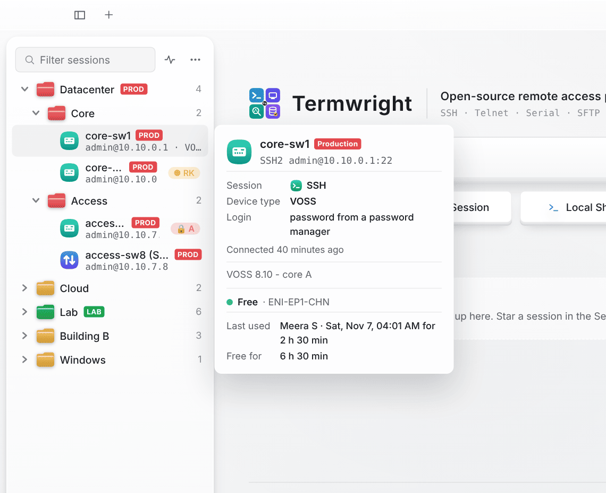 | 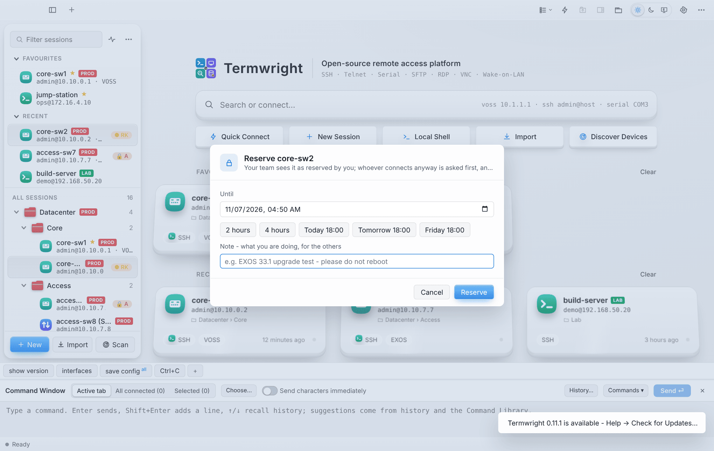 |

Passwords, usernames, keys, session files and terminal output are **never** sent: everyone logs in to the team's devices with their own login, kept on their own computer.

## The team inventory

Every member's Session Manager shows a folder named after the team (e.g. *ENI-EP1-CHN*) with the team's devices. It follows the server: a device added, renamed, moved or deleted there shows up within seconds. The team decides a device's name, folder, address, port, protocol, device type and MAC address; your username, password, account, device type login and keys on it stay yours. A copy you make of a team device (Duplicate, Copy and Paste) is your own session. Leaving the team removes its folder; your own sessions are never touched.

**Your own sessions stay yours** until you push them: right-click a session, a folder or a selection → **Push to Team…**, or in Discover Devices **Push to Team…** for the selected results. The window shows each device:

- *new for the team*: ticked, it is pushed;
- *already in the team as core-sw1 (Core)*: the team has it - matched by address and port, or by MAC address, whatever its name - and it is left out;
- *waiting for approval*: someone pushed it already.

Pushed by an owner or co-owner, devices are added at once. Pushed by a member, they wait on the admin page's **Approvals** until an owner or co-owner approves (optionally into another folder) or rejects them.

| Push to Team | The admin page |
|---|---|
| 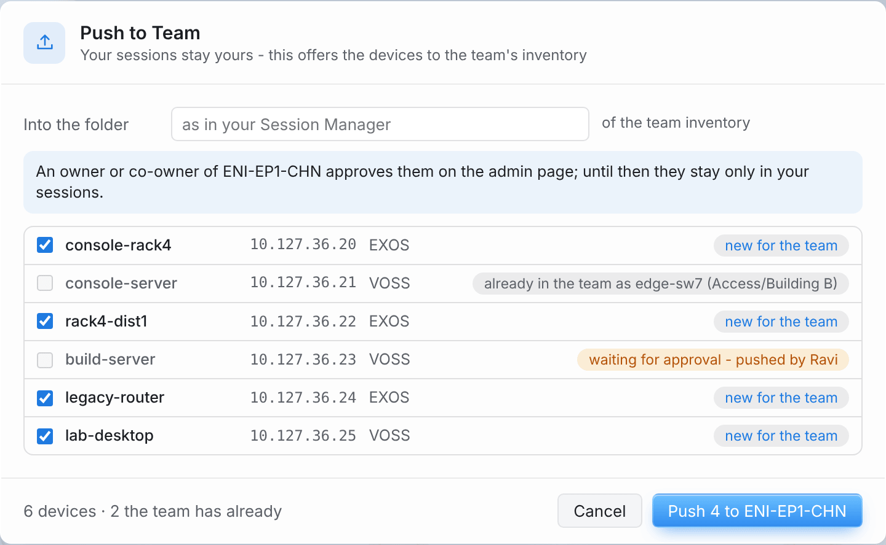 | 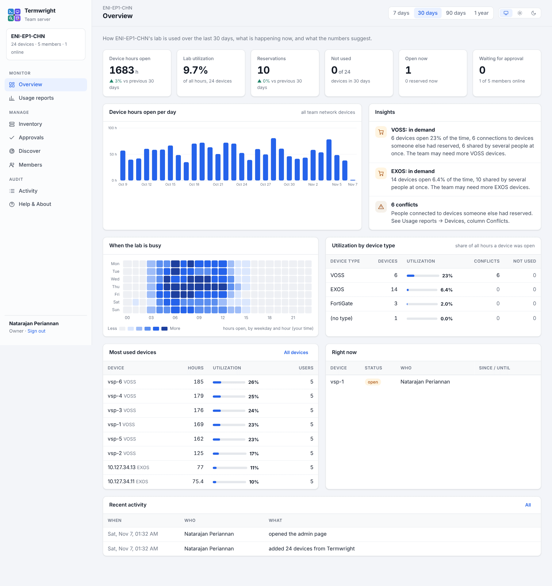 |

## The admin page

Owners and co-owners manage the team in the browser: **Options → Teams… → Open Admin Page**. Termwright signs you in with a link that works once, for two minutes; the page then keeps you signed in for eight hours on that browser. There are no passwords on the server, and members cannot open it. The certificate is the team server's own, so the browser asks once whether to trust it.

The page follows the system's light or dark theme, or the one you pick at the top right; the period (7, 30, 90 days or a year) applies to all figures.

| Page | |
|---|---|
| **Overview** | the lab at a glance: device hours open (with the trend against the period before), utilization, reservations, devices not used, what is open and reserved right now; device hours per day, *when the lab is busy* (weekday × hour), utilization per device type, the most used devices, and **insights** - device types in demand (busy, shared by several people at once, conflicts: the team may need more), devices nobody used (candidates to remove), reservations that sat idle. **All hours / Working hours** at the top switches utilization between all hours and Monday to Friday, 9:00-18:00 in your time zone |
| **Usage reports** | per **device** (shown by its own name with the address under it, **Model**; **Now**: free, in use by whom or reserved by whom until when, with **Only free now**; hours open, utilization, sessions, users, peak at once, hours reserved, reservations, conflicts, last used), per **member**, every **reservation** (from, to, length, released early or ended, note) and every **session** (who, opened, closed, length) - sortable, filterable, **Export CSV** |
| **Inventory** | the devices with folders on the side, search, device type filter, who has each one open or reserved now, its utilization and when it was last used; each device's own name and model (read by members' Termwright when they connect, or the SNMP name from a scan); *+ Add device*, edit, move, delete, **Name After Devices** (renames the selected devices to their own names - hostname, hostname (model) or hostname · last octet - for everyone), folders, **Import CSV…** / **Export CSV** (columns `name, folder, address, port, protocol, deviceType, mac, description`) |
| **Approvals** | devices members pushed: approve (into their folder or another) or reject |
| **Discover** | scans a network **from the team server's host**, inside the lab - also when you are at home on VPN. Nothing logs in. *Network devices only* (on by default) hides computers, phones and printers. Tick devices, pick a folder, **Add to Inventory**; devices the inventory has already are marked |
| **Members** | the invite (*Copy*, *New Invite*), roles, *Remove*, and *Make owner* (owner: hands the team over, you stay as co-owner) |
| **Backup & restore** | owner only: *Download Backup* (team, members, invite, inventory, reservations, usage history, certificate and key in one .tar.gz) and *Restore from a File…* (the team goes back to how it was in the backup) |
| **Activity** | the last 5000 events - who added, changed, approved, reserved, released, removed, handed over or signed in (once per sign-in) - with a filter and *Export CSV* |

Usage is counted from the presence heartbeats of members' Termwright (only the team's network devices, only while a terminal is connected) and kept on the server for 400 days in `usage.json`, next to `team.json`.

| Overview | Usage reports |
|---|---|
|  | 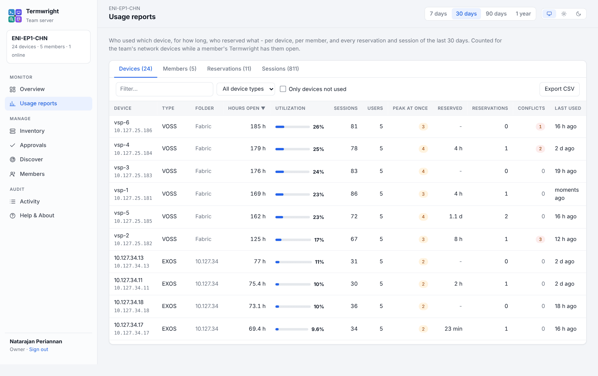 |

MAC addresses in server scans need the container on the host's network (*Use the host's network* when setting it up) and devices on the host's own subnet.

## Setting a team server up from Termwright (recommended)

**Options → Teams… → Set Up a Team Server…**

1. **Host**: pick an SSH session of a Linux host with Docker. Termwright logs in the way the session does - a key login is best.
2. **Team name**, e.g. *Switching Lab B*. The container is called `termwright-team-switching-lab-b`.
3. **Port**: leave it empty and Termwright picks the first free port from 7443. It never uses a port that is already taken (80, 8080 or anything else).
4. **Container image**:
   - *Download (GitHub)*: the host downloads `ghcr.io/nperiannan/termwright-team`.
   - *Copy over SSH*: this computer downloads the server program and copies it to the host, which builds the image itself. Use this for labs without internet. *Download* falls back to it by itself.
5. **Set Up**. Termwright checks Docker, starts the container with `--restart unless-stopped` and a data volume of its own, checks that this computer can reach it, and makes you the **owner**. The invite appears at the end: send it to your team.

When the user may not use Docker, Termwright says so. The fix on the host is `sudo usermod -aG docker <user>`, then log in again. Sudo without a password for docker works too.

When the host's firewall blocks the port, the server runs but cannot be reached. Open the port, then set up again or join with the invite:

- Ubuntu/Debian: `sudo ufw allow 7443/tcp`
- RHEL/Rocky: `sudo firewall-cmd --add-port=7443/tcp --permanent && sudo firewall-cmd --reload`

**Set up again to reconnect.** If your Termwright lost the team (a new computer, or settings reset), run *Set Up a Team Server…* again with the same host and team name. Termwright sees the running container and makes you its owner again: the team, its members, inventory, certificate and invite stay. Your earlier entry stays as a co-owner until you remove it. Only someone who can log in to the host and use Docker there can do this. By hand: `docker exec termwright-team-<name> /termwright-team -recover-owner`, then take the new code from `docker logs termwright-team-<name> | grep owner-code`.

## Joining a team

**Options → Teams… → Join a Team…**, then paste the invite. It looks like `termwright-team://10.234.179.141:7443/?fp=…&k=…&n=…`.

The invite holds:

- the server's address;
- the team key;
- the **fingerprint** of the server's certificate. Termwright talks only to the server with that certificate, so a different machine at the same address is refused.

The key that proves your membership is kept in the system keychain, not in `settings.json`.

## Single sign-on (Microsoft Entra ID, Okta, Google)

Members can join - and stay in the team - with their company account instead of the invite key. The owner sets it up on the admin page, **Single sign-on**:

1. In the Entra admin center: **App registrations → New registration** (single tenant). **Redirect URI**: platform *Web*, `https://<team server>:<port>/sso/callback` (the page shows it with *Copy*).
2. **Certificates & secrets → New client secret**, or leave the secret empty and turn on *Allow public client flows* (Termwright uses PKCE either way).
3. **Token configuration**: add the optional claim *email* to the ID token; for allowed groups also *Add groups claim*.
4. On the admin page: the **Issuer** `https://login.microsoftonline.com/<Directory (tenant) ID>/v2.0`, the **Application (client) ID**, the secret, and optionally **allowed e-mail domains** and **group ids**. **Save**, then **Test Sign-In**.

Then send the team the **invite for single sign-on** from that page (the server's address and certificate, no key). In Termwright, *Join a Team* shows **Join with Microsoft**: the sign-in opens in the browser, and Termwright joins when it is done. *Members may also join with the invite key* keeps the old way open. **Sign in again every … days** (30 by default): after that a member's Termwright asks them to sign in again, so someone who left the company drops out. Another account cannot take over a member, and the ID token's signature, issuer, audience, expiry and nonce are all checked. Okta, Google and other OpenID Connect services work the same way with their issuer address.

| Single sign-on on the admin page | Joining in Termwright |
|---|---|
| 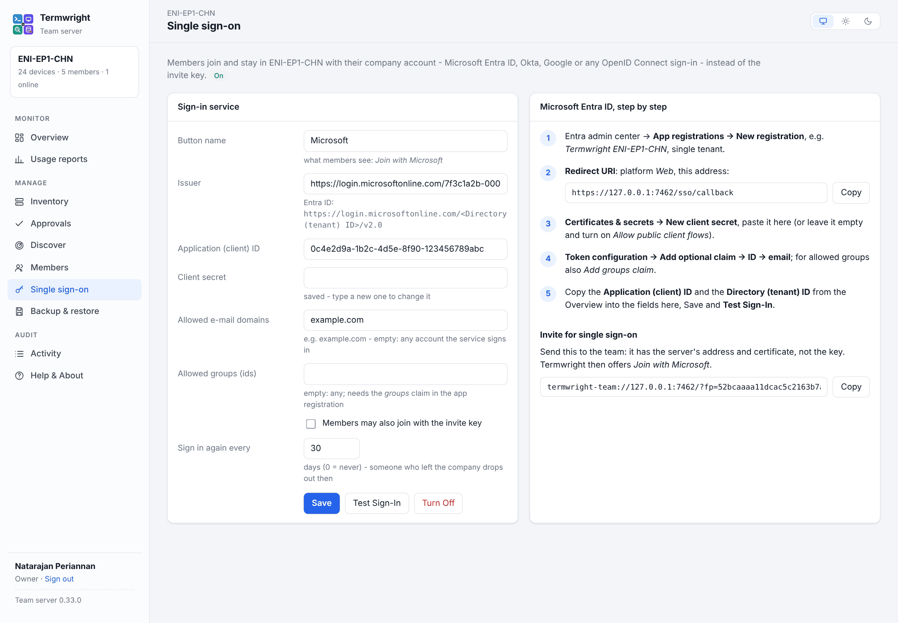 | 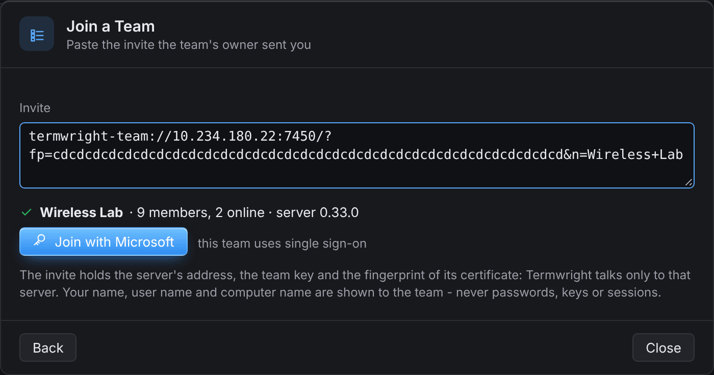 |

## Roles

| Role | Can |
|---|---|
| **Owner** (who set the server up) | everything: the admin page, the inventory and approvals, the invite, co-owners, remove anyone |
| **Co-owner** | the admin page, the inventory and approvals, the invite, make members co-owners, remove members |
| **Member** | see the team and its inventory; push devices for approval; reserve devices |

**New Invite** stops the old invite; members who already joined stay in the team. A removed member is out at once and needs a new invite to come back. The owner can leave only when nobody else is in the team.

## Installing by hand

Each release has `termwright-team-linux-amd64.tar.gz` and `termwright-team-linux-arm64.tar.gz`. Each holds:

- the program (`termwright-team`, one static file);
- a `Dockerfile`, a `docker-compose.yml` and a systemd unit;
- this guide (`INSTALL.md`).

The server listens on 7443 inside the container (HTTPS with its own certificate) and keeps its data in `/data`.

**Docker, image from GitHub:**

```
docker run -d --name termwright-team-my-lab --restart unless-stopped \
  -p 7443:7443 -v termwright-team-my-lab:/data -e TW_TEAM_NAME="My Lab" \
  ghcr.io/nperiannan/termwright-team:latest
```

**Docker without internet** (from the unpacked package):

```
docker build -t termwright-team .
docker run -d --name termwright-team-my-lab --restart unless-stopped \
  -p 7443:7443 -v termwright-team-my-lab:/data -e TW_TEAM_NAME="My Lab" termwright-team
```

**Docker Compose**: edit the name and port in `docker-compose.yml`, then `docker compose up -d`.

**Without Docker (systemd):**

```
sudo cp termwright-team /usr/local/bin/
sudo cp termwright-team.service /etc/systemd/system/
sudo systemctl enable --now termwright-team
```

Use another port on the host by changing the left side of `-p` (e.g. `-p 7450:7443`), or `TW_LISTEN` for systemd.

**Becoming the owner after a manual install**: the server prints a one-time setup code at its first start:

```
docker logs termwright-team-my-lab | grep owner-code
```

The line reads `TERMWRIGHT-TEAM owner-code=… fingerprint=…`. Join with an invite you build from it:

```
termwright-team://HOST:PORT/?k=OWNER-CODE&fp=FINGERPRINT
```

(`k` is the owner code here.) Termwright then makes you the owner, and the code stops working.

## Settings of the program

| Flag | Variable | Default | |
|---|---|---|---|
| `-data` | `TW_DATA` | `/data` | team.json, cert.pem, key.pem |
| `-listen` | `TW_LISTEN` | `:7443` | address and port |
| `-name` | `TW_TEAM_NAME` | `Team` | the team's name (first start only) |

**Backup**: on the admin page (owner) *Backup & restore → Download Backup*; or by hand, copy the data folder or volume (`docker run --rm -v termwright-team-my-lab:/d -v "$PWD":/b alpine tar czf /b/team-backup.tgz -C /d .`). The certificate is part of it: a server set up again with a new certificate needs a new invite for everyone.

**Update from Termwright** (recommended): when a team server is older than your Termwright, owners and co-owners get a notice (*Later* skips that version for a week) and **Options → Teams…** shows *Version X is available for the team server* → **Update Server…**. Pick the SSH session of the host (Termwright suggests the one it was set up with, or one that logs in to the team's address) and *Download* or *Copy over SSH*. Termwright gets the new image there and starts the team's container again with the same name, port, network, data volume and settings; the team, its members, inventory, usage history, certificate and invite stay. Only the container whose certificate is the team's is touched, so a wrong host or another team's server on the same host is never changed. The old container is kept stopped until the new one answers with the new version (90 seconds at most), and is started again if it does not. Its environment, restart policy, memory and CPU limits and labels are kept; a server from Docker Compose is updated with Compose (*pull* and *up -d*); a server installed with systemd is updated by hand (below). Members are told when the server is older, and everyone when it is newer than their Termwright. The admin page shows the server's version at the bottom left.

| A newer version for the team server | Update Server |
|---|---|
| 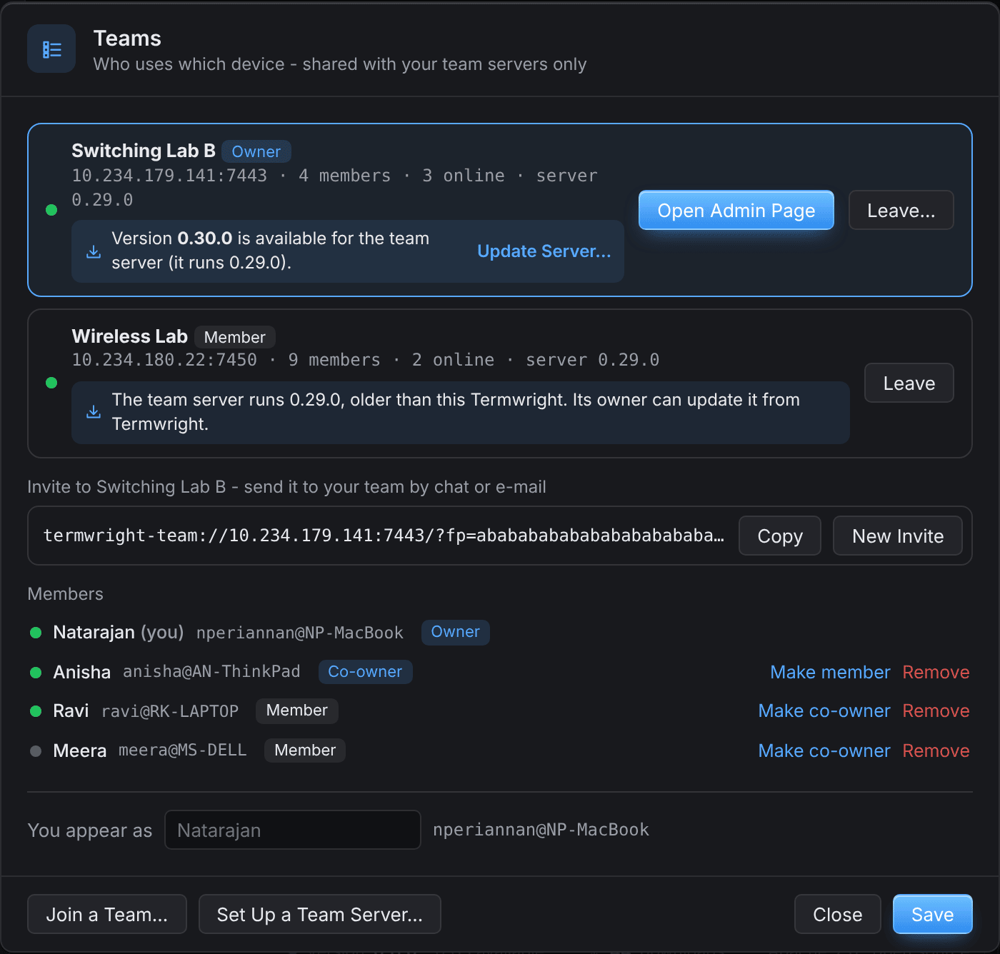 | 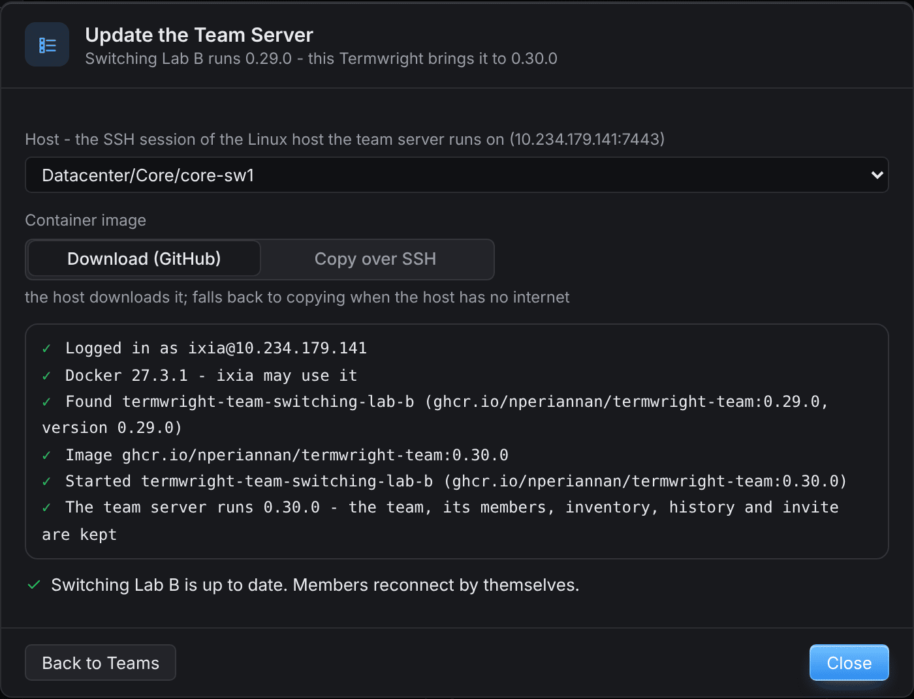 |

**Update by hand**: `docker pull ghcr.io/nperiannan/termwright-team:latest`, then remove the container and start it again with the same volume. The team and its members are kept.

**Remove**: `docker rm -f termwright-team-my-lab && docker volume rm termwright-team-my-lab`.
