# Testing with Termwright: record, run, report, schedule

This guide takes you from a manual check on a switch to a test that runs by itself every morning: record the check, look at it, run it on a testbed, read the report, schedule it and let the AI assistant explain a failure. Every step has a picture. The reference for the test format and all options is the User Guide, chapter [9f. Tests](USER_GUIDE.md#9f-tests-record-run-and-generate-code).

**What you need:** saved sessions for the devices, with their logins saved (Termwright logs in with them; tests never hold passwords). For REST steps an API session; for SNMP steps the sessions' SNMP settings.

---

## 1. Start recording

Open **Tests → Record a Test**. The **Steps** panel opens on the right. Give the test a name, then connect to the device as usual - here `access-sw7`.

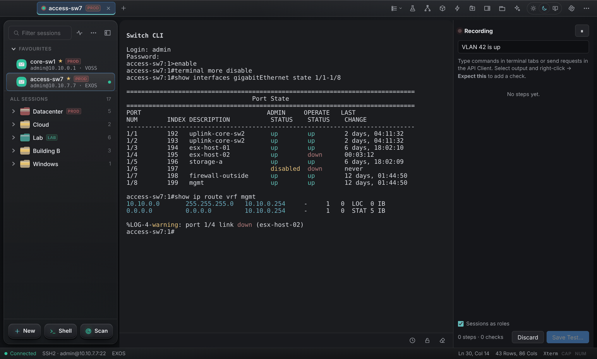

Everything you now do becomes a step:

- **commands** you type in terminal tabs (or send from the Send bar),
- **requests** you send in the **API Client** (its status code is added as a first check),
- **gets, walks and sets** in the **SNMP Browser** (a get's values are added as checks; a query on several devices gives one step per device).

Commands that may hold a password, secret, community or key are not recorded. ⏸ pauses recording.

## 2. Type the command and mark what must be true

Type `show vlan 42`. To check a value, select it in the output (a double-click selects a word), right-click and choose **Expect this**:

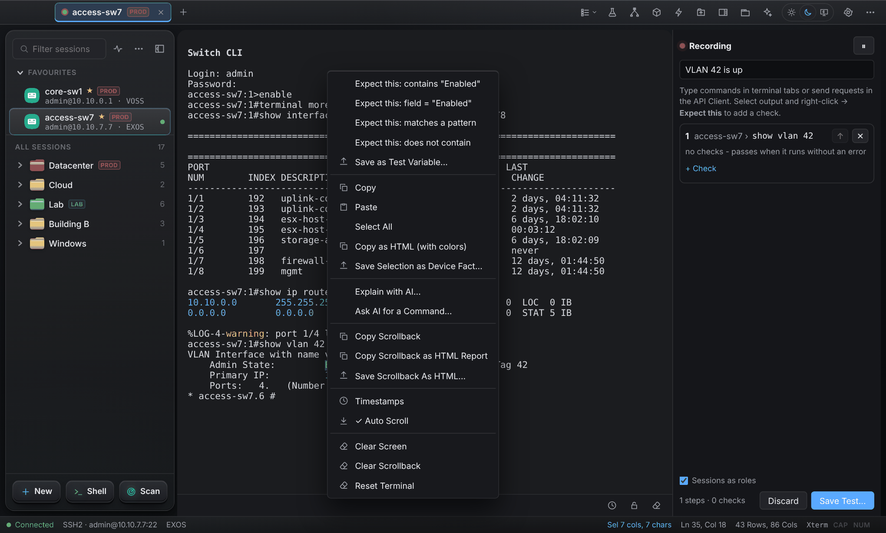

| Choice | What the test checks |
|---|---|
| *contains "…"* | the output contains the text |
| *field = "…"* | the value after its label - Termwright builds `Admin\s+State:\s*(\S+)` from the label, so it still works when spacing or other lines change |
| *matches a pattern* | the text as a regular expression, numbers as `\d+` |
| *does not contain* | the text must not be there |
| *Save as Test Variable…* | keeps the value as `{{name}}` for later steps (for example an address the REST step must return) |

## 3. Add a check by hand

**+ Check** under a step adds a check without selecting anything - contains, does not contain, matches, a field, and for REST steps the status, a JSON path (`data.items[0].name`, `length`) or a time limit; for SNMP steps a value by name or OID.

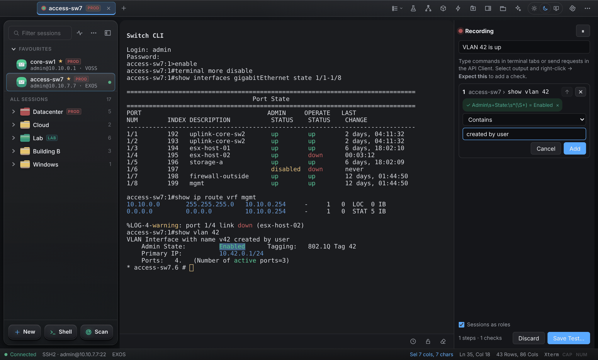

## 4. Record the rest

Type the next command (`show ports 4 information`), send a request in the API Client or read a value in the SNMP Browser. Each becomes a step with its checks. ↑ moves a step up, ✕ removes it, × on a check removes the check. A step without checks passes when it runs without an error.

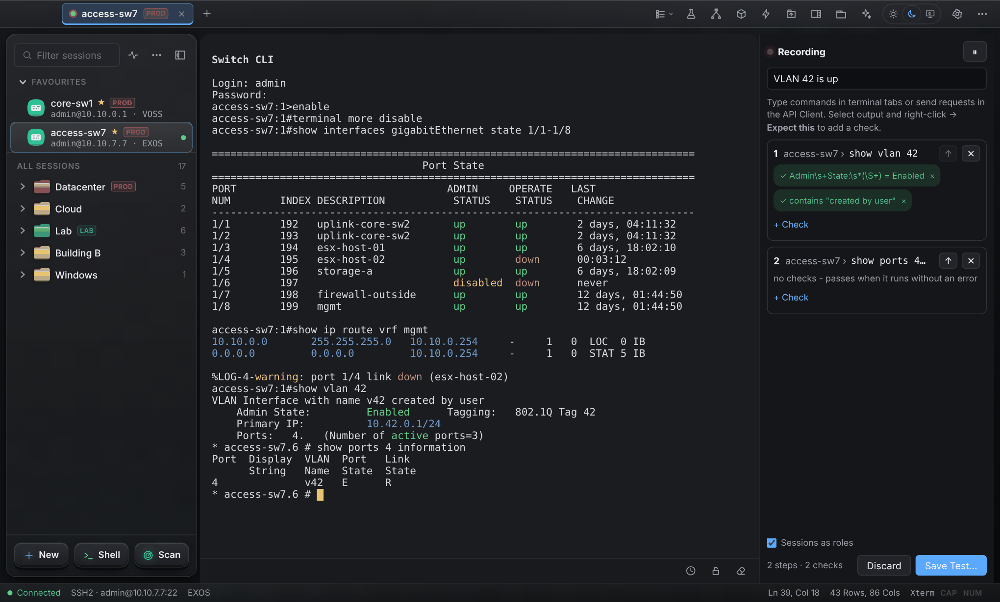

**Sessions as roles** (on by default) saves the session as a role - `access-sw7` becomes `{{access_sw7}}` with this session as the default - so the same test can later run on other devices (section 7).

## 5. Save

**Save Test…** asks for the file. Tests live in the tests folder (`cases/…`); sub-folders group them.

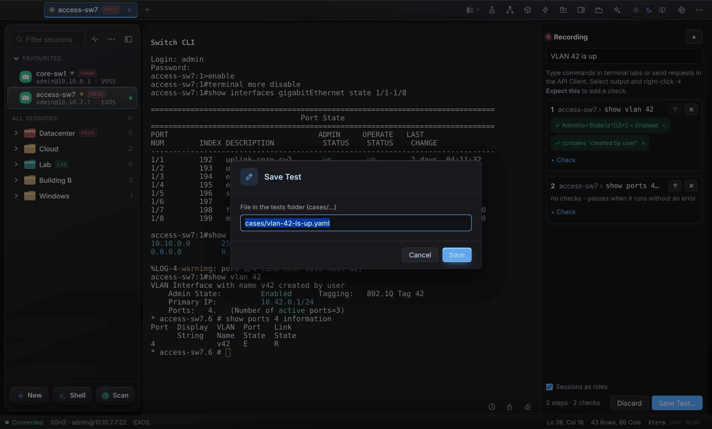

Saving writes the test as YAML and also as Go, Python and TCL code (section 6).

## 6. The Tests tab

**Tests → Tests** opens the tests folder: the tests by folder (a dot shows the last result), testbeds, schedules and past reports. Select a test to see its steps, the roles' defaults and the checks.

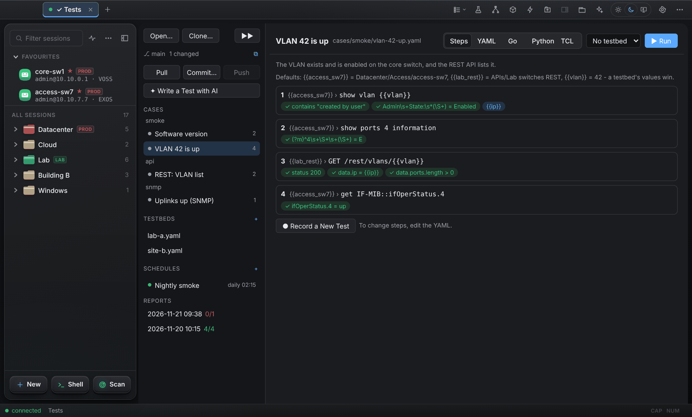

**YAML** shows the test as a file you can edit and **Save** (it is checked first). This is the part to edit - the code is written from it.

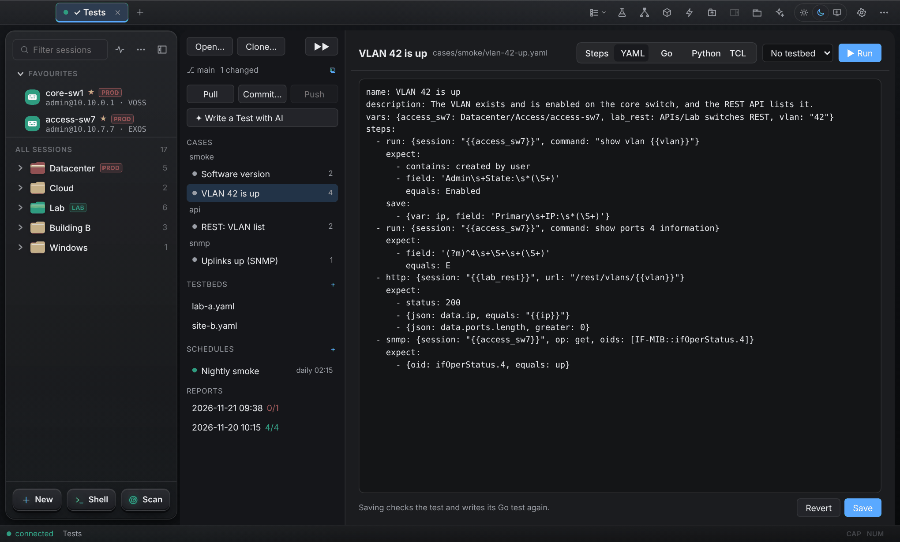

**Go**, **Python** and **TCL** show the same test as code, for CI systems and people who want to read it as a script. They send each step to Termwright, which logs in with the saved logins - no passwords in the code.

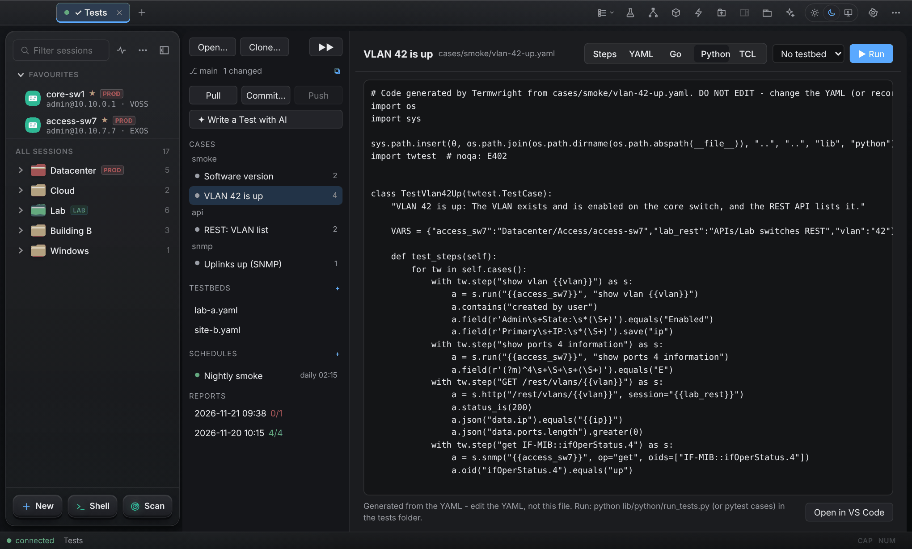

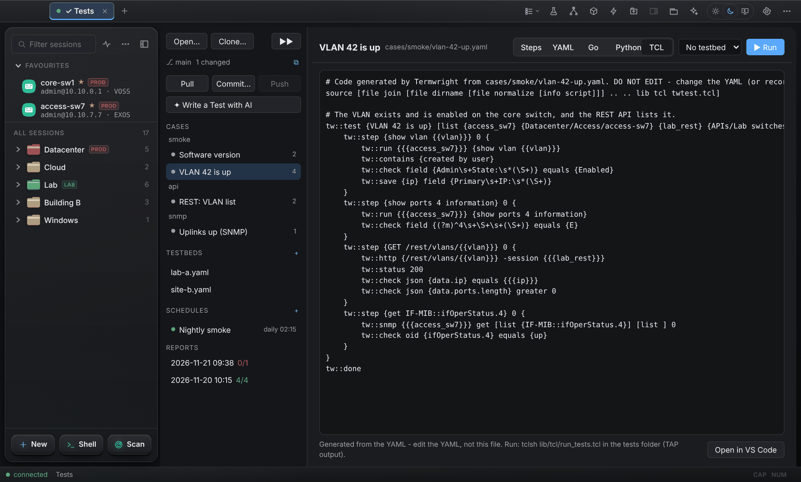

Run them in the tests folder while Termwright is open:

```sh
go test ./cases/...
python lib/python/run_tests.py --junit junit.xml     # or: pytest cases
tclsh lib/tcl/run_tests.tcl -junit junit.xml
```

## 7. Run it on a testbed

Pick a **testbed** next to **▶ Run** (or none to use the recorded devices) and press **▶ Run** - **▶▶** at the top runs every test. The steps show the result of each check and what came back; the commands of a test run over one login per device. The **Last run** list shows each test with its first failure.

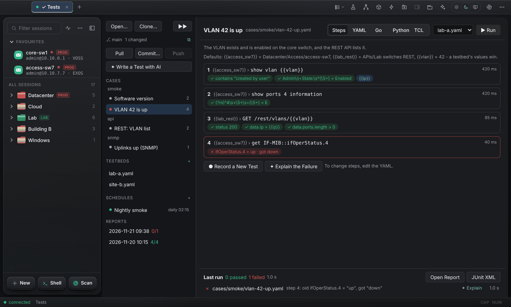

A run that uses production sessions is asked first.

## 8. Read the report

**Open Report** opens the run's HTML report: every test and step, the checks with what came back, and the output of failed steps. **JUnit XML** is the same run for CI systems. Both are kept in `reports/` (one folder per run).

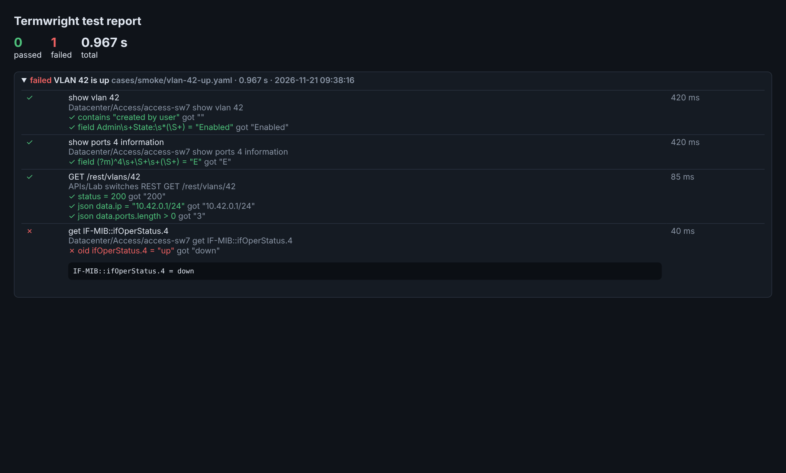

## 9. Testbeds: the same test on other devices

A testbed maps the roles to sessions. **+** next to **Testbeds** writes one from a session folder - every saved session in it becomes a role (`access-sw7` → `access_sw7: Datacenter/Access/access-sw7`). Point it at the emulated lab's folder to run the tests there first, or at another site's folder.

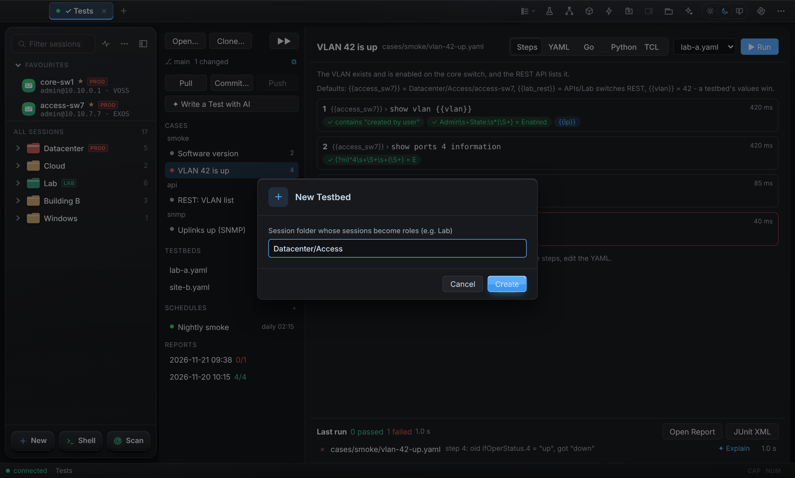

You can also write testbeds by hand (`testbeds/site-b.yaml`):

```yaml
access_sw7: Site B/access-sw2
lab_rest: APIs/Site B REST
vlan: "142"
```

To run a test with several values, add `params` to its YAML: `params: [{vlan: "42"}, {vlan: "100"}]` runs it once per entry.

## 10. Schedule it

**+** next to **Schedules** runs tests by themselves while Termwright is open: all tests or the selected one, with a testbed, daily, on weekdays, weekly or every N hours. A failed run shows a notification; the list shows each schedule's last result (with its report) and next run. **Run Now** starts it at once.

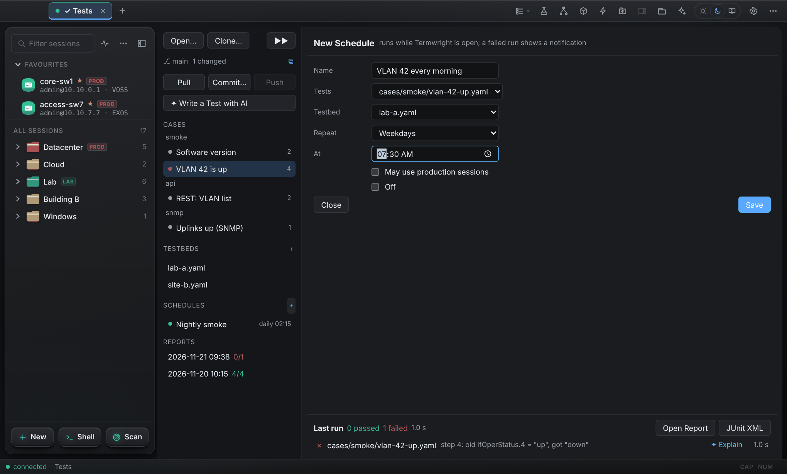

Tests may use production sessions in a schedule only when *May use production sessions* is ticked. For a server that tests around the clock without the window, use `termwright tests run` from cron or Task Scheduler (section 13).

## 11. Ask the AI assistant why it failed

**✦ Explain** next to a failed test (or **Explain the Failure** under its steps) sends the test and the run - each step, the checks with what came back, the failed output - to the AI assistant. It says whether the device, the network or the test is wrong and shows a corrected test when the test needs one.

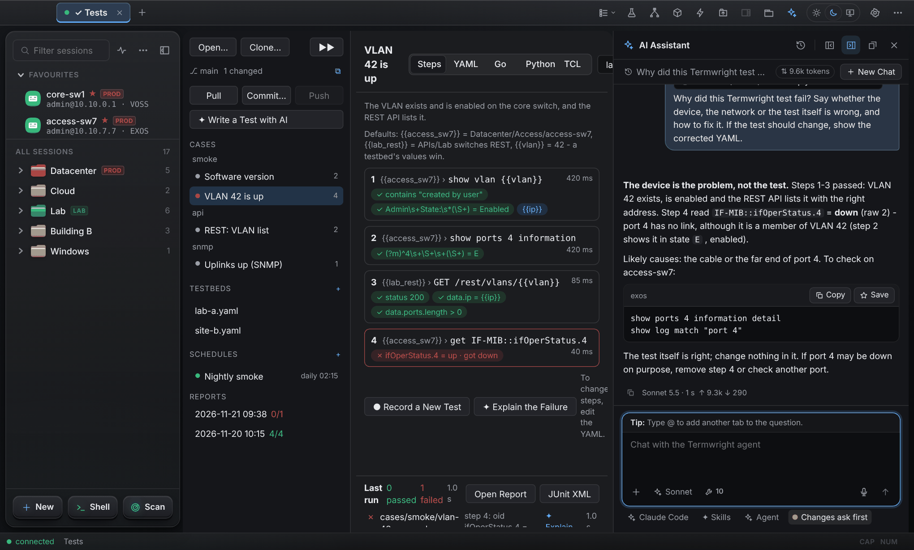

## 12. Let the AI assistant write a test

**✦ Write a Test with AI** asks what the test should check. The assistant finds the saved sessions, writes the YAML with roles and checks, saves it with the `tests` tool and offers to run it. Saving and running are asked like other changes.

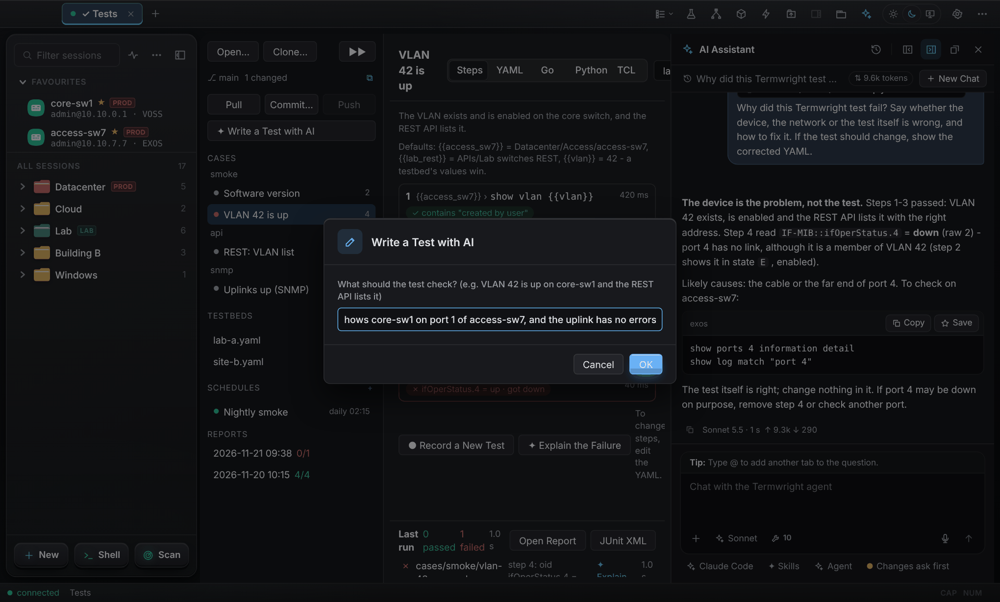

## 13. Share and run in CI

- **Git**: when the tests folder is a Git repository (**Clone…**, or *Make it a Git repository*), **Pull**, **Commit…** and **Push** keep it in step with your team; reports stay out of Git.
- **Without the window**, on a CI machine with Termwright installed:

  ```sh
  termwright tests run --testbed lab-a.yaml --junit junit.xml   # exits 1 when a test failed
  termwright tests serve                                         # only the local API, for the Go/Python/TCL code
  termwright tests secrets                                       # which TERMWRIGHT_SECRET_… variables the tests may need
  ```

  Where there is no credential store, passwords and communities can come from `TERMWRIGHT_SECRET_<KEY>` environment variables (`termwright tests secrets` lists the names; values are never printed).

## Tips

- **Mode-dependent commands**: the commands of a test share one login per device, like when you recorded them - a test that goes into configure mode stays there for its next steps.
- **Values that change** (uptime, counters): check them with a field and `greater` / `less` in the YAML instead of an exact text.
- **A value that must change**: save it in one step and check `notEquals: "{{name}}"` in a later one.
- **Slow devices**: give a step `timeout: 120` (seconds) in the YAML.
- **One test failed, the rest should go on**: add `continueOnFail: true` to the step.
