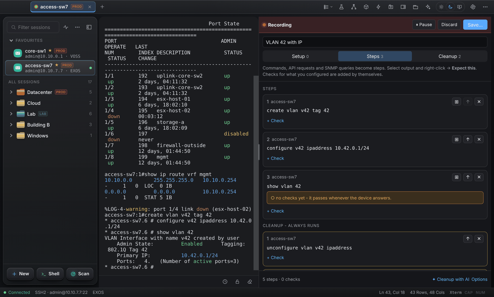
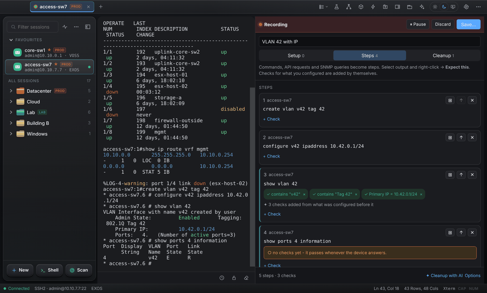
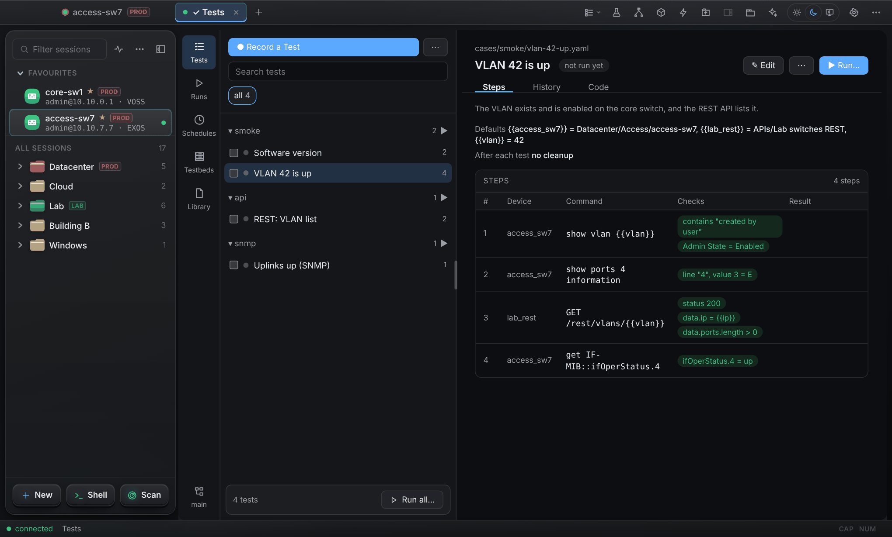
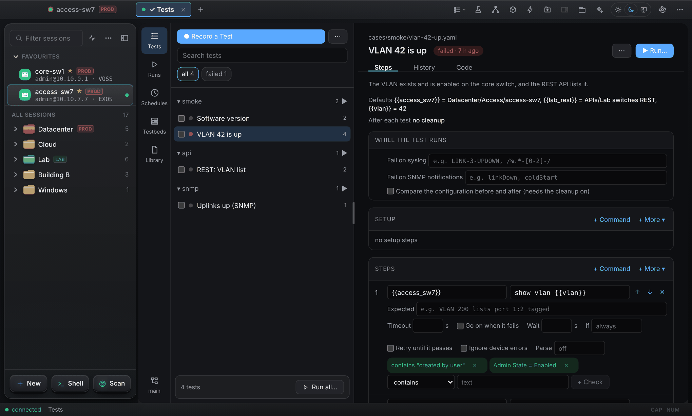
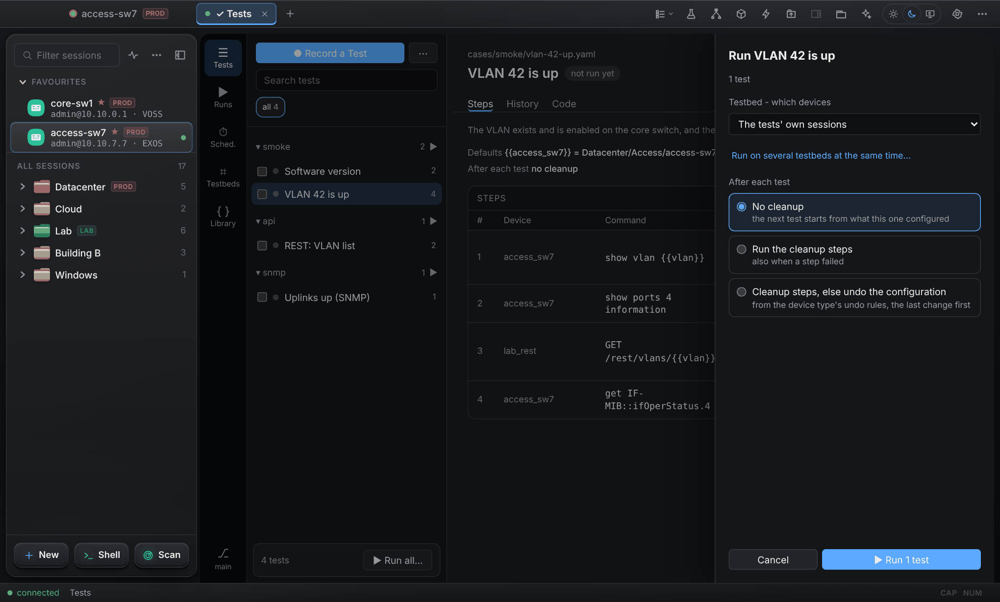
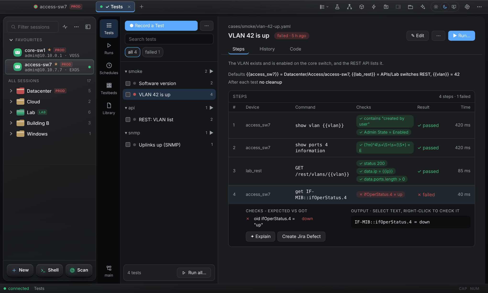
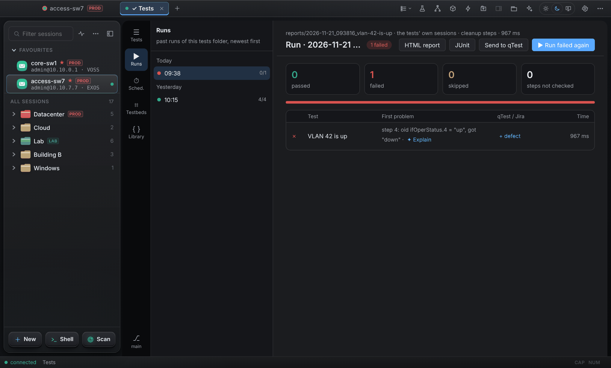
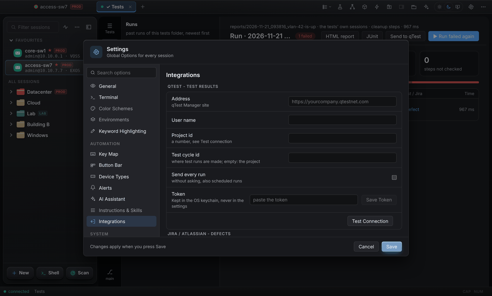

# Testing with Termwright: record, run, report, schedule

This guide takes you from a manual check on a switch to a suite that runs by itself every night and reports to your test management: record the check, let Termwright add the checks, clean up, run it on a testbed, read the results, follow its history, schedule it and send it to qTest and Jira. The reference for the test format and all options is the User Guide, chapter [9f. Tests](USER_GUIDE.md#9f-tests-record-run-and-generate-code).

**What you need:** saved sessions for the devices, with their logins saved (Termwright logs in with them; tests never hold passwords). For REST steps an API session; for SNMP steps the sessions' SNMP settings. A device type on each session gives you error detection, undo rules, tables and versions.

---

## 1. Record

**Tests → Record a Test** (or **● Record a Test** in the Tests tab) opens the recorder on the right: a red recording bar with **Pause**, **Discard** and **Save…**, the test's name, and **Setup / Steps / Cleanup** - where new steps go. Connect to the device and work as usual:

- **commands** you type in terminal tabs (or send from the Send bar),
- **requests** you send in the **API Client** (the status code becomes a first check),
- **gets, walks and sets** in the **SNMP Browser** (a get's values become checks; a query on several devices gives one step per device).

Commands that may hold a password, secret, community or key are not recorded. Drag the recorder's left edge to make it wider or narrower.



**Already have test cases?** ⋯ → **Import Test Cases** reads a **Postman collection** or an **OpenAPI / Swagger** description (one test per request, folders and tags as suites, the status check from the test script, the saved example or the first 2xx answer - name the API session they go to), or a sheet (Excel or CSV) with the columns *Suite*, *Test*, *Step*, *Device*, *Expected* (and optionally *Type*: command, api, manual): each row becomes a step, rows of the same test become one test, a row without a device becomes a manual step, and quoted text in *Expected* (`"v200"`) becomes a check. Then run them, and add checks where the import could not.

## 2. Checks - mostly written for you

A step passes when the device accepted the command **and every check holds**. Termwright writes most checks for you:

- **From what you configured** (also for API requests: the values a POST, PUT or PATCH sent must come back in its answer and in a later GET of the resource or its list): after `create vlan v42 tag 42` and `configure v42 ipaddress 10.42.0.1/24`, the next `show vlan 42` gets *contains "v42"*, *contains "Tag 42"* and *Primary IP = 10.42.0.1/24* by itself - only checks that hold for the output you saw, so a fresh test passes. In the cleanup, a show after the delete gets *does not contain "v42"*. The card says how many were added; × removes one; *Options → Add checks for what was configured* turns it off.
- **Suggested**: further values from the configuration show as dashed **+ suggestions**.
- **Expect this**: select a value in the output, right-click → *Expect this: Admin State = "Enabled"* (a field - its label is found so it still works when spacing changes), *contains*, *matches a pattern*, *does not contain*, or *Save as variable* for later steps. This works also when *Right-click pastes* is on (Paste stays in the menu).
- **+ Check** adds one by hand - for REST a status, a JSON path or a time limit; for SNMP a value by name or OID.
- **⊞** shows a command's output as a **table** (a TextFSM template from the tests folder's `templates/`); click a value to check it - see section 10.



**How a step passes or fails**

1. The command ran (no timeout, the login worked).
2. The answer has no line matching the device type's **error patterns** (`% Invalid input`, `Error:`, `%% Unrecognized` …; built in for EXOS, VOSS, Cisco IOS, NX-OS, Huawei VRP, Eltex MES and Ruckus ICX - your own in Global Options → Device Types). A step that may answer with an error gets *Ignore device errors* (`ignoreErrors: true`).
3. Every check holds. Text checks ignore spacing and line breaks, so text selected over several lines is still found.

A step **without checks** only proves that the device accepted the command - also a `show vlan` where the VLAN is missing - and runs mark it **○ not checked**. **The same holds for cleanup steps.** Saving a test whose read steps check nothing asks first.

## 3. Clean up

For every change the recorder puts its undo into the **Cleanup** as you record - from the device type's **Undo rules** (`create vlan v42` → `delete vlan v42`), the DELETE of a POST, or the old value of an SNMP set - the last change first (*Options → Add the undo of each change to the cleanup* turns it off; then **↩ cleanup: … + add** suggests it instead). A change without an undo rule shows no undo: add the rule in Global Options → Device Types, or record the undo in **Cleanup**; **✦ Cleanup with AI** asks the assistant. Record more in **Cleanup**, ideally a show with *does not contain* at the end.

Whether a run cleans up is chosen **per run** (section 6): with *No cleanup*, tests build on what earlier ones configured. *Options → Afterwards put back* adds a safety net: the **configuration** (the device type's *Test save / restore* commands, built in for NX-OS, Cisco IOS and EXOS) or a **lab snapshot** of emulated lab switches.

## 4. Save, and the Tests tab

**Save…** asks for the **suite** (a folder of tests, such as `vlan` or `l2/vlan`; it is remembered for the next test) and the test's **name** - the list shows tests by suite and name. The test is saved as YAML (`cases/<suite>/<name>.yaml`) and as **Go**, **Python** and **TCL** code.

**Tests → Tests** opens the workspace. The rail on the left switches between **Tests**, **Runs**, **Schedules**, **Testbeds** and **Library**; the Git branch at the bottom has Pull, Commit and Push. The test list has search, **tag** chips (and *failed*), check boxes and folders with ▶.

A test shows its setup, steps and cleanup as a table - device, command, its checks in words, the last result and time. Click a step to see what was expected next to what came back, its output and table.



**⋯** on a test: **Rename…**, **Duplicate…**, **Tags…**, **Depends On…**, **qTest Test Case…**, Open in VS Code, **Delete…** (moves the test and its code to `.removed/` - nothing is erased). **History** shows its past results (section 8); **Code** shows the YAML (editable) and the generated Go, Python and TCL.

## 5. Edit

**✎ Edit** changes the test without YAML (**+ More** adds an API request, a step from a curl command, a manual step, a wait, a loop, an upgrade or a traffic test; a failed step's **Compare with the last pass** shows which output lines changed): each step's session and command (method and URL, image, traffic test), timeout, *Go on when it fails*, **Wait** (seconds before it), **If** (`{{vlan}} != 1`; `==`, `!=`, `contains`, `~`, `>`, `<`), **Retry until it passes** (for links coming up or routes converging), *Ignore device errors*, **Parse** (`auto` for a table); ↑ ↓ ✕; **+ Step**, **+ Wait**, **+ Upgrade**, **+ Traffic**, **+ Loop** per section; checks with × and **+ Check** (also *table value*: `VLAN_ID=200: STATUS = active`).

**While the test runs** makes a test fail on **syslog** messages (`LINK-3-UPDOWN`, `/%.*-[0-2]-/`) or **SNMP notifications** (`linkDown`) from its devices - the syslog server or trap receiver must be on - and **Compare the configuration before and after** reads each device's configuration (its device type's backup commands) before the test and after its cleanup; a difference fails the test with the lines that changed.



**Expected** (in the step editor) says in words what should happen, as a manual test case does - it is shown under the command and in the reports. **+ Manual** adds a step a person does or looks at ("pull the cable on port 1:2 and check the LED is off"): the run stops, shows it with *Passed*, *Failed* and *Skip* and a note, and goes on; runs with nobody to ask (schedules, the command line) skip it.

**Loops** run steps once per value: `loop: {var: port, range: "1:1-1:8", steps: [...]}` (or `values: [...]`, or `from: "{{list}}"`); each result is named with its value. **+ Loop** adds one; change its values and steps in the YAML.

## 6. Run

**▶ Run…** (on a test, the selected tests, a folder, a suite, the shown tests or all) opens the **Run** panel:

- **Testbed** - which devices (section 9). A run **locks** its testbed; a testbed in use shows who has it, and Run asks before taking it over. *Run on several testbeds at the same time* runs the same tests on each, one report per testbed.
- **After each test** - *No cleanup* (the next test starts from what this one configured), *Run the cleanup steps*, or *Cleanup steps, else undo the configuration* (a test without cleanup steps undoes the commands that ran, from the device type's undo rules).
- **If a cleanup fails** - *Stop the run* (the rest are skipped, with the reason), *Restore the configuration saved before the run*, or *Factory default* (the device type's *Factory reset* commands; never on production sessions). Both may reboot; Termwright answers the confirmations and waits up to 15 minutes for each device.



A failed step opens by itself after the run, with ✦ **Explain** (the AI assistant says whether the device, the network or the test is wrong) and **Create Jira Defect**. Select text in its output and right-click to add a check.



A test whose dependency (**Depends On…**) failed is skipped with the reason; a run puts dependencies first. Runs that use production sessions are asked first.

While a run goes, the **live log** shows what is sent and what comes back: drag the bar under it to change its height, or **Expand** it over the page (Minimise brings it back).

**Debugging.** Tick **Pause when a step fails** in the Run panel: at a failed step the run waits with the connections open - **Open Device** opens a terminal to look around, **Retry Step** runs it again after a fix, **Continue** goes on, **Stop Test** ends it (the cleanup still runs). Open a step's row (or right-click it) for **Run This Step** and **Run From Here**; the row also lists the variables the step used, with their values.

## 7. Runs and reports

While a run goes, a bar shows each step with **■ Stop**, and the **live log** below it shows what is sent to each device and what comes back as it arrives, then each step's result. Every run keeps a **run log** per test (`logs/` in the run's folder): each step's device, command, full answer, checks and result - open it with **Run Log** on a test, **Log** in the Runs view or from the HTML report (the step that runs ends, the cleanups still run). **Runs** lists past runs. A run shows passed, failed, skipped and *steps not checked*, each test's first problem in words, the testbed, the cleanup mode and the software versions of the devices; **HTML report**, **JUnit**, **Send to qTest**, **+ defect** on failed tests and **▶ Run failed again**. Reports are kept in `reports/` (one folder per run): `report.html`, `junit.xml` and `results.xlsx` - an Excel workbook with a summary, a row per test and a row per step with expected vs got, for the people who keep results in spreadsheets.



## 8. History and versions

Every run is kept in `reports/history.jsonl`. A test's **History** tab shows its **pass rate**, how often it **flipped** between passed and failed (a *flaky* test), its average time, a timeline, and its results **per software version** - so you see whether a new release broke it. An **upgrade** step (`upgrade: {session, image}`) installs software with the device type's **Upgrade** commands and waits for the device, so a suite can upgrade and then test.

## 9. Testbeds, suites and tags

A **testbed** maps the roles to sessions: the recorder saves sessions as roles (`access-sw7` → `{{access_sw7}}`), and a testbed points them at other devices. **Testbeds → + New** writes one from a session folder (the emulated lab's, another site's); testbeds open and save in place and show their lock with *Release*.

**Tags** (⋯ → Tags…) group tests across suites; the tag chips filter the list and *Run shown…* runs what is shown. A **plan** (`suites/<name>.yaml`: tests as files, suite folders or other plans, narrowed by tags) is a named set to run together; select tests and **Save as plan…**, then run it from **Plans** at the top of the list. `params: [{vlan: "42"}, {vlan: "100"}]` runs a test once per entry.

## 10. Tables from command output

`parse: auto` on a command step (or **⊞** while recording) turns its output into a table with a **TextFSM** template - the format of the community *ntc-templates*: put their files and their `index` into the tests folder's `templates/`. Built in: EXOS `show vlan`, VOSS `show vlan basic`, Cisco `show vlan brief` and `show interfaces status`. A **table** check tests one value of a row:

```yaml
- run: {session: "{{sw}}", command: show vlan brief, parse: auto}
  expect:
    - table: {where: {VLAN_ID: "200"}, column: STATUS, equals: active}
    - table: {where: {STATUS: active}, rows: 3}
  save: [{var: name, where: {VLAN_ID: "200"}, column: NAME}]
```

Templates and the code helpers are in **Library**; **Get Community Templates** downloads the ntc-templates into `templates/ntc` and adds their index after yours. **Audit log** there lists who ran, saved, renamed, deleted or reported what.

## 11. Schedule

**Schedules → + New** runs tests by themselves while Termwright is open: all tests, the selected ones or a suite, only some tags, on a testbed, daily, on weekdays, weekly or every N hours, with the cleanup choices of the Run panel. A failed run shows a notification. *May use production sessions* must be ticked for production. For a machine that tests around the clock without the window, use `termwright tests run` (section 13).

## 12. qTest and Jira

Global Options → **Integrations** holds the addresses, users and tokens of **qTest**, **Jira / Atlassian** and your **Git host**, each with **Test Connection**. Tokens are kept only in the OS keychain - never in the settings, the tests or a command line.



- A test names its qTest test case (⋯ → **qTest Test Case…**, `qtest: {testCase: TC-12}`). **Send to qTest** in a run makes a test run per test with its status, a note (testbed, versions, the problem) and the HTML report; *Send every run* does it after each run.
- **+ defect** (or *Create Jira Defect*) opens a Jira issue with the problem, the steps with expected vs got, the versions, the failed output and the report; its key links to it. *Defect for failures* opens one for each failed test of a scheduled run.
- With a Git token, Clone, Pull and Push of the tests folder use it.

## 13. Team roles and approvals

`roles.yaml` in the tests folder (Library → **Team roles**) says who may edit, run and approve tests (user names as in *Run by*; an empty list lets everyone):

```yaml
editors: [anna, ravi]
runners: []               # everyone
approvers: [meera]
approval: production      # runs on production sessions need an approved request (always: every run)
```

A run that needs an approval offers **Ask for an Approval** (with a reason). The approver sees it under **Runs → Approvals** and approves or rejects it - not their own; the approval allows that run (the same tests on the same testbed) for 24 hours. Requests live in `approvals/` and go through Git with the tests; the audit log records requests, decisions and approved runs. It keeps an honest team in step - it is not a security boundary.

API steps can also check the answer against a **JSON Schema**: `schema: schemas/vlan.json` (a file in the tests folder) or the schema itself.

## 14. Procedures, data, NETCONF, debugging and tables

**Procedures** are steps several tests share, with parameters - *create a VLAN on a switch*, *check the uplinks*:

```yaml
# procs/create-vlan.yaml
name: create-vlan
params: [switch, vlan, port=1:2]
steps:
  - run: {session: "{{switch}}", command: "create vlan v{{vlan}} tag {{vlan}}"}
  - run: {session: "{{switch}}", command: "configure vlan v{{vlan}} add ports {{port}} tagged"}
  - run: {session: "{{switch}}", command: "show vlan v{{vlan}}"}
    expect: [{contains: "v{{vlan}}"}]
```

In a test: **+ More → Call a Procedure**, choose it and fill the parameters (`call: {proc: create-vlan, with: {switch: "{{core}}", vlan: "200"}}`). **Procedures** in the left bar lists them; ⋯ on a test → **Make a Procedure from This Test** makes one from its steps.

**Test data**: Edit → **Test data → Choose a File…** - a CSV or Excel file; the test runs once per row and the column names are variables (`data: data/vlans.csv`).

**NETCONF**: **+ More → NETCONF Request** - get, get-config, edit-config (a candidate edit is committed) or an RPC, over the session's SSH login on port 830. Check the reply with **XML path =** (`data.vlans.vlan[0].name = v200`) or contains.

**Breakpoints**: click a step's number - it turns red, and the run stops before that step: **Run Step**, **Continue** (to the next breakpoint), **Skip**, **Stop Test**, **Open Device**; the variables can be changed first. **Step through** (Run panel) stops before every step; **Pause when a step fails** stops at failures.

**Checks over time**: tick **Sample over time** (count and interval) and add **average of / maximum of / minimum of / change of / rate/s of** checks, e.g. `CPU:\s+(\d+) < 80`.

**Tables without TextFSM**: open a step's result → **▦ Make a Table…**: click the header line (or tick `label: value` lines), rename the columns, tick *spaces* for columns whose values have spaces, watch the preview, **Save Table**. Then add **table value** checks (`NAME=v200: VID = 200`).

## 15. Run control, notifications, trends, bookings and web pages

**Rerun and timeouts.** In the Run panel, **Run control** has *Rerun a failed test* (up to 3 times), *Test timeout* and *Run timeout* in minutes. A test that only passes on a rerun is shown as **flaky** in the results and counted in Trends. A test over its time is stopped and its cleanup still runs; a test can set its own limit with `timeout: 300` (seconds). Tests not started before the run timeout are reported as skipped. Schedules have the same choices.

**Notifications.** Options → Integrations → *Notifications - Teams / chat webhook* and *Notifications - e-mail*. Paste the incoming webhook address (it is kept in the OS keychain), fill the mail server, from and to, choose *Only when something failed* or *After every run*, and press **Send a Test**. Scheduled runs, API monitors that start failing and SNMP alarms are sent.

**PDF report.** Every run writes `report.pdf` next to the HTML report and JUnit XML; **PDF** in the run opens it.

**Trends.** Runs → **📈 Trends**: the pass rate of each run (oldest left), the tests that fail most with their flips and last problem, and the pass rate per software version. Choose a plan or a testbed to narrow it.

**Booking a testbed.** Testbeds → **📅 Calendar** shows the week, one row per testbed. Double-click a row (or **+ Book**), pick the times and say why. While it is booked, other people's runs ask before taking it and their schedules are refused. Commit `bookings.yaml` so the team sees the bookings.

**Web pages (Playwright).** + More → **Web Page (Playwright)**. Give the address, then actions: *Click*, *Type into*, *Press key*, *Choose option*, *Tick*, *Check it shows*, *Check it is gone*, *Wait for*, *Go to address*, *Screenshot*. Targets: `text=Sign in`, `#user`, `role=button[name="Save"]`, `label=Password`, `placeholder=Search` or an XPath. The first time, **Set Up Playwright** installs Playwright and its Chromium (Node.js is needed). Tick *Self-signed certificate OK* for device web pages. The output is the action log and the page's text, so a *contains* check works on what the page shows; a failed action saves a screenshot in `reports/web-shots`.

## 16. Export a standalone suite

⋯ → **Export Automation Suite** asks which tests (the selected ones, this test, a plan or all), the language (Python, Go or TCL), the operating system it will run on (Linux, macOS or Windows), the default testbed and a name, and saves a zip:

```
network-tests/
  cases/…          the YAML and the generated code
  lib/…            the helper library and its runner
  testbeds/…  templates/…  suites/…
  plan.txt         the tests to run, in order - edit it to run fewer or more
  run.sh           (run.ps1 and run.cmd on Windows)
  README.md
```

`./run.sh` (or `./run.sh testbeds/other.yaml`) runs the plan and writes `reports/<date-time>/junit.xml` and `logs/` with each test's run log. The steps go through Termwright - the desktop app with its Local API on, or `termwright tests serve` on a server - which logs in with the saved sessions, so the zip holds no passwords.

The library is also what you build on: besides run, http, snmp and the checks, it has `configure(session, commands)`, `wait_for(session, command, pattern, timeout, interval)`, `log(text)` and `session(role)` (Go: `Configure`, `WaitFor`, `Log`, `Session`; TCL: `tw::configure`, `tw::wait_for`, `tw::log`, `tw::session`).


**Without Termwright.** The export dialog has three ways to run:

- **On its own, as code** - Python or Go tests with a library that logs in to the devices itself. Procedures become functions (`twprocs.create_vlan(tw, vlan="200")` in Python, `twprocs.CreateVlan(tw, map[string]string{"vlan": "200"}, false, false)` in Go). Go: install Go 1.24 and run `./run.sh` (the first run downloads two modules) or `go test ./cases/...`.
- **On its own, with the twrun program** - the YAML tests as they are, and `bin/twrun` for the chosen system. twrun runs them exactly like Termwright (checks, procedures, data, reruns, timeouts) and writes the same reports. `twrun check` tries every login; `twrun setup-web` installs Playwright for web steps.
- **Through Termwright** - the steps go through the app or `termwright tests serve`.

REST API steps use the API sessions of `inventory.yaml` (base URL, basic / bearer / API-key login; the password in `TW_PASSWORD_<NAME>`, a token in `TW_TOKEN_<NAME>`). Web steps need Playwright: in Python `pip install playwright && playwright install chromium`; in Go and twrun Node.js and `twrun setup-web` (or `npm install --prefix .playwright playwright`).

For the Python suite: The suite then logs in to the devices itself and needs no Termwright on that computer:

1. `python3 -m pip install -r requirements.txt` (paramiko, textfsm, PyYAML; ncclient, playwright and keyring are optional; SNMP steps use the net-snmp commands).
2. `inventory.yaml` lists every session the tests use - host, protocol (ssh, telnet, api), port, user name, device type, API and SNMP settings, jump host. Change it to run on other devices.
3. Passwords are never written: set `TW_PASSWORD` (all devices) or `TW_PASSWORD_<NAME>` (the session's last part in capitals, other characters as `_`), keep them in the system keyring (service `termwright`, user = the session), or type them when asked. API tokens: `TW_TOKEN_<NAME>`; SNMP communities: `TW_COMMUNITY_<NAME>`.
4. `./run.sh` (or `run.cmd`) - reports in `reports/<date-time>/` as above.

Procedures become Python functions in `lib/python/twprocs.py`, so your own tests can call them: `twprocs.create_vlan(tw, vlan="200")`. Steps that need Termwright itself (software upgrades, lab traffic tests, manual steps, saving and restoring the configuration) are skipped or reported.

## 17. Code, CI and the AI assistant

The generated tests run outside the window while Termwright is open - they send each step to Termwright, which logs in with the saved logins:

```sh
go test ./cases/...
python lib/python/run_tests.py --junit junit.xml     # or: pytest cases
tclsh lib/tcl/run_tests.tcl -junit junit.xml
```

On a CI machine with Termwright installed:

```sh
termwright tests run suites/nightly.yaml --testbed lab-a.yaml,lab-b.yaml --tag smoke,!slow \
    --cleanup steps --on-cleanup-failure restore --junit junit.xml   # exits 1 when a test failed or was skipped
termwright tests serve       # only the local API, for the Go/Python/TCL code
termwright tests secrets     # which TERMWRIGHT_SECRET_… variables the tests may need
```

**✦ Write a Test with AI** (⋯ in the test list) asks what to check; the assistant writes, saves and runs the test. The `tests` tool gives the assistant, MCP apps, the local API and Python (`lab.tests`) the same: run, history, send_qtest, defect.

## Tips

- **Values that change** (uptime, counters): a field with `greater` / `less` instead of exact text; **a value that must change**: save it, then `notEquals: "{{name}}"`.
- **Slow devices**: `timeout: 120` on a step; **things that take time**: *Retry until it passes*.
- **Mode-dependent commands**: the commands of a test share one login per device - a test that enters configure mode stays there; leave the mode in the cleanup.
- **○ not checked** in a run: the step has no checks - add one, or the test cannot fail there.
