# Termwright User Guide

Termwright is a terminal emulator and session manager for **SSH2, Telnet, Serial, Raw TCP and local shells**, with SFTP/SCP/ZMODEM/YMODEM/XMODEM file transfer, logon automation, key-login setup (including PuTTY `.ppk` keys) Kerberos, SSH certificates and FIDO2 keys, password-manager integration, and Python, VBScript or JavaScript scripting. It runs on macOS (Apple Silicon), Windows and Linux, and imports and exports the sessions of other terminal programs (SecureCRT®, PuTTY, KiTTY, SuperPuTTY, MobaXterm, OpenSSH).

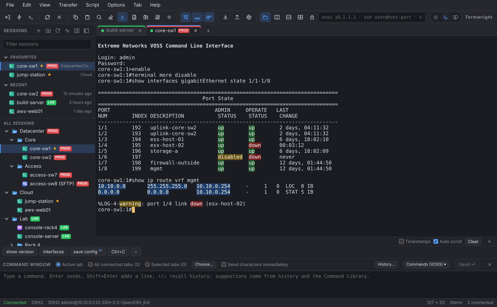

> **New in 0.21:** a **modern layout** (now the default - the classic one is a click away): tabs and search in the title bar, a [start page](#2-the-main-window) with your favourite and recent sessions, a [session side panel](#4-sessions-and-the-session-manager), new device icons and folders coloured by level, and every dialog redone. Also: [device facts](#device-facts) (model, version, MAC, uptime read after connecting - taught in two clicks), a [welcome flow](#first-start-welcome-and-master-password) with an optional **master password** and an **unlock window**, [SFTP](#sftp-browser) with clickable paths, a bookmark bar, check boxes for several files, **New File** and **Delete** on both sides, keyword highlighting on by default, **Save Screen As Image** and a shortcut for nearly every menu command.
>
> **New in 0.11:** [Kerberos (GSSAPI) login](#kerberos-gssapi-login), [SSH certificates and FIDO2 security keys](#ssh-certificates-and-fido2-security-keys), [password managers](#password-managers) (1Password, Bitwarden, HashiCorp Vault, any command), **VBScript** logon scripts, and `crt.Screen.Get` / `CurrentRow` read the rendered screen.
>
> Older changes are in the [changelog](../CHANGELOG.md).

**Contents**

1. [Install](#1-install)
2. [The main window](#2-the-main-window)
3. [Connecting](#3-connecting) - device types, first SSH connection, [SSH keys: generate, install and store](#ssh-keys-generate-install-and-store), [old devices: legacy SSH algorithms](#old-devices-legacy-ssh-algorithms)
4. [Sessions and the Session Manager](#4-sessions-and-the-session-manager) - [device facts](#device-facts), [Wake-on-LAN](#wake-on-lan)
5. [Session Options reference](#5-session-options-reference)
6. [Working in the terminal](#6-working-in-the-terminal)
7. [Command Window, Button Bar and Connect Bar](#7-command-window-button-bar-and-connect-bar)
8. [Logging and capturing output](#8-logging-and-capturing-output)
9. [File transfer](#9-file-transfer)
10. [Automation: logon actions, triggers, scripts](#10-automation-logon-actions-triggers-scripts)
11. [Tunnels, jump hosts and proxies](#11-tunnels-jump-hosts-and-proxies) - [web pages through a session](#web-pages-through-a-session)
12. [Appearance: themes, color schemes, highlighting](#12-appearance-themes-color-schemes-highlighting)
13. [Global Options reference](#13-global-options-reference)
14. [Migrating from SecureCRT, PuTTY or MobaXterm](#14-migrating-from-securecrt-putty-or-mobaxterm)
15. [Keyboard shortcuts](#15-keyboard-shortcuts)
16. [Files and folders Termwright uses](#16-files-and-folders-termwright-uses)
17. [Troubleshooting](#17-troubleshooting)

---

## 1. Install

Download the latest build from the repository's **Releases → nightly** page (or a version tag).

| OS | File | How to install |
|---|---|---|
| macOS (M1–M5) | `Termwright-…-macos-arm64.dmg` or `termwright-macos-arm64.zip` | Open the DMG and drag **Termwright** to **Applications**. The build is not notarized: the first time run `xattr -dr com.apple.quarantine /Applications/Termwright.app` in Terminal (or right-click → Open). |
| Windows 10/11 | `Termwright-…-windows-amd64-setup.exe` or `termwright-windows-amd64.zip` | Run the installer, or unzip and run `termwright.exe`. Needs the WebView2 runtime (built into Windows 11 and current Windows 10). SmartScreen may warn because the file isn't code-signed: **More info → Run anyway**. |
| Debian/Ubuntu | `termwright_…_amd64.deb` / `…_arm64.deb` | `sudo apt install ./termwright_*.deb` |
| Other Linux | `termwright-linux-amd64.tar.gz` / `…-arm64.tar.gz` | Unpack and run `./termwright`. Requires GTK 3 and WebKitGTK 4.1 (`libwebkit2gtk-4.1-0`). |

Optional: install `lrzsz` on the *remote* hosts to use ZMODEM (`sz`/`rz`).

To build from source see the [README](../README.md#build).

### First start: welcome and master password

The first time Termwright starts (and once after updating to a new version; **Help → Welcome…** shows it again) a short welcome flow opens:

1. **Look** - theme (Light, Dark or System), text size and layout (Modern or Classic).
2. **Sessions** - sessions of SecureCRT, PuTTY, SuperPuTTY, MobaXterm and OpenSSH found in their usual places are listed with an **Import** button; export files (SecureCRT `.xml`/`.zip` or Config folder, PuTTY/KiTTY `.reg`, SuperPuTTY `Sessions.xml`, MobaXterm, CSV) are one click away.
3. **Security** - an optional **master password**. Type one (any 4 or more characters; a meter shows how strong it is - capitals, numbers and symbols help but are never required) and confirm it, or press **Skip**. It can be set, changed or removed later in Options → Passwords & Accounts → Master Password.
4. **Done** - a few tips, then *Start Using Termwright* or *Discover Devices*.

| Welcome | Master password (optional) |
|---|---|
| 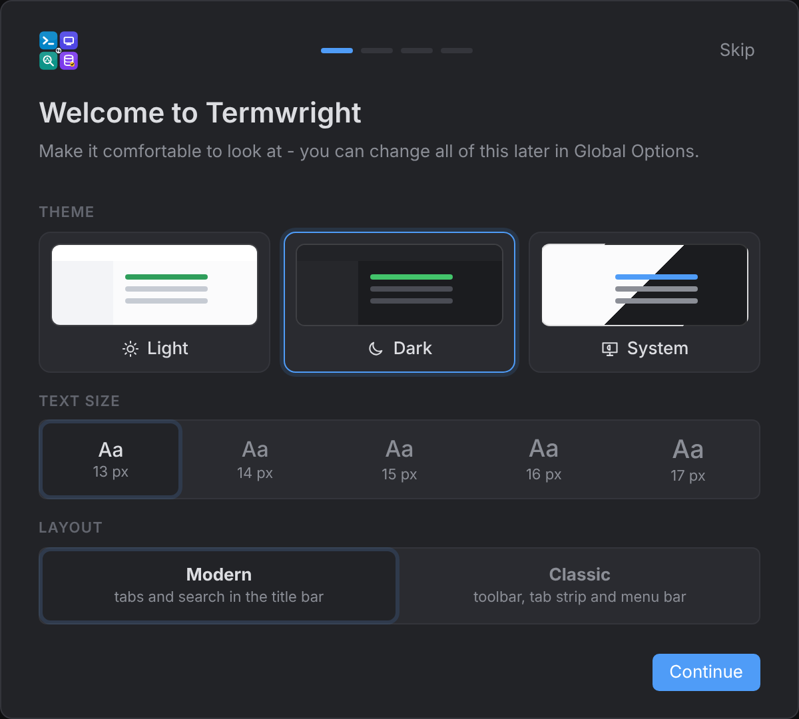 | 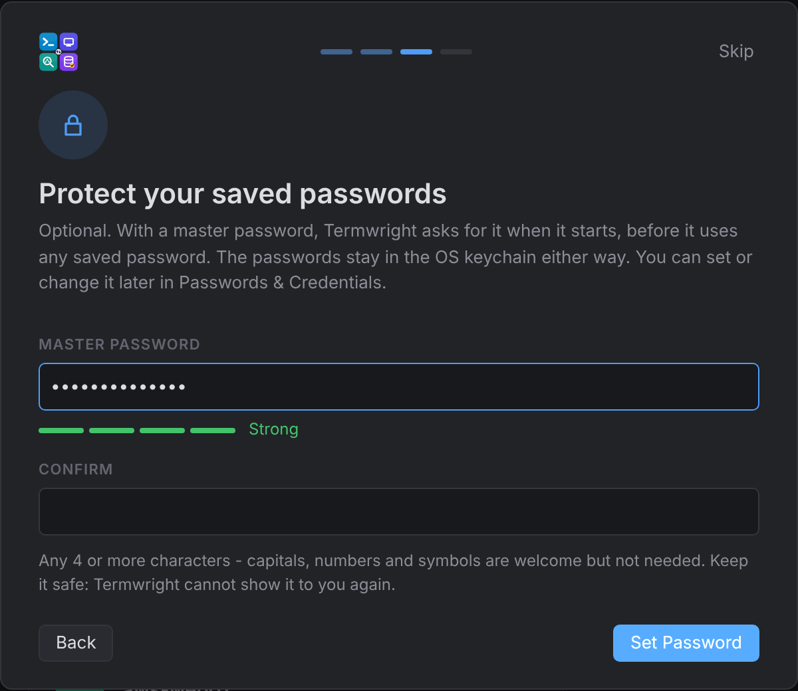 |

With a master password set, Termwright starts with an **unlock window**: type the master password and press **Unlock** to use your saved passwords. **Not now** closes it; saved passwords stay locked and are asked when connecting (unlock later in Passwords & Accounts). The passwords themselves stay in the OS keychain - the master password only lets Termwright use them. **Lock Now** (Passwords & Accounts → Master Password) locks them again and shows the unlock window.

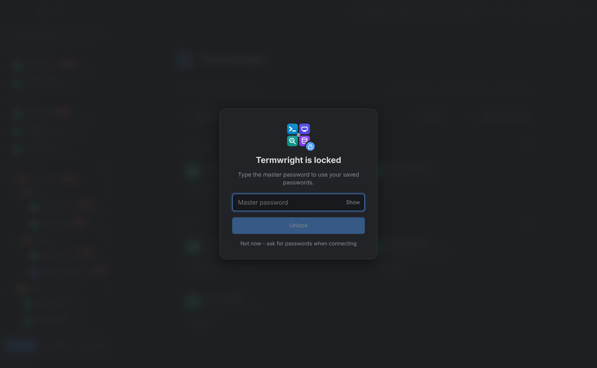

## 2. The main window

Termwright has two layouts: **Modern** (the default) and **Classic** (toolbar, tab strip and menu bar). Switch at any time with **View → Modern / Classic Layout**, the **⋯** menu, Quick Open or Options → Settings → General → Layout; on macOS the window's title bar follows after a restart.

| Area (modern layout) | What it does |
|---|---|
| **Title bar** | The **tabs** (a dot shows the state: green connected, amber connecting, red error, grey disconnected; badges for logging and recording; a running script shows as a pill with Stop), **+** for a new session, the **Sessions** button (a list of every session with its small device icon, grouped by folder with favourites first - type to filter, ↵ connects, Alt+↵ opens SFTP, an address that is no session connects to it), Quick Connect (⚡), SFTP, the layout menu, the theme switch (Light / Dark / System), Settings (⚙) and the **⋯** menu with File, Edit, View, Transfer, Tools and Help. On macOS the tabs share the title bar with the window buttons. Many tabs scroll sideways (mouse wheel or trackpad). |
| **Start page** | Shown when no tab is open: a large search-or-connect box (type `voss 10.1.1.1`, `ssh admin@host`, a session name …), quick actions (Quick Connect, New Session, Local Shell, Import, Discover Devices) and cards for your **Favourites** and **Recent** sessions with their device icon, address, device facts and when you last used them. Click a card to connect; right-click for more; *Clear* empties the list. |
| **Session Manager** (left by default) | Folders and sessions with a filter box. Folders are coloured by level (top level amber, sub-folders purple, deeper blue, production light red), sessions show a **device icon** (switch, router, firewall, access point, server …) - View → Tile / Glyph Icons switches between coloured tiles and plain glyphs. New / Import / Scan buttons at the bottom; the **pulse** button beside the filter shows **which devices answer** (a green or red dot from a quick TCP check of each session's port, every minute) and the **⋯** menu has Clear Recent / Favourites, Compact rows and the side. |
| **Session side panel** | New Session and right-click → Properties… open beside the terminal with the everyday fields and the device facts; *Advanced* and **All session options…** open the full dialog. |
| **Command Window / Button Bar** | View → Command Window / Button Bar (or `Mod+K` / `Mod+B`). |
| **Status bar** | State, protocol · user@host:port, device type and facts (e.g. *VOSS 8.10.0.0 · up 41 days*), transfers, terminal size. |

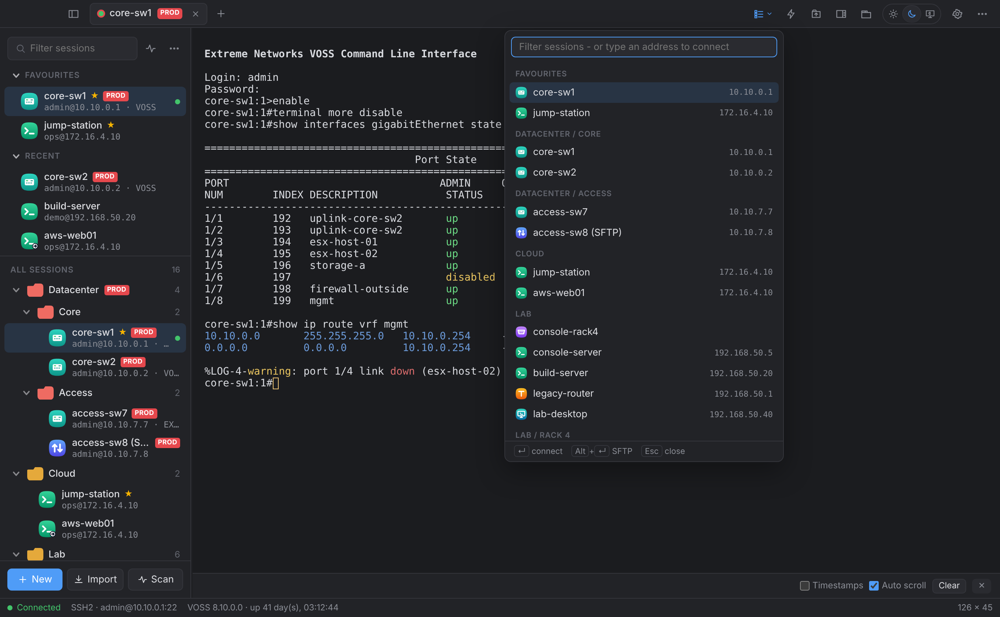

| Start page | Session side panel |
|---|---|
| 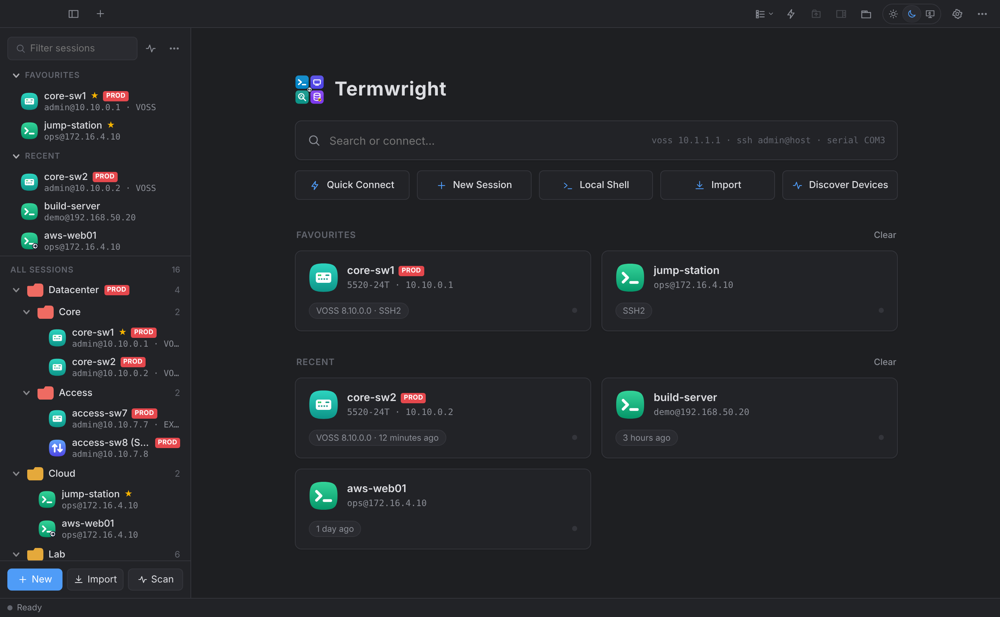 | 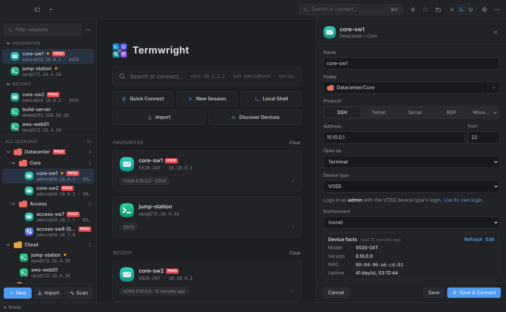 |

In the **classic layout** the menu bar (on macOS also the top-of-screen menu), the toolbar with Connect, Quick Connect, Local Shell, Reconnect, Disconnect, Copy, Paste, Find, Log, SFTP and the layout buttons, the **Connect Bar** and the tab strip are back; everything else works the same.

The Session Manager can move to the **other side** or be **hidden** (View → Session Manager Left / Right, View → Session Manager, `Mod+M`); position, visibility and width are remembered.

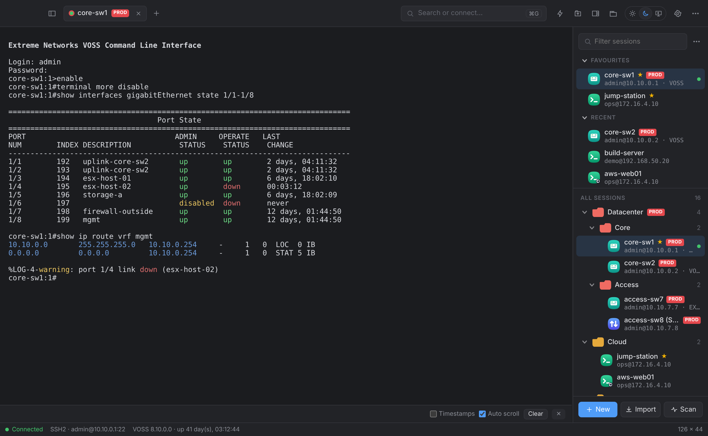

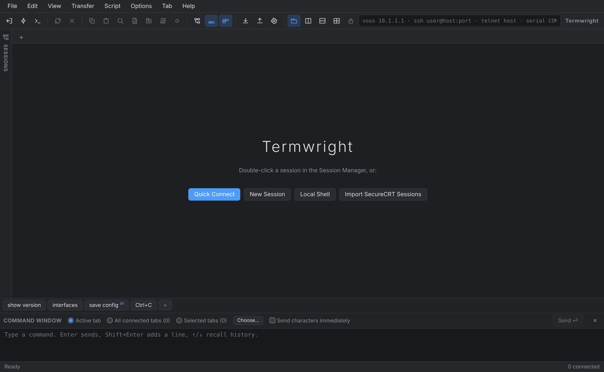

## 3. Connecting

There are several ways to open a connection:

1. **Double-click a saved session** in the Session Manager (or right-click → *Connect Terminal* / *Connect SFTP Session*, or select a folder → right-click → *Connect All in Folder*), or click a card on the start page.
2. **Quick Connect** (⚡ in the title bar, `File → Quick Connect`, `Mod+Q`): type a connect line in the top box - `voss admin@10.20.1.11`, `ssh user@host:2222`, `telnet host 23`, `serial COM3 115200` - and the fields below fill in (protocol, address and port, device type, user name), or fill in the fields yourself. A device type's chip fills the protocol, port and login steps; its username is used unless you type another. Switch on **Save as a session** to keep it in the Session Manager (in the selected folder); the switch remembers your last choice, and Settings → General → *Save Quick Connect sessions* turns it on for every Quick Connect. **More options…** opens the full Session Options.

   | Inherit the device type's login | Override it for this session |
   |---|---|
   | 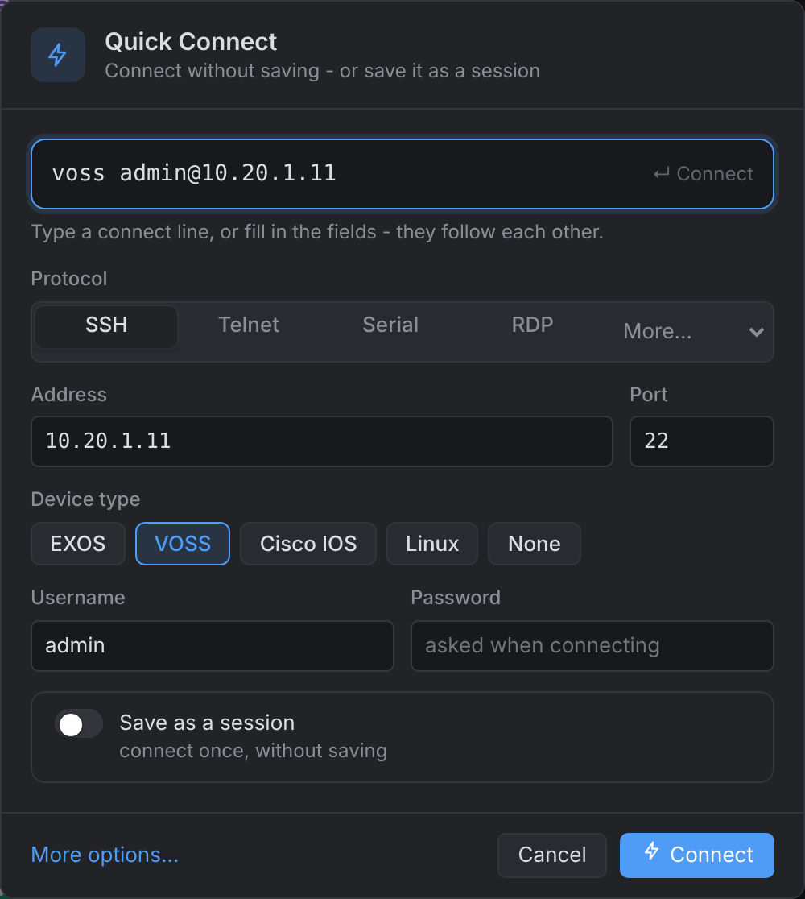 | 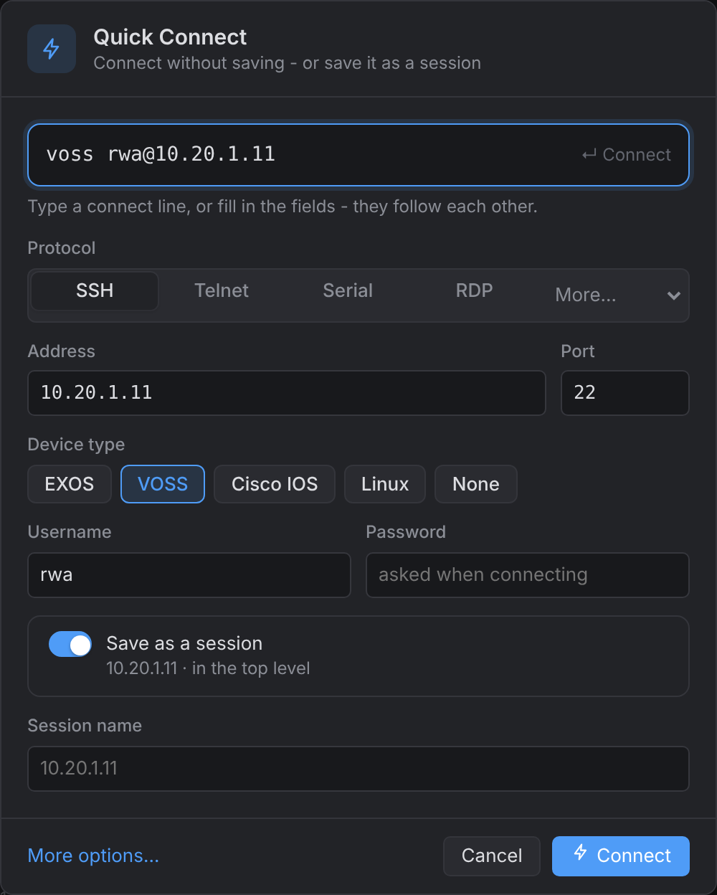 |

3. **Connect Bar** (toolbar text box): type and press Enter
   - `ssh admin@10.1.1.1`, `ssh -p 2222 -l admin core-sw1`, `ssh host:2222`
   - `telnet 10.1.1.20` or `telnet console-server 2003`
   - `serial COM3 115200` or `serial /dev/ttyUSB0 9600`
   - `raw 10.0.0.5 4001`
   - `rdp admin@10.0.0.10` (Remote Desktop) or `vnc 192.168.1.40` / `vnc host:5901`
   - a **device type and an address**: `voss 10.20.1.11`, `exos 10.1.1.5`, `telnet cisco-ios 10.0.0.1 2003`
   - a saved session name or path, e.g. `Lab/lab-sw01`
4. **Local Shell** (toolbar `>_`): your login shell (zsh/bash on macOS/Linux, PowerShell on Windows).
5. **Recent sessions** on the start page.
6. **Quick Open** (`Cmd+G` / `Ctrl+Shift+G`): type part of a session, folder, host, open tab, library command or menu action and press Enter (Alt+Enter opens a session as SFTP).

   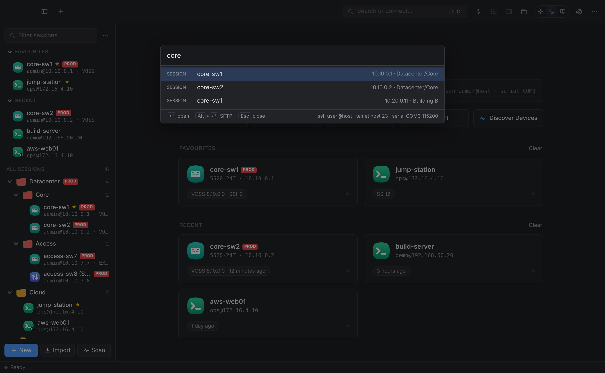
7. **Workspaces** (File → Workspaces…): reopen a saved set of sessions in its layout with one click; File → Save Workspace… saves the current tabs.

### Device types (login profiles)

Devices log in differently: EXOS is ready at `#` after username and password, VOSS starts at `>` and needs `enable`, Cisco IOS wants `enable` and `terminal length 0`. Instead of building logon actions for every session, define a **device type** once in Global Options → **Device Types** and pick it in Quick Connect, the Connect Bar, a session's Connection page or a folder's defaults.

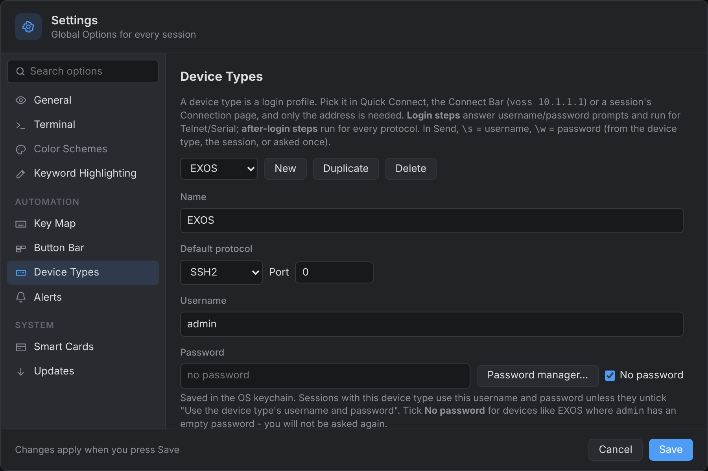

- Built-in: **EXOS**, **VOSS**, **Cisco IOS**, **Linux** - edit them or add your own (*New*, *Duplicate*).
- **Login steps** answer `login:` / `Password:` prompts; they run for Telnet, Serial and Raw (SSH authenticates before the shell starts).
- **After-login steps** run for every protocol, e.g. `>` → `enable`, `#` → `terminal more disable`.
- **Username and Password**: the device type's own login, with the password stored in the OS keychain (never in `settings.json`). Leave the password empty to be asked at connect time - the session's Login box then says *password asked when connecting*, and the password prompt offers **Remember for device type …**: tick it to save what you type, or leave the password empty and tick it to record that the device has none. Tick **No password** for devices whose account has an empty password (e.g. EXOS `admin` out of the box) - Termwright then sends an empty password and never asks. *Forget* removes a saved password.
- Sessions with a device type **inherit** its username and password; the box shows what will happen, e.g. *(admin, no password)*, *(admin, password saved)* or *(admin, password asked when connecting)*. In Session Options → Connection (or Quick Connect) untick **Use the device type's username and password** to give that session its own username and password (or *No password*); the device type's login and after-login steps still run.
- In *Send*, `\s` is the username and `\w` the password: from the device type (or the session's own login when it overrides it), or asked once when needed.
- Optional defaults: protocol, port, initial carriage return and a prompt pattern. Background runs (backups, checklists) also recognise the prompt the device shows after the after-login steps, e.g. `sw:1(config)#` after `config terminal`.
- **Backup commands**: what prints the configuration for [Configuration Backups](#configuration-backups). Built-in: EXOS `show configuration`, VOSS and Cisco IOS `show running-config`; add your own for other device types (one command per line).
- A session's own Logon Actions still run, after the device type's steps.

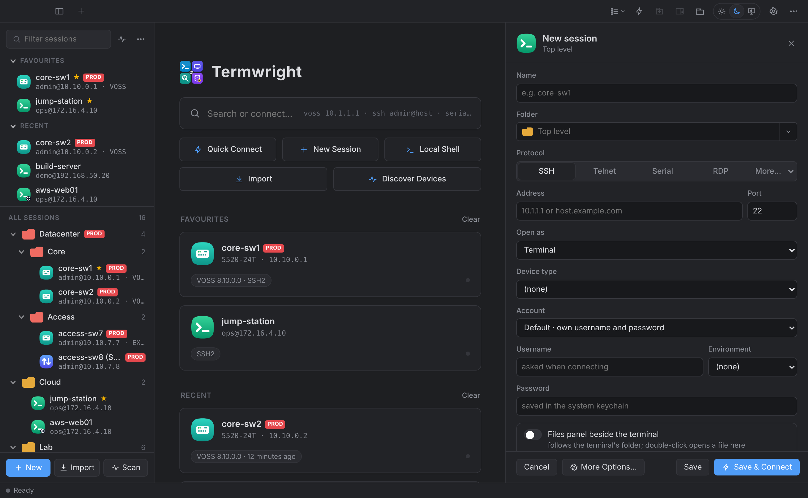

### First SSH connection

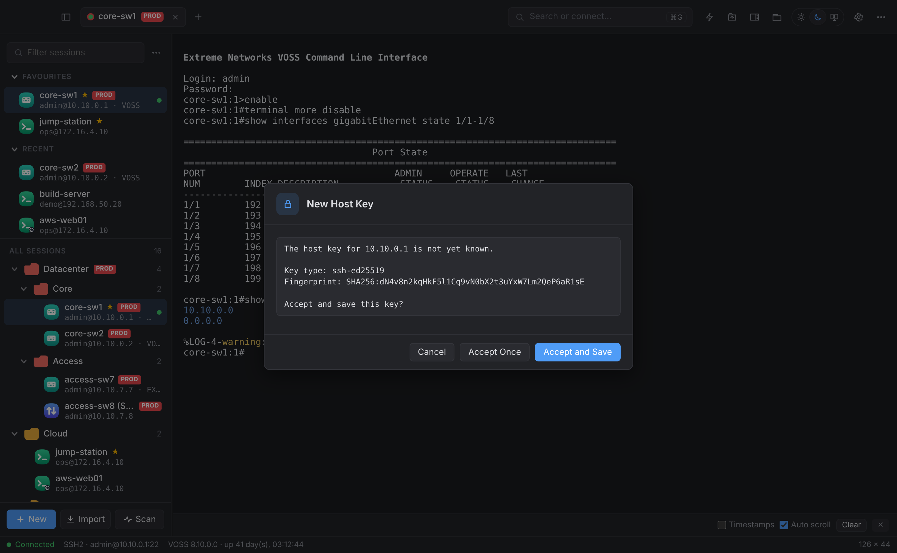

- **New host key**: Termwright shows the key type and SHA256 fingerprint. *Accept & Save* stores it in Termwright's `known_hosts`; *Accept Once* connects without saving. Your `~/.ssh/known_hosts` is also trusted (read-only).
- **Changed host key**: a red warning. Only choose *Replace & Save* if you know the device was re-keyed.
- **Empty passwords**: an account with no password (EXOS `admin`) is remembered too - press Enter at the password prompt with *Remember* ticked, set *No password* on the session, or on its device type.
- **Password**: tick *Save password (OS keychain)* to store it in the macOS Keychain / Windows Credential Manager / Secret Service. Passwords are never written to session files. Remove one with right-click → *Forget Saved Password*.
- **Keys**: Termwright tries the session's identity file, then a running SSH agent (`ssh-agent`, Windows OpenSSH agent), then `~/.ssh/id_ed25519`, `id_ecdsa`, `id_rsa` (unencrypted). The identity file can be an OpenSSH/PEM key or a **PuTTY `.ppk`** key. Encrypted identity files prompt for the passphrase (or use one saved in the keychain).

### Kerberos (GSSAPI) login

For hosts joined to Active Directory / MIT Kerberos (OpenSSH `GSSAPIAuthentication yes`): Session Options → **SSH2 Authentication** → tick **gssapi (Kerberos)** (it is tried first).

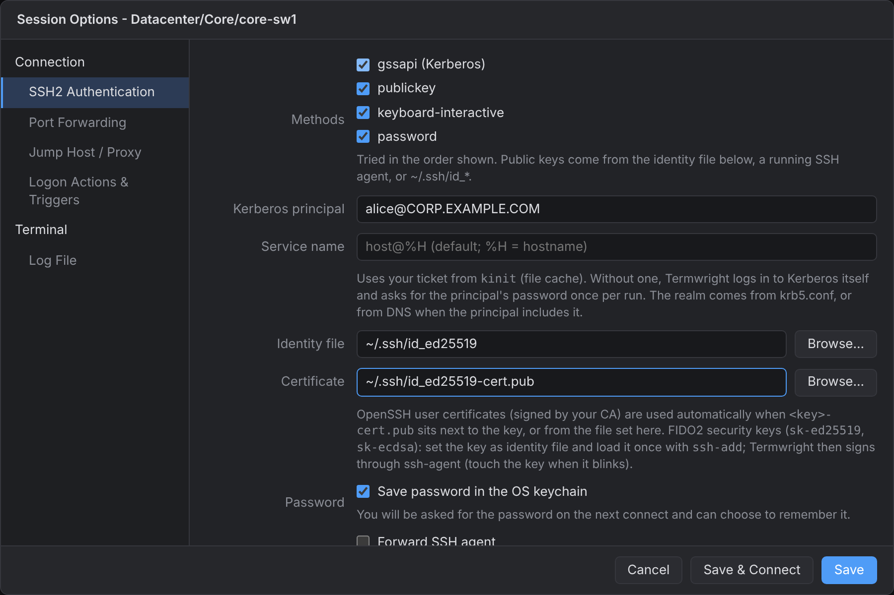

- **With a ticket from `kinit`** (file credential cache, `KRB5CCNAME=FILE:…` or `/tmp/krb5cc_<uid>`), Termwright logs in without asking anything.
- **Without a ticket**, Termwright logs in to Kerberos itself: the **Kerberos principal** (e.g. `alice@CORP.EXAMPLE.COM`; blank = the session's user name) and its password, asked once per run.
- The realm's KDCs come from `krb5.conf` (`KRB5_CONFIG`, `/etc/krb5.conf`, Windows `krb5.ini`), or from DNS SRV records when the principal includes the realm. **Service name** defaults to `host@<hostname>` (`%H` = hostname).
- Mutual authentication is used, as OpenSSH requires. macOS's built-in `API:` / Windows logon tickets are not read directly - run `kinit -c FILE:/tmp/krb5cc_$(id -u)` or let Termwright ask for the password.

### SSH certificates and FIDO2 security keys

- **OpenSSH certificates** (keys signed by your organisation's SSH CA): put `<key>-cert.pub` next to the identity file - Termwright offers the certificate first, then the plain key. A certificate stored elsewhere goes in **Certificate** (SSH2 Authentication page). Certificates loaded in your ssh-agent are used too.
- **FIDO2 / U2F hardware keys** (`sk-ssh-ed25519@openssh.com`, `sk-ecdsa-sha2-nistp256@openssh.com`, e.g. YubiKey): the private key never leaves the device, so Termwright signs through **ssh-agent**. Set the `id_ed25519_sk` file as identity file and load it once with `ssh-add ~/.ssh/id_ed25519_sk` (touch the key / enter its PIN). If it is not loaded, Termwright tells you and offers **Retry** after you ran `ssh-add`. Each login may ask you to touch the key. On macOS use an OpenSSH with security-key support (e.g. Homebrew `openssh`) for `ssh-add`.

### Smart cards: PIV, CAC and PKCS#11 keys

SSH keys on smart cards and tokens - PIV and CAC cards, YubiKey (PIV), SafeNet eToken, HSMs - are used through the card's **PKCS#11 library**. The private key never leaves the card; the card signs after you enter its PIN.

1. Install the card's middleware. For most cards that is **OpenSC** (free; macOS, Windows, Linux); YubiKey also offers `libykcs11`. Termwright finds both in their usual places.
2. **Global Options → Smart Cards**: *Test / Read Cards* lists the cards and their keys. Add other libraries with *Add Library…* (e.g. your organisation's middleware). **Copy Public Key** gives the line for the server's `~/.ssh/authorized_keys` (or for your SSH CA).

   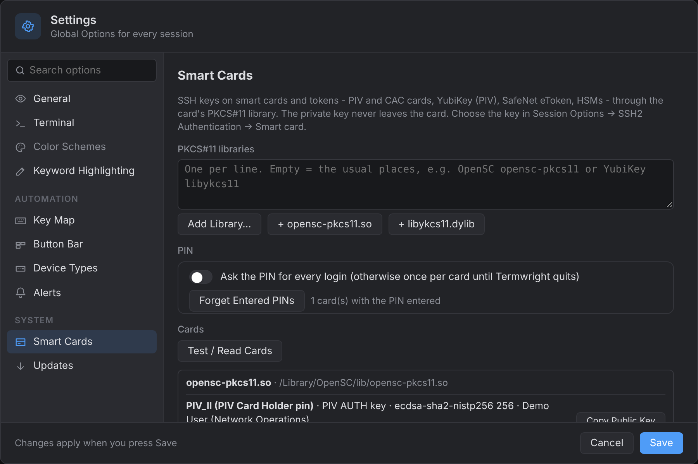
3. **Session Options → SSH2 Authentication → Smart card**: *Any key on the inserted cards*, or one key. Folder Defaults can set it for a whole folder.

   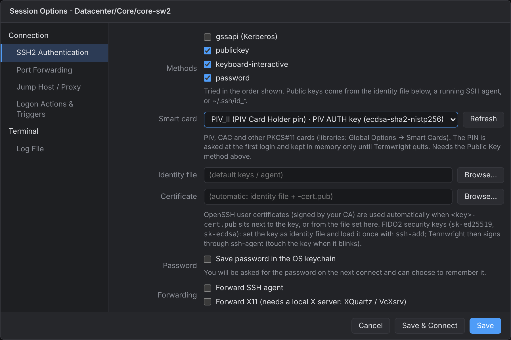

- The **PIN** is asked at the first login - only when the server accepts the card's key - and kept in memory until Termwright quits (never saved). *Ask the PIN for every login* changes that; *Forget Entered PINs* asks again. Keys that need the PIN for every signature (e.g. PIV slot 9c) are handled.
- Works with **OpenSSH certificates** (the session's *Certificate* file is used when it belongs to the card key), **jump hosts** (set the smart card on the jump session too), SFTP, and **agent forwarding**: the card's keys are offered to the server next to your local agent's keys.
- RSA (with `rsa-sha2-256` / `rsa-sha2-512`) and ECDSA P-256 / P-384 / P-521 keys.
- Background runs (backups, checklists, Run and Collect) use the card only once its PIN was entered in a tab; otherwise they fail with *smart card PIN needed*.
- After removing and re-inserting the card the PIN is asked again.

### Old devices: legacy SSH algorithms

A switch or appliance with old firmware may offer only weak algorithms (for example `diffie-hellman-group1-sha1`, `aes128-cbc` or `hmac-sha1`). Termwright does not use them by default, so the connection fails with *ssh: handshake failed … no common algorithm for key exchange*; the error then tells you what to do. In Session Options → **Authentication** → **Algorithms**, tick **Allow legacy algorithms (for old devices)** for that session only.

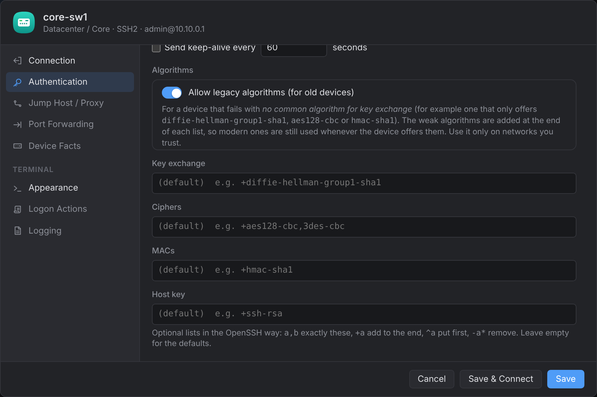

The old algorithms are added at the **end** of each list, so a device that also offers modern ones still gets them. To control the lists yourself, fill in **Key exchange**, **Ciphers**, **MACs** and **Host key** with names separated by commas, in the OpenSSH way:

| Write | Meaning |
|---|---|
| `a,b` | exactly these, in this order |
| `+a,b` | add to the end of the usual list |
| `^a` | put first in the usual list |
| `-a*` | remove (a name can end in `*`, e.g. `-hmac-sha2-512*`) |

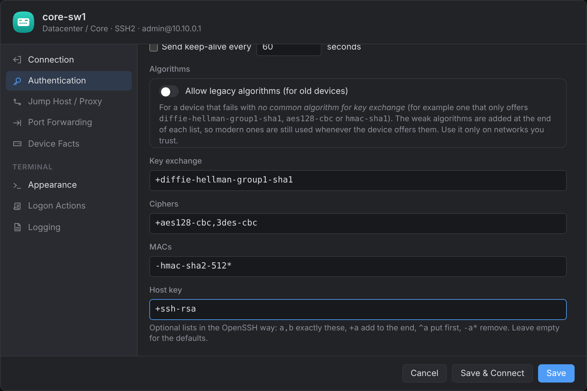

An unknown name is reported by name when you connect. When the host key is already recorded in `known_hosts`, its algorithm is tried first so the saved key still matches. Use these options only on networks you trust: the weak algorithms are weak for a reason.

### SSH keys: generate, install and store

Termwright can create SSH keys, put the public key on a server for you and switch a session from password to key login. Everything is in one dialog:

- **With a connected SSH2 tab** (password login): right-click the tab → **Set Up Key Login…**. The key is generated (or reused) and installed on that server.
- **Without a connection**: **Options → Set Up Key Login / Generate Key…** only creates a key pair, so you can copy the public key to a device yourself.


**1. Generate or choose a key**
- **Generate a new key**: *Ed25519* (recommended), *RSA 4096* (older devices) or *ECDSA P-256*. *Save as* defaults to `~/.ssh/termwright_<host>_<type>`; *Comment* is written into the public key (e.g. `you@laptop`).
- **Use an existing key on this computer**: keys found in `~/.ssh` are listed (OpenSSH/PEM or PuTTY `.ppk`); *Browse…* picks one elsewhere.
- **Passphrase** (optional, asked twice for a new key) encrypts the private key file.

**2. Install, test and use it** (tick what you want under *Then*)
- **Add the public key to the server**: appended to `~/.ssh/authorized_keys` on Linux/macOS/BSD (folder and file permissions fixed). On Windows OpenSSH it goes to `%USERPROFILE%\.ssh\authorized_keys`, or for administrators to `%ProgramData%\ssh\administrators_authorized_keys` with the ACL sshd requires. A key that is already there is not added twice.
- **Test a key-only login**: opens a second connection that may use only that key, so you know it works before relying on it.
- **Use this key for the session from the next connection**: sets the session's identity file (Session Options → SSH2 Authentication) and tries public key first; the password stays as a fallback.

**3. Where things are stored**

| What | Where |
|---|---|
| Private key | the *Save as* file, permissions `600` (owner only) |
| Public key | the same name + `.pub` (shown in the dialog with a *Copy* button) |
| Passphrase | OS keychain, only if you tick *Save the passphrase in the OS keychain*; otherwise asked when connecting |
| Which key a session uses | the session file (*Identity file*), never the key itself |

Saved passphrases are listed in **Options → Passwords & Accounts → Key Passphrases**: see which sessions use each key, *Change…* (the new passphrase is checked against the key file), *Forget*, or *Add…* one for any key file. When Termwright asks for a key's passphrase while connecting, tick *Save passphrase (OS keychain)* to remember it. Passphrases are included in the password-vault export; back up the key files themselves separately.

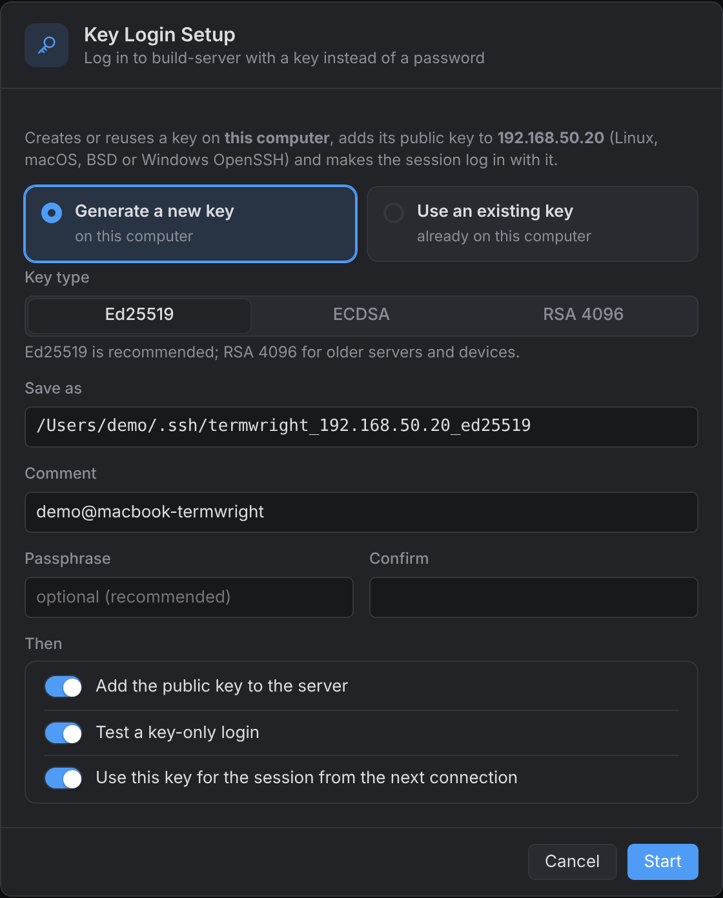

Network devices without a Unix/Windows shell (switches, routers) can't be set up automatically: generate the key, click *Copy* next to the public key and paste it into the device's own command (e.g. `ip ssh pubkey-chain` on Cisco IOS; see the device's SSH user-key commands for EXOS and VOSS).

### Reconnecting

When a connection fails, a box at the top of the terminal explains the error and offers the buttons that fix it: **Reconnect**, **Edit Session**, **Edit Jump Host** (the jump host could not be reached), **Device Type Login** (the login of a device type was refused) or **Forget Saved Password** (a saved password was refused - you are asked for it again). ✕ closes the box.

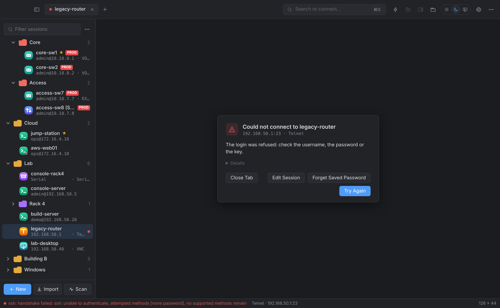

If a "browse as root" in an SFTP tab fails (*not in the sudoers file*, *a terminal is required* …), the message offers *Run As Command…* to switch user another way.

When a connection drops the tab shows `[Disconnected] Press Enter to reconnect`. Press **Enter**, use **Reconnect** (`Cmd/Ctrl+Shift+R`), or enable **Auto reconnect** in the session (retries after 2, 5, 10, 20, 30 s…, up to 20 times; never after you disconnect yourself or after a login failure).

### Remote desktops: RDP and VNC

Choose **RDP** or **VNC** as the protocol of a session (or type `rdp host` / `vnc host` in the Connect Bar). Both work through the session's **jump host or proxy** (Session Options → Jump Host / Proxy), so a Windows server or a lab desktop behind a jump station opens with a double-click like any switch.

**RDP** opens in this computer's Remote Desktop client and the tab shows what was opened:

| | Client | Password |
|---|---|---|
| Windows | Remote Desktop Connection (`mstsc`) | the session's saved password is handed over (for that connection only) |
| macOS | **Windows App** (formerly Microsoft Remote Desktop, free in the Mac App Store) | the client asks; **Copy Password** in the tab puts it on the clipboard for 60 seconds |
| Linux | FreeRDP (`xfreerdp`, `xfreerdp3`, `sdl-freerdp`), otherwise Remmina | given to FreeRDP on its input (never on the command line) |

- Session Options → **Remote Desktop**: Windows **domain**, **full screen** or a window **size** (e.g. `1600x900`).
- Through a jump host or proxy Termwright opens a **local tunnel** (`127.0.0.1:<port>` on this computer) and points the client at it. The tab shows the route and the open connections; keep it open while you work - closing it closes the tunnel. *Open Remote Desktop Again* restarts the client.

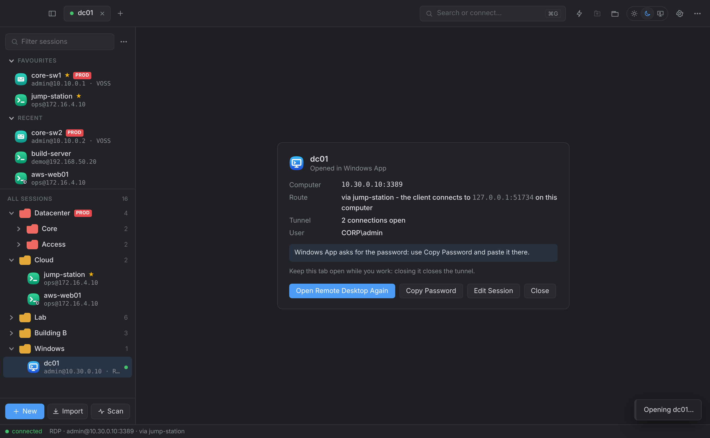

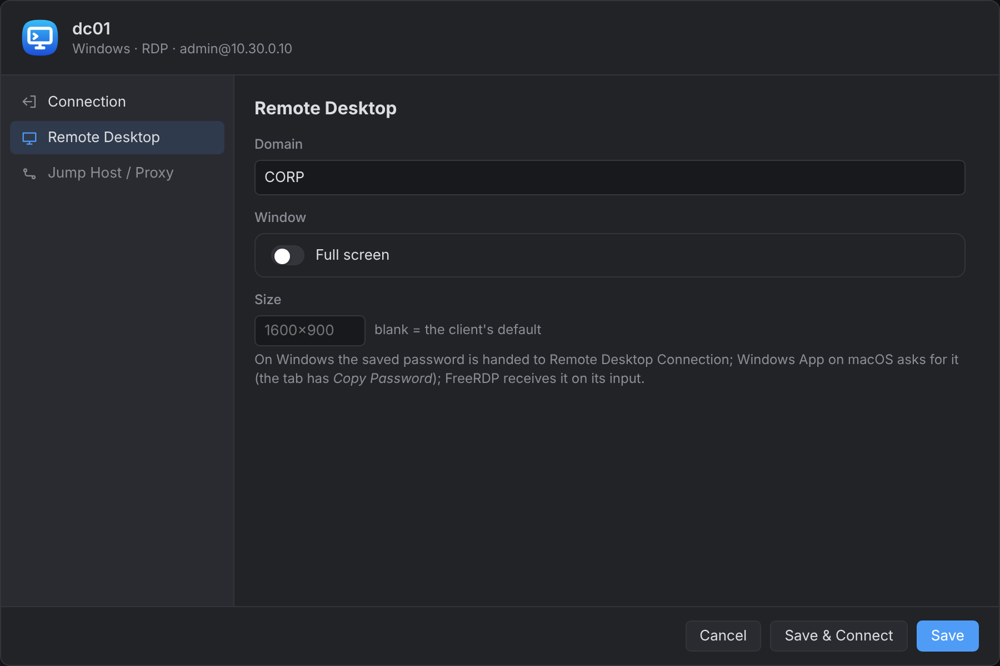

**VNC** opens in Termwright's own viewer tab (noVNC): VNC servers (TightVNC, TigerVNC, RealVNC, x11vnc), Raspberry Pi, Linux desktops and **macOS Screen Sharing** (enter your Mac account's user name and password). The saved password is used, otherwise you are asked. The toolbar has **Ctrl+Alt+Del**, **Send Clipboard** (this computer's clipboard to the remote one; copying on the remote computer comes back automatically), **View Only**, **Fit** (scale the remote screen to the tab) and **Reconnect**. Session Options → VNC → *View only* starts every connection in view-only mode.

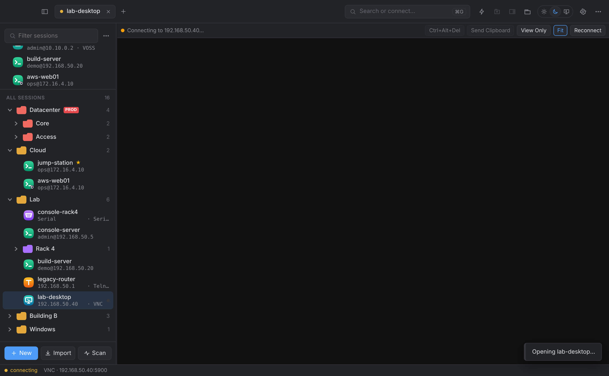

Discover Devices finds computers with RDP (3389) or VNC (5900) open and can add them as RDP or VNC sessions.

### Set up a remote desktop on a Linux machine

Right-click an **SSH2** session → **Set Up Remote Desktop…** (or, in an open SSH tab, right-click the tab or use **Options → Set Up Remote Desktop…**). Termwright installs the XFCE desktop with **xrdp** (RDP, port 3389) and/or **TigerVNC** (VNC, display :2, port 5902) on that machine. It runs a script on the machine **in the background**: nothing is typed in your terminal, and the dialog shows one line of progress (*Show details* has the full output).

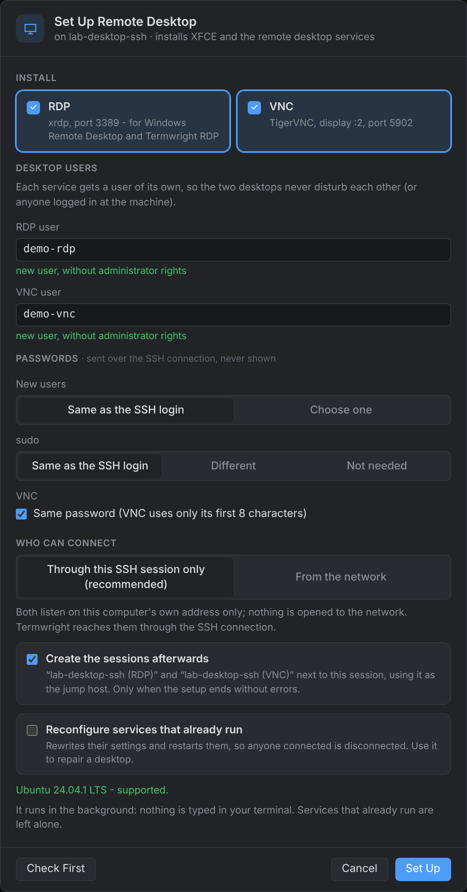

To type the passwords instead, untick the box and open *More options*:

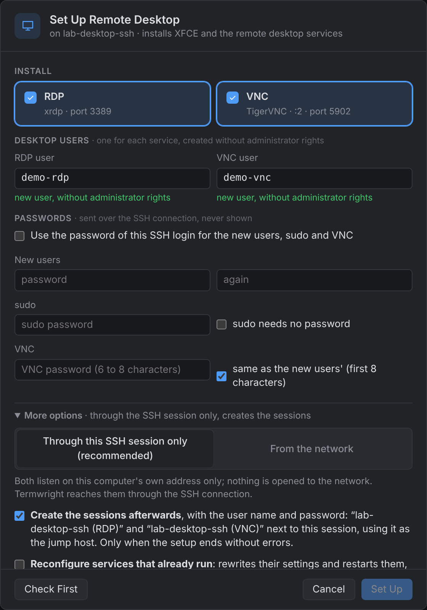

- **Install**: RDP, VNC or both. A service that is **already running is left alone**, so running it again never disconnects anyone.
- **Desktop users**: each service gets a **user of its own**, by default `<your user>-rdp` and `<your user>-vnc`. They are created when they do not exist, without administrator rights; a user that exists is used as it is and its password is not changed. Two users mean the two desktops never disturb each other, and neither disturbs the user who is logged in at the machine's own screen (a remote desktop for that same user often stays black).
- **Passwords**: one box, **Use the password of this SSH login for the new users, sudo and VNC**, is on by default. It works whether the login's password was saved or typed when you connected (a typed one is kept in memory for that tab only). Untick it to type the password of the new users (twice), the sudo password (or *sudo needs no password*) and a separate VNC password. VNC only looks at the **first 8 characters**. The passwords travel on the SSH connection to the script's input, never on a command line, and are never shown or written to a file.
- **Who can connect**, chosen **for RDP and for VNC separately** (under *More options*): *Through this SSH session* (recommended: the service listens on the machine's own address only, nothing is opened to the network, and Termwright reaches it through the SSH connection) or *Directly from the network* (all interfaces; add the network to open in the firewall). VNC is not encrypted and its password has at most 8 characters, so the dialog warns when VNC is opened directly; RDP is encrypted (TLS) either way. The sessions are saved to match: *through the SSH session* = address `127.0.0.1` with the SSH session as jump host (`127.0.0.1` is then **the machine itself**, as seen from the SSH session, not your computer; the Session Manager shows it as `127.0.0.1 (on name)`), *directly* = the machine's real address and no jump host.
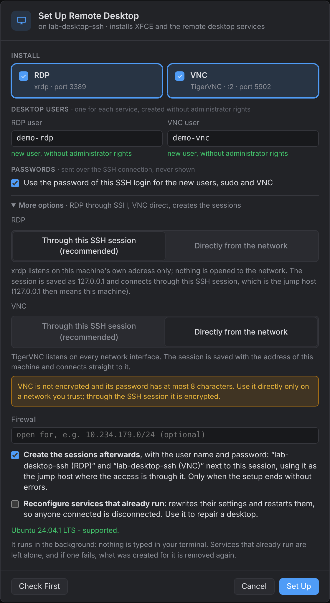

- **Create the sessions afterwards** (under *More options*, together with *Who can connect* and *Reconfigure*): when the setup ends **without errors**, Termwright makes `name (RDP)` and `name (VNC)` next to the SSH session (ports 3389 / 5902; address as chosen in *Who can connect*) with the **user name and the password** of the user it created, the password in the OS keychain like any saved password. For a user that already existed nothing is stored, because its password is not known to Termwright. The same holds for a VNC service that already ran and was not reconfigured (its password was not changed); the dialog says which session has no saved password. The first time you open it, the login asks for the password, and after it works a toast offers **Save Password**. The dialog and a toast have **Open RDP** and **Open VNC** buttons.
- **Check First** only reports what is running and which users would be created; it changes nothing.
- **Reconfigure services that already run** rewrites their settings and restarts them, so anyone connected is disconnected. Use it to repair a desktop.
- **If it fails, it cleans up after itself.** What the setup created for a service that did not come up (its new user, files, service and firewall rule) is removed again, and only for that service: when VNC works and RDP fails, RDP is removed and VNC stays, with a note and only the working session created. Users that already existed and installed packages are never removed. **Copy log** (next to *Show details*) puts the error and the whole output, passwords masked, on the clipboard.
- **Hide** lets the setup go on while you work; you are told when it ends. **Cancel setup** stops it.
- Supported: **Ubuntu 22.04**, **Ubuntu 24.04** and **Debian 12**. The dialog shows the machine's version, and the script stops before changing anything on other systems. Ubuntu 22.04 uses the older polkit rule format automatically. Debian needs `sudo` installed for the login (or log in as root). More systems (the RHEL family) are planned. The script is in `scripts/remote-desktop/` of the source.

Wrong sudo password? The dialog says *The sudo password was not accepted*; **Back** returns to the form.

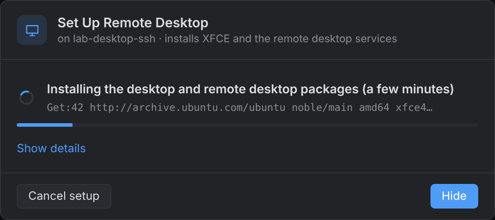

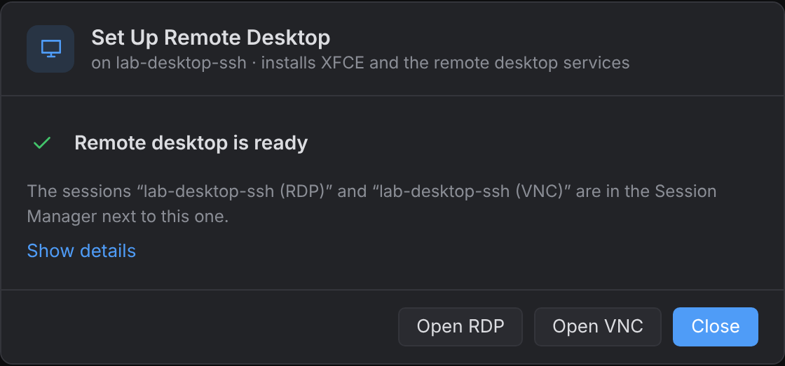

A user who is logged in at the machine's own screen is flagged before you start:

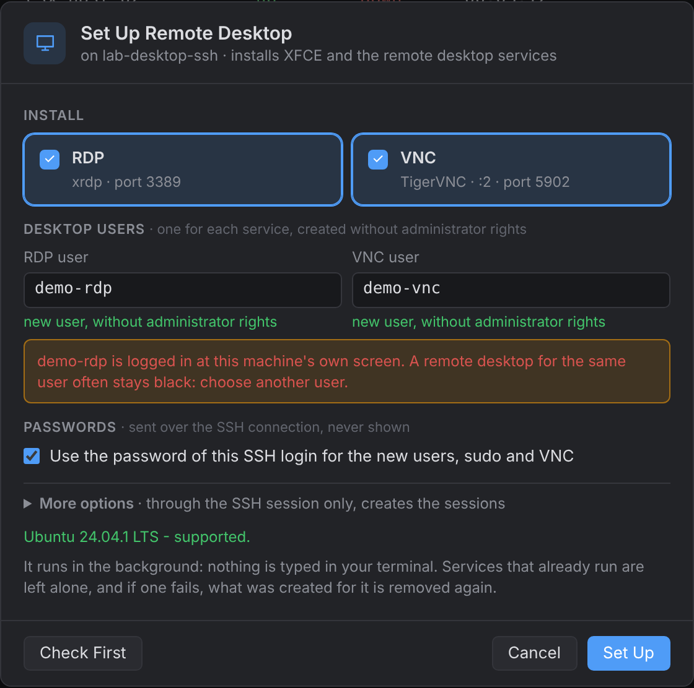

**When a desktop does not connect: Diagnose.** Right-click an **RDP** or **VNC** session (*Diagnose (why it does not connect)…*) or its **SSH** session (*Diagnose Remote Desktop…*). One click runs it, and the dialog **names the problem in a line or two** - red for what is wrong, with what to do about it - or says *No problem found* in green:

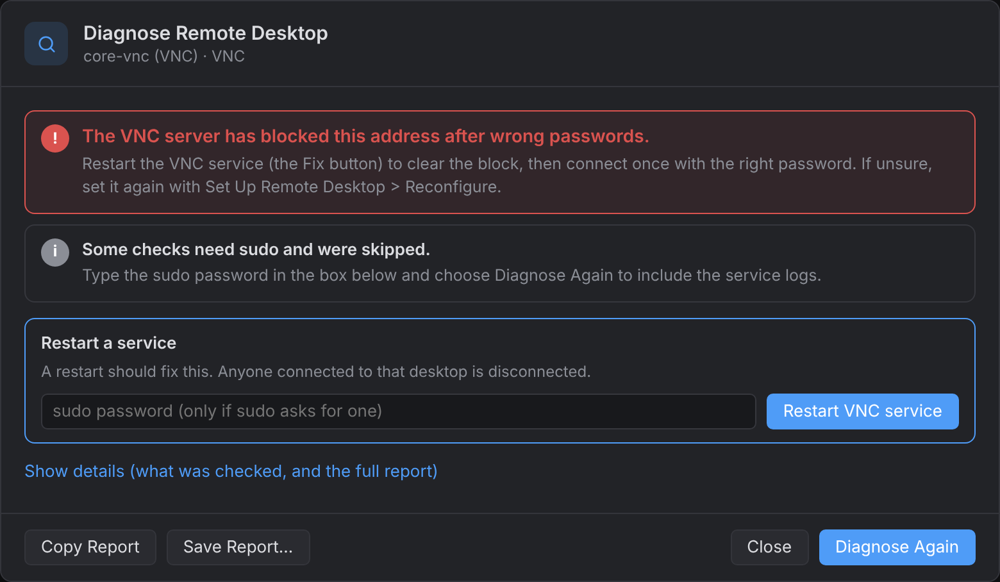

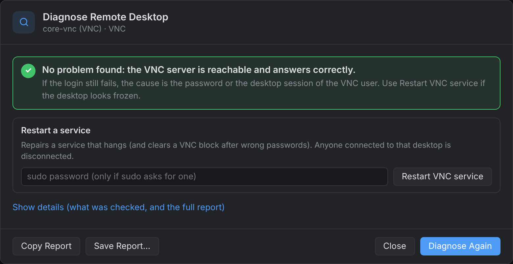

What it checks:

- the connection **from this computer**, through the jump host just as when the session is opened, with the first bytes of the handshake: for VNC what the server says (`RFB 003.008`) and which security types it offers (and whether Termwright's viewer can use them); for RDP whether the service confirms the connection and which security it chose (TLS, NLA…). A server that answers `RFB 003.003` with *Too many security failures* has blocked the address after wrong passwords (through the SSH session every login comes from 127.0.0.1, so it blocks all of them);
- **on the machine**, over the SSH session, that service only (an SSH session checks both): whether the port listens and the service runs, the service status and journal, `xrdp.log`, the VNC server log (TigerVNC 1.13+ keeps them in `~/.local/state/tigervnc`; failed logins show up there), the desktop user (exists, home folder, locked), the `sshd` forwarding settings (`AllowTcpForwarding no` is named), the listening ports and the firewall.

**Show details** opens the green and red list of everything that was checked, and under it the full report, to **copy** or **save** as a text file for someone else:

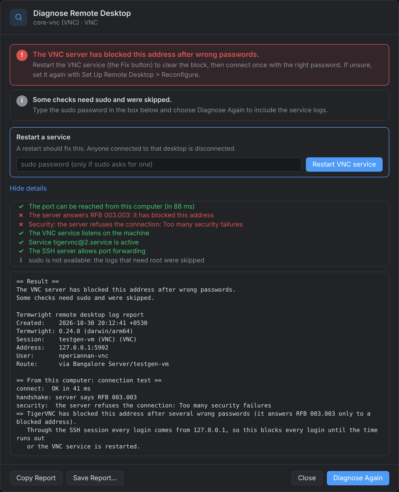

Some checks (the service journal, the VNC and RDP logs) need `sudo`: the result then says so, and you type the sudo password in the box and choose *Diagnose Again* (it is sent to the command and never shown or stored). **Nothing is changed on the machine and no password is in the report.**

**Restart a service.** The box under the result has **Restart VNC service** / **Restart RDP service** (an SSH session offers both); it is highlighted when the diagnosis says a restart should fix the problem. It asks first, because anyone connected to that desktop is disconnected, then restarts `tigervnc@<display>` or `xrdp` (with `xrdp-sesman`) on the machine over the SSH session and **diagnoses again** so you see the result. For a blocked VNC address the restart clears the block; set the password again before connecting (*Reconfigure services that already run* in Set Up Remote Desktop, or `sudo -u <vnc user> vncpasswd` on the machine), so it does not return.

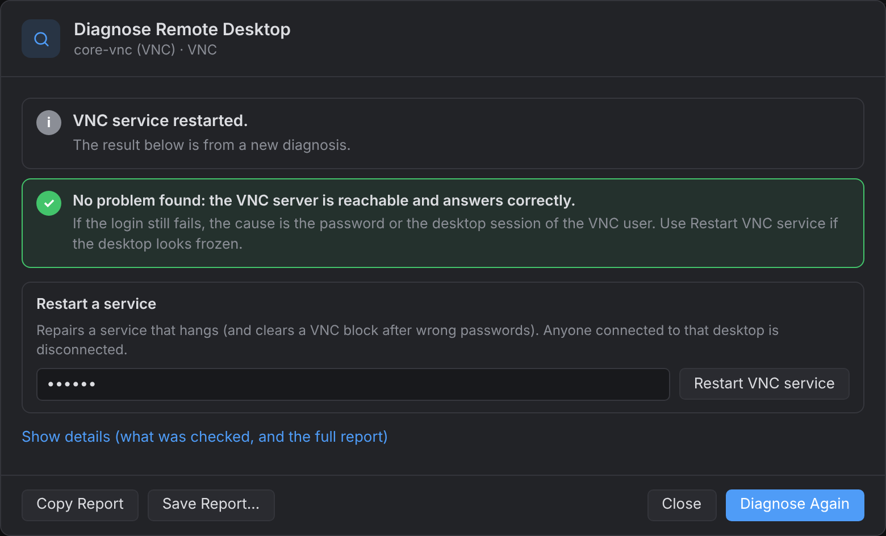

**One desktop at a time.** RDP and VNC to the same machine **as the same user** are two views of one desktop and one set of settings, so Termwright does not let both stay open (sessions made by *Set Up Remote Desktop* use two different users, so they never meet this):

- Opening RDP while a VNC tab to the same machine is open (or the other way round) asks *"VNC is already open … Shall I close it and open RDP?"*. **Yes** closes that tab and opens the new one; **Cancel** opens nothing.

  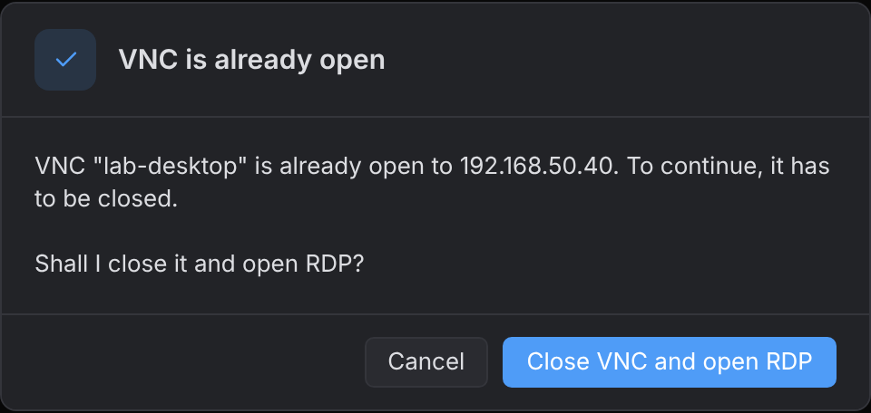
- When **someone else** is connected to the machine's RDP or VNC (Termwright asks the machine over the SSH session), it says so and asks whether to open anyway. It never closes other people's sessions.

  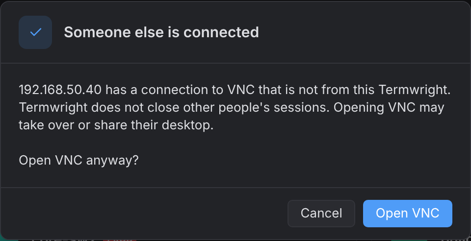


### Console servers

Devices cabled to a console server (terminal server) get a session of protocol **Console**: Termwright connects to the console server's port for the device and then logs in to the device itself, so the console of a switch in another building opens with a double-click.

1. Make a normal **SSH2** or **Telnet** session for the console server (address, username, key or saved password, jump host if needed).
2. Right-click it → **Console Server Ports…**: choose how the console server gives access to a port, the ports (`1-16`, `20, 24`, or one `port name` per line, e.g. `5 rack4-dist1`), how sessions are named, the folder and the **device type** of the devices. The preview shows each session and the command it corresponds to; sessions that already exist are skipped.

   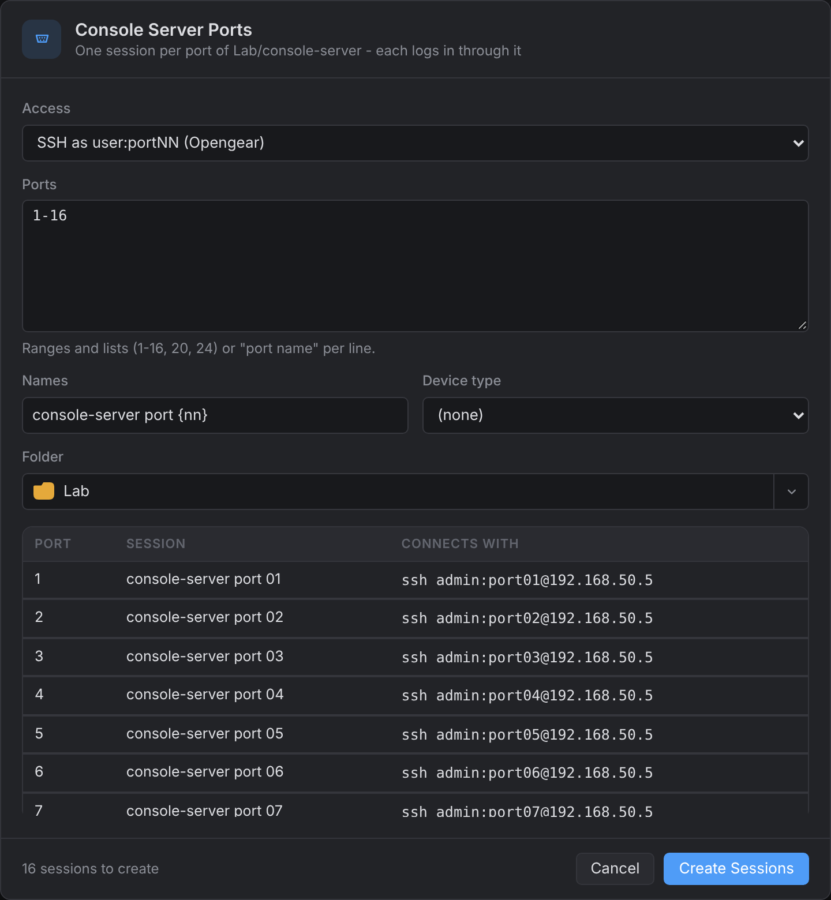
3. Or make one by hand: Session Options → Protocol **Console**, then the console server's session, the **port** and the **access**:

| Access | Connects with |
|---|---|
| SSH as user:portNN | `ssh admin:port05@console` (Opengear and similar) |
| SSH as user:ttySN | `ssh admin:ttyS5@console` (Avocent ACS and similar) |
| SSH to port 3000 + N | `ssh -p 3005 admin@console` |
| Telnet to port 2000 + N | `telnet console 2005` (Lantronix, Cisco and others) |
| Telnet to port 7000 + N | `telnet console 7005` (Avocent, Cyclades) |
| Custom | SSH2 or Telnet, any base TCP port, any user pattern (`{user}`, `{port}`, `{nn}`) |

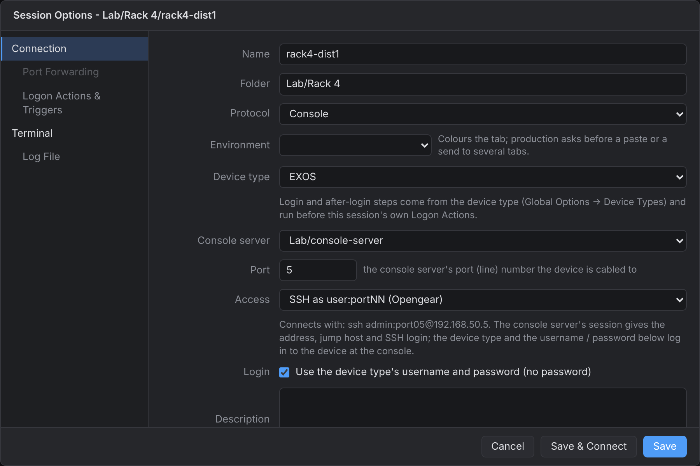

- The **console server's session** gives the address, the jump host or proxy and the SSH login (its key or saved password); change it once and every port follows.
- The **device type** (or the session's own username / password) logs in to the device at the console - over SSH too - and Enter is sent after connecting to wake the console line up.
- Console sessions can be backed up, used in change checklists and in Run and Collect like any other device. With the Session Manager's *Show which devices answer*, they are not checked (the console server is).

## 4. Sessions and the Session Manager

- **New session**: **+** after the tabs, *New* at the bottom of the Session Manager, `Mod+N`, or right-click a folder → *New Session* (goes into the selected folder). It opens in the **session side panel** with the everyday fields; **All session options…** opens the full dialog.
- **New folder**: folder-plus icon or right-click → *New Folder*. Folders can be nested.
- **Edit**: right-click → *Properties…* (or *Options → Session Options* for the active tab).
- **Duplicate / Rename / Delete**: right-click a session. Deleting a folder deletes the sessions inside it (you are asked first).
- **Move**: drag a session or folder onto another folder (or onto a session to drop into its folder; onto empty space for the top level). Termwright asks first - *Move "core-sw2" from "Datacenter/Core" to "Cloud"?* - so a slip of the mouse does not move anything; Settings → General → *Confirm before moving sessions* turns the question off.
- **Copy, Cut and Paste**: right-click a session, folder or selection → **Copy** (`Cmd/Ctrl+C`) or **Cut** (`Cmd/Ctrl+X`), then right-click a folder → **Paste** (`Cmd/Ctrl+V`; on a session it pastes into that session's folder; the ⋯ menu pastes at the top level). Paste after Cut moves; after Copy it makes copies - a folder with all its sub-folders and sessions - keeping the names when they are free there (otherwise *name (2)*). Saved passwords are copied with the sessions.
- **Undo** (⋯ menu → *Undo: …*, `Cmd/Ctrl+Z` in the Session Manager, or *Undo* on the notice after the change): undoes the last move, paste or delete - up to **three** steps back. It first says exactly what will happen, e.g. *Session "core-sw2" will be moved from "Cloud" back to "Datacenter/Core"*, *Session "core-sw2 (2)" in "Lab" will be deleted* or *Folder "Lab" will be re-created with its 6 sessions* (passwords of deleted sessions are asked again when connecting).

  | Paste on a folder | Confirm a move | Undo says what it does |
  |---|---|---|
  | 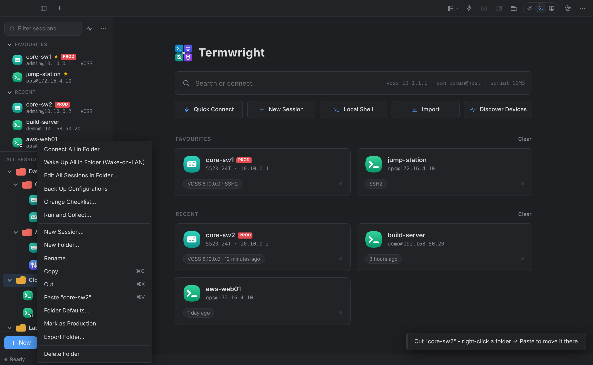 | 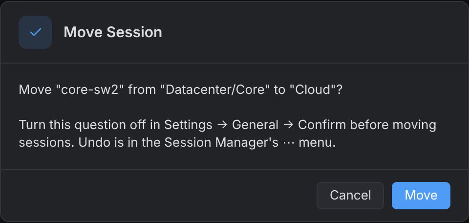 | 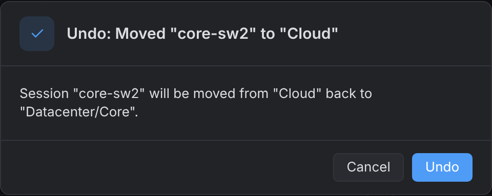 |
- **Filter**: type in *Filter sessions* to search names, hosts, users and paths. When a host, address or name equals what you typed (e.g. `10.127.34.2`), only that session is listed; *N more sessions containing …* shows the partial matches too.
- **Favourites and Recent**: right-click a session → *Add to Favourites*; favourites (★) and the five most recent sessions are listed at the top of the Session Manager, with when you last connected. Click *Favourites* or *Recent* to fold a section.
- **Hover card**: rest the pointer on a session for a moment to see its device icon, name, environment and address, then *Via* (jump host or target), device type, the device facts (model, version, uptime …), MAC address, where the login comes from (saved password, asked, or the device type's login) and the port check, when you last connected and the description.
- **Aligned rows**: the address column is wide enough for any IPv4 address, so the device types line up under each other.
- **Select several sessions**: `Cmd`-click (macOS) or `Ctrl`-click adds or removes one, `Shift`-click selects a range. Right-click the selection to **Connect**, **Edit**, add to Favourites or **Delete** them all; drag them onto a folder to move them together.
- **Jump hosts in use**: a session that is the jump host of other sessions (SSH, RDP or VNC) is known to them by its path. When you **move or rename** it (drag, cut and paste, *Rename*, *Edit Sessions*, Session Options), Termwright lists the sessions - and the folders whose default jump host it is - that use it and asks whether to **update** them to the new location; Undo of the move updates them back. When you **delete** it, it lists them and asks whether to **delete them too** (for example the RDP and VNC sessions of a machine reached through that SSH session) or only the jump host. These questions are always asked, also when *Confirm before moving sessions* is turned off.
- **Edit Sessions** (right-click a selection → *Edit N Sessions…*, or a folder → *Edit All Sessions in Folder…*): tick what to change - folder, device type, username, password (or *No password*), protocol, port, jump host, environment, color scheme, keyword set, auto reconnect - and click *Apply*. Everything else stays as it is in each session. Handy after Discover Devices added many switches.

  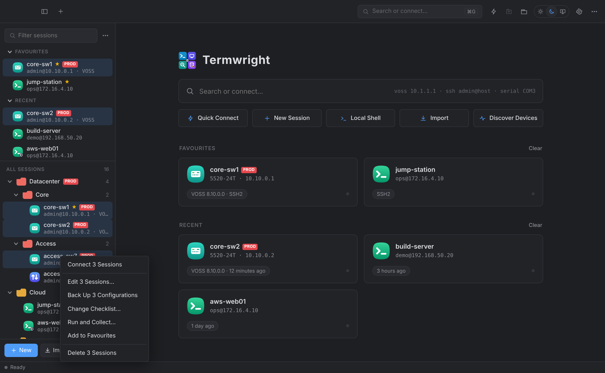

  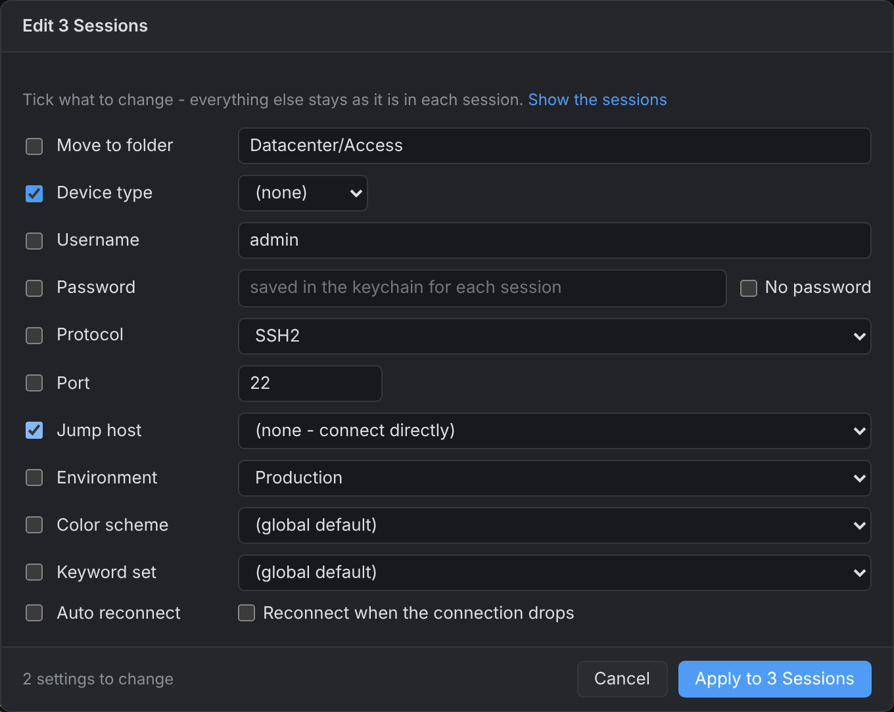
- **Environments**: mark a session (Session Options → Connection → *Environment*) or a whole folder (Folder Defaults) as **Production**, Staging, Test / Lab or Development. A coloured tag shows in the Session Manager and a coloured line on the tab. **Production** sessions ask before a multi-line paste and before the Command Window, Button Bar or Command Library sends to several tabs including them (once a minute for the same tabs).
- **Which devices answer**: the pulse button in the header checks every minute whether each session's host answers on its port (a TCP connection that is closed at once - nothing is sent). Green = answers, red = no answer, grey = not checked (serial, local shell, or through a jump host or proxy).

  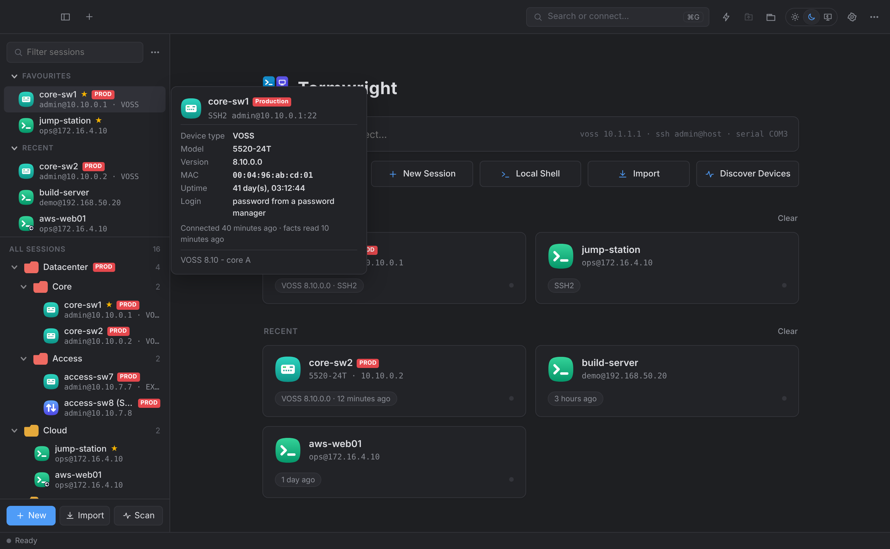
- **Icons** tell the session type at a glance:

  | Icon | Session |
  |---|---|
  |  green `›_` | SSH2 terminal |
  |  blue `⇅` | SSH2 session that opens as an SFTP file browser |
  |  orange `T` | Telnet (not encrypted) |
  |  purple connector | Serial console |
  |  slate `$` | Local shell |
  |  pink `<>` | Raw TCP |
  | small arrow badge | reached through a jump station (remote command `ssh … host`) |
- **Folder colours and production folders**: folders are coloured by level (top level amber, sub-folders purple, deeper ones blue). Right-click a folder → **Mark as Production** colours it light red and sets the *Production* environment for every session in it (Folder Defaults); *Unmark Production* undoes it.
- **Compact Session Manager** (Global Options → General, or ⋯ → *Compact Session Manager*): one line per session instead of two, for long lists; folders keep their colours and counts, a little smaller. With compact rows the Session Manager's header has a **two-line rows** button that turns them back off, next to the pulse (which devices answer) and ⋯ buttons. View → *Tile / Glyph Icons* chooses coloured tiles or plain device symbols.
- **Session side panel** (New Session, or right-click → *Properties…*): the everyday fields - name, folder, protocol, address and port, open as terminal or SFTP, device type, username, environment and password - plus two switches for SSH sessions, **Files panel beside the terminal** and **Reconnect automatically**, a **More Options…** button that opens every page of the session, the session's device facts (*Refresh* reads them now, *Edit* opens the Device Facts page) and an *Advanced* list (jump host, port forwarding, logon actions, terminal and appearance, logging, MAC address, keys) that opens the full Session Options at that page. *Save* keeps it, *Save & Connect* connects too, Esc closes the panel.
- **Default session**: a session file named `Default` at the top level (e.g. an imported one) is used as the template for new sessions.
- **Create SFTP Session / Create SSH Session**: right-click an SSH2 session (Session Manager, start page card or tab) to save a copy that opens the SFTP browser - or, for an SFTP session, a terminal - with the same address, login and saved password.
- **Clear Recent / Clear Favourites**: right-click the Recent or Favourites heading, the Session Manager's ⋯ menu, or *Clear* on the start page; right-click a recent session → *Remove from Recent*.

### Device facts

Termwright reads a device's **model, OS version, serial number, MAC address and uptime** (and any value you add) after connecting, in a **background login** - nothing is typed in your tab. Version and uptime are read at every connect, the others once. They show when you hover over a tab, in the status bar (*VOSS 8.10.0.0 · up 41 days*), on the start page cards, in the Session Manager hover card, in the session side panel and in the HTML scrollback report. A MAC address found is saved with the session, so *Find by MAC Address* works. VOSS, EXOS, Cisco IOS and Linux come with the rules; right-click a session → **Refresh Device Facts** reads them now.

**Session Options → Device Facts** lists every fact - its value for this session, the command it comes from and whether it is read at every connect or once - with:

- **Edit** (✎): name, the value for this session, the command, *Every connect* / *Once* and the pattern (a regular expression whose first `( )` group is the value). Name, command and pattern belong to the device type (all its sessions); the value only to this session.
- **Remove** (🗑): stops reading the fact for the device type and removes the value saved for this session.
- **Add by Hand…**: a value without a command, e.g. the rack location.
- **Read Now**: reads all facts again.
- **Teach a new fact**: type a command (e.g. `show sys-info`) and press **Run** - it runs in a background login - then select the value in the output with the mouse and press **Save Selection as Fact…**. Termwright works out the pattern from the output, shows what it finds, and saves it with the device type.

You can also teach from the terminal: select the value in a tab, then **Edit → Save Selection as Device Fact…** (`Cmd+Shift+6` / `Alt+Shift+6`) - or Shift+right-click (right-click pastes by default) → *Save Selection as Device Fact…*. The session side panel's *Device facts* box has **Refresh** and **Edit** (opens this page).

| Device facts | Teach a fact from the output |
|---|---|
| 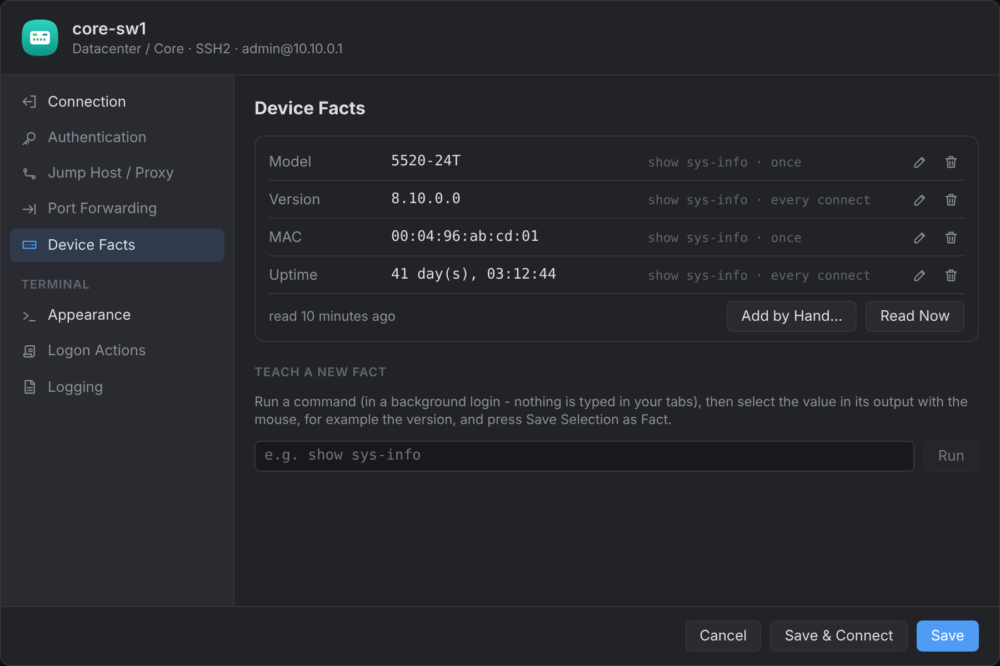 | 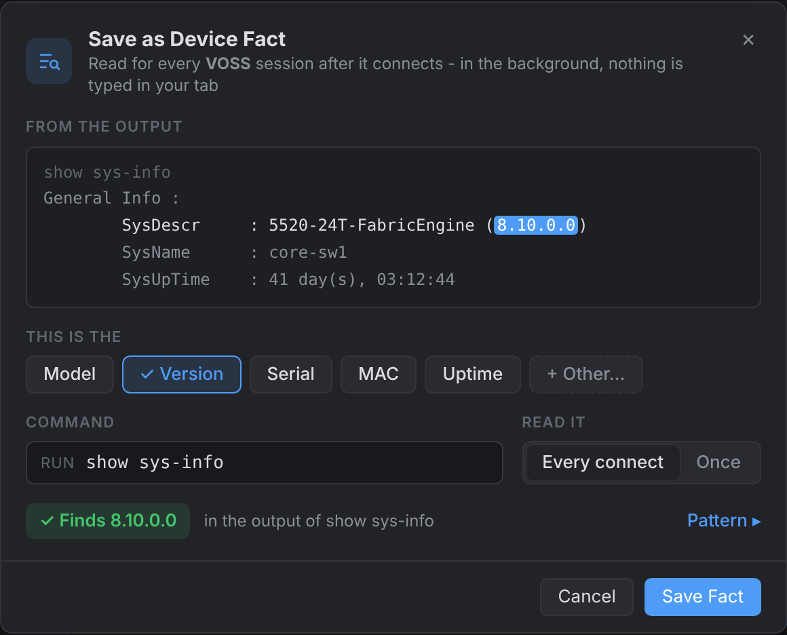 |

### Discover devices

**File → Discover Devices…** (also in the command palette) finds the devices in a network, tells what each one is, and adds the ones you pick as sessions. It **never tries to log in**.

**Wake-on-LAN sessions**: a device that answered no login port but has a MAC address can still be ticked - it is saved as a Wake-on-LAN session (see Wake-on-LAN below) with its address and MAC address. These are not ticked automatically.

**Copying from the results**: right-click a device → *Copy IP Address*, *Copy MAC Address*, *Copy Vendor / System Info* (with everything it is based on) or *Copy All Details*; or select any text in the table and press Cmd/Ctrl+C.

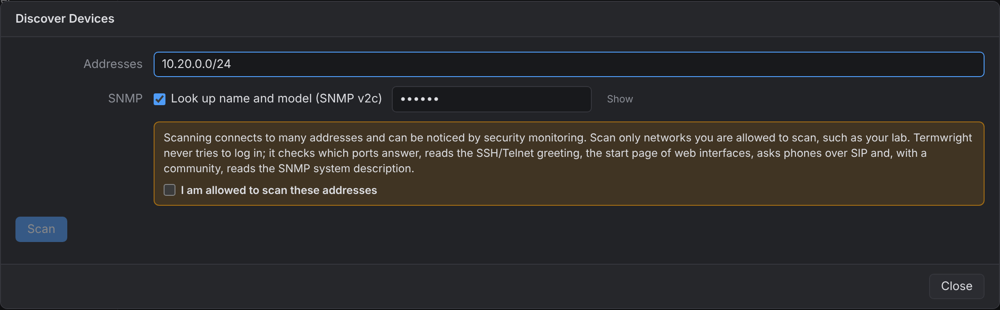

1. **Addresses**: the page opens with **Networks of this computer** - every network this computer has an address on (wired, Wi-Fi, VPN), one row each with the interface, its address, the network and how many addresses a scan covers. Click a row to fill the box (a network larger than a /22 gives the /24 around this computer; a VPN row is marked because the networks behind a VPN are not known here - type them yourself). *Refresh* reads them again after connecting a VPN. Or type your own: a network (`10.20.0.0/24`, or just `10.20.0.0` for its /24), a range (`10.20.0.10-80` or `10.20.0.10-10.20.1.20`) or single addresses, separated by commas or spaces, then **Scan** next to it (or Enter). Up to 1,024 addresses (a /22) per scan.
2. **SNMP** (on by default): a read-only SNMP v2c community (`public` is filled in). **Show / Hide** next to it reveals what you typed. The community is used for this scan only and is not saved. Devices that answer report their system name, model and software - the most reliable information. If *no* device answers, a note says so: check the community, that SNMP is enabled, and that the devices' SNMP access list allows your computer.
3. **Scan**. For every address Termwright collects, in parallel:
   - **Open ports**: SSH (22), Telnet (23), HTTP (80), HTTPS (443), SMB (445), RDP (3389), printing (9100, 631), SIP (5060).
   - **SSH greeting** (e.g. `OpenSSH_8.1`, `Mocana SSH`) and the **Telnet banner and login prompt** (Termwright answers the Telnet option negotiation, so devices show their banner, e.g. `ExtremeXOS (X440G2…) version 31.7 / login:`).
   - **Web interface**: title of the start page, `Server` header, login realm, certificate owner, and product names on the page (ExtremeXOS, TerraMaster, Yealink, LaserJet, …).
   - **SIP** (UDP 5060): phones answer with their model and firmware, e.g. `Yealink SIP-T46S 66.86.0.15`.
   - **SNMP** system name, description and vendor number; **DNS** name (home routers often register phone names such as `Galaxy-S22`).
   - **mDNS (Bonjour) name**: many devices answer with the name they give themselves, e.g. `Natarajans-iPhone`, a printer or NAS name.
   - **MAC address** of devices on your own subnet (from your computer's ARP table) - this also finds live devices with no open port. With the **MAC vendor list** (*Download the MAC vendor list*: the IEEE registry, about 3 MB, saved in the data folder) the maker is shown too.
   - **This computer** is listed and marked *this computer*.

   Devices appear while the scan runs, sorted by address; **Stop** ends it early.
4. **Results**: each device has an icon for its kind, its name (SNMP name, DNS name or address), MAC address, vendor and system, and the services that answered. Click **ⓘ** to see *what the result is based on* - every piece of evidence that was found.

   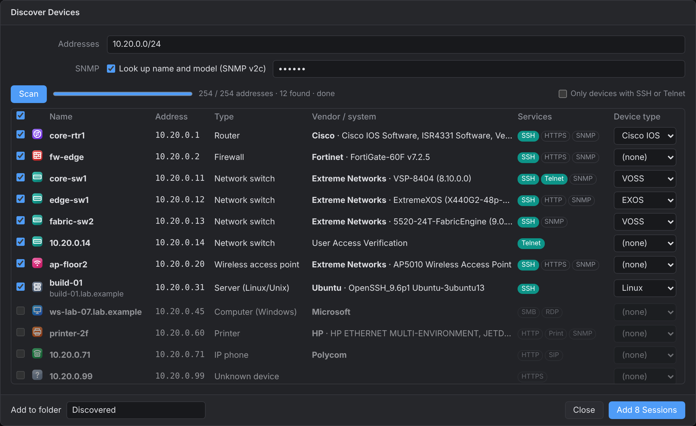

   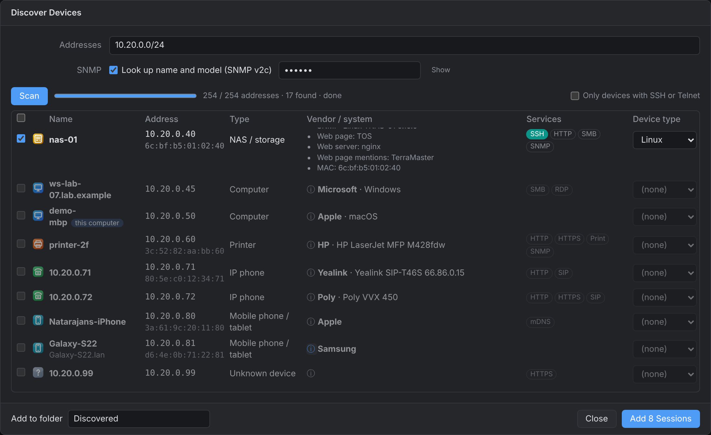

   | Icon | Kind | Recognised by |
   |---|---|---|
   |  | Network switch | SNMP, Telnet banner or web page naming VOSS, Fabric Engine, ExtremeXOS/Switch Engine, IOS, NX-OS, Junos, EOS …; network vendor MAC; embedded SSH servers (Mocana); devices with Telnet open |
   |  | Router | ISR/ASR, IOS-XR, RouterOS, VyOS, FRITZ!Box, OpenWrt … |
   |  | Firewall | FortiGate, PAN-OS, ASA/Firepower, Check Point, SonicWall, pfSense/OPNsense |
   |  | Wireless access point | "access point", AP models, UniFi, Aironet, Ruckus |
   |  | Server (Linux/Unix) | Linux/BSD in SNMP or the SSH greeting, ESXi/Proxmox, iDRAC/iLO; SSH with file sharing |
   |  | NAS / storage | TerraMaster, Synology, QNAP, TrueNAS, ReadyNAS, ASUSTOR, WD My Cloud (web page, SNMP or MAC) |
   |  | Computer | Windows (SNMP, RDP, SMB without SSH), Apple MAC addresses, this computer |
   |  | Mobile phone / tablet | names such as iPhone, iPad, Galaxy, Pixel, Redmi, OnePlus (mDNS or DNS); a phone maker's MAC address with no open ports; a **private (random) MAC address** with no open ports - Android and iOS use one per Wi-Fi network, so the maker cannot be read from it (no vendor list can name it) |
   |  | IoT / embedded board | ESP32/ESP8266 (Espressif MAC, ESPHome, Tasmota, WLED, `esp32-…` names), Arduino, STM32, Raspberry Pi Pico/RP2040, Nordic nRF, Shelly, Sonoff, Tuya; RTOS and embedded network stacks (FreeRTOS, Zephyr, ThreadX, NuttX, Mbed OS, MicroPython, **lwIP** web servers); the **ESPHome API** port (6053), **CoAP** (UDP 5683), Modbus/TCP or MQTT without a computer's services; mDNS services such as `_esphomelib`, `_arduino`, `_hap` (HomeKit) |
   |  | IP phone | SIP answer, phone models (Yealink, Poly/Polycom, Grandstream, Snom, Mitel, Cisco, Avaya …), phone vendor MAC |
   |  | Printer | printer models in SNMP or the web page (LaserJet, Brother, Canon, Epson …), printing ports |
   |  | Unknown device | nothing named it - open **ⓘ** to see what answered |

   Besides the login and web ports, the scan asks each address over unicast mDNS which services it offers (DNS-SD) and tries CoAP, the ESPHome API, MQTT and Modbus/TCP, so microcontroller boards without SSH or a web page are found too. An iPhone offering `_apple-mobdev2` or an Android phone offering wireless debugging (`_adb-tls-connect`) is recognised the same way.

   **Connect without saving**: double-click a device (or right-click → *Connect*) to open a tab to it straight away with the suggested device type; the window stays open.

   Product names win over generic words: a NAS whose SNMP says "Linux" but whose web page says "TerraMaster" is shown as a NAS.
5. **Add**: devices with SSH or Telnet are ticked (those already in the Session Manager are marked *in sessions* and left unticked; this computer is never ticked). Devices without a login port are shown but cannot be added; tick *Only devices with SSH or Telnet* to hide them. Pick a **device type** per device - Termwright suggests one from the network OS that any evidence names (an SNMP description, the web certificate *Extreme Networks, Inc., EXOS* or the EXOS Telnet greeting *telnet session telnet0 on /dev/pty…* all mean EXOS, even when the switch runs OpenSSH), then from what the device reports (VOSS, Cisco IOS, Linux …) or, failing that, from the **Telnet login prompt** compared with the first login step of your device types (e.g. EXOS `login:`, VOSS `Login:`). Type or choose a **folder** (default *Discovered*) and click **Add N Sessions**.
   - **Add** *all selected devices* (the default) or *only the selected devices of these device types*: tick one or more device types (each shows how many selected devices it has; *(no device type)* covers devices without one).
   - **A subfolder per device type** files the sessions under the folder by device type, e.g. *Discovered/EXOS*, *Discovered/VOSS* (devices without a type go to *Other*).
   - These choices are remembered for the next scan. Sessions are named after the device and get its vendor and system as description; folder defaults apply as usual.

   

Scanning connects to many addresses and can be noticed by security monitoring: scan only networks you are allowed to scan, such as your lab. Termwright asks you to confirm this before the first scan.

**Folder Defaults** (right-click a folder → *Folder Defaults…*): username, device type, jump session, identity file, keyword set, color scheme and environment that every session in the folder (and sub-folders) uses when its own field is empty. The nearest folder wins.


**Workspaces** (File → Workspaces…, File → Save Workspace…): a named set of sessions with their layout (tabs, side by side, stacked, grid). *Open* reconnects them all; *Rename* and ✕ manage the list.


### Wake-on-LAN

Termwright can wake a sleeping or powered-off computer, server or lab device by sending a Wake-on-LAN *magic packet* to its MAC address - either as a **Wake-on-LAN session** of its own, or from any saved session that has a MAC address.

#### Wake-on-LAN sessions

New Session → Protocol → *More…* → **Wake-on-LAN** makes a session whose only job is to wake a device and show whether it is up. It has its own power icon in the Session Manager.

| Field | What it does |
|---|---|
| **MAC address** (required) | the device's wired network port that is set to wake (`00:11:22:33:44:55`, `00-11-…`, `0011.2233.4455` or `001122334455`) |
| **Network** | the device's network, e.g. `192.168.1.0/24`; `192.168.1.0`, `192.168.1` or an address in it (`192.168.1.41`) mean its /24. The magic packet is **advertised on that network**: to its broadcast address and to `255.255.255.255`, out of this computer's interface on it. |
| **IP address** | the device's address: it is pinged to show whether it is up. Without a network, the packet goes to the broadcast address of the network this address is on. **The network or the IP address is required** (one of them). |
| **UDP port** | 9 by default (some devices use 7) |
| **Broadcast** | only when the right broadcast address differs from the network's (e.g. a router that forwards a directed broadcast) |
| **After waking** | how many times to search the network for the MAC address, and how many seconds apart (4 searches, 30 s apart by default) |
| **Ping** | how often the device is pinged to show up or down - every 2 minutes by default, or 30 s, 1, 5, 10 or 30 minutes, or never |
| **Send from** | with a jump host (Jump Host / Proxy page): send from the jump host - for a device on the jump host's network - or from this computer |

**Double-click** the session (or *Save & Wake*, *Wake Now*) to wake it:

1. The magic packet is sent (three times) to the network's broadcast address and to the limited broadcast `255.255.255.255`, out of the network interface that is on the device's network (several routers and switches drop a directed broadcast, and macOS and Windows send `255.255.255.255` out of one interface only, so each interface is addressed by its own address). When this computer is on no such network, every interface is used.
2. **With an IP address**, the device is pinged every 5 seconds until it answers (at least 2 minutes, or as long as the searches would take). When it answers, its **NetBIOS name** is read too (Windows and Samba answer), and the dot turns **green**. If it does not answer in time, the dot turns **orange** and a notice says it is down, not woken or not present.
3. **With only a network**, Termwright waits 30 seconds, then searches the network for the MAC address (it makes this computer look up every address of the network, as Discover Devices does, and reads the answers' MAC addresses). It repeats this up to 4 times (both are settings). When the MAC address is found, its **IP address is saved in the session** and the device is pinged; if it is not found after the last search, the device is marked **not present / down** and the searches stop. Only a network this computer is directly on can be searched.

Afterwards every Wake-on-LAN session with an IP address is **pinged every 2 minutes** (its *Ping* setting): the dot in the Session Manager is **green** when it answers and **orange** when it does not; while it is being woken the dot blinks. The hover card shows the MAC address, network, state, when it was checked and the NetBIOS name. Right-click → *Check Now (ping)* checks at once, and **Wake Up and Connect to …** wakes the device and opens its other saved session (one with the same MAC or IP address, e.g. its SSH session) as soon as it answers. A session changed to Wake-on-LAN keeps the power icon (its device type is cleared).

| Session Manager | Wake-on-LAN session options |
|---|---|
|  |  |


#### Waking the device of any session

- **The MAC address** is saved with the session: Discover Devices and device facts fill it in, or type it in Session Options → Connection → *MAC address* (`00:11:22:33:44:55`, `00-11-…`, `0011.2233.4455` or `001122334455`). Use the MAC address of the wired port that is set to wake.
- **Wake up**: right-click the session → **Wake Up (Wake-on-LAN)**, or **Wake Up and Connect** to connect as soon as it answers. Also on the tab menu, Transfer → Wake Up, and - when a connection times out - the error card's **Wake Up** button, which reconnects the tab when the device answers. Right-click a folder → *Wake Up All in Folder*, or a selection → *Wake Up N Sessions*, sends to every session with a MAC address.
- **Where the packet is sent from**: Wake-on-LAN packets are broadcasts that do not cross routers, so they must start on the device's network. *Automatic* (the default) sends from **this computer** when it has a network interface on the device's network - like a phone app on the same Wi-Fi - and otherwise from the session's **jump host** (or the jump station of an `ssh … host` command): Termwright logs in and sends the packet with `python3`, or the `wakeonlan` tool if it is installed. Session Options → Connection can force either one. The notice after sending tells where it was sent from and to which addresses. On macOS, allow Termwright under System Settings → Privacy & Security → **Local Network**, or the system silently drops the broadcast.
- **Options** (Session Options → Connection, below the MAC address): the **broadcast address** (empty = the broadcast address of the network the session's address is on - the packet goes to that network only; enter another one only when needed, e.g. `192.168.20.255` for a router that forwards directed broadcasts), the **UDP port** (9 by default, sometimes 7), **send from** (automatic / this computer / the jump host), and **Wake Now** to try the settings before saving.
- **Did it wake?** After sending, Termwright watches the session's port (through the jump host when there is one) for up to three minutes and tells you when the device answers - with a *Connect* button - or that it did not, with what to check: Wake-on-LAN enabled in the BIOS/UEFI and the network card's settings, the right MAC address, and the broadcast address for other subnets.

| Session menu | Settings | It answered |
|---|---|---|
|  |  |  |

### Devices that get a new address (DHCP)

Switches that take their management address from DHCP, lab equipment, access points and IoT boards can get **another IP address** when their lease runs out - and their old address can be given to **another device**. Termwright recognises devices by their **MAC address** so that you neither lose them nor log in to the wrong one.

- **Discover Devices saves the MAC address** in the sessions it adds (Session Options → Connection → *MAC address*; the Session Manager's hover card shows it). For sessions you made earlier, a scan offers **Remember MAC Addresses** for the sessions it found at their address.
- **After a scan**, Discover Devices tells you which saved sessions answer at a **new address** (same MAC address) and which addresses now belong to **another device**. **Review…** lists the moves; tick the sessions and **Update Sessions**.

  

  
- **When you connect**, Termwright compares the MAC address of the device that answers with the saved one - before anything is sent. If it differs, it stops and asks: **Find the Device by MAC** or *Connect Anyway*. Background runs (backups, checklists, Run and Collect) never log in to a different device.

  
- **Find by MAC Address** (also on the connection error bar when a device does not answer) searches the session's network for the MAC address and offers the new address; **Reconnect Tab** connects to it.

  

**The SSH host key is checked too**: *same SSH host key* means the device at the new address is the one you logged in to before, and its key is trusted at the new address as well. *Different SSH host key* (same MAC) is not ticked: the device was reinstalled or it is not yours. Nothing changes until you update the sessions.

Limits: MAC addresses are only visible on **this computer's own network** (the same subnet / VLAN). Devices behind a router, VPN, jump host or proxy cannot be checked this way. Where you can, a **DHCP reservation** or a **DNS name** in the session is the cleaner fix; the MAC address check is the safety net for networks where you do not control DHCP.

## 5. Session Options reference


| Page | Settings |
|---|---|
| **Connection** | Name, folder, protocol (SSH2 / Telnet / Serial / Local Shell / Raw), device type, **Connect as** (SSH2: terminal or SFTP file browser only), hostname, port, username (blank = ask), password (saved, *No password*, or from a **password manager**), description. |
| **SSH2 Authentication** | Auth methods to try (**gssapi / Kerberos**, public key, keyboard-interactive, password), Kerberos principal and service name, identity file, **certificate**, *save password in OS keychain*, **agent forwarding**, **X11 forwarding**, keep-alive interval. **Algorithms**: *Allow legacy algorithms* lets this session talk to an old device that only offers weak algorithms (`diffie-hellman-group1-sha1`, `aes128-cbc`, `hmac-sha1`, `ssh-rsa`); they are added at the end of each list, so modern ones are still preferred. Key exchange, Ciphers, MACs and Host key take lists in the OpenSSH syntax: `a,b` exactly these, `+a` add to the usual list, `-a*` remove, `^a` put first. Use it only on networks you trust. |
| **Port Forwarding** (SSH2) | Local (`-L`), Remote (`-R`) and Dynamic SOCKS5 (`-D`) forwards; see [§11](#11-tunnels-jump-hosts-and-proxies). |
| **Jump Host / Proxy** | Connect via another saved SSH2 session (chainable) or through a SOCKS5 / HTTP CONNECT proxy. |
| **Serial** | Port (picked from the ports of this computer, see [Serial consoles](#serial-consoles)), baud with **Detect Speed**, data bits, parity, stop bits, **flow control** (none, RTS/CTS, XON/XOFF), assert DTR/RTS on open. |
| **Local Shell** | Command to run (blank = login shell) and start directory. |
| **Logon Actions & Triggers** | Automate logon (Expect/Send table with hide, trailing CR and credentials), send initial CR, logon **script** with arguments, SSH2 **remote command**, and triggers that answer prompts at any time; see [§10](#10-automation-logon-actions-triggers-scripts). |
| **Terminal** | Emulation (Xterm, VT100/102/220, ANSI, Linux), TERM override, scrollback lines, color scheme, font and size, Backspace sends DEL (^?) or BS (^H), keyword set, auto reconnect, **timestamps** at the start of each line (off by default) and **auto scroll** (on by default). |
| **Log File** | File name with tokens, start on connect, append, raw log, per-line prefix; see [§8](#8-logging-and-capturing-output). |

*Save & Connect* saves and opens a tab. Changes to an open session apply on the next (re)connect.

| Serial | Terminal |
|---|---|
|  |  |

### Serial consoles

- **Port**: the list shows the serial ports of this computer in order - `COM1, COM2 … COM10` on Windows, `/dev/ttyACM0, /dev/ttyUSB0, /dev/ttyUSB1 …` on Linux, `/dev/cu.*` on macOS - with the adapter's name and USB ID when the system reports them (e.g. *FT232R USB UART (0403:6001)*). The list **updates by itself** about every second and a half: plug in a console cable and its port appears, marked *(new)*, and is picked when no port was chosen yet. A saved port that is not plugged in shows as *(not connected)*. *Other port…* types a name by hand. Quick Connect has the same list.
- **Detect Speed**: sends Enter at each common speed (9600, 115200, 19200, 38400, 57600, 4800, 2400, 230400, 1200) and keeps the one where the device answers with readable text. Close a tab that has the port open first. *Detect the speed each time it connects* does this on every connect; the status bar then shows the speed with *(detected)*.
- **Send bar** (under serial tabs): it starts with the **port and speed** of the connection (`/dev/cu.usbserial-A10K · 115200 8N1`, green while connected; *(detected)* when the speed was detected). Type a message and press **Enter** or **Send**; ↑/↓ recall earlier messages. The line ending is added after each message: **CR** (default, what consoles expect), **LF**, **CR+LF** or none. **Timestamps** puts the local time (`[10:41:07.512]`) at the start of every line, **Auto scroll** follows new output, **Clear** empties the screen and the scrollback, **Save…** writes the output to a text file. ✕ hides the bar; right-click the terminal → *Send Bar* shows it again, on any tab.
- **Hex**: the first list switches the message box between **Text** and **Hex**. In Hex mode type bytes as `48 65 6C 6C 6F 0D 0A`, `0x02,0x10,0x03` or `48656C6C6F`; they are sent exactly as typed (no line ending is added - put `0D 0A` in yourself). A typo such as `1G` is marked in red and nothing is sent. **View: Hex** shows what the device sends as hex bytes - a new line after each line feed (`0A`) or 16 bytes - with timestamps if they are on; **View: Text** goes back to normal output.


## 6. Working in the terminal

- **Copy / Paste**: select text (copied automatically when *Copy on select* is on). Paste with right-click (when *Paste on right-click* is on; Shift+right-click opens the menu), `Cmd+V` on macOS, `Ctrl+Shift+V` on Windows/Linux, or `Shift+Insert`. Copy also with `Ctrl+Insert`.
- **Find**: `Cmd/Ctrl+Shift+F` searches the scrollback; Enter = next, Shift+Enter = previous, Esc closes.
- **Zoom**: `Cmd/Ctrl +`, `Cmd/Ctrl -`, `Cmd/Ctrl 0` (back to 14).
- **Font, size and line spacing**: Global Options → Terminal & Appearance. The default is Menlo / Consolas / DejaVu Sans Mono at 14 with *Normal* line spacing (the font's own, as most terminal programs use); *Line spacing* adds 10, 20 or 35 % between lines. A session can have its own font and size (Session Options → Terminal → Appearance).
- **Save Screen As Image** (File menu, tab menu, `Mod+⇧P`): the visible screen as a PNG, with its colours and highlighting - handy for tickets and chat.
- **Files panel**: View → *Files Panel* (`Mod+⇧1`), the title-bar button or the tab's right-click menu shows a file browser beside an SSH terminal that follows its folder - see [Files panel beside the terminal](#files-panel-beside-the-terminal).
- **Terminal bar** (under every SSH, Telnet, Raw and local shell tab): **Timestamps**, **Auto scroll** and **Clear** one click away. ✕ hides it for that tab (right-click → *Terminal Bar* shows it again); Global Options → Terminal → *Terminal bar* hides it for every tab.
- **Clear Screen** (the eraser button, the terminal bar, right-click the terminal or a tab, Edit menu) empties the screen and the scrollback; the line with the cursor stays. *Clear Scrollback* keeps what is on the screen; *Reset Terminal* resets the emulator.
- **Timestamps**: right-click the terminal → *Timestamps* (or Edit → Timestamps On / Off) puts the local time with milliseconds at the start of each line, on any connection. It is display only: logs have their own per-line prefix. Session Options → Terminal → *Display* turns it on for every connection of a session (off by default).
- **Auto scroll** (on by default): the arrow button, right-click → *Auto Scroll* or Edit → Auto Scroll On / Off. When it is off the view stays where it is while output arrives, so you can read; *Auto scroll is off · Turn On* in the corner brings it back. Session Options → Terminal → *Display* can keep it off for a session.
- **Links**: URLs in the output open in your browser when clicked.
- **Send Break**: Tab → Send Break (serial break, telnet BREAK or SSH break request, e.g. to reach a boot loader / ROMMON).
- **Send Text File**: Transfer → Send Text File… pastes a file line by line (respects *Paste line delay*).
- **Layouts**: View → Tabbed / Tile Side by Side / Tile Stacked / Tile Grid, or the four layout buttons. In tiled views click a pane to make it active.


- **Lock**: Tab → Lock Session (or the lock button) blocks keyboard input to a tab until you enter the password you chose; *Lock All Sessions* locks every tab.
- **Tab menu** (right-click a tab): Reconnect, Disconnect, Clone, Add to Send Group, Open SFTP Tab, **Files Panel**, Set Up Key Login, Connect SFTP Session, Log, Save Scrollback, Timestamps, Auto Scroll, Send Bar, Clear Screen, Session Options, Rename Tab, Close, Close Other Tabs. Middle-click closes a tab.

## 7. Command Window, Button Bar and Connect Bar

**Command Window** (View → Command Window, `Cmd/Ctrl+Shift+K`)
- Enter sends the text plus Enter; Shift+Enter adds another line (each line is sent with Enter).
- Send to the **Active tab**, **All connected tabs**, or **Selected tabs** - tick tabs with *Choose…* or right-click a tab → *Add to Send Group* (a `SEL` badge marks them).

  
- *Send characters immediately* sends each key as you type.
- ↑/↓ recall history.

**Button Bar** (View → Button Bar)
- `+` adds a button. Right-click a button to edit, move, delete or toggle *Send to All Tabs*.
- In *Options → Global Options → Button Bar* each button can **send text** (escapes: `\r` Enter, `\n`, `\t`, `\e` Esc, `\x03` Ctrl+C), run an **action** (e.g. *Open SFTP Tab*) and/or run a **script**.

**Connect Bar** (classic layout): see [§3](#3-connecting). Hide it in Global Options → General. The modern layout has no toolbar: **Quick Open** (`Cmd+G` / `Ctrl+Shift+G`), the start page's box and the title bar's **Sessions** list connect the same way (View → Connect Bar opens Quick Open).

**Command History** (Script → Command History…, `Cmd+Y` / `Ctrl+Shift+Y`, or *History…* in the Command Window): every command you type in a terminal or send from the Command Window is remembered with the session, device type and time (up to 5000).
- Type words to search (`isis adj`); *Only VOSS* (the active tab's device type) narrows it down.
- **Enter** types the command in the active tab so you can check or edit it before pressing Enter; **Shift+Enter** / *Run* runs it; *To Command Window* puts it in the Command Window.
- The command is taken from the terminal line without the prompt, so commands completed with Tab or recalled with ↑ are remembered as the device shows them.
- Commands that may contain a secret - `password`, `secret`, `community`, `key-string`, `pre-shared`, tokens - are **never** remembered, nor anything typed at a password prompt. Global Options → General → *Remember typed commands* turns history off; the trash button on a command (or Shift+Delete) forgets that one command - for example one that was mistyped or that a device no longer supports; with *Only <device type>* ticked only on that device type. **Clear History…** asks which device types to forget (the active tab's is ticked; *All device types* forgets everything). History stays on this computer (`history.json` in the data folder).


**Suggestions in the Command Window**: after two characters the Command Window suggests commands from your history and the Command Library - those of the active tab's device type first, never another device type's. ↑/↓ chooses, **Tab** (or Enter on a chosen one) takes it, Esc closes; library commands with `{{values}}` ask for them.


**Command Library** (Script → Command Library…, `Cmd+E` / `Ctrl+Shift+E`)


- Save commands in folders (per device type, troubleshooting, config snippets); several lines are sent one after another.
- `{{name}}` or `{{name:default}}` placeholders are asked for when sending, e.g. `show vlan {{vlan_id:10}}`.
- Send to the active tab, the selected tabs or all connected tabs; double-click sends. Library commands also appear in Quick Open.
- **For device types**: tick the device types a command is for (or name its folder after one, e.g. *VOSS / Troubleshooting*). In a tab of that device type its commands are listed first (*For VOSS (this tab)*), *Only commands for VOSS* hides those meant for other device types, and Quick Open ranks them first.
- **Commands ▾** in the Command Window lists the library, those for the active tab's device type first; the chosen command (with its `{{values}}` filled in) goes into the box so you can check it before pressing Enter.

**Paste safety**: pasting more than one line asks first and shows a preview (Global Options → General → *Confirm before pasting more than one line*). The paste line delay (Terminal & Appearance) paces slow devices.

**Compare Outputs** (Tab → Compare Outputs…, or right-click a tab → **Compare With…** and pick another open tab or a file): side-by-side diff of two tabs' scrollback or two files - e.g. `show running-config` before and after a change, or the same command on two switches. Options ignore whitespace, timestamps/uptime counters and - optionally - **prompts** (`core-sw1:1#` vs `core-sw2:1#`, editable pattern), or show only the differences.


**Timestamps and copying**: right-click a tab (or the terminal) → *Timestamps* prefixes each new output line with the local time (display only; logs have their own setting). **Copy as HTML (with colors)** (right-click in the terminal; Shift+right-click when right-click paste is on) copies the selected text with its colors and bold text, so you can paste colored output into e-mail, Word, Teams or a ticket; plain-text editors receive the plain text. Links printed by devices (including OSC 8 hyperlinks) are clickable.


**HTML report of a session**: File → **Save Scrollback As HTML…** (also right-click the terminal or a tab) saves the whole scrollback as one web page: a header with the Termwright logo, the session, its address, the device's **model** (e.g. `5720-48MXW`), **OS version**, **serial number** and **MAC address**, the device type, protocol, user, connection details, the date and time it was saved and the number of lines, then the output with its colors, bold text and **keyword highlighting** exactly as in the tab. Open it in any browser, attach it to a ticket or e-mail, or print it to PDF. Model, version, serial and MAC are taken from output already on the screen (`show sys-info`, `show switch`, `show version`, `/etc/os-release`); when something is missing and the tab is an SSH or Telnet session with a VOSS, EXOS, Cisco or Linux device type, Termwright reads them in a background connection - nothing is typed in your tab. The MAC address saved by Discover Devices is used when the device does not show one. *Save Scrollback As…* still saves plain text. For a long session turn on a session log as well: the scrollback keeps the last 10,000 lines (Session Options → Terminal → *Scrollback lines*).


## 8. Logging and capturing output

- **Start/stop a log**: toolbar *Log*, File → Log Session…, or the tab menu. The tab shows a `LOG` badge.
- **Automatic logging**: Session Options → Log File → *Start log upon connect*.
- **File name tokens**: `%H` host, `%S` session, `%P` port, `%U` user, `%R` protocol, `%Y %M %D` date, `%h %m %s` time, `%t` ms, `%%` percent. Example: `~/logs/%S-%Y%M%D-%h%m%s.log`. With no name, logs go to the Logs folder (Global Options).
- **Plain vs raw**: by default escape sequences and colors are removed; *Raw log* keeps everything exactly as received.
- **Line prefix**: e.g. `[%h:%m:%s] ` timestamps every line.
- **Save Scrollback As…** (`Cmd/Ctrl+Shift+S`) writes the whole scrollback to a text file; **Save Selection As…** saves only the selected text.


### Session recording and playback

A recording keeps everything a device showed **with its timing**, so a session can be replayed later - for audits, change records, training or "what exactly happened at 02:14".

- **Record a tab**: right-click the tab → **Record Session** (or File → Record Session). The tab shows a blinking `● REC` badge; *Stop Recording* ends it. One recording is made per connection.
- **Record automatically**: Session Options → Log File → *Record every connection*, Folder Defaults → *Recording*, or **Record every session** (File → Recordings… or Global Options → General).
- **Markers**: **Add Marker…** (`Mod+J`, or the tab menu) puts a note at this point of the recording, e.g. *CHG-1234 start*.
- What you **type is not recorded**, only what the device shows (passwords you type are not echoed by devices).
- Background runs (backups, checklists, Run and Collect) are never recorded.


File → **Recordings…** lists them by session and date with length, markers and size. **Play** opens a player tab:

- play / pause (`Space`), speed 0.5× to 8×, the seek bar, `←` / `→` 5 seconds, `Home` / `End`
- **Skip idle** shortens pauses longer than 1.5 seconds
- **Markers** jump to a marker; **Find text** jumps to the next point where a text appeared
- **Export Text…** saves everything the device showed as plain text; **Show** opens the file's folder


Recordings are saved in *Documents/Termwright Recordings/<session>/<date>_<time>.cast* (Global Options → General → *Recordings folder*), in the open **asciinema** format: they also play with the asciinema player and tools. *Delete recordings after N days* removes old ones (0 = keep them). *Play File…* opens a `.cast` file from anywhere.

### Configuration backups

File → **Configuration Backups…** keeps dated copies of the configuration of switches, routers and firewalls, and shows what changed.


- **Backup jobs** (left): *+ New backup job*, a name, the **sessions** - folders (e.g. *Datacenter*, every session inside) or single sessions; *Add Selected* takes what is selected in the Session Manager.
- **Schedule**: *On demand* (Run Now), *Every day* or *Monday to Friday* at a time. Scheduled jobs run while Termwright is open; a run that was missed (Termwright closed at that time) starts when it opens.
- **Keep** N copies per device (default 30, oldest removed). By default a copy is saved **only when the configuration changed** - lines that change on every run (timestamps in comments, *Last configuration change at …*, *ntp clock-period* …) are ignored; tick *Save a copy every run* to keep one each time.
- **Commands**: each device type's **Backup commands** (Global Options → Device Types; EXOS `show configuration`, VOSS and Cisco IOS `show running-config`). Sessions without a device type use the job's *Commands*.
- **Run Now** backs up four devices at a time, in the background - no tabs open. The login is the one the session uses (device type, saved passwords, keys, jump hosts), but **nothing is asked**: a device whose password is not saved, or whose host key was never accepted, is reported as failed (*no saved password for admin@10.10.7.7*) - connect to it once and save the password.
- The table shows each device's **last backup**, the **result** (*no change*, *changed*, or the error - with a *device output* link to what the device sent, also saved as `last-error.txt`) and the number of copies. **What Changed** compares the newest copy with the one before in Compare Outputs; **Open** opens the copy, **Show** shows it in Finder / Explorer.
- Copies are saved in *Documents/Termwright Config Backups/<session path>/<date>_<time>.txt* (*Change…* picks another folder, e.g. a shared drive or a Git repository).
- **From the Session Manager**: right-click a session, a folder or a selection → **Back Up Configuration(s)** runs a one-off backup.


### Change checklists

File → **Change Checklists…** (or right-click a session, folder or selection in the Session Manager → **Change Checklist…**, or Quick Open → *checklist*) runs the same show commands on a set of devices **before and after a change** and tells you which devices changed.

1. **+ New checklist**: a name, the **devices** (folders or sessions, *Add Selected* takes the Session Manager selection) and the **commands per device type** - e.g. VOSS `show isis adjacency`, `show vlan basic`, EXOS `show vlan`, `show ports no-refresh`; *Any other device* covers the rest. New checklists start with suggestions for the built-in device types.

   
2. Before the change: **New Change: Take Before** (optionally with a ticket number or note). The commands run on every device in the background, four at a time, with the session's usual login - nothing is asked; a device whose password is not saved is reported as failed with its *device output*.
3. Make the change.
4. **Take After**: the same commands again. Each device is marked **same** or **changed** - times of day, dates and uptime counters are ignored - and **Compare** shows before and after side by side (*Before* / *After* open the files).

   

   

- Each change is kept: pick an earlier one in *Change* to look at it again; *Retake Before* repeats the before snapshot of the selected change.
- The outputs are saved in *Documents/Termwright Checklists/<checklist>/<date>_<time>/before|after/<session path>.txt* (each command under a `### command` line).

### Run and collect

File → **Run and Collect…** (or right-click a session, folder or selection → **Run and Collect…**, or Quick Open → *collect*) runs commands on many devices and puts values from their output in **one table** - an inventory of models, versions, serial numbers and uptimes, or anything a pattern can find.

1. **+ New collection**: the **devices** (folders or sessions), the **commands per device type** and the **columns**. New collections start with inventory commands and columns (*Model*, *Version*, *Serial*, *Uptime*) for the built-in device types; **+ Inventory Columns** adds them later.

   
2. A column has a **name**, a **device type** (or *Any device*) and a **pattern** (a regular expression, case-insensitive; the first `( )` group is the value, e.g. `Serial#\s*:\s*(\S+)`). Several rows with the same name and different device types fill one column - each device type has its own pattern.
3. **Run Now**: the commands run in the background on every device, four at a time, with the session's usual login (device type, saved passwords, keys, jump hosts, console servers) - nothing is asked.

   

- **Copy Table** copies it for a spreadsheet, **Export CSV…** saves a `.csv` file; *Output* opens a device's full output, *Device Output* what a failed device sent.
- Editing the columns updates the table at once - there is no need to run again. Earlier runs stay in *Run*.
- The outputs are saved in *Documents/Termwright Collected/<collection>/<date>_<time>/output/<session path>.txt*.

## 9. File transfer

### SFTP browser


Open with the SFTP button in the title bar, **Transfer → Open SFTP Tab** or `Mod+P` while an SSH2 tab is connected. It reuses that login (no second password).

In the modern layout the bar at the top shows the session, **Run as ▾**, the terminal-folder button, and the copy protocol (**SFTP / SCP**). Between the panes are the copy arrows (→ upload, ← download), **Sync** → / ← (make the other side match) and **Diff**: select two files - one on each side, or both on the same side - and Diff opens **Compare** with both files side by side, with line numbers and the options to ignore whitespace and timestamps. The bar at the top says whether the files are identical (green) or how many lines differ. Each pane has a **path you can click** (each folder opens with one click; click beside the path to type one), ↑, Refresh, **New Folder**, **New File**, **Delete** and the bookmark star, a **bookmark bar** below it, and a `..` row. Files show a coloured type badge (CFG, LOG, IMG, TXT, KEY …), folders are amber, and *Modified* reads *Today 09:41* or *12 Oct* (hover for the full date and permissions).


**Working directory detection** (SFTP tab opened from a terminal tab):


Working directory detection is **on by default**. When you open an SFTP tab from a terminal tab (toolbar SFTP button, Transfer → Open SFTP Tab, or the tab's right-click menu), Termwright checks over a separate channel that the login shell is **bash or zsh**, and if the terminal is sitting at a prompt it turns folder reporting on in that shell for you - the typed line is hidden, the screen stays as it was. From then on the SFTP tab opens in, and follows, the terminal's folder. This also works **through a jump station**, e.g. an AWS host reached through a bastion: open *SFTP Tab on <target> (through this login)* and the check and the folder reporting happen on the target. Network devices are left alone (their CLI is not bash or zsh). **The terminal's user is followed too:** after `sudo su -` (or `sudo -i`) in the terminal, the SFTP tab switches to browsing **as root** (through sudo, like *Run as ▾ → root*) and opens root's folder; after `sudo su - oracle` it browses as `oracle` (*sudo su - oracle*); after `exit` it goes back to the login user. If sudo asks for a password, Termwright asks for it once. Each part can be turned off in **Options → Global Options → General → SFTP from a terminal**: *Working directory detection*, *SFTP tabs follow the terminal folder* and *SFTP tabs browse as the terminal's user*. The **>_ Terminal ▾** button in the server pane offers:


- **Go to Terminal Folder** - jump to the folder the shell is in now.
- **Jump station sessions**: an SFTP tab browses either the jump station or the target. **Open SFTP Tab** (the SFTP button, ⌘P) opens it on the host the terminal is on - normally the target; right-click the terminal tab → Open SFTP Tab on … chooses. It follows the terminal only while the terminal's shell is on that host - Termwright reads the host from the shell's folder report, so after `exit` from the target the jump station's SFTP tab follows again. When the terminal is on the other host, the tab shows **>_ On <host> ▾** with *Switch This Tab to <host>*.
- **SFTP sessions with their own login** (Connect SFTP Session) follow an open terminal tab of the same session, as a tab opened from the terminal does.
- **Becoming root on a jump station**: when you run `sudo su -`, `sudo -i`, `su` or start a new shell in the terminal, the SFTP tab that follows it reads the folder and user again once the new prompt appears, so an SFTP tab opened before becoming root follows root.
- **Follow Terminal Folder** - the SFTP pane changes folder whenever you `cd` in the terminal (the button then reads *Following*). On by default; switch it off here for this tab, or for all tabs in Global Options.
- **Open This Folder in the Terminal (cd)** - the reverse: the terminal changes to the folder shown in SFTP. Also on the right-click menu of a remote folder.
- **Enable Folder Detection in This Shell** - types one line into the terminal (bash or zsh) that makes the shell report its folder after every prompt, until you log out.
- **Enable Folder Detection Permanently…** - after a confirmation, adds the same line to `~/.bashrc` (or `~/.zshrc`) on that server, once.

If the shell still does not report its folder (detection turned off, another shell, or the terminal was busy), a blue *Working directory detection* bar offers the same two buttons; close it with ✕ (remembered). Termwright understands the standard escape sequences OSC 7 (`file://host/path`), OSC 1337 `CurrentDir=` / `RemoteHost=user@host` and OSC 633 `P;Cwd=`, so shells already set up for iTerm2, VS Code, WezTerm or Tabby work as they are. For **fish**: `function _tw_cwd --on-variable PWD; printf '\e]7;file://%s%s\a' (hostname) $PWD; end` in `~/.config/fish/config.fish`. Network devices (VOSS, EXOS, …) do not report a folder. 

Folders use the same colored folder icon as the Session Manager. Files are colored by type so they stand out at a glance: text and configuration files blue, archives amber, images pink, firmware and binaries purple, scripts green, keys and certificates red, everything else gray. Symbolic links carry a small arrow, and hidden (dot) files are dimmed.

**Standalone SFTP session** (its own login, no terminal): right-click an SSH2 session in the Session Manager → **Connect SFTP Session**, or right-click a terminal tab → **Connect SFTP Session (new login)**. Use this for devices such as VOSS that refuse a second channel on an existing SSH connection. To make a session always open this way, set Session Options → Connection → **Connect as: SFTP file browser only**; right-click → **Connect Terminal** still opens a shell. The tab right-click menu also offers **Open SFTP Tab (same login)**.

- Left pane = this computer, right pane = the server. Type a path and press Enter, use ↑ (parent), Backspace, or double-click folders.
- **Keyboard**: click in a list, then ↑ / ↓ move (Shift+↑ / ↓ selects a range), Home / End and Page Up / Down jump, Enter opens a folder or file, Backspace goes up, Delete deletes.
- **Select several files**: tick the **check boxes** (they appear when you point at a row, and on every row once something is selected; the box in the header selects all or none), or Ctrl/Cmd+click, Shift+click for a range, Ctrl/Cmd+A. The footer shows how many are selected with *Clear*. **→** uploads, **←** downloads, double-clicking a file transfers it to the other side. Whole folders are copied recursively.
- **New File** (page-plus icon) makes an empty file in the pane's folder - on this computer or the server; it never replaces an existing file. **New Folder** next to it.
- **Delete** (bin icon, the Delete key, or right-click): on the **server** the selected files and folders are deleted after you confirm (folders with their contents). On **this computer** they are moved to the **Trash** (Recycle Bin on Windows), so they can be put back.

  
- Right-click (server side): Download, Rename, Delete, New Folder, Refresh. Right-click (this computer): Upload, Move to Trash, New Folder, Refresh.
- **Sync ⇉ / ⇇** copies only new or changed files (size or newer time) from the current local folder to the current remote folder or back. Nothing is deleted.
- The **transfer bar** at the bottom shows the current copy with progress, speed and time left, *Cancel*, and *N more* for the other transfers (Resume and Clear for finished ones). **✕ closes it** - copies that are running go on in the background (the status bar still shows them) and the bar comes back for the next transfer. The classic layout's queue has *Close* too.
- **Bookmarks**: the **bookmark bar** under each path lists the bookmarks of that side - click one to open it, right-click to remove it, **+ Bookmark** saves the current folder (the ☆ in the header does the same and lists them). Server bookmarks belong to their session; local bookmarks are shared by all sessions.
- **Server-to-server copy**: with two SFTP tabs open (e.g. two switches), right-click files or folders on one server → **Copy to <other server>: <its current folder>**. The data streams through this computer; nothing is stored locally. The ⇄ entry in the queue shows progress.
- **Copy via SFTP / SCP** (the SFTP / SCP selector in the top bar - between the panes in the classic layout; the choice is remembered per session): browsing always uses SFTP, but → / ← (and double-click, Upload/Download in the right-click menu) can copy with **SCP** over the same login - useful when a device's SFTP server is slow or limited. Folders are copied recursively; the queue shows `↑ SCP` / `↓ SCP`. Sync, resume and server-to-server copy stay SFTP.

  
- **Run as another user** (*Run as ▾* in the server pane header): browse the server as root or any other user, like switching user in the terminal.
  - **root (sudo)**: starts the SFTP server with `sudo` over the same connection and opens `/root`. If sudo asks for a password you type it once for the tab (kept in memory only).
  - **Other Command…**: type the command you would use in the terminal - `sudo su - oracle`, `su - admin`, `sudo -iu postgres`, `pbrun …`. Termwright runs it on a terminal, shows every **password prompt** it prints (sudo, su, one-time codes) so you can answer, waits for the new shell, then replaces that shell with the SFTP server - so files are read and written as that user. The last six commands are listed in the menu for the session.
  - The button turns red (*as oracle ▾*), the header reads *oracle @ host*, and **Back to &lt;login user&gt;** returns to the normal login. Works on a host behind a jump station too.
  - Requirements: the OpenSSH `sftp-server` program on the host (standard on Linux) and a POSIX shell for the user. Errors (wrong password, *not in the sudoers file*, *must be run from a terminal*) are shown with the command's last output. Copies use SFTP in this mode (*Copy via SCP* is disabled).

  
  
  
- **Resume** (⟳ on a failed or cancelled SFTP copy): restarts the same copy; partially copied files continue from where they stopped and files that are already complete are skipped.

### Files panel beside the terminal


A small file browser beside an SSH terminal, on the side opposite the Session Manager (with the Session Manager on the right it sits on the left). Turn it on for a session with the **Files panel beside the terminal** switch in the session side panel or in Session Options → Connection, or for one tab with **View → Files Panel**, the title-bar button, the tab's right-click menu or ⌘⇧1 (Alt+Shift+1).

- **Follows the terminal**: the panel shows the folder the shell is in (bash or zsh report it; Termwright turns this on, as for SFTP tabs). *Following* in the header turns it off and on. Through a jump station it opens on the host the terminal is on; when the terminal moves to the other host, the panel says so and *Show … here* reopens it there.
- **Follows the terminal's user**: after `sudo su -` (or `sudo -i`, `su - oracle` …) the panel browses as that user too - a red **root** badge shows it - so `/root` and other protected folders open instead of *permission denied*; after `exit` it browses as the login user again. It uses `sudo` on that host (asking for the password if sudo needs one), also through a jump station. ⋯ → *Browse as root (sudo)* / *Browse as …* switches by hand; Global Options → General → *SFTP tabs and the Files panel browse as the terminal's user* turns this off.
- **And the other way round**: open a folder in the panel (double-click, the path, ↑ or ..) and the terminal `cd`s there - only when the shell is at a prompt, so nothing is typed into a running program. ⋯ → *cd the Terminal When I Open a Folder Here* turns this off.
- **Open a file on this computer**: double-click a file (or right-click → Open). It is copied to a private temporary folder and opened with the program your system uses for its type. When you save it, the panel asks **Upload it to …?** - *Upload Now*, *Not Now* or *Stop Watching*. Programs and shortcuts (.exe, .bat, .app, .command …) are never opened from a server; use Download.
- **Upload** (choose files), **Download…** (choose a folder), **New Folder**, **Rename**, **Delete**, **Copy Path**, **cd Here in the Terminal**, *Show Hidden Files*, and a button that opens a full SFTP tab here. Drag the panel's edge to make it wider.


### SFTP through a jump station (bastion) - how the files travel

Many cloud hosts can only be reached from a jump station, often with a private key that is stored **on the jump station** (a session whose remote command is `ssh -t -i ~/.ssh/aws_key user@aws-host`, see [§10](#10-automation-logon-actions-triggers-scripts)). For such a session, *Open SFTP Tab on user@aws-host (through this login)* browses the AWS host directly:


- **One live pipe, no copies in between.** Termwright opens one extra channel on the SSH connection it already has to the jump station and runs the jump station's own `ssh` there to start the SFTP server on the AWS host. Uploads and downloads are streamed through that pipe: **from the AWS host, through the jump station's memory, straight to your Desktop** (and the reverse for uploads). Nothing is written to disk on the jump station, and no temporary copy is needed.
- **No second login, no key copying.** Your computer never sees the AWS key; the jump station uses it exactly as when you type the command in the terminal. Your existing login (password, MFA) is reused.
- **Speed** is limited by the slower of the two links (your computer ↔ jump station, jump station ↔ AWS host); both are encrypted SSH.
- **Copy via SCP** in this tab also goes to the AWS host through the same pipe (`scp -t` / `scp -f` run on the AWS host).
- **Run as / root** (*Run as ▾* in the header, below) switches the AWS side to root or another user; the pipe is the same, only the SFTP server on the AWS host runs as that user.
- The header shows *user@aws-host via jump-station*, and the status bar *SFTP to … through …*, so you always know which machine you are looking at. Both machines may have the same home path (e.g. `/home/you`); the listing is the AWS host's.


### ZMODEM (sz / rz)

- **Download**: on the remote host run `sz file1 file2…`. Termwright detects it and saves the files to your **Downloads folder** (Global Options → General); a notification shows where.
- **Upload**: run `rz` on the remote host; Termwright opens a file picker. Cancel aborts the transfer cleanly.
- Requires `lrzsz` on the remote host. Works over SSH, Telnet, serial and local shells.

### XMODEM (serial / boot loaders)

- **Transfer → Send File with XMODEM…**: start the device's XMODEM receive command first (or right after). Choose 1K blocks (XMODEM-1K) or classic 128-byte blocks if the receiver is old.
- **Transfer → Receive File with XMODEM…**: choose where to save, then start the send on the device. Trailing padding (0x1A) is removed.

### YMODEM (serial / boot loaders)

- **Transfer → Send Files with YMODEM…**: pick one or more files, then start the receiver on the device (`rb`, or the boot loader's `loady`). File names and sizes are sent in the batch header.
- **Transfer → Receive Files with YMODEM**: start the send on the device (`sb file…`); files land in your **Downloads folder**.

### SCP

To copy with SCP while browsing with SFTP, set **Via: SCP** in the SFTP tab (above). For devices that offer SCP but not SFTP: **Transfer → SCP Upload File…** or **SCP Upload Folder…** (pick, then the remote folder/path) and **SCP Download…** (remote file *or folder* path, then a local folder). Folders are copied recursively (`scp -r`).

## 10. Automation: logon actions, triggers, scripts

**Logon Actions** (Session Options → Logon Actions & Triggers):


- **Automate logon** turns the Expect/Send table on or off; **Send initial carriage return** presses Enter right after connecting (wakes up consoles and terminal servers).
- **Add… / Edit… / Delete** and **▲ ▼** manage ordered steps. Each step waits for its **Expect** text, then sends **Send**. Leave Expect empty to send immediately.
- In the **Expect/Send Properties** dialog (Add… / Edit… or double-click a row): **Hide** masks the Send text in the table, **Send trailing carriage return** adds Enter (on by default), and **Credentials** picks a named credential.
- Send escapes: `\r` CR, `\n` LF, `\b` backspace, `\t` tab, `\e` Escape, `\v` paste clipboard, `\p` pause 1 s, `\s` username and `\w` password (from the chosen credential, otherwise the session's username and saved password), `\\` backslash, `\xHH` any byte.
- Example (Cisco): `Username:` → `\s`, `Password:` → `\w` (Hide), `>` → `enable`, `Password:` → `\w`, `#` → `terminal length 0`.
- **Logon script**: tick it, choose a JavaScript (`.js`) or **Python (`.py`)** script, and optionally give **Arguments** (`scriptArgs` in JavaScript, `crt.Arguments` in Python). `.vbs` scripts run on Windows (see below).

**Remote command** (SSH2 section of the same page): runs a command instead of a login shell; a terminal is still allocated and the tab ends when the command exits. Jump-station example — log in to the jump host and go straight on to an AWS instance with the key that is stored *on the jump host*:

```
ssh -t -i ~/.ssh/aws_key ec2-user@10.0.0.5
```

(Without `-t` the target gets no terminal. Alternatively use Session Options → Firewall → *Jump session*, which tunnels through the jump host but uses a key on *this* computer.)

**SFTP on the target of a remote command.** When the remote command is `ssh … user@host`, SFTP can browse either machine:

- right-click the terminal tab → **Open SFTP Tab on &lt;jump host&gt; (same login)** or **Open SFTP Tab on &lt;user@host&gt; (through this login)**;
- right-click the session in the Session Manager → **Connect SFTP Session to &lt;jump host&gt;** or **… to &lt;user@host&gt; (through &lt;jump host&gt;)**;
- Session Options → Logon Actions → **SFTP opens on**: *Where the terminal is* (the default - the target, or the jump station after `exit`), *Always <jump station>* or *Always <target>*. The SFTP button (Open SFTP Tab), *Connect SFTP Session* and *Connect as: SFTP* use it; without a terminal, *Where the terminal is* opens on the jump station.


The server pane's header then reads **user@host via &lt;jump host&gt;**, and the status bar *SFTP to user@host through &lt;jump host&gt;*. If the target's home folder has the same path as the jump station's (e.g. `/home/you` on both), compare the files to tell them apart - the listing is the target's. Through the jump station, Termwright runs `ssh -T -o BatchMode=yes <your options> -s user@host sftp` there, with the same key and options as your command (`-t` is dropped), so the key never leaves the jump station. **Copy via SCP** in that tab also goes to the target. Because of `BatchMode`, the key must work without typing anything (no passphrase, or one held by the jump station's ssh-agent); otherwise the tab shows ssh's error, e.g. *Permission denied (publickey)*.


**Accounts** in Send strings: `\s` and `\w` send the username and password of the account chosen in the step - see [Accounts](#accounts).

**Alerts** (Global Options → **Alerts**): when output in *any* tab matches a pattern (text or regular expression), Termwright shows a notice, marks the tab with a red dot, can beep and - while it is in the background - shows an operating-system notification. Each pattern fires at most once every 5 seconds per tab. Two disabled examples (syslog severity 0-2 messages, `CRITICAL` / `link down`) are included.


**Triggers**: whenever output contains a pattern (text or regular expression), send a response, e.g. `--More--` → space, `\[y/n\]` (regex) → `y\r`. Limited to 20 per 10 seconds to avoid loops.

**Python scripts with the `crt` object**: `.py` files run with your installed Python 3 and get the `crt` script object (`crt.Screen`, `crt.Session`, `crt.Dialog`…), so existing logon and automation scripts written for it usually work unchanged. Use them as a session's *Logon script*, from Script → Run Script…, a button or a key binding. Set a different interpreter in Global Options → General → *Python interpreter*. Example:

```python
# $language = "Python3"
crt.Screen.WaitForString("login:", 10)
crt.Screen.Send("admin\r")
crt.Screen.WaitForString("Password:")
crt.Screen.Send(crt.Dialog.Prompt("Password", "Login", "", True) + "\r")
for dut in crt.Arguments:            # the Arguments field, e.g. DUT1 DUT2
    crt.Screen.Send("ping " + dut + "\r")
    if crt.Screen.WaitForStrings(["#", "unreachable"], 30) == 2:
        crt.Dialog.MessageBox(dut + " is unreachable", "Ping", ICON_WARN)
```

Supported `crt` members, timeouts and limits are listed in [SCRIPTING.md](SCRIPTING.md#python-scripts-with-the-crt-object).

**VBScript scripts** (Windows): `.vbs` logon scripts with the `crt` object run unchanged with Windows Script Host - the `# $language = "VBScript"` header is accepted, `Sub Main` is called, and `crt.Screen`, `crt.Session`, `crt.Dialog`, `crt.Arguments`, `crt.Sleep` work with their optional arguments. See [SCRIPTING.md](SCRIPTING.md#vbscript-scripts-windows).

**Reading the screen**: in Python and VBScript, `crt.Screen.Get(row1, col1, row2, col2)`, `Get2`, `CurrentRow` and `CurrentColumn` read the screen exactly as it is rendered in the tab, so `crt.Screen.Get(row, 1, row, crt.Screen.CurrentColumn - 1)` returns the current prompt (e.g. `core-sw1:1#`).

**JavaScript scripts**: Script → Run Script…, a session's *Logon script*, a key binding or a button. Full API in [SCRIPTING.md](SCRIPTING.md). Example:

```js
term.sendLine("show vlan 10");
var out = term.readUntil(/# $/m, 10000);
log(out && out.indexOf("not found") < 0 ? "VLAN 10 present" : "VLAN 10 missing");
```

**Record a script**: Script → Start / Stop Script Recording (toolbar ●; the tab shows `SCRIPT`). Type your commands; when you stop, Termwright saves a `.js` that waits for each prompt and replays the commands.

**Key Map** (Global Options → Key Map): click the *Keys* box, press a combination (e.g. `Ctrl+Shift+F2`), then choose text to send, an action and/or a script. Key bindings take priority over the remote program while a terminal has focus.

| Key Map | Button Bar |
|---|---|
|  |  |

### Accounts

An **account** is a username and a password that sessions log in with - for example `lab-admin`, your RADIUS / TACACS login, or `ec2-user` for cloud hosts. Many sessions, whole folders and device types can use the same account, so when its password changes you change it **once** and every session follows.

**Options → Passwords & Accounts → Accounts** lists them: the account, its username, where its password is (*Keychain*, *Password manager* or *Asked when connecting*), what uses it (sessions, folders, device types) and when its password was last changed. Click an account to change its name, username, password (or *Password manager…* for 1Password, Bitwarden, HashiCorp Vault or a command) and a note; *Show the sessions* lists the sessions that use it. **New Account**, **Remove Account…** (it says first what uses the account - those sessions then use their own login) and **Save Accounts**. Renaming an account renames it everywhere: sessions, folders, device types and logon actions.


**Who logs in** - every session has an **Account** list (Session Options → Connection, and the side panel):

| Choice | Who logs in |
|---|---|
| **Default** (the usual choice) | the account of the session's **folder** (Folder Defaults, the nearest folder first), else the **device type's** account or login, else the session's own username and password. The list says what Default means for this session, e.g. *Default · lab-admin (folder "Datacenter")*. |
| an account | that account, whatever the folder or device type says |
| **Own username and password** | the username and password saved in this session only |
| **+ New Account…** | opens Passwords & Accounts to make one |

Below the list a card says exactly who will log in - *Logs in as admin with the account lab-admin (from the folder "Datacenter")*. **Device type = how it logs in** (prompts, `enable`, paging off), **Account = who logs in**: the two are chosen separately. The account is used for SSH, Telnet, SFTP sessions and tabs, RDP, jump hosts and background logins (device facts, backups, Run and Collect).


- **Folder Defaults** (right-click a folder) has an **Account**, used by every session in the folder that keeps *Default*.
- **Device types** (Global Options → Device Types) have an **Account** too: sessions of that type with *Default* (and no folder account) log in with it, instead of the device type's own username and password.
- **Edit Sessions** (select sessions → *Edit N Sessions…*) can set the Account of many sessions at once.
- **A refused login** with an account shows **Update the Account Password** on the error card: type the new password once and every session that uses the account logs in with it. When a password is asked for, *Save for the account …* saves it for the account rather than for one session.
- **Convert Sessions…** (Accounts page) finds sessions that log in with the **same username and the same saved password** and turns each group into an account in one click: the account takes the username and password, and the sessions' own copies are removed.


**Master password** (Options → Passwords & Accounts → Master Password, or the welcome flow): when set, Termwright starts with an **unlock window** and asks for it before it uses any saved session, credential or device type password or key passphrase. Any 4 or more characters work - a meter shows how strong it is, and capitals, numbers or symbols are never required. **Not now** keeps the passwords locked (they are asked when connecting); **Lock Now** locks them again. The passwords stay in the OS keychain; the master password only gates their use by Termwright.


**Key Passphrases** (same dialog): passphrases of encrypted SSH keys saved in the OS keychain - change, forget or add them; see [SSH keys](#ssh-keys-generate-install-and-store).


### Password managers

**1Password, Bitwarden, HashiCorp Vault, or any command**: instead of saving a password, click **Password manager…** next to a session's, device type's or credential's password and enter a reference. Termwright tests it (you only see *OK - got an N-character secret*), stores just the reference, and reads the secret each time it connects - kept in memory for 10 minutes, never written to disk.

| Reference | Reads | Needs |
|---|---|---|
| `op://Network/core-sw1/password` | 1Password item field | 1Password CLI `op`, signed in (desktop-app integration or service account) |
| `bw://core-sw1`, `bw://core-sw1#username` | Bitwarden item password (or another field) | Bitwarden CLI `bw`, logged in; Termwright asks for the master password once to unlock |
| `vault://secret/network/core-sw1#password` | HashiCorp Vault KV v2 (or v1) field | Vault address and token in *Password Managers*, or `VAULT_ADDR` / `VAULT_TOKEN` / `vault login` |
| `cmd://security find-generic-password -s lab -w` | the output of any command | the command |

| Choose a reference | Session using it |
|---|---|
|  |  |

**Password Managers** (Options → Passwords & Accounts → Password Managers): the reference formats, the Vault address and token (saved in the OS keychain), a *Test* box and *Forget fetched secrets*. If a password manager is unavailable when connecting, Termwright shows why and asks for the password as usual (typing it does not replace the reference). CLIs installed with Homebrew, winget or Scoop are found even when the app was started from the Dock / Start menu.


Device types can use a reference too, so a whole fleet logs in with a password that lives only in your password manager:


**Password vault export/import** (same dialog → Export / Import): writes all saved session passwords, device type passwords, SSH key passphrases and credentials into one `.twvault` file encrypted with AES-256-GCM (scrypt-derived key). Import it on another computer with the same passphrase. Vault files made before 0.11.4 use an older format: export them again from 0.11.4 or later.

## 11. Tunnels, jump hosts and proxies

### Web pages through a session

Many devices have a web interface - a firewall or router UI, an IPMI / iLO / iDRAC console, a NAS, a switch's web manager - that your computer cannot reach because it sits behind a jump host or in a cloud network. Termwright opens such pages in a **browser window of their own whose traffic goes through an SSH connection**, so the page loads as if it were opened on that server.

| Command | Where | What it opens |
|---|---|---|
| **Open Web Page Through This Session…** | right-click an SSH2 session or tab, Transfer menu | any address, out through that session's SSH server - e.g. `http://nas.lan:5000`, `https://10.20.0.1`, or `http://localhost:9090` for a service that listens only on the server itself |
| **Open Web Interface…** | right-click a session (SSH2, Telnet, Raw) or its tab | the device's own address (`https://<address>`, change it as needed), through its route: its **jump host**, the **jump station** of an `ssh … host` remote command, or its proxy. A device without a jump host opens directly in your default browser. |


How it works:

1. Termwright starts a private **SOCKS5 tunnel** on `127.0.0.1` (a random port, only reachable from your computer) whose connections leave from the SSH server - the open tab's connection when there is one, otherwise a login of its own (saved password, key or the usual prompt).
2. It starts **Chrome, Edge, Chromium, Brave or Firefox** (choose in the dialog; the choice is remembered) as a **separate window with a temporary profile** that sends every request - and every name lookup - through the tunnel. Internal names such as `nas.lan` or `fritz.box` are resolved by the server. Your normal browser windows are not affected.
3. The web server sees a connection from the SSH server, not from your computer.
4. **Closing the window** ends the tunnel and its login and **deletes the profile** - no cookies, logins or cache are kept. Quitting Termwright closes the tunnels too.


Notes:

- Safari cannot send one window through a tunnel, so it is not offered; on macOS install Chrome, Edge, Brave or Firefox.
- Devices with a self-signed certificate show the browser's certificate warning; continue there if you trust the device. Termwright never turns certificate checks off.
- Downloads, uploads, audio and typing in any language work as in your normal browser.
- The SSH server must allow TCP forwarding (`AllowTcpForwarding yes`, the OpenSSH default). Network devices usually do not, so for a device use **Open Web Interface**, which goes through its jump host instead.


**Port forwarding** (Session Options → Port Forwarding, SSH2 only); active while the session is connected:

| Type | Listens on | Connects to | Example |
|---|---|---|---|
| Local | this computer (`127.0.0.1` by default) | a host reachable from the server | Listen 8443 → `10.0.0.5:443`, then browse `https://localhost:8443` |
| Remote | the server | a host reachable from this computer | Listen 9000 on server → `127.0.0.1:3000` |
| Dynamic | this computer | anything (SOCKS5 proxy) | Listen 1080, set your browser's SOCKS proxy to `127.0.0.1:1080` |


**Jump host**: pick another saved SSH2 session; Termwright logs into it first and tunnels through (the jump session can itself use a jump host). Works for SSH2, Telnet and Raw sessions.


**Proxy**: SOCKS5 or HTTP CONNECT with optional user (password asked when connecting).

**X11 forwarding** needs a local X server (XQuartz on macOS, VcXsrv/X410 on Windows, built in on Linux). **Agent forwarding** lets the remote host use your local SSH agent keys.

## 12. Appearance: themes, color schemes, highlighting


- **UI theme**: the **theme switch** at the top right - sun = Light, moon = Dark, screen = follow the system (the default: light or dark with your computer, switching when it does). Hover it to see the current theme, click an icon to change it. The same choice is in Global Options → General, with an **accent color**.
- **Interface font and text size** (Global Options → General): *System* (the default), *VS Code* (the font VS Code uses on each system - on macOS the same as System), *Inter* or *IBM Plex Sans* (both included with Termwright), and the text size from *Default (13)* to *Largest (17)*. The sample under the lists shows the choice before you press OK. It changes menus, dialogs and the Session Manager; the terminal font and size are under Terminal & Appearance (and View → Zoom).

  

  
 The app icon on the start page and in About follows the theme.
- **Terminal color scheme**: Global Options → Terminal & Appearance (default for all sessions) or Session Options → Terminal (per session). Built in: Default, Classic, Green Screen, Light, Solarized Dark/Light, Dracula, Nord, Gruvbox Dark, Tomorrow Night, Catppuccin Mocha, Tango. Common scheme names found in imported sessions map to these automatically.
- **Custom schemes**: Global Options → Color Schemes → pick a scheme → *Copy as new…*, then edit any of the 20 colors with live preview. *Export…/Import…* share schemes as JSON.


- **Font / cursor**: Global Options → Terminal & Appearance (font family, size, **line spacing**, cursor style, blink, scrollback; the default is 14 with normal line spacing); per-session font in Session Options → Terminal.
- **Keyword highlighting** (on by default with the *Network* set): Settings → Keyword Highlighting. The *Network* set colours **up / ok / enable(d) / active / forwarding** green, **down / error / failed / denied** red, **warning / disable(d) / blocked** amber and IPv4 addresses blue - the text itself is coloured (*Style → Colour the background* brings the coloured background back). Create your own sets of words or regular expressions with colors; choose the default set (*None* turns highlighting off), or a set per session (Session Options → Terminal → Appearance). Only the rows on screen are highlighted, so long sessions stay fast; it is skipped in full-screen programs such as `vi` or `less`.


## 13. Global Options reference

In the modern layout Global Options is called **Settings** (⚙ in the title bar). The General page starts with **Appearance** - theme previews, Layout (Modern / Classic) and Icons (Tiles / Glyphs) side by side, interface font and text size - then **Behaviour** (each switch with a short explanation: confirm before closing, confirm multi-line paste, remember typed commands, **save Quick Connect sessions**, reopen the tabs that were open, show the Session Manager, Button Bar and Command Window) and **Folders and files**. Changes apply when you press *Save*.

### Interface language

**Settings → General → Language** switches the interface language; the change shows as soon as you press *Save*. English is the default. **Русский (Russian)** is available as a *partial* translation: the menus, the Session Manager, Quick Connect, Settings, Session Options (Connection, Authentication and the page names) and Import Sessions are translated, and everything else stays in English until it is translated too. Terminal output, session and folder names, file names, and error messages from the program's engine are never translated.


A translation is a plain text list in the source (`frontend/src/app/i18n/ru.ts`, English text on the left, translation on the right), so improvements and further languages are welcome as pull requests: a text without an entry simply stays English. Numbers in a text use the language's own plural forms (for Russian: 1 минуту, 2 минуты, 5 минут).


**Search options**: type in *Search options* at the top of the page list (e.g. `paste`, `font`, `sudo`); click a result to open its page with the option highlighted.


| Page | Settings |
|---|---|
| **General** | Python interpreter for `.py` scripts (blank = automatic), sessions folder (it can point at a `Config/Sessions` folder shared with another program that uses the same files; back it up first), Logs folder, Downloads folder (ZMODEM), UI theme, accent color, confirm on close, **reopen last sessions on startup**, show Session Manager / Button Bar / Command Window / Connect Bar / menu bar inside the window. |
| **Terminal & Appearance** | Font, size, color scheme (*Auto* follows the UI theme; *Use this scheme for all sessions* overrides schemes set per session or imported), cursor, scrollback, copy on select, paste on right-click, paste line delay (ms between lines when pasting, for slow devices). |
| **Color Schemes** | Custom scheme editor, import/export. |
| **Keyword Highlighting** | Keyword sets and the default set. |
| **Key Map** | Key bindings. |
| **Button Bar** | Buttons: label, text, all tabs, action, script; reorder. |
| **Updates** | What to be told about (stable / stable and nightly / nothing), check at start-up; under *Advanced*, repository and token for your own fork. |

### Updates


**Help → Check for Updates…** (the same window opens from Options → Global Options → Updates → *Check for Updates…*) shows:

- the **installed** version (and the commit, for a nightly build);
- the **latest stable release** with its date and *What's new*; if it is newer, **Download** fetches the installer for this computer (macOS DMG, Windows setup.exe, Linux .deb) into the Downloads folder and **Open Installer** starts it. Termwright never replaces itself silently;
- a **nightly build**, only when one exists that is newer than what you run (Termwright asks GitHub whether the nightly commit is ahead of yours, so an older nightly is never offered). Nightly builds are untested: they may crash or change or lose settings and sessions. **Back Up Now** saves your settings and sessions to `Documents/Termwright Backups/termwright-backup-<date>.zip` (passwords stay in the OS keychain), and the nightly download is enabled only after a backup or after you tick *I have a backup and accept the risk*. To restore, quit Termwright and unzip the backup over the data folder (§16).

Options → Global Options → **Updates** decides when you are told about updates:

- **Notify me about**: *Stable releases* (default), *Stable releases and nightly builds*, or *Nothing*.
- **Check at start-up** (at most once a day; only a notice when something newer exists).
- **Advanced - only for your own fork**: repository and GitHub token. Leave them alone for the official releases.

## 14. Migrating from SecureCRT, PuTTY or MobaXterm


1. **File → Import Sessions…** and choose the source. The list is grouped into **SecureCRT**, **Other terminal apps** and **Inventories**:
   - **SecureCRT** (four ways to bring the same sessions):
     - *Configuration folder*: Windows `%APPDATA%\VanDyke\Config`, macOS `~/Library/Application Support/VanDyke/SecureCRT/Config`, Linux `~/.vandyke/SecureCRT/Config`
     - a *.zip* of that Sessions folder (e.g. a backup)
     - an *XML settings export* (SecureCRT: Tools → Export Settings…). On Windows, if the file picker shows no files, pick **All files (\*.\*)** in its file-type list; make sure the source is *XML settings export*, not *Configuration folder* (that one opens a folder picker).
     - a *single session .ini* file
   - your *OpenSSH* `~/.ssh/config`
   - **PuTTY / KiTTY**: a registry export (`reg export HKCU\Software\SimonTatham\PuTTY\Sessions putty.reg`) or the `~/.putty/sessions` folder. PuTTY Session Manager folders are kept; host, user, port, protocol, serial settings, port forwards, proxy, keepalive, remote command and logging are converted. PuTTY `.ppk` keys (formats 2 and 3, encrypted or not) are used directly - no conversion needed.
   - **SuperPuTTY**: choose its `Sessions.xml` (same *PuTTY / KiTTY / SuperPuTTY* entry). Folders (`SessionId`), host, port, protocol (SSH, Telnet, Raw, Serial with COM port and speed), username and the `-i` key file and `-l` / `-P` / `-A` / `-X` options from the extra arguments are converted. A password given with `-pw` is saved in the OS keychain, never in the session file - consider deleting `Sessions.xml` afterwards, since it holds those passwords in plain text. Cygterm and Mintty sessions (local Cygwin shells) become **Local Shell** sessions: their own command when they have one, else Cygwin's login bash on Windows when Cygwin is installed, else your normal shell. RLogin sessions are listed as skipped (RLogin sends passwords unencrypted and needs administrator rights - use SSH or Telnet).
   - **CSV** (from a spreadsheet, a script or an inventory): a header row and one session per row; only `host` is needed. The columns are `name, folder, protocol` (ssh, telnet, rdp, vnc, serial, raw, wol)`, port, username, device_type, environment, jump_host, identity_file, description, mac, account, files_panel, com_port, baud, network`. `jump_host` is the path of another session (`Folder/name`), so RDP and VNC through an SSH session import too, and follow the sessions when you import into a folder. Columns it does not know are ignored; the result lists what was left out or replaced. **Save a template CSV…** in the dialog writes an example with every column, and the **[Import format](IMPORT_FORMAT.md)** page describes it fully. **Tools Termwright has no importer for: convert their sessions to this CSV**, a few lines of script or a spreadsheet will do.

     
   - **Ansible inventory** (INI or YAML): groups become folders; `ansible_host/user/port/connection`, `ansible_network_os` → device type.
   - **NetBox**: URL + API token (+ optional filter such as `site=dc1&role=leaf`); folders are Site/Role, the device type comes from the platform.
   - **AWS EC2**: uses the AWS CLI profile/region; running Linux instances with user `ec2-user` and `~/.ssh/<KeyName>.pem`.
   - **mRemoteNG**: the connections file (in mRemoteNG *File → Save Connection File As…*, by default `%APPDATA%\mRemoteNG\confCons.xml`). Containers become folders. SSH, Telnet, RAW, RDP and VNC connections are imported with the user name, domain, port and protocol they inherit from their container; their saved passwords go to the OS keychain (type the file's master password in the *Master password* box if you set one in mRemoteNG). HTTP, ICA, Rlogin and SSH1 connections are skipped and listed. If mRemoteNG encrypts the complete file, turn that off first (*Tools → Options → Security*).

     

   - **MobaXterm**: an exported `.mxtsessions` file (right-click *User sessions* → *Export*) or `MobaXterm.ini`. SSH, Telnet and Serial sessions are imported with their folders; RDP, VNC, FTP and others are skipped.
   - **Saved passwords**: SecureCRT session passwords (`Password V2` with the `02:` or `03:` format, the older `Password`, or plain text from an export without password encryption) are decrypted and moved into the OS keychain; the copied session files no longer contain them, and *Save password* is ticked. If you set a **configuration passphrase** in SecureCRT, type it in *Config passphrase* (shown for the SecureCRT sources). The result lists how many passwords were imported and which could not be decrypted - import those again with the passphrase and *If name exists: Overwrite*, or type them once when connecting.
2. Choose a target folder and what to do when names clash (keep both / overwrite / skip).
3. Files are copied unchanged; Termwright reads host, port, user, protocol, serial settings, emulation, logging, description, jump host and more. Settings it doesn't use are preserved, so exporting back loses nothing.
4. Passwords that cannot be decrypted (for example with a wrong or missing configuration passphrase) are left out; connect once and tick *Save password*.
5. **File → Export Sessions…** writes a folder (copy its `Sessions` into SecureCRT's Config), a zip, or XML (SecureCRT *Import Settings*).

Details: [SESSION_FILES.md](SESSION_FILES.md).

### Moving sessions to another Termwright

**File → Export Sessions…** → *Zip archive*, *Folder* or *XML* keeps **everything** in the sessions: device type, **account**, MAC address, environment, jump host, port forwards, logon actions, triggers, recording, smart card, timestamps and auto-scroll, the **Files panel** switch, *SFTP opens on*, the **Wake-on-LAN** options and **Wake-on-LAN sessions**. The **CSV** keeps the basics plus device type, environment, jump host, MAC address, account, Files panel and the network of Wake-on-LAN sessions; RDP, VNC and Wake-on-LAN sessions keep their protocol.

With **Include settings** (on by default) the zip and the folder also carry your settings, so nothing has to be copied by hand:

- **device types** (login, prompts, backup commands, fact rules), **accounts** (name, username and note) and **Folder Defaults** (including a folder's account);
- the **command library**, checklists, Run and Collect, backup jobs, alerts, buttons, keyboard shortcuts, workspaces, SFTP bookmarks, favourites, keyword sets and colour schemes;
- the **Global Options** (appearance, terminal and behaviour).

What belongs to one computer stays out: the folders on disk (sessions, logs, downloads, backups, recordings), the master password, open tabs, recent sessions and the window position. XML holds sessions only.


On the other computer choose **File → Import Sessions… → Termwright .zip** (or **Termwright folder**). When the export has settings, the dialog shows what is in it and lets you choose the parts: device types, accounts and Folder Defaults and the command library are ticked, the Global Options are not (they replace yours). Items with the same name are replaced and the others are kept, so importing twice changes nothing. When the sessions go into a folder (*Into folder*), the Folder Defaults, checklists, jobs and workspaces are moved with them, and a session renamed by *Keep both* is followed. The summary after the import lists what was added and updated.


Passwords are never in a session export. **Passwords & Accounts → Export / Import** (the password vault, encrypted with a passphrase) moves the saved passwords, the accounts' passwords and the device types' passwords - import it too, so sessions that log in with an account can log in without asking.

### Exporting to other programs

Your sessions are never locked in. **File → Export Sessions…** also writes them for other programs - all sessions or the selected folder or session:


| Format | Use it in the other program |
|---|---|
| **PuTTY (.reg, Windows)** | Double-click the `.reg` file (or Registry Editor → File → Import); the sessions appear in PuTTY |
| **KiTTY (.reg, Windows)** | Double-click the `.reg` file; the sessions appear in KiTTY with their folders |
| **PuTTY sessions folder** (Linux / macOS) | Export into `~/.putty/sessions` |
| **MobaXterm (.mxtsessions)** | Right-click *User sessions* → *Import sessions from file* |
| **Tabby profiles (.yaml)** | Add the profiles to Tabby's `config.yaml` (Settings → Config file → Show config file) and restart Tabby |
| **OpenSSH config** | Add to `~/.ssh/config`, or save as `~/.ssh/termwright.conf` and put `Include termwright.conf` at its top - works with `ssh`, VS Code Remote-SSH and any SSH tool |
| **CSV** | Excel, Numbers, LibreOffice or an inventory; Termwright imports it again |

What is carried over: name, folder, protocol, address, port, username (also the device type's), key file, jump host (PuTTY 0.77+ SSH proxy, MobaXterm SSH gateway, Tabby jump host, OpenSSH `ProxyJump`), SOCKS / HTTP proxy, port forwards, keep-alive, agent and X11 forwarding, remote command, serial settings and logging (PuTTY). The CSV also has device type, environment, jump host and MAC address, and Termwright reads them back when it imports the CSV.

After the export a summary lists the sessions the format cannot hold (e.g. RDP, VNC and console sessions in PuTTY) and what stays in Termwright: device type login steps, logon actions, triggers, smart card choice, backups, checklists and recordings. **Passwords are never exported**; to move them between Termwright installations use the password vault export (Passwords & Accounts).


Tips: PuTTY needs `.ppk` keys (PuTTYgen converts OpenSSH keys) and OpenSSH cannot read `.ppk` keys; the summary says when this applies. Termwright's own folder, zip and XML keep everything.

**About** (Help → About Termwright) shows the version, how many times Termwright was downloaded from GitHub (all files of all releases; it is looked up when About opens, at most every six hours, and left out when GitHub cannot be reached), the platform, data folder, main features and links to the repository, this guide, issues and releases.


## 15. Keyboard shortcuts

`Mod` = **Cmd** on macOS and **Ctrl+Shift** on Windows/Linux (Ctrl alone stays with the terminal). `Mod+Shift` = **Cmd+Shift** on macOS and **Alt+Shift** on Windows/Linux. Nearly every menu command has a shortcut; **Help → Keyboard Shortcuts** lists them all and has a search box.


| Keys | Action | Keys | Action |
|---|---|---|---|
| Mod+O | Show Session Manager | Mod+Q | Quick Connect |
| Mod+L | Local shell | Mod+R | Reconnect |
| Mod+W | Close tab | Mod+P | Open SFTP tab |
| Mod+C / Ctrl+Insert | Copy | Mod+V / Shift+Insert | Paste |
| Mod+A | Select all | Mod+F | Find |
| Mod+S | Save scrollback | Mod+M | Toggle Session Manager |
| Mod+K | Toggle Command Window | Mod+B | Toggle Button Bar |
| Mod+E | Command Library | Mod+Y | Command History |
| Mod+J | Add marker to the recording | Mod+N | New session |
| Mod+D | Disconnect | Mod+Shift+K | Clear screen |
| Mod+Shift+A | Auto scroll on / off | Mod+Shift+T | Timestamps on / off |
| Mod+Shift+L | Log session | Mod+Shift+P | Save screen as image |
| Mod+Shift+6 | Save selection as device fact | Mod+G | Quick Open |
| Ctrl+Tab | Next tab | Cmd/Ctrl + / − / 0 | Zoom in / out / reset |
| F11 | Full screen | Enter (disconnected tab) | Reconnect |

Add your own in Global Options → Key Map. Help → Keyboard Shortcuts shows the list in the app.

## 16. Files and folders Termwright uses

| What | Where |
|---|---|
| Data folder | macOS `~/Library/Application Support/Termwright`, Windows `%APPDATA%\Termwright`, Linux `~/.config/Termwright` (override with the `TERMWRIGHT_HOME` environment variable) |
| Sessions | `<data>/Config/Sessions/**.ini` (or the folder set in Global Options) |
| Device types, command library, workspaces, folder defaults, alerts | `<data>/settings.json` |
| Window size and position | remembered in `<data>/settings.json` |
| Portable mode | create a folder named `termwright-data` next to the program (next to `Termwright.app` on macOS); everything is then kept there, e.g. on a USB stick |
| Global options | `<data>/settings.json` |
| Trusted host keys | `<data>/known_hosts` (plus read-only `~/.ssh/known_hosts`) |
| Logs | `<data>/Logs` unless set otherwise |
| Session recordings | `Documents/Termwright Recordings` unless set otherwise (asciinema `.cast`) |
| Saved passwords | OS keychain, service name `Termwright` |

Back up the data folder to back up everything except passwords.

## 17. Troubleshooting

| Problem | What to do |
|---|---|
| macOS says the app is damaged / can't be opened | `xattr -dr com.apple.quarantine /Applications/Termwright.app` (the build isn't notarized). |
| Windows SmartScreen warning | *More info → Run anyway* (the build isn't code-signed). |
| Linux: app doesn't start | Install `libwebkit2gtk-4.1-0` and `libgtk-3-0`. |
| "Host key changed" | The device was re-installed or re-keyed, or the connection is being intercepted. Verify the fingerprint before *Replace & Save*. |
| SSH auth fails with keys | Check the identity file path and that the key is not in an unsupported format; try *password* in SSH2 Authentication. |
| Serial port missing | Click *Scan* in the Serial page; on Linux add yourself to the `dialout` group; on macOS use `/dev/cu.*` devices. |
| Ctrl+C copies instead of interrupting | It doesn't: copy is Cmd+C on macOS and Ctrl+Shift+C on Windows/Linux. Check Global Options → Key Map for a conflicting binding. |
| Check for Updates fails | Read the message: *limit of 60 checks per hour* → wait an hour; *cannot reach GitHub* → check the network or proxy. Make sure the repository is `nperiannan/termwright`. A stale token is ignored, so you can also clear it. |
| Import: the .xml file is not listed (Windows) | Choose **All files (\*.\*)** in the file-type list of the picker, and check that the source is *XML settings export*. |
| Pasting into a switch drops characters | Set *Paste line delay* (e.g. 50 ms) in Global Options → Terminal. |
| ZMODEM does nothing | Install `lrzsz` on the remote host; check the Downloads folder in Global Options. |
| Highlighting is missing | Check Settings → Keyword Highlighting → Default set (it is *Network* unless you chose *None*) and the session's own keyword set (Session Options → Appearance); it is off in full-screen apps. |

---

*SecureCRT® is a registered trademark of VanDyke Software, Inc. Termwright is an independent open-source project, not affiliated with or endorsed by VanDyke Software; the name is used only to say which files Termwright can import and export.*
