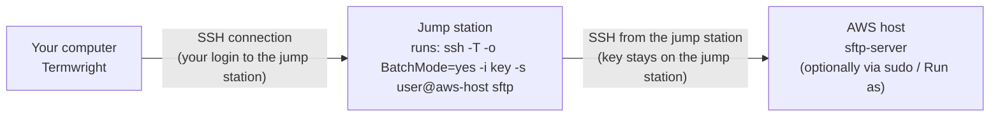

# Termwright User Guide

Termwright is a terminal emulator and session manager for **SSH2, Telnet, Serial, Raw TCP and local shells**, with SFTP/SCP/ZMODEM/YMODEM/XMODEM file transfer, logon automation, key-login setup (including PuTTY `.ppk` keys) Kerberos, SSH certificates and FIDO2 keys, password-manager integration, and SecureCRT-style Python, VBScript or JavaScript scripting. It runs on macOS (Apple Silicon), Windows and Linux, reads/writes SecureCRT®-compatible session files and imports PuTTY, MobaXterm and OpenSSH sessions.


> **New in 0.11:** [Kerberos (GSSAPI) login](#kerberos-gssapi-login), [SSH certificates and FIDO2 security keys](#ssh-certificates-and-fido2-security-keys), [password managers](#password-managers) (1Password, Bitwarden, HashiCorp Vault, any command), **VBScript** logon scripts, and `crt.Screen.Get` / `CurrentRow` read the rendered screen.
>
> **New in 0.10.6:** new application icon, clearer tab close buttons (red on hover) and folder arrows; [how SFTP through a jump station works](#sftp-through-a-jump-station-bastion---how-the-files-travel).
>
> **New in 0.10.5:** SFTP **Run as** any user with your own command (`sudo su - oracle`, `su - admin`, …), answering its password prompts. **0.10.4:** browse as root in the SFTP tab (sudo), also through a jump station. 0.10.3: the SFTP header shows *user@host via jump host*.
>
> **New in 0.10.2:** saved **SecureCRT passwords are imported** (encrypted `Password V2` 02/03, old `Password`, or plain text) into the OS keychain; **key passphrases** in Passwords & Credentials and in the password-vault export.
>
> **New in 0.10.1:** SFTP (and SCP) on the target of an `ssh … host` remote command, through the jump station ([§10](#10-automation-logon-actions-triggers-scripts)); device types with their own username and password (or *No password*), inherited or overridden per session; empty passwords remembered; SCP copies from the SFTP tab; Compare With… on the tab menu with *Ignore prompts*; import sources grouped by app.
>
> **New in 0.10:** device types (login profiles) for EXOS/VOSS/Cisco/Linux with `voss 10.1.1.1` quick connects, command library with variables, send to selected tabs, Quick Open, output alerts, workspaces, folder defaults, paste confirmation, compare outputs, CSV/Ansible/NetBox/AWS import, timestamps, copy as HTML, window size memory and portable mode.
>
> **New in 0.9:** PuTTY `.ppk` keys work directly ([§3](#first-ssh-connection)), SecureCRT-style **Python** scripts with the `crt` object ([§10](#10-automation-logon-actions-triggers-scripts), [SCRIPTING.md](SCRIPTING.md#python-scripts-securecrt-style)), terminal scheme *Auto* and *use for all sessions* ([§13](#13-global-options-reference)).

**Contents**

1. [Install](#1-install)
2. [The main window](#2-the-main-window)
3. [Connecting](#3-connecting) - device types, first SSH connection, [SSH keys: generate, install and store](#ssh-keys-generate-install-and-store)
4. [Sessions and the Session Manager](#4-sessions-and-the-session-manager)
5. [Session Options reference](#5-session-options-reference)
6. [Working in the terminal](#6-working-in-the-terminal)
7. [Command Window, Button Bar and Connect Bar](#7-command-window-button-bar-and-connect-bar)
8. [Logging and capturing output](#8-logging-and-capturing-output)
9. [File transfer](#9-file-transfer)
10. [Automation: logon actions, triggers, scripts](#10-automation-logon-actions-triggers-scripts)
11. [Tunnels, jump hosts and proxies](#11-tunnels-jump-hosts-and-proxies)
12. [Appearance: themes, color schemes, highlighting](#12-appearance-themes-color-schemes-highlighting)
13. [Global Options reference](#13-global-options-reference)
14. [Migrating from SecureCRT, PuTTY or MobaXterm](#14-migrating-from-securecrt-putty-or-mobaxterm)
15. [Keyboard shortcuts](#15-keyboard-shortcuts)
16. [Files and folders Termwright uses](#16-files-and-folders-termwright-uses)
17. [Troubleshooting](#17-troubleshooting)

---

## 1. Install

Download the latest build from the repository's **Releases → nightly** page (or a version tag).

| OS | File | How to install |
|---|---|---|
| macOS (M1–M5) | `Termwright-…-macos-arm64.dmg` or `termwright-macos-arm64.zip` | Open the DMG and drag **Termwright** to **Applications**. The build is not notarized: the first time run `xattr -dr com.apple.quarantine /Applications/Termwright.app` in Terminal (or right-click → Open). |
| Windows 10/11 | `Termwright-…-windows-amd64-setup.exe` or `termwright-windows-amd64.zip` | Run the installer, or unzip and run `termwright.exe`. Needs the WebView2 runtime (built into Windows 11 and current Windows 10). SmartScreen may warn because the file isn't code-signed: **More info → Run anyway**. |
| Debian/Ubuntu | `termwright_…_amd64.deb` / `…_arm64.deb` | `sudo apt install ./termwright_*.deb` |
| Other Linux | `termwright-linux-amd64.tar.gz` / `…-arm64.tar.gz` | Unpack and run `./termwright`. Requires GTK 3 and WebKitGTK 4.1 (`libwebkit2gtk-4.1-0`). |

Optional: install `lrzsz` on the *remote* hosts to use ZMODEM (`sz`/`rz`).

To build from source see the [README](../README.md#build).

## 2. The main window

| Area | What it does |
|---|---|
| **Menu bar** | File, Edit, View, Transfer, Script, Options, Tab, Help. On macOS it is in the top-of-screen menu bar **and** (by default) inside the window; toggle the in-window copy with View → Menu Bar in Window or Global Options → General. |
| **Toolbar** | Connect · Quick Connect · Local Shell · Reconnect · Disconnect · Copy · Paste · Find · Log · SFTP · Run Script · Record · Session Manager / Command Window / Button Bar toggles · Import · Export · Options · Tabbed / Side-by-side / Stacked / Grid layout · Lock · **Connect Bar**. Hover an icon for its name. |
| **Session Manager** (left by default) | Folder tree of saved sessions with a filter box. Drag its inner edge to resize. The header buttons move it to the **other side** of the window and **hide** it; the same is in **View → Session Manager Left / Right** and **View → Session Manager** (or the toolbar toggle, or the command palette). When hidden, a slim **SESSIONS** strip stays on that side of the window - click it to bring the Session Manager back. Position, visibility and width are remembered. |
| **Tabs** | One tab per connection. The dot shows state: green = connected, amber = connecting, red = error, grey = disconnected. `LOG` / `REC` badges show logging / script recording. |
| **Button Bar** | Your own buttons that send commands, run actions or scripts. |
| **Command Window** | Type a command once and send it to the active tab or to every connected tab. |
| **Status bar** | State, protocol, connection details (user@host, server version, route), active transfer %, terminal size and emulation, number of connected tabs. |


## 3. Connecting

There are five ways to open a connection:

1. **Double-click a saved session** in the Session Manager (or right-click → *Connect Terminal* / *Connect SFTP Session*, or select a folder → right-click → *Connect All in Folder*).
2. **Quick Connect** (toolbar ⚡, `File → Quick Connect`): optionally pick a **device type** (default *(none)*; it fills protocol, port and the login steps), then the host (`host`, `user@host` or `host:port`). With a device type, **Use the device type's username and password** is ticked: the login comes from the device type. Untick it to type a different username (and, with *Save session*, a password or *No password*) for this device only. Tick *Save session* to keep it.

   | Inherit the device type's login | Override it for this session |
   |---|---|
   |  |  |

3. **Connect Bar** (toolbar text box): type and press Enter
   - `ssh admin@10.1.1.1`, `ssh -p 2222 -l admin core-sw1`, `ssh host:2222`
   - `telnet 10.1.1.20` or `telnet console-server 2003`
   - `serial COM3 115200` or `serial /dev/ttyUSB0 9600`
   - `raw 10.0.0.5 4001`
   - a **device type and an address**: `voss 10.20.1.11`, `exos 10.1.1.5`, `telnet cisco-ios 10.0.0.1 2003`
   - a saved session name or path, e.g. `Lab/lab-sw01`
4. **Local Shell** (toolbar `>_`): your login shell (zsh/bash on macOS/Linux, PowerShell on Windows).
5. **Recent sessions** on the start page.
6. **Quick Open** (`Cmd+G` / `Ctrl+Shift+G`): type part of a session, folder, host, open tab, library command or menu action and press Enter (Alt+Enter opens a session as SFTP).

   
7. **Workspaces** (File → Workspaces…): reopen a saved set of sessions in its layout with one click; File → Save Workspace… saves the current tabs.

### Device types (login profiles)

Devices log in differently: EXOS is ready at `#` after username and password, VOSS starts at `>` and needs `enable`, Cisco IOS wants `enable` and `terminal length 0`. Instead of building logon actions for every session, define a **device type** once in Global Options → **Device Types** and pick it in Quick Connect, the Connect Bar, a session's Connection page or a folder's defaults.


- Built-in: **EXOS**, **VOSS**, **Cisco IOS**, **Linux** - edit them or add your own (*New*, *Duplicate*).
- **Login steps** answer `login:` / `Password:` prompts; they run for Telnet, Serial and Raw (SSH authenticates before the shell starts).
- **After-login steps** run for every protocol, e.g. `>` → `enable`, `#` → `terminal more disable`.
- **Username and Password**: the device type's own login, with the password stored in the OS keychain (never in `settings.json`). Leave the password empty to be asked at connect time. Tick **No password** for devices whose account has an empty password (e.g. EXOS `admin` out of the box) - Termwright then sends an empty password and never asks. *Forget* removes a saved password.
- Sessions with a device type **inherit** its username and password. In Session Options → Connection (or Quick Connect) untick **Use the device type's username and password** to give that session its own username and password (or *No password*); the device type's login and after-login steps still run.
- In *Send*, `\s` is the username and `\w` the password: from the device type (or the session's own login when it overrides it), or asked once when needed.
- Optional defaults: protocol, port, initial carriage return and a prompt pattern.
- A session's own Logon Actions still run, after the device type's steps.


### First SSH connection


- **New host key**: Termwright shows the key type and SHA256 fingerprint. *Accept & Save* stores it in Termwright's `known_hosts`; *Accept Once* connects without saving. Your `~/.ssh/known_hosts` is also trusted (read-only).
- **Changed host key**: a red warning. Only choose *Replace & Save* if you know the device was re-keyed.
- **Empty passwords**: an account with no password (EXOS `admin`) is remembered too - press Enter at the password prompt with *Remember* ticked, set *No password* on the session, or on its device type.
- **Password**: tick *Save password (OS keychain)* to store it in the macOS Keychain / Windows Credential Manager / Secret Service. Passwords are never written to session files. Remove one with right-click → *Forget Saved Password*.
- **Keys**: Termwright tries the session's identity file, then a running SSH agent (`ssh-agent`, Windows OpenSSH agent), then `~/.ssh/id_ed25519`, `id_ecdsa`, `id_rsa` (unencrypted). The identity file can be an OpenSSH/PEM key or a **PuTTY `.ppk`** key. Encrypted identity files prompt for the passphrase (or use one saved in the keychain).

### Kerberos (GSSAPI) login

For hosts joined to Active Directory / MIT Kerberos (OpenSSH `GSSAPIAuthentication yes`): Session Options → **SSH2 Authentication** → tick **gssapi (Kerberos)** (it is tried first).


- **With a ticket from `kinit`** (file credential cache, `KRB5CCNAME=FILE:…` or `/tmp/krb5cc_<uid>`), Termwright logs in without asking anything.
- **Without a ticket**, Termwright logs in to Kerberos itself: the **Kerberos principal** (e.g. `alice@CORP.EXAMPLE.COM`; blank = the session's user name) and its password, asked once per run.
- The realm's KDCs come from `krb5.conf` (`KRB5_CONFIG`, `/etc/krb5.conf`, Windows `krb5.ini`), or from DNS SRV records when the principal includes the realm. **Service name** defaults to `host@<hostname>` (`%H` = hostname).
- Mutual authentication is used, as OpenSSH requires. macOS's built-in `API:` / Windows logon tickets are not read directly - run `kinit -c FILE:/tmp/krb5cc_$(id -u)` or let Termwright ask for the password.

### SSH certificates and FIDO2 security keys

- **OpenSSH certificates** (keys signed by your organisation's SSH CA): put `<key>-cert.pub` next to the identity file - Termwright offers the certificate first, then the plain key. A certificate stored elsewhere goes in **Certificate** (SSH2 Authentication page). Certificates loaded in your ssh-agent are used too.
- **FIDO2 / U2F hardware keys** (`sk-ssh-ed25519@openssh.com`, `sk-ecdsa-sha2-nistp256@openssh.com`, e.g. YubiKey): the private key never leaves the device, so Termwright signs through **ssh-agent**. Set the `id_ed25519_sk` file as identity file and load it once with `ssh-add ~/.ssh/id_ed25519_sk` (touch the key / enter its PIN). If it is not loaded, Termwright tells you and offers **Retry** after you ran `ssh-add`. Each login may ask you to touch the key. On macOS use an OpenSSH with security-key support (e.g. Homebrew `openssh`) for `ssh-add`.

### SSH keys: generate, install and store

Termwright can create SSH keys, put the public key on a server for you and switch a session from password to key login. Everything is in one dialog:

- **With a connected SSH2 tab** (password login): right-click the tab → **Set Up Key Login…**. The key is generated (or reused) and installed on that server.
- **Without a connection**: **Options → Set Up Key Login / Generate Key…** only creates a key pair, so you can copy the public key to a device yourself.


**1. Generate or choose a key**
- **Generate a new key**: *Ed25519* (recommended), *RSA 4096* (older devices) or *ECDSA P-256*. *Save as* defaults to `~/.ssh/termwright_<host>_<type>`; *Comment* is written into the public key (e.g. `you@laptop`).
- **Use an existing key on this computer**: keys found in `~/.ssh` are listed (OpenSSH/PEM or PuTTY `.ppk`); *Browse…* picks one elsewhere.
- **Passphrase** (optional, asked twice for a new key) encrypts the private key file.

**2. Install, test and use it** (tick what you want under *Then*)
- **Add the public key to the server**: appended to `~/.ssh/authorized_keys` on Linux/macOS/BSD (folder and file permissions fixed). On Windows OpenSSH it goes to `%USERPROFILE%\.ssh\authorized_keys`, or for administrators to `%ProgramData%\ssh\administrators_authorized_keys` with the ACL sshd requires. A key that is already there is not added twice.
- **Test a key-only login**: opens a second connection that may use only that key, so you know it works before relying on it.
- **Use this key for the session from the next connection**: sets the session's identity file (Session Options → SSH2 Authentication) and tries public key first; the password stays as a fallback.

**3. Where things are stored**

| What | Where |
|---|---|
| Private key | the *Save as* file, permissions `600` (owner only) |
| Public key | the same name + `.pub` (shown in the dialog with a *Copy* button) |
| Passphrase | OS keychain, only if you tick *Save the passphrase in the OS keychain*; otherwise asked when connecting |
| Which key a session uses | the session file (*Identity file*), never the key itself |

Saved passphrases are listed in **Options → Passwords & Credentials → Key Passphrases**: see which sessions use each key, *Change…* (the new passphrase is checked against the key file), *Forget*, or *Add…* one for any key file. When Termwright asks for a key's passphrase while connecting, tick *Save passphrase (OS keychain)* to remember it. Passphrases are included in the password-vault export; back up the key files themselves separately.


Network devices without a Unix/Windows shell (switches, routers) can't be set up automatically: generate the key, click *Copy* next to the public key and paste it into the device's own command (e.g. `ip ssh pubkey-chain` on Cisco IOS; see the device's SSH user-key commands for EXOS and VOSS).

### Reconnecting

When a connection drops the tab shows `[Disconnected] Press Enter to reconnect`. Press **Enter**, use **Reconnect** (`Cmd/Ctrl+Shift+R`), or enable **Auto reconnect** in the session (retries after 2, 5, 10, 20, 30 s…, up to 20 times; never after you disconnect yourself or after a login failure).

## 4. Sessions and the Session Manager

- **New session**: `+` in the Session Manager header (goes into the selected folder) or right-click → *New Session*.
- **New folder**: folder-plus icon or right-click → *New Folder*. Folders can be nested.
- **Edit**: right-click → *Properties…* (or *Options → Session Options* for the active tab).
- **Duplicate / Rename / Delete**: right-click a session. Deleting a folder deletes the sessions inside it (you are asked first).
- **Move**: drag a session or folder onto another folder (or onto a session to drop into its folder; onto empty space for the top level).
- **Filter**: type in *Filter sessions* to search names, hosts, users and paths.
- **Tooltip**: hover a session to see protocol, user@host:port and its description.
- **Icons** tell the session type at a glance:

  | Icon | Session |
  |---|---|
  |  green `›_` | SSH2 terminal |
  |  blue `⇅` | SSH2 session that opens as an SFTP file browser |
  |  orange `T` | Telnet (not encrypted) |
  |  purple connector | Serial console |
  |  slate `$` | Local shell |
  |  pink `<>` | Raw TCP |
  | small arrow badge | reached through a jump station (remote command `ssh … host`) |
- **Default session**: a session file named `Default` at the top level (e.g. imported from SecureCRT) is used as the template for new sessions.

### Discover devices

**File → Discover Devices…** (also in the command palette) finds the devices in a network, tells what each one is, and adds the ones you pick as sessions. It **never tries to log in**.


1. **Addresses**: a network (`10.20.0.0/24`), a range (`10.20.0.10-80` or `10.20.0.10-10.20.1.20`) or single addresses, separated by commas or spaces. Up to 1,024 addresses (a /22) per scan.
2. **SNMP** (on by default): a read-only SNMP v2c community (`public` is filled in). **Show / Hide** next to it reveals what you typed. The community is used for this scan only and is not saved. Devices that answer report their system name, model and software - the most reliable information. If *no* device answers, a note says so: check the community, that SNMP is enabled, and that the devices' SNMP access list allows your computer.
3. **Scan**. For every address Termwright collects, in parallel:
   - **Open ports**: SSH (22), Telnet (23), HTTP (80), HTTPS (443), SMB (445), RDP (3389), printing (9100, 631), SIP (5060).
   - **SSH greeting** (e.g. `OpenSSH_8.1`, `Mocana SSH`) and the **Telnet banner and login prompt** (Termwright answers the Telnet option negotiation, so devices show their banner, e.g. `ExtremeXOS (X440G2…) version 31.7 / login:`).
   - **Web interface**: title of the start page, `Server` header, login realm, certificate owner, and product names on the page (ExtremeXOS, TerraMaster, Yealink, LaserJet, …).
   - **SIP** (UDP 5060): phones answer with their model and firmware, e.g. `Yealink SIP-T46S 66.86.0.15`.
   - **SNMP** system name, description and vendor number; **DNS** name (home routers often register phone names such as `Galaxy-S22`).
   - **mDNS (Bonjour) name**: many devices answer with the name they give themselves, e.g. `Natarajans-iPhone`, a printer or NAS name.
   - **MAC address** of devices on your own subnet (from your computer's ARP table) - this also finds live devices with no open port. With the **MAC vendor list** (*Download the MAC vendor list*: the IEEE registry, about 3 MB, saved in the data folder) the maker is shown too.
   - **This computer** is listed and marked *this computer*.

   Devices appear while the scan runs, sorted by address; **Stop** ends it early.
4. **Results**: each device has an icon for its kind, its name (SNMP name, DNS name or address), MAC address, vendor and system, and the services that answered. Click **ⓘ** to see *what the result is based on* - every piece of evidence that was found.

   

   

   | Icon | Kind | Recognised by |
   |---|---|---|
   |  | Network switch | SNMP, Telnet banner or web page naming VOSS, Fabric Engine, ExtremeXOS/Switch Engine, IOS, NX-OS, Junos, EOS …; network vendor MAC; embedded SSH servers (Mocana); devices with Telnet open |
   |  | Router | ISR/ASR, IOS-XR, RouterOS, VyOS, FRITZ!Box, OpenWrt … |
   |  | Firewall | FortiGate, PAN-OS, ASA/Firepower, Check Point, SonicWall, pfSense/OPNsense |
   |  | Wireless access point | "access point", AP models, UniFi, Aironet, Ruckus |
   |  | Server (Linux/Unix) | Linux/BSD in SNMP or the SSH greeting, ESXi/Proxmox, iDRAC/iLO; SSH with file sharing |
   |  | NAS / storage | TerraMaster, Synology, QNAP, TrueNAS, ReadyNAS, ASUSTOR, WD My Cloud (web page, SNMP or MAC) |
   |  | Computer | Windows (SNMP, RDP, SMB without SSH), Apple MAC addresses, this computer |
   |  | Mobile phone / tablet | names such as iPhone, iPad, Galaxy, Pixel, Redmi, OnePlus (mDNS or DNS); a phone maker's MAC address with no open ports; a **private (random) MAC address** with no open ports - Android and iOS use one per Wi-Fi network, so the maker cannot be read from it (no vendor list can name it) |
   |  | IP phone | SIP answer, phone models (Yealink, Poly/Polycom, Grandstream, Snom, Mitel, Cisco, Avaya …), phone vendor MAC |
   |  | Printer | printer models in SNMP or the web page (LaserJet, Brother, Canon, Epson …), printing ports |
   |  | Unknown device | nothing named it - open **ⓘ** to see what answered |

   Product names win over generic words: a NAS whose SNMP says "Linux" but whose web page says "TerraMaster" is shown as a NAS.
5. **Add**: devices with SSH or Telnet are ticked (those already in the Session Manager are marked *in sessions* and left unticked; this computer is never ticked). Devices without a login port are shown but cannot be added; tick *Only devices with SSH or Telnet* to hide them. Pick a **device type** per device - Termwright suggests one from what the device reports (VOSS, EXOS, Cisco IOS, Linux …) or, failing that, from the **Telnet login prompt** compared with the first login step of your device types (e.g. EXOS `login:`, VOSS `Login:`). Type or choose a **folder** (default *Discovered*) and click **Add N Sessions**. Sessions are named after the device and get its vendor and system as description; folder defaults apply as usual.

   

Scanning connects to many addresses and can be noticed by security monitoring: scan only networks you are allowed to scan, such as your lab. Termwright asks you to confirm this before the first scan.

**Folder Defaults** (right-click a folder → *Folder Defaults…*): username, device type, jump session, identity file, keyword set and color scheme that every session in the folder (and sub-folders) uses when its own field is empty. The nearest folder wins.


**Workspaces** (File → Workspaces…, File → Save Workspace…): a named set of sessions with their layout (tabs, side by side, stacked, grid). *Open* reconnects them all; *Rename* and ✕ manage the list.


## 5. Session Options reference


| Page | Settings |
|---|---|
| **Connection** | Name, folder, protocol (SSH2 / Telnet / Serial / Local Shell / Raw), device type, **Connect as** (SSH2: terminal or SFTP file browser only), hostname, port, username (blank = ask), password (saved, *No password*, or from a **password manager**), description. |
| **SSH2 Authentication** | Auth methods to try (**gssapi / Kerberos**, public key, keyboard-interactive, password), Kerberos principal and service name, identity file, **certificate**, *save password in OS keychain*, **agent forwarding**, **X11 forwarding**, keep-alive interval. |
| **Port Forwarding** (SSH2) | Local (`-L`), Remote (`-R`) and Dynamic SOCKS5 (`-D`) forwards; see [§11](#11-tunnels-jump-hosts-and-proxies). |
| **Jump Host / Proxy** | Connect via another saved SSH2 session (chainable) or through a SOCKS5 / HTTP CONNECT proxy. |
| **Serial** | Port (Scan lists detected ports), baud, data bits, parity, stop bits, **flow control** (none, RTS/CTS, XON/XOFF), assert DTR/RTS on open. |
| **Local Shell** | Command to run (blank = login shell) and start directory. |
| **Logon Actions & Triggers** | Automate logon (Expect/Send table with hide, trailing CR and credentials), send initial CR, logon **script** with arguments, SSH2 **remote command**, and triggers that answer prompts at any time; see [§10](#10-automation-logon-actions-triggers-scripts). |
| **Terminal** | Emulation (Xterm, VT100/102/220, ANSI, Linux), TERM override, scrollback lines, color scheme, font and size, Backspace sends DEL (^?) or BS (^H), keyword set, auto reconnect. |
| **Log File** | File name with tokens, start on connect, append, raw log, per-line prefix; see [§8](#8-logging-and-capturing-output). |

*Save & Connect* saves and opens a tab. Changes to an open session apply on the next (re)connect.

| Serial | Terminal |
|---|---|
|  |  |

## 6. Working in the terminal

- **Copy / Paste**: select text (copied automatically when *Copy on select* is on). Paste with right-click (when *Paste on right-click* is on; Shift+right-click opens the menu), `Cmd+V` on macOS, `Ctrl+Shift+V` on Windows/Linux, or `Shift+Insert`. Copy also with `Ctrl+Insert`.
- **Find**: `Cmd/Ctrl+Shift+F` searches the scrollback; Enter = next, Shift+Enter = previous, Esc closes.
- **Zoom**: `Cmd/Ctrl +`, `Cmd/Ctrl -`, `Cmd/Ctrl 0`.
- **Clear / Reset**: Edit → Clear Scrollback, Clear Screen, Reset Terminal.
- **Links**: URLs in the output open in your browser when clicked.
- **Send Break**: Tab → Send Break (serial break, telnet BREAK or SSH break request, e.g. to reach a boot loader / ROMMON).
- **Send Text File**: Transfer → Send Text File… pastes a file line by line (respects *Paste line delay*).
- **Layouts**: View → Tabbed / Tile Side by Side / Tile Stacked / Tile Grid, or the four layout buttons. In tiled views click a pane to make it active.


- **Lock**: Tab → Lock Session (or the lock button) blocks keyboard input to a tab until you enter the password you chose; *Lock All Sessions* locks every tab.
- **Tab menu** (right-click a tab): Reconnect, Disconnect, Clone, Log, Save Scrollback, Session Options, Rename Tab, Close, Close Other Tabs. Middle-click closes a tab.

## 7. Command Window, Button Bar and Connect Bar

**Command Window** (View → Command Window, `Cmd/Ctrl+Shift+K`)
- Enter sends the text plus Enter; Shift+Enter adds another line (each line is sent with Enter).
- Send to the **Active tab**, **All connected tabs**, or **Selected tabs** - tick tabs with *Choose…* or right-click a tab → *Add to Send Group* (a `SEL` badge marks them).

  
- *Send characters immediately* sends each key as you type.
- ↑/↓ recall history.

**Button Bar** (View → Button Bar)
- `+` adds a button. Right-click a button to edit, move, delete or toggle *Send to All Tabs*.
- In *Options → Global Options → Button Bar* each button can **send text** (escapes: `\r` Enter, `\n`, `\t`, `\e` Esc, `\x03` Ctrl+C), run an **action** (e.g. *Open SFTP Tab*) and/or run a **script**.

**Connect Bar**: see [§3](#3-connecting). Hide it in Global Options → General.

**Command Library** (Script → Command Library…, `Cmd+E` / `Ctrl+Shift+E`)


- Save commands in folders (per device type, troubleshooting, config snippets); several lines are sent one after another.
- `{{name}}` or `{{name:default}}` placeholders are asked for when sending, e.g. `show vlan {{vlan_id:10}}`.
- Send to the active tab, the selected tabs or all connected tabs; double-click sends. Library commands also appear in Quick Open.

**Paste safety**: pasting more than one line asks first and shows a preview (Global Options → General → *Confirm before pasting more than one line*). The paste line delay (Terminal & Appearance) paces slow devices.

**Compare Outputs** (Tab → Compare Outputs…, or right-click a tab → **Compare With…** and pick another open tab or a file): side-by-side diff of two tabs' scrollback or two files - e.g. `show running-config` before and after a change, or the same command on two switches. Options ignore whitespace, timestamps/uptime counters and - optionally - **prompts** (`core-sw1:1#` vs `core-sw2:1#`, editable pattern), or show only the differences.


**Timestamps and copying**: right-click a tab (or the terminal) → *Show Timestamps* prefixes each new output line with the time (display only; logs have their own setting). **Copy as HTML (with colors)** (right-click in the terminal; Shift+right-click when right-click paste is on) copies the selected text with its colors and bold text, so you can paste colored output into e-mail, Word, Teams or a ticket; plain-text editors receive the plain text. Links printed by devices (including OSC 8 hyperlinks) are clickable.


## 8. Logging and capturing output

- **Start/stop a log**: toolbar *Log*, File → Log Session…, or the tab menu. The tab shows a `LOG` badge.
- **Automatic logging**: Session Options → Log File → *Start log upon connect*.
- **File name tokens**: `%H` host, `%S` session, `%P` port, `%U` user, `%R` protocol, `%Y %M %D` date, `%h %m %s` time, `%t` ms, `%%` percent. Example: `~/logs/%S-%Y%M%D-%h%m%s.log`. With no name, logs go to the Logs folder (Global Options).
- **Plain vs raw**: by default escape sequences and colors are removed; *Raw log* keeps everything exactly as received.
- **Line prefix**: e.g. `[%h:%m:%s] ` timestamps every line.
- **Save Scrollback As…** (`Cmd/Ctrl+Shift+S`) writes the whole scrollback to a text file; **Save Selection As…** saves only the selected text.


## 9. File transfer

### SFTP browser


Open with the toolbar SFTP button, **Transfer → Open SFTP Tab** or `Cmd/Ctrl+Shift+P` while an SSH2 tab is connected. It reuses that login (no second password).

**Working directory detection** (SFTP tab opened from a terminal tab):


Working directory detection is **on by default**. When you open an SFTP tab from a terminal tab (toolbar SFTP button, Transfer → Open SFTP Tab, or the tab's right-click menu), Termwright checks over a separate channel that the login shell is **bash or zsh**, and if the terminal is sitting at a prompt it turns folder reporting on in that shell for you - the typed line is hidden, the screen stays as it was. From then on the SFTP tab opens in, and follows, the terminal's folder. This also works **through a jump station**, e.g. an AWS host reached through a bastion: open *SFTP Tab on <target> (through this login)* and the check and the folder reporting happen on the target. Network devices are left alone (their CLI is not bash or zsh). **The terminal's user is followed too:** after `sudo su -` (or `sudo -i`) in the terminal, the SFTP tab switches to browsing **as root** (through sudo, like *Run as ▾ → root*) and opens root's folder; after `sudo su - oracle` it browses as `oracle` (*sudo su - oracle*); after `exit` it goes back to the login user. If sudo asks for a password, Termwright asks for it once. Each part can be turned off in **Options → Global Options → General → SFTP from a terminal**: *Working directory detection*, *SFTP tabs follow the terminal folder* and *SFTP tabs browse as the terminal's user*. The **>_ Terminal ▾** button in the server pane offers:


- **Go to Terminal Folder** - jump to the folder the shell is in now.
- **Follow Terminal Folder** - the SFTP pane changes folder whenever you `cd` in the terminal (the button then reads *Following*). On by default; switch it off here for this tab, or for all tabs in Global Options.
- **Open This Folder in the Terminal (cd)** - the reverse: the terminal changes to the folder shown in SFTP. Also on the right-click menu of a remote folder.
- **Enable Folder Detection in This Shell** - types one line into the terminal (bash or zsh) that makes the shell report its folder after every prompt, until you log out.
- **Enable Folder Detection Permanently…** - after a confirmation, adds the same line to `~/.bashrc` (or `~/.zshrc`) on that server, once.

If the shell still does not report its folder (detection turned off, another shell, or the terminal was busy), a blue *Working directory detection* bar offers the same two buttons; close it with ✕ (remembered). Termwright understands the standard escape sequences OSC 7 (`file://host/path`), OSC 1337 `CurrentDir=` / `RemoteHost=user@host` and OSC 633 `P;Cwd=`, so shells already set up for iTerm2, VS Code, WezTerm or Tabby work as they are. For **fish**: `function _tw_cwd --on-variable PWD; printf '\e]7;file://%s%s\a' (hostname) $PWD; end` in `~/.config/fish/config.fish`. Network devices (VOSS, EXOS, …) do not report a folder. 

Folders use the same colored folder icon as the Session Manager. Files are colored by type so they stand out at a glance: text and configuration files blue, archives amber, images pink, firmware and binaries purple, scripts green, keys and certificates red, everything else gray. Symbolic links carry a small arrow, and hidden (dot) files are dimmed.

**Standalone SFTP session** (its own login, no terminal): right-click an SSH2 session in the Session Manager → **Connect SFTP Session**, or right-click a terminal tab → **Connect SFTP Session (new login)**. Use this for devices such as VOSS that refuse a second channel on an existing SSH connection. To make a session always open this way, set Session Options → Connection → **Connect as: SFTP file browser only**; right-click → **Connect Terminal** still opens a shell. The tab right-click menu also offers **Open SFTP Tab (same login)**.

- Left pane = this computer, right pane = the server. Type a path and press Enter, use ↑ (parent), Backspace, or double-click folders.
- Select with click, Ctrl/Cmd+click, Shift+click, Ctrl/Cmd+A. **→** uploads, **←** downloads, double-clicking a file transfers it to the other side. Whole folders are copied recursively.
- Right-click (server side): Download, Rename, Delete (asks first; folders are deleted with contents), New Folder, Refresh. Local files are never deleted by Termwright.
- **Sync ⇉ / ⇇** copies only new or changed files (size or newer time) from the current local folder to the current remote folder or back. Nothing is deleted.
- The transfer queue shows progress; ✕ cancels, *Clear finished* tidies the list.
- **Bookmarks** (☆ in each pane's header): *Bookmark This Folder…* saves the current folder; the ☆ menu lists bookmarks to jump to and removes the current one. Server bookmarks belong to their session; local bookmarks are shared by all sessions. The star turns solid (★) in a bookmarked folder.
- **Server-to-server copy**: with two SFTP tabs open (e.g. two switches), right-click files or folders on one server → **Copy to <other server>: <its current folder>**. The data streams through this computer; nothing is stored locally. The ⇄ entry in the queue shows progress.
- **Copy via SFTP / SCP** (the two buttons between the panes; the choice is remembered per session): browsing always uses SFTP, but → / ← (and double-click, Upload/Download in the right-click menu) can copy with **SCP** over the same login - useful when a device's SFTP server is slow or limited. Folders are copied recursively; the queue shows `↑ SCP` / `↓ SCP`. Sync, resume and server-to-server copy stay SFTP.

  
- **Run as another user** (*Run as ▾* in the server pane header): browse the server as root or any other user, like switching user in the terminal.
  - **root (sudo)**: starts the SFTP server with `sudo` over the same connection and opens `/root`. If sudo asks for a password you type it once for the tab (kept in memory only).
  - **Other Command…**: type the command you would use in the terminal - `sudo su - oracle`, `su - admin`, `sudo -iu postgres`, `pbrun …`. Termwright runs it on a terminal, shows every **password prompt** it prints (sudo, su, one-time codes) so you can answer, waits for the new shell, then replaces that shell with the SFTP server - so files are read and written as that user. The last six commands are listed in the menu for the session.
  - The button turns red (*as oracle ▾*), the header reads *oracle @ host*, and **Back to &lt;login user&gt;** returns to the normal login. Works on a host behind a jump station too.
  - Requirements: the OpenSSH `sftp-server` program on the host (standard on Linux) and a POSIX shell for the user. Errors (wrong password, *not in the sudoers file*, *must be run from a terminal*) are shown with the command's last output. Copies use SFTP in this mode (*Copy via SCP* is disabled).

  
  
  
- **Resume** (⟳ on a failed or cancelled SFTP copy): restarts the same copy; partially copied files continue from where they stopped and files that are already complete are skipped.

### SFTP through a jump station (bastion) - how the files travel

Many cloud hosts can only be reached from a jump station, often with a private key that is stored **on the jump station** (a session whose remote command is `ssh -t -i ~/.ssh/aws_key user@aws-host`, see [§10](#10-automation-logon-actions-triggers-scripts)). For such a session, *Open SFTP Tab on user@aws-host (through this login)* browses the AWS host directly:



- **One live pipe, no copies in between.** Termwright opens one extra channel on the SSH connection it already has to the jump station and runs the jump station's own `ssh` there to start the SFTP server on the AWS host. Uploads and downloads are streamed through that pipe: **from the AWS host, through the jump station's memory, straight to your Desktop** (and the reverse for uploads). Nothing is written to disk on the jump station, and no temporary copy is needed.
- **No second login, no key copying.** Your computer never sees the AWS key; the jump station uses it exactly as when you type the command in the terminal. Your existing login (password, MFA) is reused.
- **Speed** is limited by the slower of the two links (your computer ↔ jump station, jump station ↔ AWS host); both are encrypted SSH.
- **Copy via SCP** in this tab also goes to the AWS host through the same pipe (`scp -t` / `scp -f` run on the AWS host).
- **Run as / root** (*Run as ▾* in the header, below) switches the AWS side to root or another user; the pipe is the same, only the SFTP server on the AWS host runs as that user.
- The header shows *user@aws-host via jump-station*, and the status bar *SFTP to … through …*, so you always know which machine you are looking at. Both machines may have the same home path (e.g. `/home/you`); the listing is the AWS host's.


### ZMODEM (sz / rz)

- **Download**: on the remote host run `sz file1 file2…`. Termwright detects it and saves the files to your **Downloads folder** (Global Options → General); a notification shows where.
- **Upload**: run `rz` on the remote host; Termwright opens a file picker. Cancel aborts the transfer cleanly.
- Requires `lrzsz` on the remote host. Works over SSH, Telnet, serial and local shells.

### XMODEM (serial / boot loaders)

- **Transfer → Send File with XMODEM…**: start the device's XMODEM receive command first (or right after). Choose 1K blocks (XMODEM-1K) or classic 128-byte blocks if the receiver is old.
- **Transfer → Receive File with XMODEM…**: choose where to save, then start the send on the device. Trailing padding (0x1A) is removed.

### YMODEM (serial / boot loaders)

- **Transfer → Send Files with YMODEM…**: pick one or more files, then start the receiver on the device (`rb`, or the boot loader's `loady`). File names and sizes are sent in the batch header.
- **Transfer → Receive Files with YMODEM**: start the send on the device (`sb file…`); files land in your **Downloads folder**.

### SCP

To copy with SCP while browsing with SFTP, set **Via: SCP** in the SFTP tab (above). For devices that offer SCP but not SFTP: **Transfer → SCP Upload File…** or **SCP Upload Folder…** (pick, then the remote folder/path) and **SCP Download…** (remote file *or folder* path, then a local folder). Folders are copied recursively (`scp -r`).

## 10. Automation: logon actions, triggers, scripts

**Logon Actions** (Session Options → Logon Actions & Triggers):


- **Automate logon** turns the Expect/Send table on or off; **Send initial carriage return** presses Enter right after connecting (wakes up consoles and terminal servers).
- **Add… / Edit… / Delete** and **▲ ▼** manage ordered steps. Each step waits for its **Expect** text, then sends **Send**. Leave Expect empty to send immediately.
- In the **Expect/Send Properties** dialog (Add… / Edit… or double-click a row): **Hide** masks the Send text in the table, **Send trailing carriage return** adds Enter (on by default), and **Credentials** picks a named credential.
- Send escapes: `\r` CR, `\n` LF, `\b` backspace, `\t` tab, `\e` Escape, `\v` paste clipboard, `\p` pause 1 s, `\s` username and `\w` password (from the chosen credential, otherwise the session's username and saved password), `\\` backslash, `\xHH` any byte.
- Example (Cisco): `Username:` → `\s`, `Password:` → `\w` (Hide), `>` → `enable`, `Password:` → `\w`, `#` → `terminal length 0`.
- **Logon script**: tick it, choose a JavaScript (`.js`) or **SecureCRT-style Python (`.py`)** script, and optionally give **Arguments** (`scriptArgs` in JavaScript, `crt.Arguments` in Python). SecureCRT `.vbs` scripts are kept in the session but skipped with a notice.

**Remote command** (SSH2 section of the same page): runs a command instead of a login shell; a terminal is still allocated and the tab ends when the command exits. Jump-station example — log in to the jump host and go straight on to an AWS instance with the key that is stored *on the jump host*:

```
ssh -t -i ~/.ssh/aws_key ec2-user@10.0.0.5
```

(Without `-t` the target gets no terminal. Alternatively use Session Options → Firewall → *Jump session*, which tunnels through the jump host but uses a key on *this* computer.)

**SFTP on the target of a remote command.** When the remote command is `ssh … user@host`, SFTP can browse either machine:

- right-click the terminal tab → **Open SFTP Tab on &lt;jump host&gt; (same login)** or **Open SFTP Tab on &lt;user@host&gt; (through this login)**;
- right-click the session in the Session Manager → **Connect SFTP Session to &lt;jump host&gt;** or **… to &lt;user@host&gt; (through &lt;jump host&gt;)**;
- Session Options → Logon Actions → **SFTP opens on**: choose which one the SFTP toolbar button, *Connect SFTP Session* and *Connect as: SFTP* use.


The server pane's header then reads **user@host via &lt;jump host&gt;**, and the status bar *SFTP to user@host through &lt;jump host&gt;*. If the target's home folder has the same path as the jump station's (e.g. `/home/you` on both), compare the files to tell them apart - the listing is the target's. Through the jump station, Termwright runs `ssh -T -o BatchMode=yes <your options> -s user@host sftp` there, with the same key and options as your command (`-t` is dropped), so the key never leaves the jump station. **Copy via SCP** in that tab also goes to the target. Because of `BatchMode`, the key must work without typing anything (no passphrase, or one held by the jump station's ssh-agent); otherwise the tab shows ssh's error, e.g. *Permission denied (publickey)*.


**Credentials** (Options → Passwords & Credentials → Credentials): named username/password pairs shared by many sessions; passwords are stored in the OS keychain.

**Alerts** (Global Options → **Alerts**): when output in *any* tab matches a pattern (text or regular expression), Termwright shows a notice, marks the tab with a red dot, can beep and - while it is in the background - shows an operating-system notification. Each pattern fires at most once every 5 seconds per tab. Two disabled examples (syslog severity 0-2 messages, `CRITICAL` / `link down`) are included.


**Triggers**: whenever output contains a pattern (text or regular expression), send a response, e.g. `--More--` → space, `\[y/n\]` (regex) → `y\r`. Limited to 20 per 10 seconds to avoid loops.

**Python scripts (SecureCRT style)**: `.py` files run with your installed Python 3 and get SecureCRT's `crt` object, so existing SecureCRT logon and automation scripts usually work unchanged. Use them as a session's *Logon script*, from Script → Run Script…, a button or a key binding. Set a different interpreter in Global Options → General → *Python interpreter*. Example:

```python
# $language = "Python3"
crt.Screen.WaitForString("login:", 10)
crt.Screen.Send("admin\r")
crt.Screen.WaitForString("Password:")
crt.Screen.Send(crt.Dialog.Prompt("Password", "Login", "", True) + "\r")
for dut in crt.Arguments:            # the Arguments field, e.g. DUT1 DUT2
    crt.Screen.Send("ping " + dut + "\r")
    if crt.Screen.WaitForStrings(["#", "unreachable"], 30) == 2:
        crt.Dialog.MessageBox(dut + " is unreachable", "Ping", ICON_WARN)
```

Supported `crt` members, timeouts and limits are listed in [SCRIPTING.md](SCRIPTING.md#python-scripts-securecrt-style).

**VBScript scripts** (Windows): SecureCRT `.vbs` logon scripts run unchanged with Windows Script Host - the `# $language = "VBScript"` header is accepted, `Sub Main` is called, and `crt.Screen`, `crt.Session`, `crt.Dialog`, `crt.Arguments`, `crt.Sleep` work with their optional arguments. See [SCRIPTING.md](SCRIPTING.md#vbscript-scripts-securecrt-style-windows).

**Reading the screen**: in Python and VBScript, `crt.Screen.Get(row1, col1, row2, col2)`, `Get2`, `CurrentRow` and `CurrentColumn` read the screen exactly as it is rendered in the tab, so `crt.Screen.Get(row, 1, row, crt.Screen.CurrentColumn - 1)` returns the current prompt (e.g. `core-sw1:1#`).

**JavaScript scripts**: Script → Run Script…, a session's *Logon script*, a key binding or a button. Full API in [SCRIPTING.md](SCRIPTING.md). Example:

```js
term.sendLine("show vlan 10");
var out = term.readUntil(/# $/m, 10000);
log(out && out.indexOf("not found") < 0 ? "VLAN 10 present" : "VLAN 10 missing");
```

**Record a script**: Script → Start / Stop Recording (toolbar ●). Type your commands; when you stop, Termwright saves a `.js` that waits for each prompt and replays the commands.

**Key Map** (Global Options → Key Map): click the *Keys* box, press a combination (e.g. `Ctrl+Shift+F2`), then choose text to send, an action and/or a script. Key bindings take priority over the remote program while a terminal has focus.

| Key Map | Button Bar |
|---|---|
|  |  |


**Master password** (Options → Passwords & Credentials → Master Password): when set, Termwright asks for it at start-up before it uses any saved session, credential or device type password or key passphrase. The passwords stay in the OS keychain; the master password only gates their use by Termwright.

**Key Passphrases** (same dialog): passphrases of encrypted SSH keys saved in the OS keychain - change, forget or add them; see [SSH keys](#ssh-keys-generate-install-and-store).


### Password managers

**1Password, Bitwarden, HashiCorp Vault, or any command**: instead of saving a password, click **Password manager…** next to a session's, device type's or credential's password and enter a reference. Termwright tests it (you only see *OK - got an N-character secret*), stores just the reference, and reads the secret each time it connects - kept in memory for 10 minutes, never written to disk.

| Reference | Reads | Needs |
|---|---|---|
| `op://Network/core-sw1/password` | 1Password item field | 1Password CLI `op`, signed in (desktop-app integration or service account) |
| `bw://core-sw1`, `bw://core-sw1#username` | Bitwarden item password (or another field) | Bitwarden CLI `bw`, logged in; Termwright asks for the master password once to unlock |
| `vault://secret/network/core-sw1#password` | HashiCorp Vault KV v2 (or v1) field | Vault address and token in *Password Managers*, or `VAULT_ADDR` / `VAULT_TOKEN` / `vault login` |
| `cmd://security find-generic-password -s lab -w` | the output of any command | the command |

| Choose a reference | Session using it |
|---|---|
|  |  |

**Password Managers** (Options → Passwords & Credentials → Password Managers): the reference formats, the Vault address and token (saved in the OS keychain), a *Test* box and *Forget fetched secrets*. If a password manager is unavailable when connecting, Termwright shows why and asks for the password as usual (typing it does not replace the reference). CLIs installed with Homebrew, winget or Scoop are found even when the app was started from the Dock / Start menu.


Device types can use a reference too, so a whole fleet logs in with a password that lives only in your password manager:


**Password vault export/import** (same dialog → Export / Import): writes all saved session passwords, device type passwords, SSH key passphrases and credentials into one `.twvault` file encrypted with AES-256-GCM (scrypt-derived key). Import it on another computer with the same passphrase. Vault files made before 0.11.4 use an older format: export them again from 0.11.4 or later.

## 11. Tunnels, jump hosts and proxies

**Port forwarding** (Session Options → Port Forwarding, SSH2 only); active while the session is connected:

| Type | Listens on | Connects to | Example |
|---|---|---|---|
| Local | this computer (`127.0.0.1` by default) | a host reachable from the server | Listen 8443 → `10.0.0.5:443`, then browse `https://localhost:8443` |
| Remote | the server | a host reachable from this computer | Listen 9000 on server → `127.0.0.1:3000` |
| Dynamic | this computer | anything (SOCKS5 proxy) | Listen 1080, set your browser's SOCKS proxy to `127.0.0.1:1080` |


**Jump host**: pick another saved SSH2 session; Termwright logs into it first and tunnels through (the jump session can itself use a jump host). Works for SSH2, Telnet and Raw sessions.


**Proxy**: SOCKS5 or HTTP CONNECT with optional user (password asked when connecting).

**X11 forwarding** needs a local X server (XQuartz on macOS, VcXsrv/X410 on Windows, built in on Linux). **Agent forwarding** lets the remote host use your local SSH agent keys.

## 12. Appearance: themes, color schemes, highlighting


- **UI theme**: Global Options → General → *Follow system*, *Dark* or *Light*, plus an **accent color**.
- **Terminal color scheme**: Global Options → Terminal & Appearance (default for all sessions) or Session Options → Terminal (per session). Built in: Default, Classic, Green Screen, Light, Solarized Dark/Light, Dracula, Nord, Gruvbox Dark, Tomorrow Night, Catppuccin Mocha, Tango. Common SecureCRT scheme names map to these automatically.
- **Custom schemes**: Global Options → Color Schemes → pick a scheme → *Copy as new…*, then edit any of the 20 colors with live preview. *Export…/Import…* share schemes as JSON.


- **Font / cursor**: Global Options → Terminal & Appearance (font family, size, cursor style, blink, scrollback); per-session font in Session Options → Terminal.
- **Keyword highlighting**: Global Options → Keyword Highlighting. Create sets of words or regular expressions with colors; choose the default set, or a set per session (Session Options → Terminal). The built-in *Network* set marks errors/down (red), warnings (amber), up/ok (green) and IPv4 addresses (blue). Highlighting is skipped in full-screen programs such as `vi` or `less`.


## 13. Global Options reference


| Page | Settings |
|---|---|
| **General** | Python interpreter for `.py` scripts (blank = automatic), sessions folder (point it at an existing SecureCRT `Config/Sessions` folder to share sessions; back it up first), Logs folder, Downloads folder (ZMODEM), UI theme, accent color, confirm on close, **reopen last sessions on startup**, show Session Manager / Button Bar / Command Window / Connect Bar / menu bar inside the window. |
| **Terminal & Appearance** | Font, size, color scheme (*Auto* follows the UI theme; *Use this scheme for all sessions* overrides schemes set per session or imported from SecureCRT), cursor, scrollback, copy on select, paste on right-click, paste line delay (ms between lines when pasting, for slow devices). |
| **Color Schemes** | Custom scheme editor, import/export. |
| **Keyword Highlighting** | Keyword sets and the default set. |
| **Key Map** | Key bindings. |
| **Button Bar** | Buttons: label, text, all tabs, action, script; reorder. |
| **Updates** | What to be told about (stable / stable and nightly / nothing), check at start-up; under *Advanced*, repository and token for your own fork. |

### Updates


**Help → Check for Updates…** (the same window opens from Options → Global Options → Updates → *Check for Updates…*) shows:

- the **installed** version (and the commit, for a nightly build);
- the **latest stable release** with its date and *What's new*; if it is newer, **Download** fetches the installer for this computer (macOS DMG, Windows setup.exe, Linux .deb) into the Downloads folder and **Open Installer** starts it. Termwright never replaces itself silently;
- a **nightly build**, only when one exists that is newer than what you run (Termwright asks GitHub whether the nightly commit is ahead of yours, so an older nightly is never offered). Nightly builds are untested: they may crash or change or lose settings and sessions. **Back Up Now** saves your settings and sessions to `Documents/Termwright Backups/termwright-backup-<date>.zip` (passwords stay in the OS keychain), and the nightly download is enabled only after a backup or after you tick *I have a backup and accept the risk*. To restore, quit Termwright and unzip the backup over the data folder (§16).

Options → Global Options → **Updates** decides when you are told about updates:

- **Notify me about**: *Stable releases* (default), *Stable releases and nightly builds*, or *Nothing*.
- **Check at start-up** (at most once a day; only a notice when something newer exists).
- **Advanced - only for your own fork**: repository and GitHub token. Leave them alone for the official releases.

## 14. Migrating from SecureCRT, PuTTY or MobaXterm


1. **File → Import Sessions…** and choose the source. The list is grouped into **SecureCRT**, **Other terminal apps** and **Inventories**:
   - **SecureCRT** (four ways to bring the same sessions):
     - *Configuration folder*: Windows `%APPDATA%\VanDyke\Config`, macOS `~/Library/Application Support/VanDyke/SecureCRT/Config`, Linux `~/.vandyke/SecureCRT/Config`
     - a *.zip* of that Sessions folder (e.g. a backup)
     - an *XML settings export* (SecureCRT: Tools → Export Settings…). On Windows, if the file picker shows no files, pick **All files (\*.\*)** in its file-type list; make sure the source is *XML settings export*, not *Configuration folder* (that one opens a folder picker).
     - a *single session .ini* file
   - your *OpenSSH* `~/.ssh/config`
   - **PuTTY / KiTTY**: a registry export (`reg export HKCU\Software\SimonTatham\PuTTY\Sessions putty.reg`) or the `~/.putty/sessions` folder. PuTTY Session Manager folders are kept; host, user, port, protocol, serial settings, port forwards, proxy, keepalive, remote command and logging are converted. PuTTY `.ppk` keys (formats 2 and 3, encrypted or not) are used directly - no conversion needed.
   - **CSV** (from a spreadsheet): header row with `name, host, protocol, port, username, folder, device_type, description, identity_file`.

     
   - **Ansible inventory** (INI or YAML): groups become folders; `ansible_host/user/port/connection`, `ansible_network_os` → device type.
   - **NetBox**: URL + API token (+ optional filter such as `site=dc1&role=leaf`); folders are Site/Role, the device type comes from the platform.
   - **AWS EC2**: uses the AWS CLI profile/region; running Linux instances with user `ec2-user` and `~/.ssh/<KeyName>.pem`.
   - **MobaXterm**: an exported `.mxtsessions` file (right-click *User sessions* → *Export*) or `MobaXterm.ini`. SSH, Telnet and Serial sessions are imported with their folders; RDP, VNC, FTP and others are skipped.
   - **Saved passwords**: SecureCRT session passwords (`Password V2` with the `02:` or `03:` format, the older `Password`, or plain text from an export without password encryption) are decrypted and moved into the OS keychain; the copied session files no longer contain them, and *Save password* is ticked. If you set a **configuration passphrase** in SecureCRT, type it in *Config passphrase* (shown for the SecureCRT sources). The result lists how many passwords were imported and which could not be decrypted - import those again with the passphrase and *If name exists: Overwrite*, or type them once when connecting.
2. Choose a target folder and what to do when names clash (keep both / overwrite / skip).
3. Files are copied unchanged; Termwright reads host, port, user, protocol, serial settings, emulation, logging, description, jump host and more. Settings it doesn't use are preserved, so exporting back loses nothing.
4. Passwords that cannot be decrypted (for example with a wrong or missing configuration passphrase) are left out; connect once and tick *Save password*.
5. **File → Export Sessions…** writes a folder (copy its `Sessions` into SecureCRT's Config), a zip, or XML (SecureCRT *Import Settings*).

Details: [SECURECRT_COMPAT.md](SECURECRT_COMPAT.md).

**About** (Help → About Termwright) shows the version, platform, data folder, main features and links to the repository, this guide, issues and releases.


## 15. Keyboard shortcuts

`Mod` = **Cmd** on macOS and **Ctrl+Shift** on Windows/Linux (Ctrl alone stays with the terminal).

| Keys | Action | Keys | Action |
|---|---|---|---|
| Mod+O | Show Session Manager | Mod+Q | Quick Connect |
| Mod+L | Local shell | Mod+R | Reconnect |
| Mod+W | Close tab | Mod+P | Open SFTP tab |
| Mod+C / Ctrl+Insert | Copy | Mod+V / Shift+Insert | Paste |
| Mod+A | Select all | Mod+F | Find |
| Mod+S | Save scrollback | Mod+M | Toggle Session Manager |
| Mod+K | Toggle Command Window | Mod+B | Toggle Button Bar |
| Ctrl+Tab | Next tab | Cmd/Ctrl + / − / 0 | Zoom in / out / reset |
| F11 | Full screen | Enter (disconnected tab) | Reconnect |

Add your own in Global Options → Key Map. Help → Keyboard Shortcuts shows the list in the app.

## 16. Files and folders Termwright uses

| What | Where |
|---|---|
| Data folder | macOS `~/Library/Application Support/Termwright`, Windows `%APPDATA%\Termwright`, Linux `~/.config/Termwright` (override with the `TERMWRIGHT_HOME` environment variable) |
| Sessions | `<data>/Config/Sessions/**.ini` (or the folder set in Global Options) |
| Device types, command library, workspaces, folder defaults, alerts | `<data>/settings.json` |
| Window size and position | remembered in `<data>/settings.json` |
| Portable mode | create a folder named `termwright-data` next to the program (next to `Termwright.app` on macOS); everything is then kept there, e.g. on a USB stick |
| Global options | `<data>/settings.json` |
| Trusted host keys | `<data>/known_hosts` (plus read-only `~/.ssh/known_hosts`) |
| Logs | `<data>/Logs` unless set otherwise |
| Saved passwords | OS keychain, service name `Termwright` |

Back up the data folder to back up everything except passwords.

## 17. Troubleshooting

| Problem | What to do |
|---|---|
| macOS says the app is damaged / can't be opened | `xattr -dr com.apple.quarantine /Applications/Termwright.app` (the build isn't notarized). |
| Windows SmartScreen warning | *More info → Run anyway* (the build isn't code-signed). |
| Linux: app doesn't start | Install `libwebkit2gtk-4.1-0` and `libgtk-3-0`. |
| "Host key changed" | The device was re-installed or re-keyed, or the connection is being intercepted. Verify the fingerprint before *Replace & Save*. |
| SSH auth fails with keys | Check the identity file path and that the key is not in an unsupported format; try *password* in SSH2 Authentication. |
| Serial port missing | Click *Scan* in the Serial page; on Linux add yourself to the `dialout` group; on macOS use `/dev/cu.*` devices. |
| Ctrl+C copies instead of interrupting | It doesn't: copy is Cmd+C on macOS and Ctrl+Shift+C on Windows/Linux. Check Global Options → Key Map for a conflicting binding. |
| Check for Updates fails | Read the message: *limit of 60 checks per hour* → wait an hour; *cannot reach GitHub* → check the network or proxy. Make sure the repository is `nperiannan/termwright`. A stale token is ignored, so you can also clear it. |
| Import: the .xml file is not listed (Windows) | Choose **All files (\*.\*)** in the file-type list of the picker, and check that the source is *XML settings export*. |
| Pasting into a switch drops characters | Set *Paste line delay* (e.g. 50 ms) in Global Options → Terminal. |
| ZMODEM does nothing | Install `lrzsz` on the remote host; check the Downloads folder in Global Options. |
| Highlighting is missing | Check the session's keyword set (Terminal page) and the default set; it is off in full-screen apps. |
