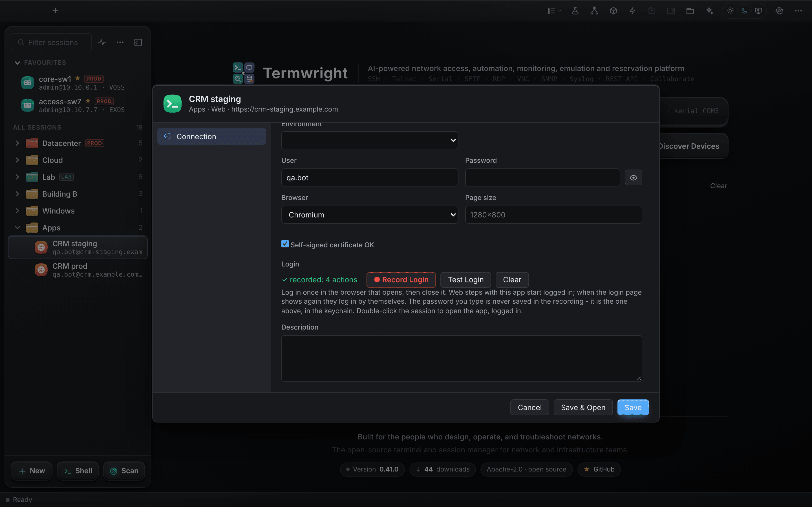
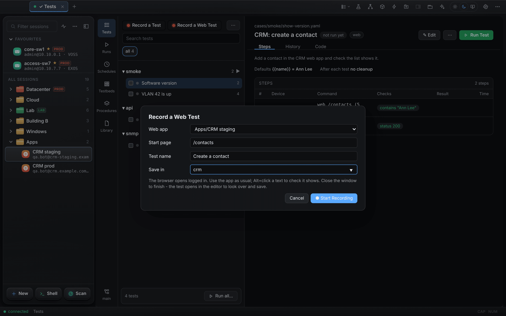
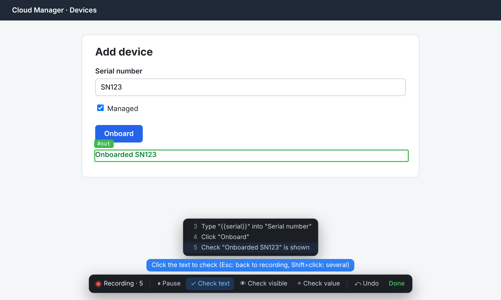
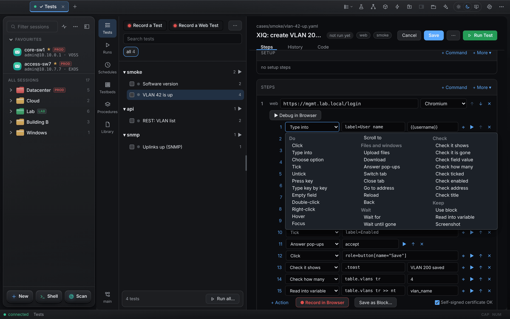
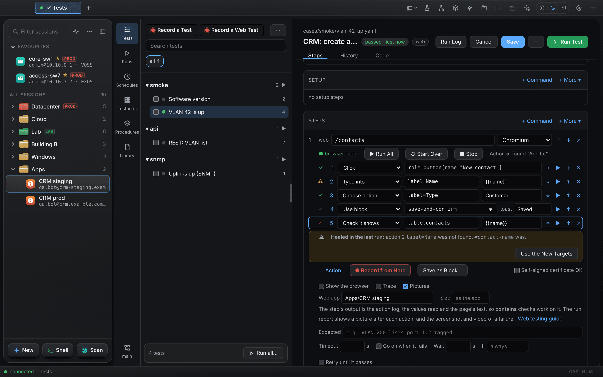
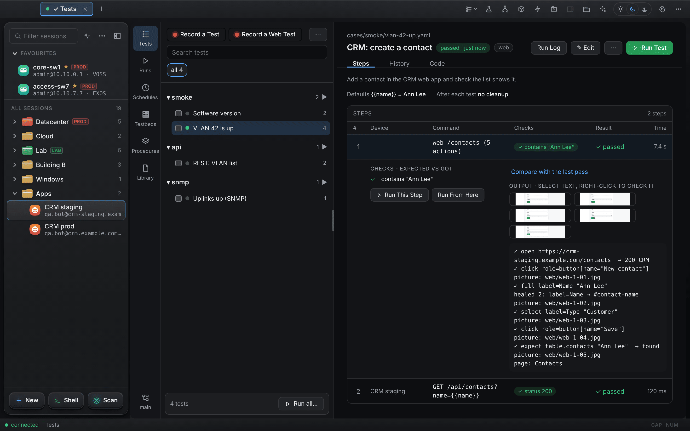

# Web GUI Testing Guide

Termwright tests can drive a web browser with [Playwright](https://playwright.dev) - for **any web
application**, not only device GUIs: a CRM, a portal, a controller, your own product. You record or pick
the actions; you do not write code. Compared with plain Playwright you get a saved login per app, a
recorder, element picking, step-by-step runs in a live browser, self-healing targets, reusable blocks,
a picture after every action in the report - and the same test can also use the CLI, REST, SNMP and
NETCONF steps.

- [1. Set up (once)](#1-set-up-once)
- [2. Save the web app as a session](#2-save-the-web-app-as-a-session)
- [3. Record a web test](#3-record-a-web-test)
- [4. The web step, field by field](#4-the-web-step-field-by-field)
- [5. Actions](#5-actions)
- [6. Targets: telling it what to act on](#6-targets-telling-it-what-to-act-on)
- [7. Step by step in a live browser: Debug, ▶ and ⌖ Pick](#7-step-by-step-in-a-live-browser-debug--and--pick)
- [8. Self-healing targets](#8-self-healing-targets)
- [9. Blocks: reusable actions](#9-blocks-reusable-actions)
- [10. Checks](#10-checks)
- [11. Logins and passwords](#11-logins-and-passwords)
- [12. Variables, test data and reading values from the page](#12-variables-test-data-and-reading-values-from-the-page)
- [13. Frames, tabs, pop-ups and dialogs](#13-frames-tabs-pop-ups-and-dialogs)
- [14. Files: upload and download](#14-files-upload-and-download)
- [15. Waiting for slow pages](#15-waiting-for-slow-pages)
- [16. The run report: pictures, video, trace](#16-the-run-report-pictures-video-trace)
- [17. Web, REST and CLI in one test](#17-web-rest-and-cli-in-one-test)
- [18. Environments: the same test on staging and production](#18-environments-the-same-test-on-staging-and-production)
- [19. Running without Termwright (CI)](#19-running-without-termwright-ci)
- [20. Worked examples](#20-worked-examples)
- [21. Troubleshooting](#21-troubleshooting)

---

## 1. Set up (once)

Web steps need **Node.js** (18 or later) on the computer that runs the tests.

1. Install Node.js from [nodejs.org](https://nodejs.org) (macOS: `brew install node`).
2. In Termwright open **Tests**, click **Record a Web Test** (or add a step with **+ More ▾ → Web Page
   (Playwright)**).
3. If it says *Playwright is not set up on this computer*, click **Set Up Playwright**. It installs
   Playwright and its Chromium browser in Termwright's data folder (about 150 MB, once).

## 2. Save the web app as a session

A web app is saved like a device: in the session list, **+ New**, protocol **More… → Web App**.



| Field | |
|---|---|
| **Address** | `https://crm-staging.example.com` - web steps' paths (`/contacts`) go after it |
| **User / Password** | the account the tests use; the password is kept in the system keychain |
| **Browser, Page size** | Chromium (default), Firefox or WebKit; e.g. `1280x800` |
| **Self-signed certificate OK** | for test servers with their own certificates |
| **Login → ● Record Login** | a browser opens at the address: log in as usual, then close it |

**Record Login** saves the login as actions (`{{username}}` and `{{password}}` in place of what you
typed - the password itself is never in the recording). From then on:

- every web step with this app starts **logged in** (the browser's cookies are kept per app),
- when the app shows its login page again (expired session, new computer, CI), the step **logs in by
  itself** with the recorded login and goes on,
- **Test Login** checks the recorded login in a fresh browser,
- **double-click** the session (or right-click → **Open in Browser**) opens the app, logged in.

Single sign-on pages (Okta, Azure AD…) record the same way; one-time codes cannot be automated - use a
test account without them.

## 3. Record a web test

1. **Tests → Record a Web Test**.

   

2. Choose the **web app**, the **start page** (`/contacts`, or empty for the address), a **name** and the
   folder.
3. **Start Recording.** The browser opens logged in, with a banner at the bottom:

   

4. Do the task: click, type, choose, tick, upload. Each one becomes an action (a blue outline flashes).
5. To add a **check**, hold **Alt** (Option on a Mac) and click a text: *Check it shows* (green outline).
6. Close the browser. The test opens in the editor:

   

7. Look it over, **▶ Debug in Browser** to try it ([7](#7-step-by-step-in-a-live-browser-debug--and--pick)),
   then **Save** and **Run Test**.

What the recorder writes:

| You do | Recorded |
|---|---|
| Click a button, link, tab or menu item | `click` with the most readable target (`role=button[name="Save"]`, `text=Alarms`) and up to two fallbacks |
| Type into a field (then leave it or press Enter) | `fill label=Name "Ann Lee"` (and `press Enter` if you pressed it) |
| Type into a password field | `fill label=Password "{{password}}"` - never the password |
| Choose in a drop-down | `select label=Type "Customer"` (the option's text) |
| Tick / untick | `check` / `uncheck` |
| Choose a file | `upload` with the file names (put the files in the tests folder) |
| A link opens a new tab | `tab last` |
| Alt+click a text | `expect "the text"` |

You can also record into any existing web step: **● Record in Browser** (or, with the debug browser open,
**● Record from Here** - the actions go after the selected one).

## 4. The web step, field by field


| Field | What it does |
|---|---|
| **Address** | The page opened first: a path after the web app's address (`/contacts`, empty = the address itself), or a full address. `{{variables}}` work. |
| **Browser** | Chromium (default), Firefox or WebKit (Safari's engine). Firefox and WebKit need `npx playwright install firefox webkit` in the Playwright folder. |
| **Actions** | What to do, in order. Each has an action, usually a **target**, and sometimes a **value**. |
| **Self-signed certificate OK** | Accept certificates the browser does not trust (device GUIs). |
| **Show the browser** | Run with a visible window (default hidden) - useful to watch a run. |
| **Trace** | Record a Playwright trace of the whole step ([16](#16-the-run-report-pictures-video-trace)). |
| **Web app** | The web app session (its address, login and settings) - or any saved session whose user name and password fill `{{username}}` / `{{password}}`. A testbed role works too: `{{app}}`. |
| **Keep login as** | (sessions that are not web apps) keep the cookies under this name: the next web steps with the same name start logged in. Web apps do this by themselves. |
| **Pictures** | A picture after every action in the run report (off: only when an action fails). |
| **Size** | The page size, e.g. `1280x800`, or `390x844` to see a phone layout. |
| **Checks** | The usual checks of a step; they look at the step's output (see [10](#10-checks)). |

In the YAML file the step looks like this:

```yaml
- name: Create a contact
  web:
    login: Apps/CRM staging        # the web app: starts logged in
    url: /contacts
    actions:
      - { do: click, target: 'role=button[name="New contact"]', alt: ['#new-contact'] }
      - { do: fill, target: label=Name, value: "{{name}}", alt: ['#contact-name'] }
      - { do: select, target: label=Type, value: Customer }
      - { do: block, target: save-and-confirm, with: { toast: Saved } }
      - { do: expect, target: table.contacts, value: "{{name}}" }
```

`alt` are the fallback targets ([8](#8-self-healing-targets)); `block` uses a saved block ([9](#9-blocks-reusable-actions)).

## 5. Actions

Pick the action from the list; the boxes after it change to what it needs.



| Action (YAML `do`) | Target | Value | What it does |
|---|---|---|---|
| Click (`click`) | yes | - | Clicks it. Waits until it is visible and enabled. |
| Type into (`fill`) | yes | text | Replaces the field's text. |
| Choose option (`select`) | yes | option | Chooses by the option's text, else by its value. |
| Tick / Untick (`check` / `uncheck`) | yes | - | Checkboxes and radio buttons. |
| Press key (`press`) | optional | key | `Enter`, `Tab`, `Escape`, `ArrowDown`, `Control+A`… On the target, or the page. |
| Type key by key (`type`) | yes | text | For fields that react to each key (search-as-you-type). |
| Empty field (`clear`) | yes | - | |
| Double-click, Right-click (`dblclick`, `rightclick`) | yes | - | |
| Hover (`hover`) | yes | - | Menus that open on mouse-over. |
| Focus (`focus`) | yes | - | |
| Scroll to (`scroll`) | optional | - | Scrolls to the target, or one screen down. |
| Upload files (`upload`) | yes | files | Files of the tests folder, comma-separated. |
| Download (`download`) | yes | file name | Clicks it and saves the download in `reports/web-shots`. |
| Answer pop-ups (`dialog`) | - | `accept`, `dismiss` or text | How to answer the alerts, confirms and prompts that come next. |
| Switch tab (`tab`) | - | `last`, `1`, `2`… or part of its address | Tabs and pop-up windows. |
| Close tab (`close_tab`) | - | - | Closes it and goes back to the previous tab. |
| Go to address (`goto`) | - | address | |
| Reload, Back (`reload`, `back`) | - | - | |
| Wait for (`wait`) | optional | seconds or address part | A target: until it shows. No target: the seconds, or until the address contains the value. |
| Wait until gone (`wait_gone`) | yes | - | Spinners, *Loading…* overlays. |
| Check it shows (`expect`) | optional | text | No target: the text anywhere on the page. A target and text: it contains the text. |
| Check it is gone (`expect_not`) | optional | text | |
| Check field value (`expect_value`) | yes | value | What a field holds. |
| Check how many (`expect_count`) | yes | number | E.g. the rows of a table. |
| Check ticked / Check enabled (`expect_checked` / `expect_enabled`) | yes | - | |
| Check address / Check title (`expect_url` / `expect_title`) | - | text | Part of the address or the title. |
| Read into variable (`read`) | yes | name | Its text becomes `{{name}}` for later steps. |
| Screenshot (`screenshot`) | optional | file name | The page, or just the target. Saved in `reports/web-shots`. |
| Use block (`block`) | block name | its values | The actions of a saved block ([9](#9-blocks-reusable-actions)). |

Every action waits for its target (up to the step's timeout, 30 s by default), so you rarely need *Wait*.

## 6. Targets: telling it what to act on

Prefer what a person sees on the page; it survives redesigns better than CSS.

| Target | Finds | Example |
|---|---|---|
| `text=…` | An element with this text | `text=Sign in` |
| `label=…` | The field of this label | `label=User name` |
| `placeholder=…` | The field showing this hint | `placeholder=Search devices` |
| `role=…[name="…"]` | Buttons, links, tabs, checkboxes… by role and name | `role=button[name="Save"]`, `role=tab[name="Ports"]` |
| `title=…`, `alt=…` | By tooltip, or an image's text | `title=Refresh`, `alt=Logo` |
| `testid=…` | `data-testid` (ask your GUI developers to add them) | `testid=vlan-save` |
| CSS | Any CSS selector | `#username`, `table.vlans tr`, `.toast` |
| XPath | Starts with `//` | `//button[contains(., "Apply")]` |
| `… >> …` | Look inside the first match | `role=row[name=/VLAN 200/] >> role=button[name="Edit"]` |
| `… >> nth=N` | The Nth match (0 = first, -1 = last) | `table.vlans tr >> nth=-1` |
| `frame=… >> …` | Inside an iframe | `frame=#content >> text=Apply` |

Tips:

- Type `text=`, `label=` or `role=` and the box suggests the forms.
- If a target matches several elements the first one is used; make it more exact with `>>` or `nth=`.
- `role=row[name=/200/]` takes a regular expression between slashes.
- Ids that look generated (`mat-input-17`, `ext-gen1234`) change between releases; the recorder avoids them.

## 7. Step by step in a live browser: Debug, ▶ and ⌖ Pick

Writing or fixing a web test does not need full runs. **▶ Debug in Browser** opens the step's page in a
browser (logged in) and **keeps it open** while you edit:



- **▶** on an action runs just that action in the open browser; its result shows on the left
  (✓, ⚠ healed, ✗ with the reason). Change the action and press ▶ again - no rerun from the start.
- **▶ Run All** runs the step from its page; **↺ Start Over** goes back to the page; **■ Stop** closes
  the browser.
- **⌖ Pick**: click ⌖ on an action, then click the element in the browser (a blue box follows the mouse,
  Esc cancels). Its target - and fallbacks - are filled in. Nobody needs to write selectors.
- **● Record from Here**: records in the open browser; the actions go after the selected action (click
  an action's number to select it; Shift+click selects a range).

The variables of the test (its defaults and the first data row) are used, and blocks run as their actions.

## 8. Self-healing targets

The recorder and ⌖ Pick save up to two **fallback targets** with each action (`alt:` in the YAML; the
target box's tooltip shows them). When a new release of the app changes the page and the target is no
longer found, the run tries the fallbacks before failing. The action passes, and the run says so:

```
✓ fill label=Name "Ann Lee"
healed 2: label=Name → #contact-name
```

The step shows **⚠ Healed in the last run** with **Use the New Targets**: one click makes the target that
worked the target (the old one becomes a fallback); save the test. The HTML report lists healed actions
too, so a release that renamed things is visible without failing every test.

## 9. Blocks: reusable actions

Logging in, saving a dialog, opening a menu: actions many tests repeat can be a **block**.

1. Select the actions (click their numbers; Shift+click for a range) - or none for all.
2. **Save as Block…** and give it a name, e.g. *Save and confirm*.
3. The actions become one **Use block** action. `{{names}}` in them become the block's values: the
   action shows a box for each (e.g. `toast: Saved`).

Other web steps choose **Use block** and the block's name; its actions run in the same browser, in
place. Blocks are files of the tests folder (`procs/<name>.yaml`) - change one and every test that uses
it changes. A block can use other blocks.

## 10. Checks

There are two places to check things.

**Check actions** (in the step) stop the step at the first problem, with a screenshot:
*Check it shows*, *Check it is gone*, *Check field value*, *Check how many*, *Check ticked*,
*Check enabled*, *Check address*, *Check title*.

**Step checks** (under the step, like any step) look at the step's **output**: the action log, the values
read and the page's text at the end. For example `contains "VLAN 200 saved"`, `not contains "Error"`,
`field "Uptime: (\S+)"`, or a regular expression. They report every check, not just the first failure.

## 11. Logins and passwords

Passwords never go in a test file.

**Web apps** ([2](#2-save-the-web-app-as-a-session)): record the login once on the session; the steps
need no login actions at all.

**Other sites**, or a login inside the test:

1. Save the account as a session (any protocol, with the user name and password - the password is kept in
   the system keychain).
2. In the web step choose it in **Web app**.
3. Use `{{username}}` and `{{password}}` as values:

   ```yaml
   - { do: fill, target: label=User name, value: "{{username}}" }
   - { do: fill, target: label=Password, value: "{{password}}" }
   ```

The password is typed into the page but shown as `"••••"` in logs and reports. The same session also
answers HTTP (basic) logins. Recording a password field writes `{{password}}` for you.

**Log in once per run** (sessions that are not web apps): set **Keep login as** (e.g. `mgmt`) on every
web step of the GUI. The first step logs in; its cookies are kept, and the next steps with the same name
open already logged in.

## 12. Variables, test data and reading values from the page

- `{{name}}` works in addresses, targets and values: test variables, testbed roles and **test data**
  columns (run the test once per row of a CSV/Excel file).
- **Read into variable** keeps a text of the page for later steps:

  ```yaml
  - { do: read, target: "table.vlans tr >> nth=-1 >> td >> nth=2", value: vlan_name }
  ```

  The log shows `read vlan_name = voice`, and later steps can use `{{vlan_name}}`, e.g. to check the
  switch's CLI shows the same name.
- Values read also show in the step's output, so step checks can test them.

## 13. Frames, tabs, pop-ups and dialogs

- **Frames:** start the target with `frame=<the iframe> >>`: `frame=#main >> role=button[name="Apply"]`.
  Frames inside frames: `frame=#outer >> frame=#inner >> text=OK`.
- **New tabs and pop-up windows:** after the click that opens it, add `tab last`; act in it; `close_tab`
  goes back. `tab 1` is the first tab; `tab /alarms` the tab whose address contains `/alarms`.
- **Alerts and confirms** (*Are you sure?*): put `Answer pop-ups accept` (or `dismiss`, or the text to type
  into a prompt) **before** the click that shows it. Without one, pop-ups are accepted. Every pop-up's
  message is in the log (`dialog: confirm: Save?`).

## 14. Files: upload and download

- **Upload:** put the file in the tests folder (e.g. `files/fw-33.2.bin`), then
  `upload label=Firmware "files/fw-33.2.bin"`. Several files: separate them with commas.
- **Download:** `download role=button[name="Export"] "config.txt"` clicks it and saves the file in
  `reports/web-shots/config.txt`.

## 15. Waiting for slow pages

Actions already wait for their target. When a page needs more:

- `wait_gone text=Loading…` - until a spinner or overlay goes away.
- `wait role=row[name=/200/]` - until something shows.
- `wait "/dashboard"` - until the address contains `/dashboard`.
- `wait "5"` - five seconds (last resort).
- Give the step a longer **Timeout** (s) for slow controllers, or tick **Retry until it passes** for
  values that settle.

## 16. The run report: pictures, video, trace

Each run keeps, in its report folder (`reports/<run>/web/`):

- a **picture after every action** (turn off with *Pictures* on the step),
- the **screenshot** of the moment an action failed (red frame),
- a **video** of a failed step (`.webm`),
- the **trace**, when *Trace* is ticked.

In Termwright the step's result shows the pictures as a strip - click one to enlarge it:



The HTML report shows them the same way, and the run folder can be zipped and shared on its own. When an
action fails the log says which one and why:

```
✓ click role=button[name="Save"]
✗ expect .toast "VLAN 200 saved": found "VLAN 200 exists"
screenshot: web/failed-1763814455123.png
video: web/failed-1763814455990.webm
```

- Tick **Show the browser** and run the test to watch it.
- Tick **Trace** for a full recording of the step: the page before and after each action, the network and
  the console. Open it with `npx playwright show-trace reports/web-shots/trace-….zip`
  (or drop it on [trace.playwright.dev](https://trace.playwright.dev)).
- Add `screenshot "after-save"` actions to keep pictures of passing runs too.
- **Explain Failure** (AI) reads the log and the page text and suggests the fix.

## 17. Web, REST and CLI in one test

A web step is a step like any other. **REST steps can use the web app session too**: the path goes after
the app's address and the request carries the login the web steps keep (the browser's cookies), so an
API call runs as the logged-in user - create data through the API, check it in the GUI, clean up through
the API:

```yaml
name: Contact from the API shows in the GUI
vars: { app: Apps/CRM staging, name: Test Contact 7 }
steps:
  - web: { login: "{{app}}", url: / }             # logs in (once)
  - http: { session: "{{app}}", method: POST, url: /api/contacts, body: '{"name": "{{name}}"}' }
    expect: [{ status: 201 }]
    save: [{ var: id, json: id }]
  - web:
      login: "{{app}}"
      url: /contacts
      actions:
        - { do: fill, target: placeholder=Search, value: "{{name}}" }
        - { do: expect, target: table.contacts, value: "{{name}}" }
cleanup:
  - http: { session: "{{app}}", method: DELETE, url: "/api/contacts/{{id}}" }
```

And with devices - change something in a GUI and check it on the switch:

```yaml
name: GUI VLAN reaches the switch
vars: { core: Datacenter/Core/core-sw1, vlan: "200" }
steps:
  - name: Add the VLAN in the GUI
    web:
      url: https://mgmt.lab.local/vlans
      login: Lab Web/mgmt-admin
      state: mgmt
      insecure: true
      actions:
        - { do: click, target: 'role=button[name="Add VLAN"]' }
        - { do: fill, target: label=VLAN ID, value: "{{vlan}}" }
        - { do: fill, target: label=Name, value: voice }
        - { do: click, target: 'role=button[name="Save"]' }
        - { do: expect, target: .toast, value: saved }
  - run: { session: "{{core}}", command: "show vlan {{vlan}}" }
    expect: [{ contains: voice }]
cleanup:
  - run: { session: "{{core}}", command: "no vlan {{vlan}}" }
```

## 18. Environments: the same test on staging and production

Use a testbed role for the app instead of the session's name:

```yaml
# testbeds/staging.yaml          # testbeds/prod.yaml
app: Apps/CRM staging            app: Apps/CRM prod
```

The steps say `login: "{{app}}"` (and `session: "{{app}}"` in REST steps). Choose the testbed when you run
- in Termwright, in a schedule, or `twrun run --testbed testbeds/prod.yaml`. Each app keeps its own
login.

## 19. Running without Termwright (CI)

Web steps run everywhere tests run:

- **twrun** (exported suite, *How it runs: twrun*): `bin/twrun-… setup-web` installs Playwright once, then
  `run.sh` as usual.
- **Python and Go suites:** they use the same browser runner through Node.js. Install Playwright in the
  suite once:

  ```sh
  npm install --prefix .playwright playwright
  npx --prefix .playwright playwright install chromium
  ```

  (`TW_PLAYWRIGHT_DIR=/path` uses a Playwright installed elsewhere.)
- The web app is in the exported `inventory.yaml` (`protocol: web`, `web_url`, `web_login` - the recorded
  login, with no password); its password comes from `TW_PASSWORD_<NAME>`, the keychain or a prompt, like
  device passwords. The login the steps keep is in `.web-state/` of the suite.
- On a Linux CI machine without a display, leave **Show the browser** off. Chromium may need its system
  libraries: `npx --prefix .playwright playwright install --with-deps chromium`.

Values read into variables are passed on by Termwright and twrun; in Python and Go suites they show in
the log. Blocks are expanded when the suite is exported.

## 20. Worked examples

**Log in and check the dashboard**

```yaml
web:
  url: https://{{controller}}/login
  insecure: true
  login: Lab Web/controller-admin
  state: ctrl
  actions:
    - { do: fill, target: label=User name, value: "{{username}}" }
    - { do: fill, target: label=Password, value: "{{password}}" }
    - { do: press, target: label=Password, value: Enter }
    - { do: wait_gone, target: .spinner }
    - { do: expect_title, value: Dashboard }
    - { do: expect_not, value: Critical }
```

**Count the alarms table rows**

```yaml
    - { do: click, target: role=link[name="Alarms"] }
    - { do: expect_count, target: table#alarms tbody tr, value: "0" }
```

**Upgrade firmware through the GUI, then wait for the device**

```yaml
    - { do: click, target: role=tab[name="Firmware"] }
    - { do: upload, target: label=Image file, value: files/fw-33.2.bin }
    - { do: dialog, value: accept }
    - { do: click, target: role=button[name="Install and reboot"] }
    - { do: expect, value: Rebooting }
```

…followed by a CLI step with **Retry until it passes** that checks `show version` for `33.2`.

**A settings page inside an iframe**

```yaml
    - { do: select, target: frame=#settings >> label=Speed, value: 10 Gbps }
    - { do: check, target: frame=#settings >> label=Enabled }
    - { do: click, target: frame=#settings >> role=button[name="Apply"] }
```

## 21. Troubleshooting

| Problem | Fix |
|---|---|
| *web steps need Playwright* | Click **Set Up Playwright** in a web step (Node.js needed). |
| `net::ERR_CERT_AUTHORITY_INVALID` | Tick **Self-signed certificate OK**. |
| *Timeout 30000ms exceeded* waiting for a target | The target does not match: check the spelling, use `text=`/`role=`, or the element is in a frame (`frame=… >>`) or another tab (`tab last`). |
| A click does nothing | Something covers it (cookie banner, overlay): click that away first, or `wait_gone` it. |
| *strict mode* / the wrong element | Make the target exact: `>> nth=0`, `role=…[name="…"]`. |
| `{{password}}` typed literally | Choose the step's **Web app** (or login session). |
| *the app's login (fill label=Email): …* | The login page changed: **Record Login** again on the web app session, then **Test Login**. |
| A step keeps logging in | The app's cookies expire quickly, or the login's first field is also on other pages - that is fine; it only logs in when that field shows. |
| ⌖ Pick does nothing | Click in the browser window that opened (it may be behind Termwright); Esc cancels. |
| Logged out between steps | Use a web app session (it keeps the login), or give every web step the same **Keep login as**. |
| Recording records too much | Delete the extra actions with ✕ - hovering, scrolling and clicks on empty space are not recorded. |
| Works on your Mac, fails in CI | Different screen size: set **Size**. Missing libraries: `playwright install --with-deps chromium`. |
