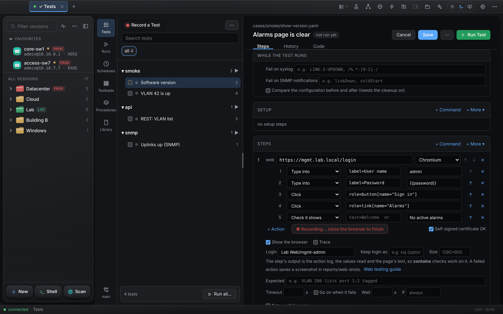
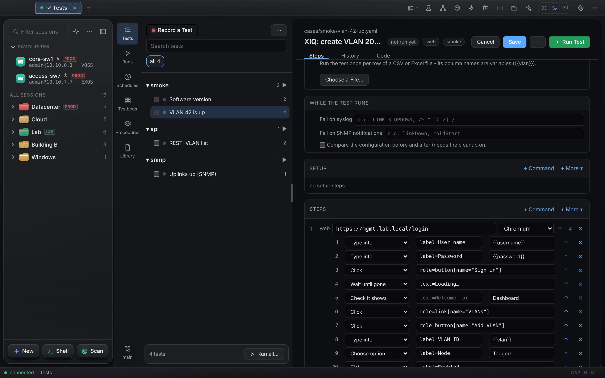

# Web GUI Testing Guide

Termwright tests can drive a web browser with [Playwright](https://playwright.dev): log in to a device's or
a controller's web GUI, click through it, fill forms, upload firmware, and check what the page shows -
next to CLI, REST, SNMP and NETCONF steps in the same test. You record or pick the actions; you do not
write code.

This guide goes step by step from setting up to running web tests in CI.

- [1. Set up (once)](#1-set-up-once)
- [2. Your first web test: record it](#2-your-first-web-test-record-it)
- [3. The web step, field by field](#3-the-web-step-field-by-field)
- [4. Actions](#4-actions)
- [5. Targets: telling it what to act on](#5-targets-telling-it-what-to-act-on)
- [6. Checks](#6-checks)
- [7. Logins and passwords](#7-logins-and-passwords)
- [8. Variables, test data and reading values from the page](#8-variables-test-data-and-reading-values-from-the-page)
- [9. Frames, tabs, pop-ups and dialogs](#9-frames-tabs-pop-ups-and-dialogs)
- [10. Files: upload and download](#10-files-upload-and-download)
- [11. Waiting for slow pages](#11-waiting-for-slow-pages)
- [12. Screenshots, traces and debugging a failure](#12-screenshots-traces-and-debugging-a-failure)
- [13. Mixing web and CLI steps](#13-mixing-web-and-cli-steps)
- [14. Running without Termwright (CI)](#14-running-without-termwright-ci)
- [15. Worked examples](#15-worked-examples)
- [16. Troubleshooting](#16-troubleshooting)

---

## 1. Set up (once)

Web steps need **Node.js** (18 or later) on the computer that runs the tests.

1. Install Node.js from [nodejs.org](https://nodejs.org) (macOS: `brew install node`).
2. In Termwright open **Tests**, edit a test and add a step with **+ More ▾ → Web Page (Playwright)**.
3. The step says *Playwright is not set up on this computer*. Click **Set Up Playwright**. It installs
   Playwright and its Chromium browser in Termwright's data folder (about 150 MB, once).

When the banner is gone, web steps can run and record.

## 2. Your first web test: record it

Recording is the fastest way: you use the site as usual and Termwright writes the actions.

1. **Tests → + New Test** (or edit a test), then **+ More ▾ → Web Page (Playwright)**.
2. Type the page address, for example `https://10.10.0.5/login`.
3. If the site uses a self-signed certificate (most device GUIs do), tick **Self-signed certificate OK**.
4. If the site asks you to log in, choose the saved session that holds its user name and password in
   **Login** (see [7](#7-logins-and-passwords)).
5. Click **● Record in Browser**. A browser window opens at that address with a banner at the bottom:

   

6. Do the task: click links and buttons, type into fields, choose options, tick boxes. Each one is added
   to the step as you go (a blue outline flashes on what was recorded).
7. To add a **check**, hold **Alt** (Option on a Mac) and click a text on the page: the step gets
   *Check it shows* for that text (a green outline flashes).
8. Close the browser window. The recording is in the step:

   

9. Look the actions over: rename targets if you like, delete extra clicks (✕), move actions (↑), add
   more (**+ Action**). Click **Save**, then **Run Test**.

What the recorder writes:

| You do | Recorded |
|---|---|
| Click a button, link, tab or menu item | `click` with the most readable target it finds (`role=button[name="Save"]`, `text=Alarms`) |
| Type into a field (then leave it or press Enter) | `fill label=User name "admin"` (and `press Enter` if you pressed it) |
| Type into a password field | `fill label=Password "{{password}}"` - the password itself is never recorded |
| Choose in a drop-down | `select label=Mode "Tagged"` (the option's text) |
| Tick / untick | `check` / `uncheck` |
| Choose a file | `upload` with the file names (put the files in the tests folder) |
| A link opens a new tab | `tab last` |
| Alt+click a text | `expect "the text"` |

## 3. The web step, field by field



| Field | What it does |
|---|---|
| **Address** | The page opened first. May be empty if the first action is *Go to address*. `{{variables}}` work. |
| **Browser** | Chromium (default), Firefox or WebKit (Safari's engine). Firefox and WebKit need `npx playwright install firefox webkit` in the Playwright folder. |
| **Actions** | What to do, in order. Each has an action, usually a **target**, and sometimes a **value**. |
| **Self-signed certificate OK** | Accept certificates the browser does not trust (device GUIs). |
| **Show the browser** | Run with a visible window (default hidden) - useful to watch a run. |
| **Trace** | Record a Playwright trace of the whole step ([12](#12-screenshots-traces-and-debugging-a-failure)). |
| **Login** | A saved session: its user name and password fill `{{username}}` / `{{password}}` and answer the site's HTTP login (the browser's own user-name box). |
| **Keep login as** | Keep the cookies under this name: the next web steps with the same name start logged in, so only the first one has to log in. |
| **Size** | The page size, e.g. `1280x800`, or `390x844` to see a phone layout. |
| **Checks** | The usual checks of a step; they look at the step's output (see [6](#6-checks)). |

In the YAML file the step looks like this:

```yaml
- name: Add VLAN 200 in the GUI
  web:
    url: https://mgmt.lab.local/login
    insecure: true
    login: Lab Web/mgmt-admin
    state: mgmt
    actions:
      - { do: fill, target: label=User name, value: "{{username}}" }
      - { do: fill, target: label=Password, value: "{{password}}" }
      - { do: click, target: 'role=button[name="Sign in"]' }
      - { do: expect, value: Dashboard }
```

## 4. Actions

Pick the action from the list; the boxes after it change to what it needs.


| Action (YAML `do`) | Target | Value | What it does |
|---|---|---|---|
| Click (`click`) | yes | - | Clicks it. Waits until it is visible and enabled. |
| Type into (`fill`) | yes | text | Replaces the field's text. |
| Choose option (`select`) | yes | option | Chooses by the option's text, else by its value. |
| Tick / Untick (`check` / `uncheck`) | yes | - | Checkboxes and radio buttons. |
| Press key (`press`) | optional | key | `Enter`, `Tab`, `Escape`, `ArrowDown`, `Control+A`… On the target, or the page. |
| Type key by key (`type`) | yes | text | For fields that react to each key (search-as-you-type). |
| Empty field (`clear`) | yes | - | |
| Double-click, Right-click (`dblclick`, `rightclick`) | yes | - | |
| Hover (`hover`) | yes | - | Menus that open on mouse-over. |
| Focus (`focus`) | yes | - | |
| Scroll to (`scroll`) | optional | - | Scrolls to the target, or one screen down. |
| Upload files (`upload`) | yes | files | Files of the tests folder, comma-separated. |
| Download (`download`) | yes | file name | Clicks it and saves the download in `reports/web-shots`. |
| Answer pop-ups (`dialog`) | - | `accept`, `dismiss` or text | How to answer the alerts, confirms and prompts that come next. |
| Switch tab (`tab`) | - | `last`, `1`, `2`… or part of its address | Tabs and pop-up windows. |
| Close tab (`close_tab`) | - | - | Closes it and goes back to the previous tab. |
| Go to address (`goto`) | - | address | |
| Reload, Back (`reload`, `back`) | - | - | |
| Wait for (`wait`) | optional | seconds or address part | A target: until it shows. No target: the seconds, or until the address contains the value. |
| Wait until gone (`wait_gone`) | yes | - | Spinners, *Loading…* overlays. |
| Check it shows (`expect`) | optional | text | No target: the text anywhere on the page. A target and text: it contains the text. |
| Check it is gone (`expect_not`) | optional | text | |
| Check field value (`expect_value`) | yes | value | What a field holds. |
| Check how many (`expect_count`) | yes | number | E.g. the rows of a table. |
| Check ticked / Check enabled (`expect_checked` / `expect_enabled`) | yes | - | |
| Check address / Check title (`expect_url` / `expect_title`) | - | text | Part of the address or the title. |
| Read into variable (`read`) | yes | name | Its text becomes `{{name}}` for later steps. |
| Screenshot (`screenshot`) | optional | file name | The page, or just the target. Saved in `reports/web-shots`. |

Every action waits for its target (up to the step's timeout, 30 s by default), so you rarely need *Wait*.

## 5. Targets: telling it what to act on

Prefer what a person sees on the page; it survives redesigns better than CSS.

| Target | Finds | Example |
|---|---|---|
| `text=…` | An element with this text | `text=Sign in` |
| `label=…` | The field of this label | `label=User name` |
| `placeholder=…` | The field showing this hint | `placeholder=Search devices` |
| `role=…[name="…"]` | Buttons, links, tabs, checkboxes… by role and name | `role=button[name="Save"]`, `role=tab[name="Ports"]` |
| `title=…`, `alt=…` | By tooltip, or an image's text | `title=Refresh`, `alt=Logo` |
| `testid=…` | `data-testid` (ask your GUI developers to add them) | `testid=vlan-save` |
| CSS | Any CSS selector | `#username`, `table.vlans tr`, `.toast` |
| XPath | Starts with `//` | `//button[contains(., "Apply")]` |
| `… >> …` | Look inside the first match | `role=row[name=/VLAN 200/] >> role=button[name="Edit"]` |
| `… >> nth=N` | The Nth match (0 = first, -1 = last) | `table.vlans tr >> nth=-1` |
| `frame=… >> …` | Inside an iframe | `frame=#content >> text=Apply` |

Tips:

- Type `text=`, `label=` or `role=` and the box suggests the forms.
- If a target matches several elements the first one is used; make it more exact with `>>` or `nth=`.
- `role=row[name=/200/]` takes a regular expression between slashes.
- Ids that look generated (`mat-input-17`, `ext-gen1234`) change between releases; the recorder avoids them.

## 6. Checks

There are two places to check things.

**Check actions** (in the step) stop the step at the first problem, with a screenshot:
*Check it shows*, *Check it is gone*, *Check field value*, *Check how many*, *Check ticked*,
*Check enabled*, *Check address*, *Check title*.

**Step checks** (under the step, like any step) look at the step's **output**: the action log, the values
read and the page's text at the end. For example `contains "VLAN 200 saved"`, `not contains "Error"`,
`field "Uptime: (\S+)"`, or a regular expression. They report every check, not just the first failure.

## 7. Logins and passwords

Passwords never go in a test file.

1. Save the site's login as a session (**+ New** in the session list; protocol API or any, with the host,
   user name and password - the password is kept in the system keychain).
2. In the web step choose it in **Login**.
3. Use `{{username}}` and `{{password}}` as values:

   ```yaml
   - { do: fill, target: label=User name, value: "{{username}}" }
   - { do: fill, target: label=Password, value: "{{password}}" }
   ```

The password is typed into the page but shown as `"••••"` in logs and reports. The same session also
answers HTTP (basic) logins. Recording a password field writes `{{password}}` for you.

**Log in once per run:** set **Keep login as** (e.g. `mgmt`) on every web step of the GUI. The first
step logs in; its cookies are kept, and the next steps with the same name open already logged in - they
need no login actions. If a later step finds the login page again, add the login actions to it too.

## 8. Variables, test data and reading values from the page

- `{{name}}` works in addresses, targets and values: test variables, testbed roles and **test data**
  columns (run the test once per row of a CSV/Excel file).
- **Read into variable** keeps a text of the page for later steps:

  ```yaml
  - { do: read, target: "table.vlans tr >> nth=-1 >> td >> nth=2", value: vlan_name }
  ```

  The log shows `read vlan_name = voice`, and later steps can use `{{vlan_name}}`, e.g. to check the
  switch's CLI shows the same name.
- Values read also show in the step's output, so step checks can test them.

## 9. Frames, tabs, pop-ups and dialogs

- **Frames:** start the target with `frame=<the iframe> >>`: `frame=#main >> role=button[name="Apply"]`.
  Frames inside frames: `frame=#outer >> frame=#inner >> text=OK`.
- **New tabs and pop-up windows:** after the click that opens it, add `tab last`; act in it; `close_tab`
  goes back. `tab 1` is the first tab; `tab /alarms` the tab whose address contains `/alarms`.
- **Alerts and confirms** (*Are you sure?*): put `Answer pop-ups accept` (or `dismiss`, or the text to type
  into a prompt) **before** the click that shows it. Without one, pop-ups are accepted. Every pop-up's
  message is in the log (`dialog: confirm: Save?`).

## 10. Files: upload and download

- **Upload:** put the file in the tests folder (e.g. `files/fw-33.2.bin`), then
  `upload label=Firmware "files/fw-33.2.bin"`. Several files: separate them with commas.
- **Download:** `download role=button[name="Export"] "config.txt"` clicks it and saves the file in
  `reports/web-shots/config.txt`.

## 11. Waiting for slow pages

Actions already wait for their target. When a page needs more:

- `wait_gone text=Loading…` - until a spinner or overlay goes away.
- `wait role=row[name=/200/]` - until something shows.
- `wait "/dashboard"` - until the address contains `/dashboard`.
- `wait "5"` - five seconds (last resort).
- Give the step a longer **Timeout** (s) for slow controllers, or tick **Retry until it passes** for
  values that settle.

## 12. Screenshots, traces and debugging a failure

When an action fails the log shows which one and why, for example:

```
✓ click role=button[name="Save"]
✗ expect .toast "VLAN 200 saved": found "VLAN 200 exists"
screenshot: reports/web-shots/failed-1763814455123.png
```

- The **screenshot** of the moment it failed is in the run report.
- Tick **Show the browser** and run the test to watch it.
- Tick **Trace** for a full recording of the step: the page before and after each action, the network and
  the console. Open it with `npx playwright show-trace reports/web-shots/trace-….zip`
  (or drop it on [trace.playwright.dev](https://trace.playwright.dev)).
- Add `screenshot "after-save"` actions to keep pictures of passing runs too.
- **Explain Failure** (AI) reads the log and the page text and suggests the fix.

## 13. Mixing web and CLI steps

A web step is a step like any other, so one test can change something in the GUI and check it on the
device (or the other way round):

```yaml
name: GUI VLAN reaches the switch
vars: { core: Datacenter/Core/core-sw1, vlan: "200" }
steps:
  - name: Add the VLAN in the GUI
    web:
      url: https://mgmt.lab.local/vlans
      login: Lab Web/mgmt-admin
      state: mgmt
      insecure: true
      actions:
        - { do: click, target: 'role=button[name="Add VLAN"]' }
        - { do: fill, target: label=VLAN ID, value: "{{vlan}}" }
        - { do: fill, target: label=Name, value: voice }
        - { do: click, target: 'role=button[name="Save"]' }
        - { do: expect, target: .toast, value: saved }
  - run: { session: "{{core}}", command: "show vlan {{vlan}}" }
    expect: [{ contains: voice }]
cleanup:
  - run: { session: "{{core}}", command: "no vlan {{vlan}}" }
```

## 14. Running without Termwright (CI)

Web steps run everywhere tests run:

- **twrun** (exported suite, *How it runs: twrun*): `bin/twrun-… setup-web` installs Playwright once, then
  `run.sh` as usual.
- **Python and Go suites:** they use the same browser runner through Node.js. Install Playwright in the
  suite once:

  ```sh
  npm install --prefix .playwright playwright
  npx --prefix .playwright playwright install chromium
  ```

  (`TW_PLAYWRIGHT_DIR=/path` uses a Playwright installed elsewhere.)
- The **Login** session must be in the exported `inventory.yaml` (it is, when the test uses it); its
  password comes from `TW_PASSWORD_<NAME>`, the keychain or a prompt, like device passwords.
- On a Linux CI machine without a display, leave **Show the browser** off. Chromium may need its system
  libraries: `npx --prefix .playwright playwright install --with-deps chromium`.

Values read into variables are passed on by Termwright and twrun; in Python and Go suites they show in
the log.

## 15. Worked examples

**Log in and check the dashboard**

```yaml
web:
  url: https://{{controller}}/login
  insecure: true
  login: Lab Web/controller-admin
  state: ctrl
  actions:
    - { do: fill, target: label=User name, value: "{{username}}" }
    - { do: fill, target: label=Password, value: "{{password}}" }
    - { do: press, target: label=Password, value: Enter }
    - { do: wait_gone, target: .spinner }
    - { do: expect_title, value: Dashboard }
    - { do: expect_not, value: Critical }
```

**Count the alarms table rows**

```yaml
    - { do: click, target: role=link[name="Alarms"] }
    - { do: expect_count, target: table#alarms tbody tr, value: "0" }
```

**Upgrade firmware through the GUI, then wait for the device**

```yaml
    - { do: click, target: role=tab[name="Firmware"] }
    - { do: upload, target: label=Image file, value: files/fw-33.2.bin }
    - { do: dialog, value: accept }
    - { do: click, target: role=button[name="Install and reboot"] }
    - { do: expect, value: Rebooting }
```

…followed by a CLI step with **Retry until it passes** that checks `show version` for `33.2`.

**A settings page inside an iframe**

```yaml
    - { do: select, target: frame=#settings >> label=Speed, value: 10 Gbps }
    - { do: check, target: frame=#settings >> label=Enabled }
    - { do: click, target: frame=#settings >> role=button[name="Apply"] }
```

## 16. Troubleshooting

| Problem | Fix |
|---|---|
| *web steps need Playwright* | Click **Set Up Playwright** in a web step (Node.js needed). |
| `net::ERR_CERT_AUTHORITY_INVALID` | Tick **Self-signed certificate OK**. |
| *Timeout 30000ms exceeded* waiting for a target | The target does not match: check the spelling, use `text=`/`role=`, or the element is in a frame (`frame=… >>`) or another tab (`tab last`). |
| A click does nothing | Something covers it (cookie banner, overlay): click that away first, or `wait_gone` it. |
| *strict mode* / the wrong element | Make the target exact: `>> nth=0`, `role=…[name="…"]`. |
| `{{password}}` typed literally | Choose the **Login** session of the step. |
| Logged out between steps | Give every web step of the site the same **Keep login as**. |
| Recording records too much | Delete the extra actions with ✕ - hovering, scrolling and clicks on empty space are not recorded. |
| Works on your Mac, fails in CI | Different screen size: set **Size**. Missing libraries: `playwright install --with-deps chromium`. |
